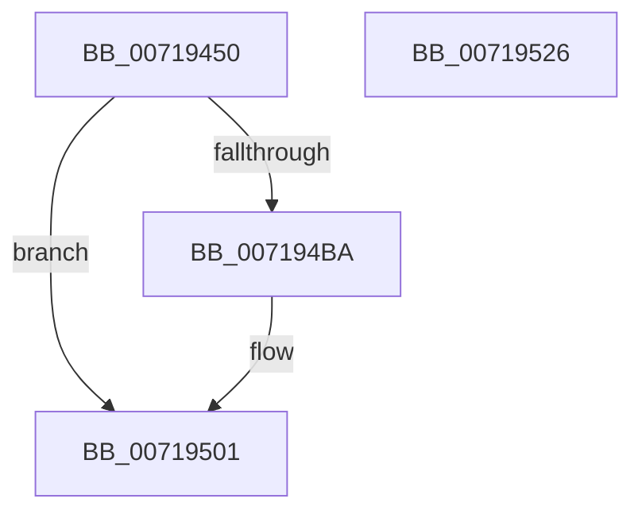

# VslRegisterSyscallProviderServiceTableMetadata

- RVA: `0x00719450`–`0x00719527` (길이 `215` bytes)
- VA: `0x0000000140719450`
- 실행 섹션: `PAGE`
- PDB 이름 있음: `예`; PDB Function 태그: `아니요`
- unwind 정보 RVA: `0x000BD0D0`
- 디코드: `50`개 명령, `215/215` bytes 표시
- 미해석 바이트: `0` (있으면 어셈블리에 `.byte`로 보존)

> 이 문서는 커널 이미지의 기계어와 PDB 기호를 분석해 생성했습니다. 4번과 5번은 함수 원형과 자료형을 바이너리 사용 방식에서 추정한 C 해석이며 원본 소스 복구 결과는 아닙니다.

## 1. Dependencies

- 직접 호출 지점: **6**; 고유 호출 대상: **5**
- 직접 호출자로 확인된 함수: **2**
- RIP 상대 이미지 참조: **1**

### Outgoing calls
- `0x00719489` → [memset](../../text/6C/memset_function_006C6C40.md) (function, `0x006C6C40`)
- `0x00719499` → [memset](../../text/6C/memset_function_006C6C40.md) (function, `0x006C6C40`)
- `0x007194B1` → [VslpLockPagesForTransfer](../../text/29/VslpLockPagesForTransfer_function_0029E0FC.md) (function, `0x0029E0FC`)
- `0x007194EE` → [VslpEnterIumSecureMode](../../text/23/VslpEnterIumSecureMode_function_00235E50.md) (function, `0x00235E50`)
- `0x007194FA` → [VslpUnlockPagesForTransfer](../../text/29/VslpUnlockPagesForTransfer_function_0029EE4C.md) (function, `0x0029EE4C`)
- `0x0071950C` → [_security_check_cookie](../../text/6A/_security_check_cookie_function_006AC640.md) (function, `0x006AC640`)

### Direct callers
- [PsRegisterSyscallProviderServiceTableMetadata](../AD/PsRegisterSyscallProviderServiceTableMetadata_function_00ADB224.md) at `0x00ADB298`
- [PspRegisterSyscallProviderServiceTableMetadata](../../init/C4/PspRegisterSyscallProviderServiceTableMetadata_function_00C44D18.md) at `0x00C44D4B`

### Static image references
- `0x00719462` → RVA `0x00E0A740` (`.data`; read)

## 2. Other-region calls and transfers

- 다른 실행 섹션으로 향하는 call: **6**
  - `0x00719489` → [memset](../../text/6C/memset_function_006C6C40.md) (`PAGE` → `.text`)
  - `0x00719499` → [memset](../../text/6C/memset_function_006C6C40.md) (`PAGE` → `.text`)
  - `0x007194B1` → [VslpLockPagesForTransfer](../../text/29/VslpLockPagesForTransfer_function_0029E0FC.md) (`PAGE` → `.text`)
  - `0x007194EE` → [VslpEnterIumSecureMode](../../text/23/VslpEnterIumSecureMode_function_00235E50.md) (`PAGE` → `.text`)
  - `0x007194FA` → [VslpUnlockPagesForTransfer](../../text/29/VslpUnlockPagesForTransfer_function_0029EE4C.md) (`PAGE` → `.text`)
  - `0x0071950C` → [_security_check_cookie](../../text/6A/_security_check_cookie_function_006AC640.md) (`PAGE` → `.text`)
- 별도 외부 분기/꼬리 이동을 확인하지 못했습니다.

## 3. Assembly (complete function range)

```asm
00719450  48 89 5C 24 08                  mov qword ptr [rsp + 8], rbx
00719455  48 89 74 24 20                  mov qword ptr [rsp + 0x20], rsi
0071945A  57                              push rdi
0071945B  48 81 EC 00 01 00 00            sub rsp, 0x100
00719462  48 8B 05 D7 12 6F 00            mov rax, qword ptr [rip + 0x6f12d7]
00719469  48 33 C4                        xor rax, rsp
0071946C  48 89 84 24 F0 00 00 00         mov qword ptr [rsp + 0xf0], rax
00719474  8B DA                           mov ebx, edx
00719476  8B F1                           mov esi, ecx
00719478  33 D2                           xor edx, edx
0071947A  48 8D 8C 24 80 00 00 00         lea rcx, [rsp + 0x80]
00719482  49 8B F8                        mov rdi, r8
00719485  44 8D 42 68                     lea r8d, [rdx + 0x68]
00719489  E8 B2 D7 FA FF                  call 0x1406c6c40
0071948E  33 D2                           xor edx, edx
00719490  48 8D 4C 24 30                  lea rcx, [rsp + 0x30]
00719495  44 8D 42 48                     lea r8d, [rdx + 0x48]
00719499  E8 A2 D7 FA FF                  call 0x1406c6c40
0071949E  83 64 24 20 00                  and dword ptr [rsp + 0x20], 0
007194A3  48 8D 4C 24 30                  lea rcx, [rsp + 0x30]
007194A8  45 33 C9                        xor r9d, r9d
007194AB  44 8B C3                        mov r8d, ebx
007194AE  48 8B D7                        mov rdx, rdi
007194B1  E8 46 4C B8 FF                  call 0x14029e0fc
007194B6  85 C0                           test eax, eax
007194B8  78 47                           js 0x140719501
007194BA  48 8B 44 24 30                  mov rax, qword ptr [rsp + 0x30]
007194BF  4C 8D 8C 24 80 00 00 00         lea r9, [rsp + 0x80]
007194C7  48 89 84 24 90 00 00 00         mov qword ptr [rsp + 0x90], rax
007194CF  BA E9 00 00 00                  mov edx, 0xe9
007194D4  48 8B 44 24 68                  mov rax, qword ptr [rsp + 0x68]
007194D9  45 33 C0                        xor r8d, r8d
007194DC  B1 02                           mov cl, 2
007194DE  48 89 84 24 98 00 00 00         mov qword ptr [rsp + 0x98], rax
007194E6  48 89 B4 24 88 00 00 00         mov qword ptr [rsp + 0x88], rsi
007194EE  E8 5D C9 B1 FF                  call 0x140235e50
007194F3  48 8D 4C 24 30                  lea rcx, [rsp + 0x30]
007194F8  8B D8                           mov ebx, eax
007194FA  E8 4D 59 B8 FF                  call 0x14029ee4c
007194FF  8B C3                           mov eax, ebx
00719501  48 8B 8C 24 F0 00 00 00         mov rcx, qword ptr [rsp + 0xf0]
00719509  48 33 CC                        xor rcx, rsp
0071950C  E8 2F 31 F9 FF                  call 0x1406ac640
00719511  4C 8D 9C 24 00 01 00 00         lea r11, [rsp + 0x100]
00719519  49 8B 5B 10                     mov rbx, qword ptr [r11 + 0x10]
0071951D  49 8B 73 28                     mov rsi, qword ptr [r11 + 0x28]
00719521  49 8B E3                        mov rsp, r11
00719524  5F                              pop rdi
00719525  C3                              ret
00719526  CC                              int3
```

## 4. C-style interpretation (structured pseudocode)

```c
__int64 __fastcall VslRegisterSyscallProviderServiceTableMetadata(int a1, int a2, __int64 a3, int a4)
{
    __int64 result;
    __int64 v_rbx;
    __int64 v_rsp;
    unsigned __int64 v_stack_m18;
    unsigned __int64 v_stack_m70;
    unsigned __int64 v_stack_m78;
    unsigned __int64 v_stack_m8;
    unsigned __int64 v_stack_m80;
    unsigned __int64 v_stack_m88;
    unsigned __int64 v_stack_mA0;
    unsigned __int64 v_stack_mD8;
    unsigned int v_stack_mE8;
    unsigned __int64 v_stack_p20;
    unsigned __int64 v_stack_p8;

    v_stack_p8 = v_rbx;
    v_stack_p20 = v_rsi;
    v_rsp = (v_rsp) - (256);
    result = (*(unsigned __int64 *)(v_rip + 7279319)) ^ (v_rsp);
    v_stack_m18 = result;
    a2 = 0;
    result = memset(v_stack_m88, a2, a2 + 104, a4);
    a2 = 0;
    result = memset(v_stack_mD8, a2, a2 + 72, a4);
    a4 = 0;
    result = VslpLockPagesForTransfer(v_stack_mD8, a3, (unsigned int)((unsigned int)((unsigned int)(a2))), a4);
    v_rbx = (unsigned int)(a2);
    if (!(sign_flag)) {
        result = v_stack_mD8;
        a4 = v_stack_m88;
        v_stack_m78 = result;
        a2 = 233;
        result = v_stack_mA0;
        a3 = 0;
        a1 = 2;
        v_stack_m70 = result;
        v_stack_m80 = (unsigned int)(a1);
        result = VslpEnterIumSecureMode(a1, a2, a3, a4);
        a1 = v_stack_mD8;
        v_rbx = (unsigned int)(result);
        result = VslpUnlockPagesForTransfer(a1, a2, a3, a4);
        result = (unsigned int)(v_rbx);
    }
    a1 = (v_stack_m18) ^ (v_rsp);
    result = _security_check_cookie(a1, a2, a3, a4);
    return result;
}
```

## 5. (Beta) C Style

```c
int64_t VslRegisterSyscallProviderServiceTableMetadata(int32_t Arg1, int32_t Arg2, int64_t Arg3, int32_t Arg4)
{
    int64_t result;
    int64_t local_rbx;
    int64_t local_rsp;
    uint64_t v_stack_m18;
    uint64_t v_stack_m70;
    uint64_t v_stack_m78;
    uint64_t v_stack_m8;
    uint64_t v_stack_m80;
    uint64_t v_stack_m88;
    uint64_t v_stack_mA0;
    uint64_t v_stack_mD8;
    uint32_t v_stack_mE8;
    uint64_t v_stack_p20;
    uint64_t v_stack_p8;

    v_stack_p8 = local_rbx;
    v_stack_p20 = local_rsi;
    local_rsp = (local_rsp) - (256);
    result = (*(uint64_t *)(v_rip + 0x6F12D7)) ^ (local_rsp);
    v_stack_m18 = result;
    Arg2 = 0;
    result = memset(v_stack_m88, Arg2, Arg2 + 104, Arg4);
    Arg2 = 0;
    result = memset(v_stack_mD8, Arg2, Arg2 + 72, Arg4);
    Arg4 = 0;
    result = VslpLockPagesForTransfer(v_stack_mD8, Arg3, (uint32_t)((uint32_t)((uint32_t)(Arg2))), Arg4);
    local_rbx = (uint32_t)(Arg2);
    if (!(sign_flag)) {
        result = v_stack_mD8;
        Arg4 = v_stack_m88;
        v_stack_m78 = result;
        Arg2 = 233;
        result = v_stack_mA0;
        Arg3 = 0;
        Arg1 = 2;
        v_stack_m70 = result;
        v_stack_m80 = (uint32_t)(Arg1);
        result = VslpEnterIumSecureMode(Arg1, Arg2, Arg3, Arg4);
        Arg1 = v_stack_mD8;
        local_rbx = (uint32_t)(result);
        result = VslpUnlockPagesForTransfer(Arg1, Arg2, Arg3, Arg4);
        result = (uint32_t)(local_rbx);
    }
    Arg1 = (v_stack_m18) ^ (local_rsp);
    result = _security_check_cookie(Arg1, Arg2, Arg3, Arg4);
    return result;
}
```

## 6. Execution-region graph

[열기: 2D/3D 그래프와 함수 탐색 컨트롤 패널](../../../control-panel.html?section=page&rva=0x00719450&view=graph)

- 2D 그래프는 위에서 아래로 흐르고, 3D 그래프는 빈 공간을 드래그해 회전합니다. Shift+드래그는 이동, 휠은 확대·축소, 함수 노드 선택은 대상 보고서 이동입니다.

### Static fallback


