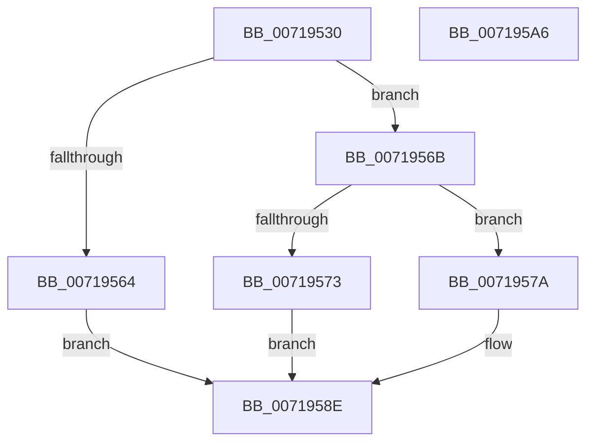

# VslRelaxQuotas

- RVA: `0x00719530`–`0x007195A7` (길이 `119` bytes)
- VA: `0x0000000140719530`
- 실행 섹션: `PAGE`
- PDB 이름 있음: `예`; PDB Function 태그: `아니요`
- unwind 정보 RVA: `0x000AA6F8`
- 디코드: `29`개 명령, `119/119` bytes 표시
- 미해석 바이트: `0` (있으면 어셈블리에 `.byte`로 보존)

> 이 문서는 커널 이미지의 기계어와 PDB 기호를 분석해 생성했습니다. 4번과 5번은 함수 원형과 자료형을 바이너리 사용 방식에서 추정한 C 해석이며 원본 소스 복구 결과는 아닙니다.

## 1. Dependencies

- 직접 호출 지점: **4**; 고유 호출 대상: **4**
- 직접 호출자로 확인된 함수: **1**
- RIP 상대 이미지 참조: **2**

### Outgoing calls
- `0x00719554` → [memset](../../text/6C/memset_function_006C6C40.md) (function, `0x006C6C40`)
- `0x0071955B` → [HvlQueryVsmConnection](../../text/45/HvlQueryVsmConnection_function_0045D180.md) (function, `0x0045D180`)
- `0x00719589` → [VslpEnterIumSecureMode](../../text/23/VslpEnterIumSecureMode_function_00235E50.md) (function, `0x00235E50`)
- `0x00719599` → [_security_check_cookie](../../text/6A/_security_check_cookie_function_006AC640.md) (function, `0x006AC640`)

### Direct callers
- [NtSetSystemInformation](../AF/NtSetSystemInformation_function_00AF4A60.md) at `0x00AF6208`

### Static image references
- `0x00719537` → RVA `0x00E0A740` (`.data`; read)
- `0x0071956B` → RVA `0x00F475F8` (`.data`; read)

## 2. Other-region calls and transfers

- 다른 실행 섹션으로 향하는 call: **4**
  - `0x00719554` → [memset](../../text/6C/memset_function_006C6C40.md) (`PAGE` → `.text`)
  - `0x0071955B` → [HvlQueryVsmConnection](../../text/45/HvlQueryVsmConnection_function_0045D180.md) (`PAGE` → `.text`)
  - `0x00719589` → [VslpEnterIumSecureMode](../../text/23/VslpEnterIumSecureMode_function_00235E50.md) (`PAGE` → `.text`)
  - `0x00719599` → [_security_check_cookie](../../text/6A/_security_check_cookie_function_006AC640.md) (`PAGE` → `.text`)
- 별도 외부 분기/꼬리 이동을 확인하지 못했습니다.

## 3. Assembly (complete function range)

```asm
00719530  48 81 EC A8 00 00 00            sub rsp, 0xa8
00719537  48 8B 05 02 12 6F 00            mov rax, qword ptr [rip + 0x6f1202]
0071953E  48 33 C4                        xor rax, rsp
00719541  48 89 84 24 90 00 00 00         mov qword ptr [rsp + 0x90], rax
00719549  33 D2                           xor edx, edx
0071954B  48 8D 4C 24 20                  lea rcx, [rsp + 0x20]
00719550  44 8D 42 68                     lea r8d, [rdx + 0x68]
00719554  E8 E7 D6 FA FF                  call 0x1406c6c40
00719559  33 C9                           xor ecx, ecx
0071955B  E8 20 3C D4 FF                  call 0x14045d180
00719560  84 C0                           test al, al
00719562  75 07                           jne 0x14071956b
00719564  B8 1E 00 35 C0                  mov eax, 0xc035001e
00719569  EB 23                           jmp 0x14071958e
0071956B  38 0D 87 E0 82 00               cmp byte ptr [rip + 0x82e087], cl
00719571  75 07                           jne 0x14071957a
00719573  B8 54 03 00 C0                  mov eax, 0xc0000354
00719578  EB 14                           jmp 0x14071958e
0071957A  BA 38 00 00 00                  mov edx, 0x38
0071957F  4C 8D 4C 24 20                  lea r9, [rsp + 0x20]
00719584  45 33 C0                        xor r8d, r8d
00719587  B1 02                           mov cl, 2
00719589  E8 C2 C8 B1 FF                  call 0x140235e50
0071958E  48 8B 8C 24 90 00 00 00         mov rcx, qword ptr [rsp + 0x90]
00719596  48 33 CC                        xor rcx, rsp
00719599  E8 A2 30 F9 FF                  call 0x1406ac640
0071959E  48 81 C4 A8 00 00 00            add rsp, 0xa8
007195A5  C3                              ret
007195A6  CC                              int3
```

## 4. C-style interpretation (structured pseudocode)

```c
__int64 __fastcall VslRelaxQuotas(__int64 a1, int a2)
{
    __int64 result;
    __int64 v_rsp;
    unsigned __int64 v_stack_m18;
    unsigned __int64 v_stack_m88;

    v_rsp = (v_rsp) - (168);
    result = (*(unsigned __int64 *)(v_rip + 7279106)) ^ (v_rsp);
    v_stack_m18 = result;
    a2 = 0;
    result = memset(v_stack_m88, a2, a2 + 104, a4);
    a1 = 0;
    result = HvlQueryVsmConnection(a1, a2, a2 + 104, a4);
    if ((unsigned __int8)(result) != 0) goto loc_0071956B;
    goto loc_0071958E;
loc_0071956B:
    if ((*(unsigned __int8 *)(v_rip + 8577159)) != 0) goto loc_0071957A;
    goto loc_0071958E;
loc_0071957A:
    a3 = 0;
    result = VslpEnterIumSecureMode(2, 56, a3, v_stack_m88);
loc_0071958E:
    a1 = (v_stack_m18) ^ (v_rsp);
    result = _security_check_cookie(a1, 56, a3, v_stack_m88);
    v_rsp = (v_rsp) + (168);
    return result;
}
```

## 5. (Beta) C Style

```c
int64_t VslRelaxQuotas(int64_t Arg1, int32_t Arg2)
{
    int64_t result;
    int64_t local_rsp;
    uint64_t v_stack_m18;
    uint64_t v_stack_m88;

    local_rsp = (local_rsp) - (168);
    result = (*(uint64_t *)(v_rip + 0x6F1202)) ^ (local_rsp);
    v_stack_m18 = result;
    Arg2 = 0;
    result = memset(v_stack_m88, Arg2, Arg2 + 104, a4);
    Arg1 = 0;
    result = HvlQueryVsmConnection(Arg1, Arg2, Arg2 + 104, a4);
    if ((uint8_t)(result) != 0) goto loc_0071956B;
    goto loc_0071958E;
loc_0071956B:
    if ((*(uint8_t *)(v_rip + 0x82E087)) != 0) goto loc_0071957A;
    goto loc_0071958E;
loc_0071957A:
    a3 = 0;
    result = VslpEnterIumSecureMode(2, 56, a3, v_stack_m88);
loc_0071958E:
    Arg1 = (v_stack_m18) ^ (local_rsp);
    result = _security_check_cookie(Arg1, 56, a3, v_stack_m88);
    local_rsp = (local_rsp) + (168);
    return result;
}
```

## 6. Execution-region graph

[열기: 2D/3D 그래프와 함수 탐색 컨트롤 패널](../../../control-panel.html?section=page&rva=0x00719530&view=graph)

- 2D 그래프는 위에서 아래로 흐르고, 3D 그래프는 빈 공간을 드래그해 회전합니다. Shift+드래그는 이동, 휠은 확대·축소, 함수 노드 선택은 대상 보고서 이동입니다.

### Static fallback


