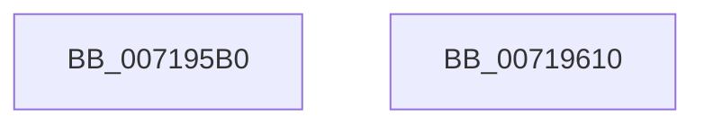

# VslRevokeSyscallProviderServiceTables

- RVA: `0x007195B0`–`0x00719611` (길이 `97` bytes)
- VA: `0x00000001407195B0`
- 실행 섹션: `PAGE`
- PDB 이름 있음: `예`; PDB Function 태그: `아니요`
- unwind 정보 RVA: `0x000AF554`
- 디코드: `23`개 명령, `97/97` bytes 표시
- 미해석 바이트: `0` (있으면 어셈블리에 `.byte`로 보존)

> 이 문서는 커널 이미지의 기계어와 PDB 기호를 분석해 생성했습니다. 4번과 5번은 함수 원형과 자료형을 바이너리 사용 방식에서 추정한 C 해석이며 원본 소스 복구 결과는 아닙니다.

## 1. Dependencies

- 직접 호출 지점: **3**; 고유 호출 대상: **3**
- 직접 호출자로 확인된 함수: **2**
- RIP 상대 이미지 참조: **1**

### Outgoing calls
- `0x007195D9` → [memset](../../text/6C/memset_function_006C6C40.md) (function, `0x006C6C40`)
- `0x007195F2` → [VslpEnterIumSecureMode](../../text/23/VslpEnterIumSecureMode_function_00235E50.md) (function, `0x00235E50`)
- `0x00719602` → [_security_check_cookie](../../text/6A/_security_check_cookie_function_006AC640.md) (function, `0x006AC640`)

### Direct callers
- [PsRegisterSyscallProvider](../77/PsRegisterSyscallProvider_function_0077E140.md) at `0x0077E2D1`
- [PspDestroySyscallProvider](../77/PspDestroySyscallProvider_function_0077E454.md) at `0x0077E488`

### Static image references
- `0x007195B9` → RVA `0x00E0A740` (`.data`; read)

## 2. Other-region calls and transfers

- 다른 실행 섹션으로 향하는 call: **3**
  - `0x007195D9` → [memset](../../text/6C/memset_function_006C6C40.md) (`PAGE` → `.text`)
  - `0x007195F2` → [VslpEnterIumSecureMode](../../text/23/VslpEnterIumSecureMode_function_00235E50.md) (`PAGE` → `.text`)
  - `0x00719602` → [_security_check_cookie](../../text/6A/_security_check_cookie_function_006AC640.md) (`PAGE` → `.text`)
- 별도 외부 분기/꼬리 이동을 확인하지 못했습니다.

## 3. Assembly (complete function range)

```asm
007195B0  40 53                           push rbx
007195B2  48 81 EC A0 00 00 00            sub rsp, 0xa0
007195B9  48 8B 05 80 11 6F 00            mov rax, qword ptr [rip + 0x6f1180]
007195C0  48 33 C4                        xor rax, rsp
007195C3  48 89 84 24 90 00 00 00         mov qword ptr [rsp + 0x90], rax
007195CB  33 D2                           xor edx, edx
007195CD  48 8B D9                        mov rbx, rcx
007195D0  48 8D 4C 24 20                  lea rcx, [rsp + 0x20]
007195D5  44 8D 42 68                     lea r8d, [rdx + 0x68]
007195D9  E8 62 D6 FA FF                  call 0x1406c6c40
007195DE  BA 5B 00 00 00                  mov edx, 0x5b
007195E3  48 89 5C 24 28                  mov qword ptr [rsp + 0x28], rbx
007195E8  4C 8D 4C 24 20                  lea r9, [rsp + 0x20]
007195ED  45 33 C0                        xor r8d, r8d
007195F0  B1 02                           mov cl, 2
007195F2  E8 59 C8 B1 FF                  call 0x140235e50
007195F7  48 8B 8C 24 90 00 00 00         mov rcx, qword ptr [rsp + 0x90]
007195FF  48 33 CC                        xor rcx, rsp
00719602  E8 39 30 F9 FF                  call 0x1406ac640
00719607  48 81 C4 A0 00 00 00            add rsp, 0xa0
0071960E  5B                              pop rbx
0071960F  C3                              ret
00719610  CC                              int3
```

## 4. C-style interpretation (structured pseudocode)

```c
__int64 __fastcall VslRevokeSyscallProviderServiceTables(__int64 a1, int a2)
{
    __int64 result;
    __int64 v_rsp;
    unsigned __int64 v_stack_m18;
    unsigned __int64 v_stack_m80;
    unsigned __int64 v_stack_m88;

    v_rsp = (v_rsp) - (160);
    result = (*(unsigned __int64 *)(v_rip + 7278976)) ^ (v_rsp);
    v_stack_m18 = result;
    a2 = 0;
    result = memset(v_stack_m88, a2, a2 + 104, a4);
    v_stack_m80 = a1;
    a3 = 0;
    result = VslpEnterIumSecureMode(2, 91, a3, v_stack_m88);
    a1 = (v_stack_m18) ^ (v_rsp);
    result = _security_check_cookie(a1, 91, a3, v_stack_m88);
    v_rsp = (v_rsp) + (160);
    return result;
}
```

## 5. (Beta) C Style

```c
int64_t VslRevokeSyscallProviderServiceTables(int64_t Arg1, int32_t Arg2)
{
    int64_t result;
    int64_t local_rsp;
    uint64_t v_stack_m18;
    uint64_t v_stack_m80;
    uint64_t v_stack_m88;

    local_rsp = (local_rsp) - (160);
    result = (*(uint64_t *)(v_rip + 0x6F1180)) ^ (local_rsp);
    v_stack_m18 = result;
    Arg2 = 0;
    result = memset(v_stack_m88, Arg2, Arg2 + 104, a4);
    v_stack_m80 = Arg1;
    a3 = 0;
    result = VslpEnterIumSecureMode(2, 91, a3, v_stack_m88);
    Arg1 = (v_stack_m18) ^ (local_rsp);
    result = _security_check_cookie(Arg1, 91, a3, v_stack_m88);
    local_rsp = (local_rsp) + (160);
    return result;
}
```

## 6. Execution-region graph

[열기: 2D/3D 그래프와 함수 탐색 컨트롤 패널](../../../control-panel.html?section=page&rva=0x007195B0&view=graph)

- 2D 그래프는 위에서 아래로 흐르고, 3D 그래프는 빈 공간을 드래그해 회전합니다. Shift+드래그는 이동, 휠은 확대·축소, 함수 노드 선택은 대상 보고서 이동입니다.

### Static fallback


