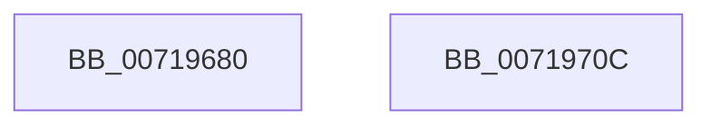

# VslSendDebugAttachNotifications

- RVA: `0x00719680`–`0x0071970D` (길이 `141` bytes)
- VA: `0x0000000140719680`
- 실행 섹션: `PAGE`
- PDB 이름 있음: `예`; PDB Function 태그: `아니요`
- unwind 정보 RVA: `0x000AFF04`
- 디코드: `33`개 명령, `141/141` bytes 표시
- 미해석 바이트: `0` (있으면 어셈블리에 `.byte`로 보존)

> 이 문서는 커널 이미지의 기계어와 PDB 기호를 분석해 생성했습니다. 4번과 5번은 함수 원형과 자료형을 바이너리 사용 방식에서 추정한 C 해석이며 원본 소스 복구 결과는 아닙니다.

## 1. Dependencies

- 직접 호출 지점: **3**; 고유 호출 대상: **3**
- 직접 호출자로 확인된 함수: **1**
- RIP 상대 이미지 참조: **1**

### Outgoing calls
- `0x007196B8` → [memset](../../text/6C/memset_function_006C6C40.md) (function, `0x006C6C40`)
- `0x007196E2` → [VslpEnterIumSecureMode](../../text/23/VslpEnterIumSecureMode_function_00235E50.md) (function, `0x00235E50`)
- `0x007196F2` → [_security_check_cookie](../../text/6A/_security_check_cookie_function_006AC640.md) (function, `0x006AC640`)

### Direct callers
- [DbgkpPostModuleMessages](../A5/DbgkpPostModuleMessages_function_00A5F86C.md) at `0x00A5FB52`

### Static image references
- `0x00719692` → RVA `0x00E0A740` (`.data`; read)

## 2. Other-region calls and transfers

- 다른 실행 섹션으로 향하는 call: **3**
  - `0x007196B8` → [memset](../../text/6C/memset_function_006C6C40.md) (`PAGE` → `.text`)
  - `0x007196E2` → [VslpEnterIumSecureMode](../../text/23/VslpEnterIumSecureMode_function_00235E50.md) (`PAGE` → `.text`)
  - `0x007196F2` → [_security_check_cookie](../../text/6A/_security_check_cookie_function_006AC640.md) (`PAGE` → `.text`)
- 별도 외부 분기/꼬리 이동을 확인하지 못했습니다.

## 3. Assembly (complete function range)

```asm
00719680  48 89 5C 24 08                  mov qword ptr [rsp + 8], rbx
00719685  48 89 74 24 10                  mov qword ptr [rsp + 0x10], rsi
0071968A  57                              push rdi
0071968B  48 81 EC A0 00 00 00            sub rsp, 0xa0
00719692  48 8B 05 A7 10 6F 00            mov rax, qword ptr [rip + 0x6f10a7]
00719699  48 33 C4                        xor rax, rsp
0071969C  48 89 84 24 90 00 00 00         mov qword ptr [rsp + 0x90], rax
007196A4  48 8B FA                        mov rdi, rdx
007196A7  49 8B F0                        mov rsi, r8
007196AA  33 D2                           xor edx, edx
007196AC  48 8B D9                        mov rbx, rcx
007196AF  48 8D 4C 24 20                  lea rcx, [rsp + 0x20]
007196B4  44 8D 42 68                     lea r8d, [rdx + 0x68]
007196B8  E8 83 D5 FA FF                  call 0x1406c6c40
007196BD  48 8B 83 70 01 00 00            mov rax, qword ptr [rbx + 0x170]
007196C4  4C 8D 4C 24 20                  lea r9, [rsp + 0x20]
007196C9  BA 10 00 00 00                  mov edx, 0x10
007196CE  48 89 44 24 28                  mov qword ptr [rsp + 0x28], rax
007196D3  45 33 C0                        xor r8d, r8d
007196D6  48 89 7C 24 30                  mov qword ptr [rsp + 0x30], rdi
007196DB  B1 02                           mov cl, 2
007196DD  48 89 74 24 38                  mov qword ptr [rsp + 0x38], rsi
007196E2  E8 69 C7 B1 FF                  call 0x140235e50
007196E7  48 8B 8C 24 90 00 00 00         mov rcx, qword ptr [rsp + 0x90]
007196EF  48 33 CC                        xor rcx, rsp
007196F2  E8 49 2F F9 FF                  call 0x1406ac640
007196F7  4C 8D 9C 24 A0 00 00 00         lea r11, [rsp + 0xa0]
007196FF  49 8B 5B 10                     mov rbx, qword ptr [r11 + 0x10]
00719703  49 8B 73 18                     mov rsi, qword ptr [r11 + 0x18]
00719707  49 8B E3                        mov rsp, r11
0071970A  5F                              pop rdi
0071970B  C3                              ret
0071970C  CC                              int3
```

## 4. C-style interpretation (structured pseudocode)

```c
__int64 __fastcall VslSendDebugAttachNotifications(__int64 a1, __int64 a2, __int64 a3)
{
    __int64 result;
    __int64 v_rsp;
    unsigned __int64 v_stack_m18;
    unsigned __int64 v_stack_m70;
    unsigned __int64 v_stack_m78;
    unsigned __int64 v_stack_m8;
    unsigned __int64 v_stack_m80;
    unsigned __int64 v_stack_m88;
    unsigned __int64 v_stack_p10;
    unsigned __int64 v_stack_p8;

    v_stack_p8 = v_rbx;
    v_stack_p10 = v_rsi;
    v_rsp = (v_rsp) - (160);
    result = (*(unsigned __int64 *)(v_rip + 7278759)) ^ (v_rsp);
    v_stack_m18 = result;
    a2 = 0;
    result = memset(v_stack_m88, a2, a2 + 104, a4);
    v_stack_m80 = *(unsigned __int64 *)(a1 + 368);
    a3 = 0;
    v_stack_m78 = 0;
    v_stack_m70 = 0;
    result = VslpEnterIumSecureMode(2, 16, a3, v_stack_m88);
    a1 = (v_stack_m18) ^ (v_rsp);
    result = _security_check_cookie(a1, 16, a3, v_stack_m88);
    return result;
}
```

## 5. (Beta) C Style

```c
int64_t VslSendDebugAttachNotifications(void *Arg1, int64_t Arg2, int64_t Arg3)
{
    uint8_t *arg1 = (uint8_t *)Arg1;

    int64_t result;
    int64_t local_rsp;
    uint64_t v_stack_m18;
    uint64_t v_stack_m70;
    uint64_t v_stack_m78;
    uint64_t v_stack_m8;
    uint64_t v_stack_m80;
    uint64_t v_stack_m88;
    uint64_t v_stack_p10;
    uint64_t v_stack_p8;

    v_stack_p8 = local_rbx;
    v_stack_p10 = local_rsi;
    local_rsp = (local_rsp) - (160);
    result = (*(uint64_t *)(v_rip + 0x6F10A7)) ^ (local_rsp);
    v_stack_m18 = result;
    Arg2 = 0;
    result = memset(v_stack_m88, Arg2, Arg2 + 104, a4);
    v_stack_m80 = *(uint64_t *)(arg1 + 0x170);
    Arg3 = 0;
    v_stack_m78 = 0;
    v_stack_m70 = 0;
    result = VslpEnterIumSecureMode(2, 16, Arg3, v_stack_m88);
    Arg1 = (v_stack_m18) ^ (local_rsp);
    result = _security_check_cookie(Arg1, 16, Arg3, v_stack_m88);
    return result;
}
```

### 관측된 메모리 오프셋

구조체 형식이 확인되지 않은 접근은 인자 기준의 오프셋으로만 기록했습니다.

| 기준 인자 | 오프셋 표현 | 폭 (bit) | 접근 |
|---|---:|---:|---|
| `Arg1` | `+ 0x170` | `64` | `R` |

## 6. Execution-region graph

[열기: 2D/3D 그래프와 함수 탐색 컨트롤 패널](../../../control-panel.html?section=page&rva=0x00719680&view=graph)

- 2D 그래프는 위에서 아래로 흐르고, 3D 그래프는 빈 공간을 드래그해 회전합니다. Shift+드래그는 이동, 휠은 확대·축소, 함수 노드 선택은 대상 보고서 이동입니다.

### Static fallback


