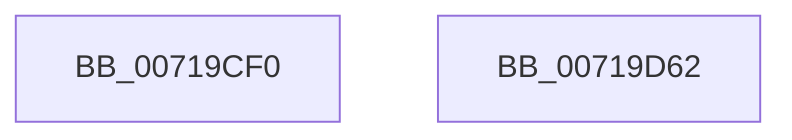

# VslSetCodeIntegrityPolicy

- RVA: `0x00719CF0`–`0x00719D63` (길이 `115` bytes)
- VA: `0x0000000140719CF0`
- 실행 섹션: `PAGE`
- PDB 이름 있음: `예`; PDB Function 태그: `아니요`
- unwind 정보 RVA: `0x000B3900`
- 디코드: `27`개 명령, `115/115` bytes 표시
- 미해석 바이트: `0` (있으면 어셈블리에 `.byte`로 보존)

> 이 문서는 커널 이미지의 기계어와 PDB 기호를 분석해 생성했습니다. 4번과 5번은 함수 원형과 자료형을 바이너리 사용 방식에서 추정한 C 해석이며 원본 소스 복구 결과는 아닙니다.

## 1. Dependencies

- 직접 호출 지점: **3**; 고유 호출 대상: **3**
- 직접 호출자로 확인된 함수: **0**
- RIP 상대 이미지 참조: **1**

### Outgoing calls
- `0x00719D1F` → [memset](../../text/6C/memset_function_006C6C40.md) (function, `0x006C6C40`)
- `0x00719D3C` → [VslpEnterIumSecureMode](../../text/23/VslpEnterIumSecureMode_function_00235E50.md) (function, `0x00235E50`)
- `0x00719D4C` → [_security_check_cookie](../../text/6A/_security_check_cookie_function_006AC640.md) (function, `0x006AC640`)

### Direct callers
- 이 함수 시작 RVA로 연결되는 직접 call은 확인되지 않았습니다. 간접 호출은 완전히 역산할 수 없습니다.

### Static image references
- `0x00719CFD` → RVA `0x00E0A740` (`.data`; read)

## 2. Other-region calls and transfers

- 다른 실행 섹션으로 향하는 call: **3**
  - `0x00719D1F` → [memset](../../text/6C/memset_function_006C6C40.md) (`PAGE` → `.text`)
  - `0x00719D3C` → [VslpEnterIumSecureMode](../../text/23/VslpEnterIumSecureMode_function_00235E50.md) (`PAGE` → `.text`)
  - `0x00719D4C` → [_security_check_cookie](../../text/6A/_security_check_cookie_function_006AC640.md) (`PAGE` → `.text`)
- 별도 외부 분기/꼬리 이동을 확인하지 못했습니다.

## 3. Assembly (complete function range)

```asm
00719CF0  48 89 5C 24 18                  mov qword ptr [rsp + 0x18], rbx
00719CF5  57                              push rdi
00719CF6  48 81 EC A0 00 00 00            sub rsp, 0xa0
00719CFD  48 8B 05 3C 0A 6F 00            mov rax, qword ptr [rip + 0x6f0a3c]
00719D04  48 33 C4                        xor rax, rsp
00719D07  48 89 84 24 90 00 00 00         mov qword ptr [rsp + 0x90], rax
00719D0F  48 8B FA                        mov rdi, rdx
00719D12  8B D9                           mov ebx, ecx
00719D14  33 D2                           xor edx, edx
00719D16  48 8D 4C 24 20                  lea rcx, [rsp + 0x20]
00719D1B  44 8D 42 68                     lea r8d, [rdx + 0x68]
00719D1F  E8 1C CF FA FF                  call 0x1406c6c40
00719D24  BA 22 00 00 00                  mov edx, 0x22
00719D29  89 5C 24 28                     mov dword ptr [rsp + 0x28], ebx
00719D2D  4C 8D 4C 24 20                  lea r9, [rsp + 0x20]
00719D32  48 89 7C 24 30                  mov qword ptr [rsp + 0x30], rdi
00719D37  45 33 C0                        xor r8d, r8d
00719D3A  B1 02                           mov cl, 2
00719D3C  E8 0F C1 B1 FF                  call 0x140235e50
00719D41  48 8B 8C 24 90 00 00 00         mov rcx, qword ptr [rsp + 0x90]
00719D49  48 33 CC                        xor rcx, rsp
00719D4C  E8 EF 28 F9 FF                  call 0x1406ac640
00719D51  48 8B 9C 24 C0 00 00 00         mov rbx, qword ptr [rsp + 0xc0]
00719D59  48 81 C4 A0 00 00 00            add rsp, 0xa0
00719D60  5F                              pop rdi
00719D61  C3                              ret
00719D62  CC                              int3
```

## 4. C-style interpretation (structured pseudocode)

```c
__int64 __fastcall VslSetCodeIntegrityPolicy(int a1, __int64 a2)
{
    __int64 result;
    __int64 v_rsp;
    unsigned __int64 v_stack_m18;
    unsigned __int64 v_stack_m78;
    unsigned int v_stack_m80;
    unsigned __int64 v_stack_m88;
    unsigned __int64 v_stack_p18;

    v_stack_p18 = v_rbx;
    v_rsp = (v_rsp) - (160);
    result = (*(unsigned __int64 *)(v_rip + 7277116)) ^ (v_rsp);
    v_stack_m18 = result;
    a2 = 0;
    result = memset(v_stack_m88, a2, a2 + 104, a4);
    v_stack_m80 = (unsigned int)((unsigned int)(a1));
    v_stack_m78 = 0;
    a3 = 0;
    result = VslpEnterIumSecureMode(2, 34, a3, v_stack_m88);
    a1 = (v_stack_m18) ^ (v_rsp);
    result = _security_check_cookie(a1, 34, a3, v_stack_m88);
    v_rsp = (v_rsp) + (160);
    return result;
}
```

## 5. (Beta) C Style

```c
int64_t VslSetCodeIntegrityPolicy(int32_t Arg1, int64_t Arg2)
{
    int64_t result;
    int64_t local_rsp;
    uint64_t v_stack_m18;
    uint64_t v_stack_m78;
    uint32_t v_stack_m80;
    uint64_t v_stack_m88;
    uint64_t v_stack_p18;

    v_stack_p18 = local_rbx;
    local_rsp = (local_rsp) - (160);
    result = (*(uint64_t *)(v_rip + 0x6F0A3C)) ^ (local_rsp);
    v_stack_m18 = result;
    Arg2 = 0;
    result = memset(v_stack_m88, Arg2, Arg2 + 104, a4);
    v_stack_m80 = (uint32_t)((uint32_t)(Arg1));
    v_stack_m78 = 0;
    a3 = 0;
    result = VslpEnterIumSecureMode(2, 34, a3, v_stack_m88);
    Arg1 = (v_stack_m18) ^ (local_rsp);
    result = _security_check_cookie(Arg1, 34, a3, v_stack_m88);
    local_rsp = (local_rsp) + (160);
    return result;
}
```

## 6. Execution-region graph

[열기: 2D/3D 그래프와 함수 탐색 컨트롤 패널](../../../control-panel.html?section=page&rva=0x00719CF0&view=graph)

- 2D 그래프는 위에서 아래로 흐르고, 3D 그래프는 빈 공간을 드래그해 회전합니다. Shift+드래그는 이동, 휠은 확대·축소, 함수 노드 선택은 대상 보고서 이동입니다.

### Static fallback


