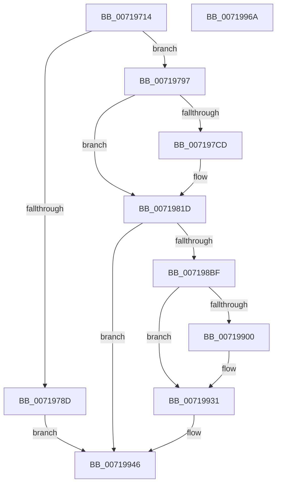

# VslStartSecureProcessor

- RVA: `0x00719714`–`0x0071996B` (길이 `599` bytes)
- VA: `0x0000000140719714`
- 실행 섹션: `PAGE`
- PDB 이름 있음: `예`; PDB Function 태그: `아니요`
- unwind 정보 RVA: `0x000C6E50`
- 디코드: `145`개 명령, `599/599` bytes 표시
- 미해석 바이트: `0` (있으면 어셈블리에 `.byte`로 보존)

> 이 문서는 커널 이미지의 기계어와 PDB 기호를 분석해 생성했습니다. 4번과 5번은 함수 원형과 자료형을 바이너리 사용 방식에서 추정한 C 해석이며 원본 소스 복구 결과는 아닙니다.

## 1. Dependencies

- 직접 호출 지점: **14**; 고유 호출 대상: **9**
- 직접 호출자로 확인된 함수: **1**
- RIP 상대 이미지 참조: **2**

### Outgoing calls
- `0x0071974F` → [memset](../../text/6C/memset_function_006C6C40.md) (function, `0x006C6C40`)
- `0x0071975E` → [memset](../../text/6C/memset_function_006C6C40.md) (function, `0x006C6C40`)
- `0x0071976D` → [memset](../../text/6C/memset_function_006C6C40.md) (function, `0x006C6C40`)
- `0x00719780` → [ExAllocatePool2](../../poolcode/B8/ExAllocatePool2_function_00B820F0.md) (function, `0x00B820F0`)
- `0x007197C4` → [KeIsKernelCetEnabled](../../text/45/KeIsKernelCetEnabled_function_0045D610.md) (function, `0x0045D610`)
- `0x00719814` → [MmGetPhysicalAddress](../../text/23/MmGetPhysicalAddress_function_0023A500.md) (function, `0x0023A500`)
- `0x007198B2` → [VslpLockPagesForTransfer](../../text/29/VslpLockPagesForTransfer_function_0029E0FC.md) (function, `0x0029E0FC`)
- `0x007198D6` → [MmGetPhysicalAddress](../../text/23/MmGetPhysicalAddress_function_0023A500.md) (function, `0x0023A500`)
- `0x007198F5` → [VslpLockPagesForTransfer](../../text/29/VslpLockPagesForTransfer_function_0029E0FC.md) (function, `0x0029E0FC`)
- `0x00719920` → [VslpEnterIumSecureMode](../../text/23/VslpEnterIumSecureMode_function_00235E50.md) (function, `0x00235E50`)
- `0x0071992C` → [VslpUnlockPagesForTransfer](../../text/29/VslpUnlockPagesForTransfer_function_0029EE4C.md) (function, `0x0029EE4C`)
- `0x00719935` → [VslpUnlockPagesForTransfer](../../text/29/VslpUnlockPagesForTransfer_function_0029EE4C.md) (function, `0x0029EE4C`)
- `0x0071993F` → [ExFreePoolWithTag](../../poolcode/B8/ExFreePoolWithTag_function_00B82870.md) (function, `0x00B82870`)
- `0x0071994D` → [_security_check_cookie](../../text/6A/_security_check_cookie_function_006AC640.md) (function, `0x006AC640`)

### Direct callers
- [HvlHalStartVirtualProcessor](../../text/58/HvlHalStartVirtualProcessor_function_00588710.md) at `0x0058871D`

### Static image references
- `0x0071972E` → RVA `0x00E0A740` (`.data`; read)
- `0x00719797` → RVA `0x00FC6B20` (`ALMOSTRO`; read)

## 2. Other-region calls and transfers

- 다른 실행 섹션으로 향하는 call: **14**
  - `0x0071974F` → [memset](../../text/6C/memset_function_006C6C40.md) (`PAGE` → `.text`)
  - `0x0071975E` → [memset](../../text/6C/memset_function_006C6C40.md) (`PAGE` → `.text`)
  - `0x0071976D` → [memset](../../text/6C/memset_function_006C6C40.md) (`PAGE` → `.text`)
  - `0x00719780` → [ExAllocatePool2](../../poolcode/B8/ExAllocatePool2_function_00B820F0.md) (`PAGE` → `POOLCODE`)
  - `0x007197C4` → [KeIsKernelCetEnabled](../../text/45/KeIsKernelCetEnabled_function_0045D610.md) (`PAGE` → `.text`)
  - `0x00719814` → [MmGetPhysicalAddress](../../text/23/MmGetPhysicalAddress_function_0023A500.md) (`PAGE` → `.text`)
  - `0x007198B2` → [VslpLockPagesForTransfer](../../text/29/VslpLockPagesForTransfer_function_0029E0FC.md) (`PAGE` → `.text`)
  - `0x007198D6` → [MmGetPhysicalAddress](../../text/23/MmGetPhysicalAddress_function_0023A500.md) (`PAGE` → `.text`)
  - `0x007198F5` → [VslpLockPagesForTransfer](../../text/29/VslpLockPagesForTransfer_function_0029E0FC.md) (`PAGE` → `.text`)
  - `0x00719920` → [VslpEnterIumSecureMode](../../text/23/VslpEnterIumSecureMode_function_00235E50.md) (`PAGE` → `.text`)
  - `0x0071992C` → [VslpUnlockPagesForTransfer](../../text/29/VslpUnlockPagesForTransfer_function_0029EE4C.md) (`PAGE` → `.text`)
  - `0x00719935` → [VslpUnlockPagesForTransfer](../../text/29/VslpUnlockPagesForTransfer_function_0029EE4C.md) (`PAGE` → `.text`)
  - `0x0071993F` → [ExFreePoolWithTag](../../poolcode/B8/ExFreePoolWithTag_function_00B82870.md) (`PAGE` → `POOLCODE`)
  - `0x0071994D` → [_security_check_cookie](../../text/6A/_security_check_cookie_function_006AC640.md) (`PAGE` → `.text`)
- 별도 외부 분기/꼬리 이동을 확인하지 못했습니다.

## 3. Assembly (complete function range)

```asm
00719714  48 89 5C 24 08                  mov qword ptr [rsp + 8], rbx
00719719  48 89 74 24 18                  mov qword ptr [rsp + 0x18], rsi
0071971E  55                              push rbp
0071971F  57                              push rdi
00719720  41 56                           push r14
00719722  48 8D 6C 24 B0                  lea rbp, [rsp - 0x50]
00719727  48 81 EC 50 01 00 00            sub rsp, 0x150
0071972E  48 8B 05 0B 10 6F 00            mov rax, qword ptr [rip + 0x6f100b]
00719735  48 33 C4                        xor rax, rsp
00719738  48 89 45 40                     mov qword ptr [rbp + 0x40], rax
0071973C  48 8B F2                        mov rsi, rdx
0071973F  8B F9                           mov edi, ecx
00719741  BB 48 00 00 00                  mov ebx, 0x48
00719746  48 8D 4D 80                     lea rcx, [rbp - 0x80]
0071974A  44 8B C3                        mov r8d, ebx
0071974D  33 D2                           xor edx, edx
0071974F  E8 EC D4 FA FF                  call 0x1406c6c40
00719754  33 D2                           xor edx, edx
00719756  44 8D 43 20                     lea r8d, [rbx + 0x20]
0071975A  48 8D 4D D0                     lea rcx, [rbp - 0x30]
0071975E  E8 DD D4 FA FF                  call 0x1406c6c40
00719763  44 8B C3                        mov r8d, ebx
00719766  48 8D 4C 24 30                  lea rcx, [rsp + 0x30]
0071976B  33 D2                           xor edx, edx
0071976D  E8 CE D4 FA FF                  call 0x1406c6c40
00719772  BA 18 01 00 00                  mov edx, 0x118
00719777  8D 4B F8                        lea ecx, [rbx - 8]
0071977A  41 B8 56 6D 73 54               mov r8d, 0x54736d56
00719780  E8 6B 89 46 00                  call 0x140b820f0
00719785  48 8B D8                        mov rbx, rax
00719788  48 85 C0                        test rax, rax
0071978B  75 0A                           jne 0x140719797
0071978D  B8 9A 00 00 C0                  mov eax, 0xc000009a
00719792  E9 AF 01 00 00                  jmp 0x140719946
00719797  48 8B 05 82 D3 8A 00            mov rax, qword ptr [rip + 0x8ad382]
0071979E  48 8B 88 88 00 00 00            mov rcx, qword ptr [rax + 0x88]
007197A5  89 3B                           mov dword ptr [rbx], edi
007197A7  0F B6 91 D0 00 00 00            movzx edx, byte ptr [rcx + 0xd0]
007197AE  4C 8D B1 80 FE FF FF            lea r14, [rcx - 0x180]
007197B5  0F B6 81 D1 00 00 00            movzx eax, byte ptr [rcx + 0xd1]
007197BC  C1 E2 08                        shl edx, 8
007197BF  0B D0                           or edx, eax
007197C1  89 53 04                        mov dword ptr [rbx + 4], edx
007197C4  E8 47 3E D4 FF                  call 0x14045d610
007197C9  84 C0                           test al, al
007197CB  74 50                           je 0x14071981d
007197CD  48 8B 05 4C D3 8A 00            mov rax, qword ptr [rip + 0x8ad34c]
007197D4  48 8B 88 F0 00 00 00            mov rcx, qword ptr [rax + 0xf0]
007197DB  48 8B 81 88 0E 00 00            mov rax, qword ptr [rcx + 0xe88]
007197E2  48 89 43 20                     mov qword ptr [rbx + 0x20], rax
007197E6  48 8B 05 33 D3 8A 00            mov rax, qword ptr [rip + 0x8ad333]
007197ED  48 8B 88 F0 00 00 00            mov rcx, qword ptr [rax + 0xf0]
007197F4  48 8B 81 90 0E 00 00            mov rax, qword ptr [rcx + 0xe90]
007197FB  48 89 43 28                     mov qword ptr [rbx + 0x28], rax
007197FF  48 8B 05 1A D3 8A 00            mov rax, qword ptr [rip + 0x8ad31a]
00719806  48 8B 88 F0 00 00 00            mov rcx, qword ptr [rax + 0xf0]
0071980D  48 8B 89 90 0E 00 00            mov rcx, qword ptr [rcx + 0xe90]
00719814  E8 E7 0C B2 FF                  call 0x14023a500
00719819  48 89 43 30                     mov qword ptr [rbx + 0x30], rax
0071981D  0F 10 06                        movups xmm0, xmmword ptr [rsi]
00719820  48 8D 4B 38                     lea rcx, [rbx + 0x38]
00719824  C7 44 24 20 02 00 00 00         mov dword ptr [rsp + 0x20], 2
0071982C  BA 80 00 00 00                  mov edx, 0x80
00719831  41 B8 80 D0 00 00               mov r8d, 0xd080
00719837  0F 11 01                        movups xmmword ptr [rcx], xmm0
0071983A  0F 10 4E 10                     movups xmm1, xmmword ptr [rsi + 0x10]
0071983E  48 8D 04 32                     lea rax, [rdx + rsi]
00719842  44 8D 4A 82                     lea r9d, [rdx - 0x7e]
00719846  0F 11 49 10                     movups xmmword ptr [rcx + 0x10], xmm1
0071984A  0F 10 46 20                     movups xmm0, xmmword ptr [rsi + 0x20]
0071984E  0F 11 41 20                     movups xmmword ptr [rcx + 0x20], xmm0
00719852  0F 10 4E 30                     movups xmm1, xmmword ptr [rsi + 0x30]
00719856  0F 11 49 30                     movups xmmword ptr [rcx + 0x30], xmm1
0071985A  0F 10 46 40                     movups xmm0, xmmword ptr [rsi + 0x40]
0071985E  0F 11 41 40                     movups xmmword ptr [rcx + 0x40], xmm0
00719862  0F 10 4E 50                     movups xmm1, xmmword ptr [rsi + 0x50]
00719866  0F 11 49 50                     movups xmmword ptr [rcx + 0x50], xmm1
0071986A  0F 10 46 60                     movups xmm0, xmmword ptr [rsi + 0x60]
0071986E  0F 11 41 60                     movups xmmword ptr [rcx + 0x60], xmm0
00719872  48 03 CA                        add rcx, rdx
00719875  49 8B D6                        mov rdx, r14
00719878  0F 10 46 70                     movups xmm0, xmmword ptr [rsi + 0x70]
0071987C  0F 11 41 F0                     movups xmmword ptr [rcx - 0x10], xmm0
00719880  0F 10 08                        movups xmm1, xmmword ptr [rax]
00719883  0F 11 09                        movups xmmword ptr [rcx], xmm1
00719886  0F 10 40 10                     movups xmm0, xmmword ptr [rax + 0x10]
0071988A  0F 11 41 10                     movups xmmword ptr [rcx + 0x10], xmm0
0071988E  0F 10 48 20                     movups xmm1, xmmword ptr [rax + 0x20]
00719892  0F 11 49 20                     movups xmmword ptr [rcx + 0x20], xmm1
00719896  0F 10 40 30                     movups xmm0, xmmword ptr [rax + 0x30]
0071989A  0F 11 41 30                     movups xmmword ptr [rcx + 0x30], xmm0
0071989E  0F 10 48 40                     movups xmm1, xmmword ptr [rax + 0x40]
007198A2  0F 11 49 40                     movups xmmword ptr [rcx + 0x40], xmm1
007198A6  0F 10 40 50                     movups xmm0, xmmword ptr [rax + 0x50]
007198AA  0F 11 41 50                     movups xmmword ptr [rcx + 0x50], xmm0
007198AE  48 8D 4D 80                     lea rcx, [rbp - 0x80]
007198B2  E8 45 48 B8 FF                  call 0x14029e0fc
007198B7  85 C0                           test eax, eax
007198B9  0F 88 87 00 00 00               js 0x140719946
007198BF  48 8B 45 80                     mov rax, qword ptr [rbp - 0x80]
007198C3  48 89 43 08                     mov qword ptr [rbx + 8], rax
007198C7  48 8B 45 B8                     mov rax, qword ptr [rbp - 0x48]
007198CB  48 89 43 10                     mov qword ptr [rbx + 0x10], rax
007198CF  48 8B 8E B0 00 00 00            mov rcx, qword ptr [rsi + 0xb0]
007198D6  E8 25 0C B2 FF                  call 0x14023a500
007198DB  83 64 24 20 00                  and dword ptr [rsp + 0x20], 0
007198E0  48 8D 4C 24 30                  lea rcx, [rsp + 0x30]
007198E5  45 33 C9                        xor r9d, r9d
007198E8  48 89 43 18                     mov qword ptr [rbx + 0x18], rax
007198EC  41 B8 18 01 00 00               mov r8d, 0x118
007198F2  48 8B D3                        mov rdx, rbx
007198F5  E8 02 48 B8 FF                  call 0x14029e0fc
007198FA  8B F8                           mov edi, eax
007198FC  85 C0                           test eax, eax
007198FE  78 31                           js 0x140719931
00719900  48 8B 44 24 30                  mov rax, qword ptr [rsp + 0x30]
00719905  4C 8D 4D D0                     lea r9, [rbp - 0x30]
00719909  48 89 45 D8                     mov qword ptr [rbp - 0x28], rax
0071990D  BA 02 00 00 00                  mov edx, 2
00719912  48 8B 44 24 68                  mov rax, qword ptr [rsp + 0x68]
00719917  45 33 C0                        xor r8d, r8d
0071991A  8A CA                           mov cl, dl
0071991C  48 89 45 E0                     mov qword ptr [rbp - 0x20], rax
00719920  E8 2B C5 B1 FF                  call 0x140235e50
00719925  48 8D 4C 24 30                  lea rcx, [rsp + 0x30]
0071992A  8B F8                           mov edi, eax
0071992C  E8 1B 55 B8 FF                  call 0x14029ee4c
00719931  48 8D 4D 80                     lea rcx, [rbp - 0x80]
00719935  E8 12 55 B8 FF                  call 0x14029ee4c
0071993A  33 D2                           xor edx, edx
0071993C  48 8B CB                        mov rcx, rbx
0071993F  E8 2C 8F 46 00                  call 0x140b82870
00719944  8B C7                           mov eax, edi
00719946  48 8B 4D 40                     mov rcx, qword ptr [rbp + 0x40]
0071994A  48 33 CC                        xor rcx, rsp
0071994D  E8 EE 2C F9 FF                  call 0x1406ac640
00719952  4C 8D 9C 24 50 01 00 00         lea r11, [rsp + 0x150]
0071995A  49 8B 5B 20                     mov rbx, qword ptr [r11 + 0x20]
0071995E  49 8B 73 30                     mov rsi, qword ptr [r11 + 0x30]
00719962  49 8B E3                        mov rsp, r11
00719965  41 5E                           pop r14
00719967  5F                              pop rdi
00719968  5D                              pop rbp
00719969  C3                              ret
0071996A  CC                              int3
```

## 4. C-style interpretation (structured pseudocode)

```c
__int64 __fastcall VslStartSecureProcessor(int a1, __int64 a2)
{
    __int64 result;
    __int64 v_rdi;
    __int64 v_rsp;
    unsigned __int64 v_stack_m100;
    unsigned __int64 v_stack_m138;
    unsigned int v_stack_m148;
    unsigned __int64 v_stack_m18;
    unsigned __int64 v_stack_m28;
    unsigned __int64 v_stack_m68;
    unsigned __int64 v_stack_m88;
    unsigned __int64 v_stack_m90;
    unsigned __int64 v_stack_m98;
    unsigned __int64 v_stack_mB0;
    unsigned __int64 v_stack_mE8;
    unsigned __int64 v_stack_p18;
    unsigned __int64 v_stack_p8;

    v_stack_p8 = v_rbx;
    v_stack_p18 = v_rsi;
    v_rsp = (v_rsp) - (336);
    result = (*(unsigned __int64 *)(v_rip + 7278603)) ^ (v_rsp);
    v_stack_m28 = result;
    a2 = 0;
    result = memset(v_stack_mE8, a2, 72, a4);
    a2 = 0;
    result = memset(v_stack_m98, a2, 72 + 32, a4);
    a2 = 0;
    result = memset(v_stack_m138, a2, 72, a4);
    result = ExAllocatePool2(72 - 8, 280, (unsigned int)(0x54736D56ULL), a4);
    if (result != 0) goto loc_00719797;
    goto loc_00719946;
loc_00719797:
    *(unsigned int *)(result) = (unsigned int)((unsigned int)(a1));
    a2 = (unsigned int)((*(unsigned __int8 *)(*(unsigned __int64 *)(*(unsigned __int64 *)(v_rip + 9098114) + 136) + 208)) << (8));
    a2 = (unsigned int)((a2) | ((unsigned int)(*(unsigned __int8 *)(*(unsigned __int64 *)(*(unsigned __int64 *)(v_rip + 9098114) + 136) + 209))));
    *(unsigned int *)(result + 4) = (unsigned int)(a2);
    result = KeIsKernelCetEnabled(*(unsigned __int64 *)(*(unsigned __int64 *)(v_rip + 9098114) + 136), a2, (unsigned int)(0x54736D56ULL), a4);
    if ((unsigned __int8)(result) != 0) {
        result = *(unsigned __int64 *)(v_rip + 9098060);
        a1 = *(unsigned __int64 *)(result + 240);
        result = *(unsigned __int64 *)(a1 + 3720);
        *(unsigned __int64 *)(result + 32) = result;
        result = *(unsigned __int64 *)(v_rip + 9098035);
        a1 = *(unsigned __int64 *)(result + 240);
        result = *(unsigned __int64 *)(a1 + 3728);
        *(unsigned __int64 *)(result + 40) = result;
        result = *(unsigned __int64 *)(v_rip + 9098010);
        a1 = *(unsigned __int64 *)(result + 240);
        a1 = *(unsigned __int64 *)(a1 + 3728);
        result = MmGetPhysicalAddress(a1, a2, (unsigned int)(0x54736D56ULL), a4);
        *(unsigned __int64 *)(result + 48) = result;
    }
    v_stack_m148 = 2;
    *(unsigned __int64 *)(result + 56) = v_xmm0;
    *(unsigned __int64 *)(result + 56 + 16) = v_xmm1;
    *(unsigned __int64 *)(result + 56 + 32) = v_xmm0;
    *(unsigned __int64 *)(result + 56 + 48) = v_xmm1;
    *(unsigned __int64 *)(result + 56 + 64) = v_xmm0;
    *(unsigned __int64 *)(result + 56 + 80) = v_xmm1;
    *(unsigned __int64 *)(result + 56 + 96) = v_xmm0;
    a1 = (result + 56) + (128);
    *(unsigned __int64 *)(a1 - 16) = v_xmm0;
    *(unsigned __int64 *)(a1) = v_xmm1;
    *(unsigned __int64 *)(a1 + 16) = v_xmm0;
    *(unsigned __int64 *)(a1 + 32) = v_xmm1;
    *(unsigned __int64 *)(a1 + 48) = v_xmm0;
    *(unsigned __int64 *)(a1 + 64) = v_xmm1;
    *(unsigned __int64 *)(a1 + 80) = v_xmm0;
    result = VslpLockPagesForTransfer(v_stack_mE8, *(unsigned __int64 *)(*(unsigned __int64 *)(v_rip + 9098114) + 136) - 384, (unsigned int)(0xD080ULL), 128 - 126);
    if (sign_flag) goto loc_00719946;
    *(unsigned __int64 *)(result + 8) = v_stack_mE8;
    *(unsigned __int64 *)(result + 16) = v_stack_mB0;
    result = MmGetPhysicalAddress(*(unsigned __int64 *)(a2 + 176), *(unsigned __int64 *)(*(unsigned __int64 *)(v_rip + 9098114) + 136) - 384, (unsigned int)(0xD080ULL), 128 - 126);
    a4 = 0;
    *(unsigned __int64 *)(result + 24) = result;
    result = VslpLockPagesForTransfer(v_stack_m138, result, 280, a4);
    v_rdi = (unsigned int)((unsigned int)(result));
    if (!(sign_flag)) {
        result = v_stack_m138;
        a4 = v_stack_m98;
        v_stack_m90 = result;
        a2 = 2;
        result = v_stack_m100;
        a3 = 0;
        a1 = (unsigned __int8)(a2);
        v_stack_m88 = result;
        result = VslpEnterIumSecureMode(a1, a2, a3, a4);
        a1 = v_stack_m138;
        v_rdi = (unsigned int)(result);
        result = VslpUnlockPagesForTransfer(a1, a2, a3, a4);
    }
    result = VslpUnlockPagesForTransfer(v_stack_mE8, a2, a3, a4);
    a2 = 0;
    result = ExFreePoolWithTag(result, a2, a3, a4);
loc_00719946:
    a1 = (v_stack_m28) ^ (v_rsp);
    result = _security_check_cookie(a1, a2, a3, a4);
    return result;
}
```

## 5. (Beta) C Style

```c
int64_t VslStartSecureProcessor(int32_t Arg1, void *Arg2)
{
    uint8_t *arg2 = (uint8_t *)Arg2;

    int64_t result;
    int64_t local_rdi;
    int64_t local_rsp;
    uint64_t v_stack_m100;
    uint64_t v_stack_m138;
    uint32_t v_stack_m148;
    uint64_t v_stack_m18;
    uint64_t v_stack_m28;
    uint64_t v_stack_m68;
    uint64_t v_stack_m88;
    uint64_t v_stack_m90;
    uint64_t v_stack_m98;
    uint64_t v_stack_mB0;
    uint64_t v_stack_mE8;
    uint64_t v_stack_p18;
    uint64_t v_stack_p8;

    v_stack_p8 = local_rbx;
    v_stack_p18 = local_rsi;
    local_rsp = (local_rsp) - (336);
    result = (*(uint64_t *)(v_rip + 0x6F100B)) ^ (local_rsp);
    v_stack_m28 = result;
    Arg2 = 0;
    result = memset(v_stack_mE8, Arg2, 72, a4);
    Arg2 = 0;
    result = memset(v_stack_m98, Arg2, 72 + 32, a4);
    Arg2 = 0;
    result = memset(v_stack_m138, Arg2, 72, a4);
    result = ExAllocatePool2(72 - 8, 280, (uint32_t)(0x54736D56ULL), a4);
    if (result != 0) goto loc_00719797;
    goto loc_00719946;
loc_00719797:
    *(uint32_t *)(result) = (uint32_t)((uint32_t)(Arg1));
    Arg2 = (uint32_t)((*(uint8_t *)(*(uint64_t *)(*(uint64_t *)(v_rip + 0x8AD382) + 0x88) + 0xD0)) << (8));
    Arg2 = (uint32_t)((Arg2) | ((uint32_t)(*(uint8_t *)(*(uint64_t *)(*(uint64_t *)(v_rip + 0x8AD382) + 0x88) + 0xD1))));
    *(uint32_t *)(result + 0x4) = (uint32_t)(Arg2);
    result = KeIsKernelCetEnabled(*(uint64_t *)(*(uint64_t *)(v_rip + 0x8AD382) + 0x88), Arg2, (uint32_t)(0x54736D56ULL), a4);
    if ((uint8_t)(result) != 0) {
        result = *(uint64_t *)(v_rip + 0x8AD34C);
        Arg1 = *(uint64_t *)(result + 0xF0);
        result = *(uint64_t *)(Arg1 + 0xE88);
        *(uint64_t *)(result + 0x20) = result;
        result = *(uint64_t *)(v_rip + 0x8AD333);
        Arg1 = *(uint64_t *)(result + 0xF0);
        result = *(uint64_t *)(Arg1 + 0xE90);
        *(uint64_t *)(result + 0x28) = result;
        result = *(uint64_t *)(v_rip + 0x8AD31A);
        Arg1 = *(uint64_t *)(result + 0xF0);
        Arg1 = *(uint64_t *)(Arg1 + 0xE90);
        result = MmGetPhysicalAddress(Arg1, Arg2, (uint32_t)(0x54736D56ULL), a4);
        *(uint64_t *)(result + 0x30) = result;
    }
    v_stack_m148 = 2;
    *(uint64_t *)(result + 0x38) = v_xmm0;
    *(uint64_t *)(result + 0x38 + 0x10) = v_xmm1;
    *(uint64_t *)(result + 0x38 + 0x20) = v_xmm0;
    *(uint64_t *)(result + 0x38 + 0x30) = v_xmm1;
    *(uint64_t *)(result + 0x38 + 0x40) = v_xmm0;
    *(uint64_t *)(result + 0x38 + 0x50) = v_xmm1;
    *(uint64_t *)(result + 0x38 + 0x60) = v_xmm0;
    Arg1 = (result + 56) + (128);
    *(uint64_t *)(Arg1 - 0x10) = v_xmm0;
    *(uint64_t *)(Arg1) = v_xmm1;
    *(uint64_t *)(Arg1 + 0x10) = v_xmm0;
    *(uint64_t *)(Arg1 + 0x20) = v_xmm1;
    *(uint64_t *)(Arg1 + 0x30) = v_xmm0;
    *(uint64_t *)(Arg1 + 0x40) = v_xmm1;
    *(uint64_t *)(Arg1 + 0x50) = v_xmm0;
    result = VslpLockPagesForTransfer(v_stack_mE8, *(uint64_t *)(*(uint64_t *)(v_rip + 0x8AD382) + 0x88) - 384, (uint32_t)(0xD080ULL), 128 - 126);
    if (sign_flag) goto loc_00719946;
    *(uint64_t *)(result + 0x8) = v_stack_mE8;
    *(uint64_t *)(result + 0x10) = v_stack_mB0;
    result = MmGetPhysicalAddress(*(uint64_t *)(arg2 + 0xB0), *(uint64_t *)(*(uint64_t *)(v_rip + 0x8AD382) + 0x88) - 384, (uint32_t)(0xD080ULL), 128 - 126);
    a4 = 0;
    *(uint64_t *)(result + 0x18) = result;
    result = VslpLockPagesForTransfer(v_stack_m138, result, 280, a4);
    local_rdi = (uint32_t)((uint32_t)(result));
    if (!(sign_flag)) {
        result = v_stack_m138;
        a4 = v_stack_m98;
        v_stack_m90 = result;
        Arg2 = 2;
        result = v_stack_m100;
        a3 = 0;
        Arg1 = (uint8_t)(Arg2);
        v_stack_m88 = result;
        result = VslpEnterIumSecureMode(Arg1, Arg2, a3, a4);
        Arg1 = v_stack_m138;
        local_rdi = (uint32_t)(result);
        result = VslpUnlockPagesForTransfer(Arg1, Arg2, a3, a4);
    }
    result = VslpUnlockPagesForTransfer(v_stack_mE8, Arg2, a3, a4);
    Arg2 = 0;
    result = ExFreePoolWithTag(result, Arg2, a3, a4);
loc_00719946:
    Arg1 = (v_stack_m28) ^ (local_rsp);
    result = _security_check_cookie(Arg1, Arg2, a3, a4);
    return result;
}
```

### 관측된 메모리 오프셋

구조체 형식이 확인되지 않은 접근은 인자 기준의 오프셋으로만 기록했습니다.

| 기준 인자 | 오프셋 표현 | 폭 (bit) | 접근 |
|---|---:|---:|---|
| `Arg2` | `+ 0x0` | `128` | `R` |
| `Arg2` | `+ 0x10` | `128` | `R` |
| `Arg2` | `+ 0x20` | `128` | `R` |
| `Arg2` | `+ 0x30` | `128` | `R` |
| `Arg2` | `+ 0x40` | `128` | `R` |
| `Arg2` | `+ 0x50` | `128` | `R` |
| `Arg2` | `+ 0x60` | `128` | `R` |
| `Arg2` | `+ 0x70` | `128` | `R` |
| `Arg2` | `+ 0xB0` | `64` | `R` |

## 6. Execution-region graph

[열기: 2D/3D 그래프와 함수 탐색 컨트롤 패널](../../../control-panel.html?section=page&rva=0x00719714&view=graph)

- 2D 그래프는 위에서 아래로 흐르고, 3D 그래프는 빈 공간을 드래그해 회전합니다. Shift+드래그는 이동, 휠은 확대·축소, 함수 노드 선택은 대상 보고서 이동입니다.

### Static fallback


