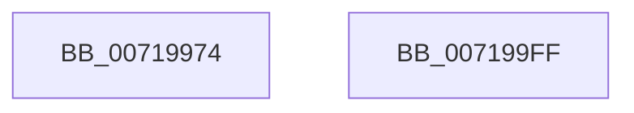

# VslTerminateSecureThread

- RVA: `0x00719974`–`0x00719A00` (길이 `140` bytes)
- VA: `0x0000000140719974`
- 실행 섹션: `PAGE`
- PDB 이름 있음: `예`; PDB Function 태그: `아니요`
- unwind 정보 RVA: `0x000B3900`
- 디코드: `33`개 명령, `140/140` bytes 표시
- 미해석 바이트: `0` (있으면 어셈블리에 `.byte`로 보존)

> 이 문서는 커널 이미지의 기계어와 PDB 기호를 분석해 생성했습니다. 4번과 5번은 함수 원형과 자료형을 바이너리 사용 방식에서 추정한 C 해석이며 원본 소스 복구 결과는 아닙니다.

## 1. Dependencies

- 직접 호출 지점: **4**; 고유 호출 대상: **4**
- 직접 호출자로 확인된 함수: **1**
- RIP 상대 이미지 참조: **1**

### Outgoing calls
- `0x007199A3` → [memset](../../text/6C/memset_function_006C6C40.md) (function, `0x006C6C40`)
- `0x007199C8` → [VslpEnterIumSecureMode](../../text/23/VslpEnterIumSecureMode_function_00235E50.md) (function, `0x00235E50`)
- `0x007199CF` → [KeLeaveCriticalRegion](../../text/25/KeLeaveCriticalRegion_function_0025D8B0.md) (function, `0x0025D8B0`)
- `0x007199E9` → [_security_check_cookie](../../text/6A/_security_check_cookie_function_006AC640.md) (function, `0x006AC640`)

### Direct callers
- [KeUnsecureThread](../../text/5B/KeUnsecureThread_function_005B90F0.md) at `0x005B910D`

### Static image references
- `0x00719981` → RVA `0x00E0A740` (`.data`; read)

## 2. Other-region calls and transfers

- 다른 실행 섹션으로 향하는 call: **4**
  - `0x007199A3` → [memset](../../text/6C/memset_function_006C6C40.md) (`PAGE` → `.text`)
  - `0x007199C8` → [VslpEnterIumSecureMode](../../text/23/VslpEnterIumSecureMode_function_00235E50.md) (`PAGE` → `.text`)
  - `0x007199CF` → [KeLeaveCriticalRegion](../../text/25/KeLeaveCriticalRegion_function_0025D8B0.md) (`PAGE` → `.text`)
  - `0x007199E9` → [_security_check_cookie](../../text/6A/_security_check_cookie_function_006AC640.md) (`PAGE` → `.text`)
- 별도 외부 분기/꼬리 이동을 확인하지 못했습니다.

## 3. Assembly (complete function range)

```asm
00719974  48 89 5C 24 18                  mov qword ptr [rsp + 0x18], rbx
00719979  57                              push rdi
0071997A  48 81 EC A0 00 00 00            sub rsp, 0xa0
00719981  48 8B 05 B8 0D 6F 00            mov rax, qword ptr [rip + 0x6f0db8]
00719988  48 33 C4                        xor rax, rsp
0071998B  48 89 84 24 90 00 00 00         mov qword ptr [rsp + 0x90], rax
00719993  48 8B FA                        mov rdi, rdx
00719996  8B D9                           mov ebx, ecx
00719998  33 D2                           xor edx, edx
0071999A  48 8D 4C 24 20                  lea rcx, [rsp + 0x20]
0071999F  44 8D 42 68                     lea r8d, [rdx + 0x68]
007199A3  E8 98 D2 FA FF                  call 0x1406c6c40
007199A8  65 48 8B 04 25 88 01 00 00      mov rax, qword ptr gs:[0x188]
007199B1  4C 8D 4C 24 20                  lea r9, [rsp + 0x20]
007199B6  BA 0A 00 00 00                  mov edx, 0xa
007199BB  44 8B C3                        mov r8d, ebx
007199BE  B1 02                           mov cl, 2
007199C0  66 FF 88 E4 01 00 00            dec word ptr [rax + 0x1e4]
007199C7  90                              nop
007199C8  E8 83 C4 B1 FF                  call 0x140235e50
007199CD  8B D8                           mov ebx, eax
007199CF  E8 DC 3E B4 FF                  call 0x14025d8b0
007199D4  48 8B 4C 24 30                  mov rcx, qword ptr [rsp + 0x30]
007199D9  8B C3                           mov eax, ebx
007199DB  48 89 0F                        mov qword ptr [rdi], rcx
007199DE  48 8B 8C 24 90 00 00 00         mov rcx, qword ptr [rsp + 0x90]
007199E6  48 33 CC                        xor rcx, rsp
007199E9  E8 52 2C F9 FF                  call 0x1406ac640
007199EE  48 8B 9C 24 C0 00 00 00         mov rbx, qword ptr [rsp + 0xc0]
007199F6  48 81 C4 A0 00 00 00            add rsp, 0xa0
007199FD  5F                              pop rdi
007199FE  C3                              ret
007199FF  CC                              int3
```

## 4. C-style interpretation (structured pseudocode)

```c
__int64 __fastcall VslTerminateSecureThread(int a1, __int64 a2)
{
    __int64 result;
    __int64 v_rsp;
    unsigned __int64 v_stack_m18;
    unsigned __int64 v_stack_m78;
    unsigned __int64 v_stack_m88;
    unsigned __int64 v_stack_p18;

    v_stack_p18 = v_rbx;
    v_rsp = (v_rsp) - (160);
    result = (*(unsigned __int64 *)(v_rip + 7278008)) ^ (v_rsp);
    v_stack_m18 = result;
    a2 = 0;
    result = memset(v_stack_m88, a2, a2 + 104, a4);
    result = VslpEnterIumSecureMode(2, 10, (unsigned int)((unsigned int)((unsigned int)(a1))), v_stack_m88);
    result = KeLeaveCriticalRegion(2, 10, (unsigned int)((unsigned int)((unsigned int)(a1))), v_stack_m88);
    *(unsigned __int64 *)(a2) = v_stack_m78;
    a1 = (v_stack_m18) ^ (v_rsp);
    result = _security_check_cookie(a1, 10, (unsigned int)((unsigned int)((unsigned int)(a1))), v_stack_m88);
    v_rsp = (v_rsp) + (160);
    return result;
}
```

## 5. (Beta) C Style

```c
int64_t VslTerminateSecureThread(int32_t Arg1, void *Arg2)
{
    uint8_t *arg2 = (uint8_t *)Arg2;

    int64_t result;
    int64_t local_rsp;
    uint64_t v_stack_m18;
    uint64_t v_stack_m78;
    uint64_t v_stack_m88;
    uint64_t v_stack_p18;

    v_stack_p18 = local_rbx;
    local_rsp = (local_rsp) - (160);
    result = (*(uint64_t *)(v_rip + 0x6F0DB8)) ^ (local_rsp);
    v_stack_m18 = result;
    Arg2 = 0;
    result = memset(v_stack_m88, Arg2, Arg2 + 104, a4);
    result = VslpEnterIumSecureMode(2, 10, (uint32_t)((uint32_t)((uint32_t)(Arg1))), v_stack_m88);
    result = KeLeaveCriticalRegion(2, 10, (uint32_t)((uint32_t)((uint32_t)(Arg1))), v_stack_m88);
    *(uint64_t *)(arg2) = v_stack_m78;
    Arg1 = (v_stack_m18) ^ (local_rsp);
    result = _security_check_cookie(Arg1, 10, (uint32_t)((uint32_t)((uint32_t)(Arg1))), v_stack_m88);
    local_rsp = (local_rsp) + (160);
    return result;
}
```

### 관측된 메모리 오프셋

구조체 형식이 확인되지 않은 접근은 인자 기준의 오프셋으로만 기록했습니다.

| 기준 인자 | 오프셋 표현 | 폭 (bit) | 접근 |
|---|---:|---:|---|
| `Arg2` | `+ 0x0` | `64` | `W` |

## 6. Execution-region graph

[열기: 2D/3D 그래프와 함수 탐색 컨트롤 패널](../../../control-panel.html?section=page&rva=0x00719974&view=graph)

- 2D 그래프는 위에서 아래로 흐르고, 3D 그래프는 빈 공간을 드래그해 회전합니다. Shift+드래그는 이동, 휠은 확대·축소, 함수 노드 선택은 대상 보고서 이동입니다.

### Static fallback


