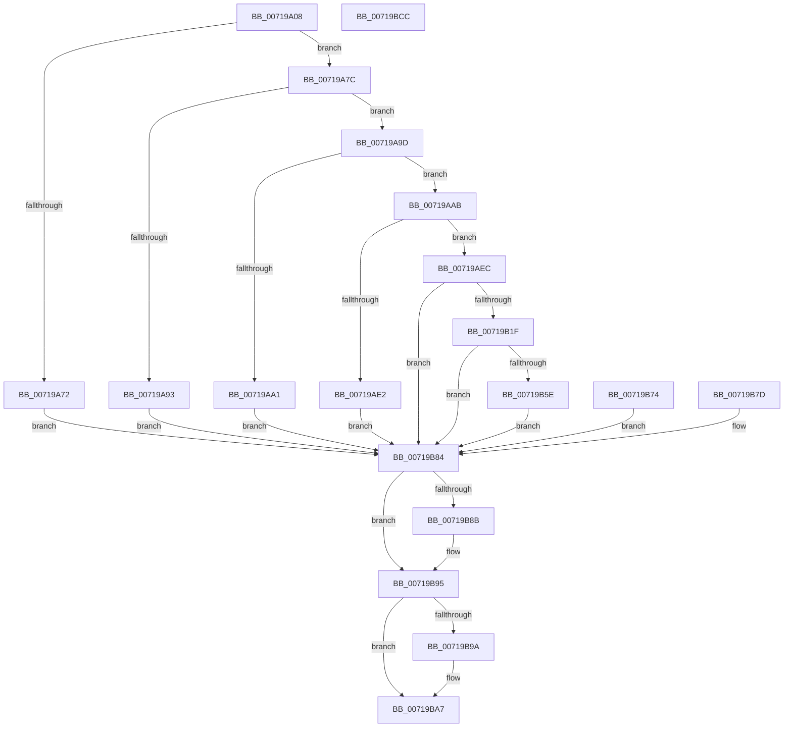

# VslTransformDumpKey

- RVA: `0x00719A08`–`0x00719BCD` (길이 `453` bytes)
- VA: `0x0000000140719A08`
- 실행 섹션: `PAGE`
- PDB 이름 있음: `예`; PDB Function 태그: `아니요`
- unwind 정보 RVA: `0x000C6B9C`
- 디코드: `118`개 명령, `453/453` bytes 표시
- 미해석 바이트: `0` (있으면 어셈블리에 `.byte`로 보존)

> 이 문서는 커널 이미지의 기계어와 PDB 기호를 분석해 생성했습니다. 4번과 5번은 함수 원형과 자료형을 바이너리 사용 방식에서 추정한 C 해석이며 원본 소스 복구 결과는 아닙니다.

## 1. Dependencies

- 직접 호출 지점: **11**; 고유 호출 대상: **9**
- 직접 호출자로 확인된 함수: **1**
- RIP 상대 이미지 참조: **3**

### Outgoing calls
- `0x00719A4E` → [memset](../../text/6C/memset_function_006C6C40.md) (function, `0x006C6C40`)
- `0x00719A60` → [memset](../../text/6C/memset_function_006C6C40.md) (function, `0x006C6C40`)
- `0x00719A8A` → [SeSinglePrivilegeCheck](../87/SeSinglePrivilegeCheck_function_00871E20.md) (function, `0x00871E20`)
- `0x00719AD0` → [ExAllocatePool2](../../poolcode/B8/ExAllocatePool2_function_00B820F0.md) (function, `0x00B820F0`)
- `0x00719AF5` → [memcpy](../../text/6C/memcpy_function_006C6840.md) (function, `0x006C6840`)
- `0x00719B14` → [VslpLockPagesForTransfer](../../text/29/VslpLockPagesForTransfer_function_0029E0FC.md) (function, `0x0029E0FC`)
- `0x00719B53` → [VslpEnterIumSecureMode](../../text/23/VslpEnterIumSecureMode_function_00235E50.md) (function, `0x00235E50`)
- `0x00719B67` → [memcpy](../../text/6C/memcpy_function_006C6840.md) (function, `0x006C6840`)
- `0x00719B90` → [VslpUnlockPagesForTransfer](../../text/29/VslpUnlockPagesForTransfer_function_0029EE4C.md) (function, `0x0029EE4C`)
- `0x00719BA2` → [ExFreePoolWithTag](../../poolcode/B8/ExFreePoolWithTag_function_00B82870.md) (function, `0x00B82870`)
- `0x00719BB4` → [_security_check_cookie](../../text/6A/_security_check_cookie_function_006AC640.md) (function, `0x006AC640`)

### Direct callers
- [ExpQuerySystemInformation](../A5/ExpQuerySystemInformation_function_00A57858.md) at `0x00A5ACE9`

### Static image references
- `0x00719A1B` → RVA `0x00E0A740` (`.data`; read)
- `0x00719A69` → RVA `0x00FC6A84` (`ALMOSTRO`; read)
- `0x00719A83` → RVA `0x00FD9A80` (`PAGEDATA`; read)

## 2. Other-region calls and transfers

- 다른 실행 섹션으로 향하는 call: **10**
  - `0x00719A4E` → [memset](../../text/6C/memset_function_006C6C40.md) (`PAGE` → `.text`)
  - `0x00719A60` → [memset](../../text/6C/memset_function_006C6C40.md) (`PAGE` → `.text`)
  - `0x00719AD0` → [ExAllocatePool2](../../poolcode/B8/ExAllocatePool2_function_00B820F0.md) (`PAGE` → `POOLCODE`)
  - `0x00719AF5` → [memcpy](../../text/6C/memcpy_function_006C6840.md) (`PAGE` → `.text`)
  - `0x00719B14` → [VslpLockPagesForTransfer](../../text/29/VslpLockPagesForTransfer_function_0029E0FC.md) (`PAGE` → `.text`)
  - `0x00719B53` → [VslpEnterIumSecureMode](../../text/23/VslpEnterIumSecureMode_function_00235E50.md) (`PAGE` → `.text`)
  - `0x00719B67` → [memcpy](../../text/6C/memcpy_function_006C6840.md) (`PAGE` → `.text`)
  - `0x00719B90` → [VslpUnlockPagesForTransfer](../../text/29/VslpUnlockPagesForTransfer_function_0029EE4C.md) (`PAGE` → `.text`)
  - `0x00719BA2` → [ExFreePoolWithTag](../../poolcode/B8/ExFreePoolWithTag_function_00B82870.md) (`PAGE` → `POOLCODE`)
  - `0x00719BB4` → [_security_check_cookie](../../text/6A/_security_check_cookie_function_006AC640.md) (`PAGE` → `.text`)
- 별도 외부 분기/꼬리 이동을 확인하지 못했습니다.

## 3. Assembly (complete function range)

```asm
00719A08  40 53                           push rbx
00719A0A  56                              push rsi
00719A0B  57                              push rdi
00719A0C  41 54                           push r12
00719A0E  41 55                           push r13
00719A10  41 56                           push r14
00719A12  41 57                           push r15
00719A14  48 81 EC 10 01 00 00            sub rsp, 0x110
00719A1B  48 8B 05 1E 0D 6F 00            mov rax, qword ptr [rip + 0x6f0d1e]
00719A22  48 33 C4                        xor rax, rsp
00719A25  48 89 84 24 00 01 00 00         mov qword ptr [rsp + 0x100], rax
00719A2D  45 8B F1                        mov r14d, r9d
00719A30  4D 8B E0                        mov r12, r8
00719A33  8B DA                           mov ebx, edx
00719A35  4C 8B F9                        mov r15, rcx
00719A38  4C 8B AC 24 70 01 00 00         mov r13, qword ptr [rsp + 0x170]
00719A40  33 D2                           xor edx, edx
00719A42  44 8D 42 68                     lea r8d, [rdx + 0x68]
00719A46  48 8D 8C 24 90 00 00 00         lea rcx, [rsp + 0x90]
00719A4E  E8 ED D1 FA FF                  call 0x1406c6c40
00719A53  33 FF                           xor edi, edi
00719A55  33 D2                           xor edx, edx
00719A57  44 8D 47 48                     lea r8d, [rdi + 0x48]
00719A5B  48 8D 4C 24 40                  lea rcx, [rsp + 0x40]
00719A60  E8 DB D1 FA FF                  call 0x1406c6c40
00719A65  21 7C 24 30                     and dword ptr [rsp + 0x30], edi
00719A69  40 38 3D 14 D0 8A 00            cmp byte ptr [rip + 0x8ad014], dil
00719A70  75 0A                           jne 0x140719a7c
00719A72  BB 9D 00 00 C0                  mov ebx, 0xc000009d
00719A77  E9 08 01 00 00                  jmp 0x140719b84
00719A7C  8A 94 24 78 01 00 00            mov dl, byte ptr [rsp + 0x178]
00719A83  48 8B 0D F6 FF 8B 00            mov rcx, qword ptr [rip + 0x8bfff6]
00719A8A  E8 91 83 15 00                  call 0x140871e20
00719A8F  84 C0                           test al, al
00719A91  75 0A                           jne 0x140719a9d
00719A93  BB 61 00 00 C0                  mov ebx, 0xc0000061
00719A98  E9 E7 00 00 00                  jmp 0x140719b84
00719A9D  85 DB                           test ebx, ebx
00719A9F  75 0A                           jne 0x140719aab
00719AA1  BB 04 00 00 C0                  mov ebx, 0xc0000004
00719AA6  E9 D9 00 00 00                  jmp 0x140719b84
00719AAB  BE 00 10 00 00                  mov esi, 0x1000
00719AB0  44 3B F6                        cmp r14d, esi
00719AB3  41 0F 46 F6                     cmovbe esi, r14d
00719AB7  48 8D 93 FF 0F 00 00            lea rdx, [rbx + 0xfff]
00719ABE  48 81 E2 00 F0 FF FF            and rdx, 0xfffffffffffff000
00719AC5  B9 40 00 00 00                  mov ecx, 0x40
00719ACA  41 B8 56 6D 73 54               mov r8d, 0x54736d56
00719AD0  E8 1B 86 46 00                  call 0x140b820f0
00719AD5  48 8B F8                        mov rdi, rax
00719AD8  48 89 44 24 38                  mov qword ptr [rsp + 0x38], rax
00719ADD  48 85 C0                        test rax, rax
00719AE0  75 0A                           jne 0x140719aec
00719AE2  BB 9A 00 00 C0                  mov ebx, 0xc000009a
00719AE7  E9 98 00 00 00                  jmp 0x140719b84
00719AEC  4C 8B C3                        mov r8, rbx
00719AEF  49 8B D7                        mov rdx, r15
00719AF2  48 8B CF                        mov rcx, rdi
00719AF5  E8 46 CD FA FF                  call 0x1406c6840
00719AFA  90                              nop
00719AFB  41 BE 02 00 00 00               mov r14d, 2
00719B01  44 89 74 24 20                  mov dword ptr [rsp + 0x20], r14d
00719B06  45 8B CE                        mov r9d, r14d
00719B09  44 8B C3                        mov r8d, ebx
00719B0C  48 8B D7                        mov rdx, rdi
00719B0F  48 8D 4C 24 40                  lea rcx, [rsp + 0x40]
00719B14  E8 E3 45 B8 FF                  call 0x14029e0fc
00719B19  8B D8                           mov ebx, eax
00719B1B  85 C0                           test eax, eax
00719B1D  78 65                           js 0x140719b84
00719B1F  C7 44 24 30 01 00 00 00         mov dword ptr [rsp + 0x30], 1
00719B27  48 8B 44 24 40                  mov rax, qword ptr [rsp + 0x40]
00719B2C  48 89 84 24 98 00 00 00         mov qword ptr [rsp + 0x98], rax
00719B34  48 8B 44 24 78                  mov rax, qword ptr [rsp + 0x78]
00719B39  48 89 84 24 A0 00 00 00         mov qword ptr [rsp + 0xa0], rax
00719B41  41 8D 56 57                     lea edx, [r14 + 0x57]
00719B45  4C 8D 8C 24 90 00 00 00         lea r9, [rsp + 0x90]
00719B4D  45 33 C0                        xor r8d, r8d
00719B50  41 8A CE                        mov cl, r14b
00719B53  E8 F8 C2 B1 FF                  call 0x140235e50
00719B58  8B D8                           mov ebx, eax
00719B5A  85 C0                           test eax, eax
00719B5C  78 26                           js 0x140719b84
00719B5E  44 8B C6                        mov r8d, esi
00719B61  48 8B D7                        mov rdx, rdi
00719B64  49 8B CC                        mov rcx, r12
00719B67  E8 D4 CC FA FF                  call 0x1406c6840
00719B6C  41 89 75 00                     mov dword ptr [r13], esi
00719B70  33 DB                           xor ebx, ebx
00719B72  EB 10                           jmp 0x140719b84
00719B74  8B D8                           mov ebx, eax
00719B76  48 8B 7C 24 38                  mov rdi, qword ptr [rsp + 0x38]
00719B7B  EB 07                           jmp 0x140719b84
00719B7D  8B D8                           mov ebx, eax
00719B7F  48 8B 7C 24 38                  mov rdi, qword ptr [rsp + 0x38]
00719B84  83 7C 24 30 00                  cmp dword ptr [rsp + 0x30], 0
00719B89  74 0A                           je 0x140719b95
00719B8B  48 8D 4C 24 40                  lea rcx, [rsp + 0x40]
00719B90  E8 B7 52 B8 FF                  call 0x14029ee4c
00719B95  48 85 FF                        test rdi, rdi
00719B98  74 0D                           je 0x140719ba7
00719B9A  BA 56 6D 73 54                  mov edx, 0x54736d56
00719B9F  48 8B CF                        mov rcx, rdi
00719BA2  E8 C9 8C 46 00                  call 0x140b82870
00719BA7  8B C3                           mov eax, ebx
00719BA9  48 8B 8C 24 00 01 00 00         mov rcx, qword ptr [rsp + 0x100]
00719BB1  48 33 CC                        xor rcx, rsp
00719BB4  E8 87 2A F9 FF                  call 0x1406ac640
00719BB9  48 81 C4 10 01 00 00            add rsp, 0x110
00719BC0  41 5F                           pop r15
00719BC2  41 5E                           pop r14
00719BC4  41 5D                           pop r13
00719BC6  41 5C                           pop r12
00719BC8  5F                              pop rdi
00719BC9  5E                              pop rsi
00719BCA  5B                              pop rbx
00719BCB  C3                              ret
00719BCC  CC                              int3
```

## 4. C-style interpretation (structured pseudocode)

```c
__int64 __fastcall VslTransformDumpKey(__int64 a1, int a2, __int64 a3, int a4, __int64 a5, unsigned __int8 a6)
{
    __int64 result;
    __int64 v_rbx;
    __int64 v_rdi;
    __int64 v_rsi;
    __int64 v_rsp;
    unsigned __int64 v_stack_m108;
    unsigned __int64 v_stack_m110;
    unsigned int v_stack_m118;
    unsigned int v_stack_m128;
    unsigned __int64 v_stack_m48;
    unsigned __int64 v_stack_mA8;
    unsigned __int64 v_stack_mB0;
    unsigned __int64 v_stack_mB8;
    unsigned __int64 v_stack_mD0;

    v_rsp = (v_rsp) - (272);
    result = (*(unsigned __int64 *)(v_rip + 7277854)) ^ (v_rsp);
    v_stack_m48 = result;
    a2 = 0;
    result = memset(v_stack_mB8, a2, a2 + 104, a4);
    v_rdi = 0;
    a2 = 0;
    result = memset(v_stack_m108, a2, v_rdi + 72, a4);
    if ((*(unsigned __int8 *)(v_rip + 9097236)) != 0) goto loc_00719A7C;
    goto loc_00719B84;
loc_00719A7C:
    result = SeSinglePrivilegeCheck(*(unsigned __int64 *)(v_rip + 9175030), a6, v_rdi + 72, a4);
    if ((unsigned __int8)(result) != 0) goto loc_00719A9D;
    goto loc_00719B84;
loc_00719A9D:
    if ((unsigned int)((unsigned int)(0xC0000061ULL)) != 0) goto loc_00719AAB;
    goto loc_00719B84;
loc_00719AAB:
    v_rsi = (unsigned int)(0x1000ULL);
    if (((unsigned int)((unsigned int)(a4))) <= ((unsigned int)((unsigned int)(0x1000ULL)))) { v_rsi = (unsigned int)((unsigned int)(a4)); }
    a2 = ((unsigned int)(0xC0000004ULL) + 4095) & (0xFFFFFFFFFFFFF000ULL);
    result = ExAllocatePool2(64, a2, (unsigned int)(0x54736D56ULL), a4);
    v_stack_m110 = result;
    if (result != 0) goto loc_00719AEC;
    goto loc_00719B84;
loc_00719AEC:
    result = memcpy(result, a1, (unsigned int)(0xC000009AULL), a4);
    v_stack_m128 = 2;
    result = VslpLockPagesForTransfer(v_stack_m108, result, (unsigned int)((unsigned int)((unsigned int)(0xC000009AULL))), 2);
    if (sign_flag) goto loc_00719B84;
    v_stack_m118 = 1;
    v_stack_mB0 = v_stack_m108;
    v_stack_mA8 = v_stack_mD0;
    a3 = 0;
    result = VslpEnterIumSecureMode(2, 2 + 87, a3, v_stack_mB8);
    if (sign_flag) goto loc_00719B84;
    result = memcpy(0, result, (unsigned int)((unsigned int)(v_rsi)), v_stack_mB8);
    *(unsigned int *)(a5) = (unsigned int)(v_rsi);
    v_rbx = 0;
    goto loc_00719B84;
loc_00719B84:
    if (v_stack_m118 != 0) {
        a1 = v_stack_m108;
        result = VslpUnlockPagesForTransfer(a1, result, (unsigned int)((unsigned int)(v_rsi)), v_stack_mB8);
    }
    if (result != 0) {
        a2 = 0x54736D56ULL;
        a1 = result;
        result = ExFreePoolWithTag(a1, a2, (unsigned int)((unsigned int)(v_rsi)), v_stack_mB8);
    }
    a1 = (v_stack_m48) ^ (v_rsp);
    result = _security_check_cookie(a1, a2, (unsigned int)((unsigned int)(v_rsi)), v_stack_mB8);
    v_rsp = (v_rsp) + (272);
    return result;
}
```

## 5. (Beta) C Style

```c
int64_t VslTransformDumpKey(int64_t Arg1, int32_t Arg2, int64_t Arg3, int32_t Arg4, void *Arg5, uint8_t Arg6)
{
    uint8_t *arg5 = (uint8_t *)Arg5;

    int64_t result;
    int64_t local_rbx;
    int64_t local_rdi;
    int64_t local_rsi;
    int64_t local_rsp;
    uint64_t v_stack_m108;
    uint64_t v_stack_m110;
    uint32_t v_stack_m118;
    uint32_t v_stack_m128;
    uint64_t v_stack_m48;
    uint64_t v_stack_mA8;
    uint64_t v_stack_mB0;
    uint64_t v_stack_mB8;
    uint64_t v_stack_mD0;

    local_rsp = (local_rsp) - (272);
    result = (*(uint64_t *)(v_rip + 0x6F0D1E)) ^ (local_rsp);
    v_stack_m48 = result;
    Arg2 = 0;
    result = memset(v_stack_mB8, Arg2, Arg2 + 104, Arg4);
    local_rdi = 0;
    Arg2 = 0;
    result = memset(v_stack_m108, Arg2, local_rdi + 72, Arg4);
    if ((*(uint8_t *)(v_rip + 0x8AD014)) != 0) goto loc_00719A7C;
    goto loc_00719B84;
loc_00719A7C:
    result = SeSinglePrivilegeCheck(*(uint64_t *)(v_rip + 0x8BFFF6), Arg6, local_rdi + 72, Arg4);
    if ((uint8_t)(result) != 0) goto loc_00719A9D;
    goto loc_00719B84;
loc_00719A9D:
    if ((uint32_t)((uint32_t)(0xC0000061ULL)) != 0) goto loc_00719AAB;
    goto loc_00719B84;
loc_00719AAB:
    local_rsi = (uint32_t)(0x1000ULL);
    if (((uint32_t)((uint32_t)(Arg4))) <= ((uint32_t)((uint32_t)(0x1000ULL)))) { local_rsi = (uint32_t)((uint32_t)(Arg4)); }
    Arg2 = ((uint32_t)(0xC0000004ULL) + 4095) & (0xFFFFFFFFFFFFF000ULL);
    result = ExAllocatePool2(64, Arg2, (uint32_t)(0x54736D56ULL), Arg4);
    v_stack_m110 = result;
    if (result != 0) goto loc_00719AEC;
    goto loc_00719B84;
loc_00719AEC:
    result = memcpy(result, Arg1, (uint32_t)(0xC000009AULL), Arg4);
    v_stack_m128 = 2;
    result = VslpLockPagesForTransfer(v_stack_m108, result, (uint32_t)((uint32_t)((uint32_t)(0xC000009AULL))), 2);
    if (sign_flag) goto loc_00719B84;
    v_stack_m118 = 1;
    v_stack_mB0 = v_stack_m108;
    v_stack_mA8 = v_stack_mD0;
    Arg3 = 0;
    result = VslpEnterIumSecureMode(2, 2 + 87, Arg3, v_stack_mB8);
    if (sign_flag) goto loc_00719B84;
    result = memcpy(0, result, (uint32_t)((uint32_t)(local_rsi)), v_stack_mB8);
    *(uint32_t *)(arg5) = (uint32_t)(local_rsi);
    local_rbx = 0;
    goto loc_00719B84;
loc_00719B84:
    if (v_stack_m118 != 0) {
        Arg1 = v_stack_m108;
        result = VslpUnlockPagesForTransfer(Arg1, result, (uint32_t)((uint32_t)(local_rsi)), v_stack_mB8);
    }
    if (result != 0) {
        Arg2 = 0x54736D56ULL;
        Arg1 = result;
        result = ExFreePoolWithTag(Arg1, Arg2, (uint32_t)((uint32_t)(local_rsi)), v_stack_mB8);
    }
    Arg1 = (v_stack_m48) ^ (local_rsp);
    result = _security_check_cookie(Arg1, Arg2, (uint32_t)((uint32_t)(local_rsi)), v_stack_mB8);
    local_rsp = (local_rsp) + (272);
    return result;
}
```

### 관측된 메모리 오프셋

구조체 형식이 확인되지 않은 접근은 인자 기준의 오프셋으로만 기록했습니다.

| 기준 인자 | 오프셋 표현 | 폭 (bit) | 접근 |
|---|---:|---:|---|
| `Arg5` | `+ 0x0` | `32` | `W` |

## 6. Execution-region graph

[열기: 2D/3D 그래프와 함수 탐색 컨트롤 패널](../../../control-panel.html?section=page&rva=0x00719A08&view=graph)

- 2D 그래프는 위에서 아래로 흐르고, 3D 그래프는 빈 공간을 드래그해 회전합니다. Shift+드래그는 이동, 휠은 확대·축소, 함수 노드 선택은 대상 보고서 이동입니다.

### Static fallback


