# pIoQueryDeviceDescription

- RVA: `0x0071F10C`–`0x0071F5EE` (길이 `1,250` bytes)
- VA: `0x000000014071F10C`
- 실행 섹션: `PAGE`
- PDB 이름 있음: `예`; PDB Function 태그: `아니요`
- unwind 정보 RVA: `0x000C76E8`
- 디코드: `324`개 명령, `1,250/1,250` bytes 표시
- 미해석 바이트: `0` (있으면 어셈블리에 `.byte`로 보존)

> 이 문서는 커널 이미지의 기계어와 PDB 기호를 분석해 생성했습니다. 4번과 5번은 함수 원형과 자료형을 바이너리 사용 방식에서 추정한 C 해석이며 원본 소스 복구 결과는 아닙니다.

## 1. Dependencies

- 직접 호출 지점: **33**; 고유 호출 대상: **10**
- 직접 호출자로 확인된 함수: **1**
- RIP 상대 이미지 참조: **3**

### Outgoing calls
- `0x0071F1A6` → [RtlAppendUnicodeToString](../../text/40/RtlAppendUnicodeToString_function_0040F990.md) (function, `0x0040F990`)
- `0x0071F1CC` → [RtlAppendUnicodeToString](../../text/40/RtlAppendUnicodeToString_function_0040F990.md) (function, `0x0040F990`)
- `0x0071F203` → [IopOpenRegistryKey](../A8/IopOpenRegistryKey_function_00A8F200.md) (function, `0x00A8F200`)
- `0x0071F21B` → [IopGetRegistryKeyInformation](../99/IopGetRegistryKeyInformation_function_009972C0.md) (function, `0x009972C0`)
- `0x0071F227` → [ZwClose](../../text/6A/ZwClose_function_006AD2B0.md) (function, `0x006AD2B0`)
- `0x0071F246` → [ExFreePoolWithTag](../../poolcode/B8/ExFreePoolWithTag_function_00B82870.md) (function, `0x00B82870`)
- `0x0071F273` → [RtlIntegerToUnicodeString](../91/RtlIntegerToUnicodeString_function_0091D3E0.md) (function, `0x0091D3E0`)
- `0x0071F28E` → [RtlAppendUnicodeToString](../../text/40/RtlAppendUnicodeToString_function_0040F990.md) (function, `0x0040F990`)
- `0x0071F2A6` → [RtlAppendUnicodeStringToString](../../text/40/RtlAppendUnicodeStringToString_function_0040FA50.md) (function, `0x0040FA50`)
- `0x0071F2CC` → [IopOpenRegistryKey](../A8/IopOpenRegistryKey_function_00A8F200.md) (function, `0x00A8F200`)
- `0x0071F2E4` → [IopGetRegistryValues](../99/IopGetRegistryValues_function_00996E88.md) (function, `0x00996E88`)
- `0x0071F2F0` → [ZwClose](../../text/6A/ZwClose_function_006AD2B0.md) (function, `0x006AD2B0`)
- `0x0071F349` → [guard_dispatch_icall](../../text/6B/guard_dispatch_icall_function_006BAAD0.md) (function, `0x006BAAD0`)
- `0x0071F361` → [RtlAppendUnicodeToString](../../text/40/RtlAppendUnicodeToString_function_0040F990.md) (function, `0x0040F990`)
- `0x0071F387` → [RtlAppendUnicodeToString](../../text/40/RtlAppendUnicodeToString_function_0040F990.md) (function, `0x0040F990`)
- `0x0071F3BE` → [IopOpenRegistryKey](../A8/IopOpenRegistryKey_function_00A8F200.md) (function, `0x00A8F200`)
- `0x0071F3D4` → [IopGetRegistryKeyInformation](../99/IopGetRegistryKeyInformation_function_009972C0.md) (function, `0x009972C0`)
- `0x0071F3E0` → [ZwClose](../../text/6A/ZwClose_function_006AD2B0.md) (function, `0x006AD2B0`)
- `0x0071F3FE` → [ExFreePoolWithTag](../../poolcode/B8/ExFreePoolWithTag_function_00B82870.md) (function, `0x00B82870`)
- `0x0071F429` → [RtlIntegerToUnicodeString](../91/RtlIntegerToUnicodeString_function_0091D3E0.md) (function, `0x0091D3E0`)
- `0x0071F444` → [RtlAppendUnicodeToString](../../text/40/RtlAppendUnicodeToString_function_0040F990.md) (function, `0x0040F990`)
- `0x0071F45C` → [RtlAppendUnicodeStringToString](../../text/40/RtlAppendUnicodeStringToString_function_0040FA50.md) (function, `0x0040FA50`)
- `0x0071F482` → [IopOpenRegistryKey](../A8/IopOpenRegistryKey_function_00A8F200.md) (function, `0x00A8F200`)
- `0x0071F49A` → [IopGetRegistryValues](../99/IopGetRegistryValues_function_00996E88.md) (function, `0x00996E88`)
- `0x0071F4A6` → [ZwClose](../../text/6A/ZwClose_function_006AD2B0.md) (function, `0x006AD2B0`)
- `0x0071F506` → [guard_dispatch_icall](../../text/6B/guard_dispatch_icall_function_006BAAD0.md) (function, `0x006BAAD0`)
- `0x0071F518` → [ExFreePoolWithTag](../../poolcode/B8/ExFreePoolWithTag_function_00B82870.md) (function, `0x00B82870`)
- `0x0071F52D` → [ExFreePoolWithTag](../../poolcode/B8/ExFreePoolWithTag_function_00B82870.md) (function, `0x00B82870`)
- `0x0071F542` → [ExFreePoolWithTag](../../poolcode/B8/ExFreePoolWithTag_function_00B82870.md) (function, `0x00B82870`)
- `0x0071F56D` → [ExFreePoolWithTag](../../poolcode/B8/ExFreePoolWithTag_function_00B82870.md) (function, `0x00B82870`)
- `0x0071F581` → [ExFreePoolWithTag](../../poolcode/B8/ExFreePoolWithTag_function_00B82870.md) (function, `0x00B82870`)
- `0x0071F595` → [ExFreePoolWithTag](../../poolcode/B8/ExFreePoolWithTag_function_00B82870.md) (function, `0x00B82870`)
- `0x0071F5BB` → [_security_check_cookie](../../text/6A/_security_check_cookie_function_006AC640.md) (function, `0x006AC640`)

### Direct callers
- [sub_00B2C588](../B2/Unknown_function_00B2C588.md) at `0x00B2C5A7`

### Static image references
- `0x0071F131` → RVA `0x00E0A740` (`.data`; read)
- `0x0071F14C` → RVA `0x00AFC990` (` ?? ::NNGAKEGL::`string'`; read)
- `0x0071F1C1` → RVA `0x00B4D1D0` (`CmTypeString`; read)

## 2. Other-region calls and transfers

- 다른 실행 섹션으로 향하는 call: **23**
  - `0x0071F1A6` → [RtlAppendUnicodeToString](../../text/40/RtlAppendUnicodeToString_function_0040F990.md) (`PAGE` → `.text`)
  - `0x0071F1CC` → [RtlAppendUnicodeToString](../../text/40/RtlAppendUnicodeToString_function_0040F990.md) (`PAGE` → `.text`)
  - `0x0071F227` → [ZwClose](../../text/6A/ZwClose_function_006AD2B0.md) (`PAGE` → `.text`)
  - `0x0071F246` → [ExFreePoolWithTag](../../poolcode/B8/ExFreePoolWithTag_function_00B82870.md) (`PAGE` → `POOLCODE`)
  - `0x0071F28E` → [RtlAppendUnicodeToString](../../text/40/RtlAppendUnicodeToString_function_0040F990.md) (`PAGE` → `.text`)
  - `0x0071F2A6` → [RtlAppendUnicodeStringToString](../../text/40/RtlAppendUnicodeStringToString_function_0040FA50.md) (`PAGE` → `.text`)
  - `0x0071F2F0` → [ZwClose](../../text/6A/ZwClose_function_006AD2B0.md) (`PAGE` → `.text`)
  - `0x0071F349` → [guard_dispatch_icall](../../text/6B/guard_dispatch_icall_function_006BAAD0.md) (`PAGE` → `.text`)
  - `0x0071F361` → [RtlAppendUnicodeToString](../../text/40/RtlAppendUnicodeToString_function_0040F990.md) (`PAGE` → `.text`)
  - `0x0071F387` → [RtlAppendUnicodeToString](../../text/40/RtlAppendUnicodeToString_function_0040F990.md) (`PAGE` → `.text`)
  - `0x0071F3E0` → [ZwClose](../../text/6A/ZwClose_function_006AD2B0.md) (`PAGE` → `.text`)
  - `0x0071F3FE` → [ExFreePoolWithTag](../../poolcode/B8/ExFreePoolWithTag_function_00B82870.md) (`PAGE` → `POOLCODE`)
  - `0x0071F444` → [RtlAppendUnicodeToString](../../text/40/RtlAppendUnicodeToString_function_0040F990.md) (`PAGE` → `.text`)
  - `0x0071F45C` → [RtlAppendUnicodeStringToString](../../text/40/RtlAppendUnicodeStringToString_function_0040FA50.md) (`PAGE` → `.text`)
  - `0x0071F4A6` → [ZwClose](../../text/6A/ZwClose_function_006AD2B0.md) (`PAGE` → `.text`)
  - `0x0071F506` → [guard_dispatch_icall](../../text/6B/guard_dispatch_icall_function_006BAAD0.md) (`PAGE` → `.text`)
  - `0x0071F518` → [ExFreePoolWithTag](../../poolcode/B8/ExFreePoolWithTag_function_00B82870.md) (`PAGE` → `POOLCODE`)
  - `0x0071F52D` → [ExFreePoolWithTag](../../poolcode/B8/ExFreePoolWithTag_function_00B82870.md) (`PAGE` → `POOLCODE`)
  - `0x0071F542` → [ExFreePoolWithTag](../../poolcode/B8/ExFreePoolWithTag_function_00B82870.md) (`PAGE` → `POOLCODE`)
  - `0x0071F56D` → [ExFreePoolWithTag](../../poolcode/B8/ExFreePoolWithTag_function_00B82870.md) (`PAGE` → `POOLCODE`)
  - `0x0071F581` → [ExFreePoolWithTag](../../poolcode/B8/ExFreePoolWithTag_function_00B82870.md) (`PAGE` → `POOLCODE`)
  - `0x0071F595` → [ExFreePoolWithTag](../../poolcode/B8/ExFreePoolWithTag_function_00B82870.md) (`PAGE` → `POOLCODE`)
  - `0x0071F5BB` → [_security_check_cookie](../../text/6A/_security_check_cookie_function_006AC640.md) (`PAGE` → `.text`)
- 별도 외부 분기/꼬리 이동을 확인하지 못했습니다.

## 3. Assembly (complete function range)

```asm
0071F10C  48 8B C4                        mov rax, rsp
0071F10F  48 89 58 18                     mov qword ptr [rax + 0x18], rbx
0071F113  55                              push rbp
0071F114  56                              push rsi
0071F115  57                              push rdi
0071F116  41 54                           push r12
0071F118  41 55                           push r13
0071F11A  41 56                           push r14
0071F11C  41 57                           push r15
0071F11E  48 8D 68 A8                     lea rbp, [rax - 0x58]
0071F122  48 81 EC 20 01 00 00            sub rsp, 0x120
0071F129  0F 29 70 B8                     movaps xmmword ptr [rax - 0x48], xmm6
0071F12D  0F 29 78 A8                     movaps xmmword ptr [rax - 0x58], xmm7
0071F131  48 8B 05 08 B6 6E 00            mov rax, qword ptr [rip + 0x6eb608]
0071F138  48 33 C4                        xor rax, rsp
0071F13B  48 89 45 F8                     mov qword ptr [rbp - 8], rax
0071F13F  0F 28 02                        movaps xmm0, xmmword ptr [rdx]
0071F142  45 33 FF                        xor r15d, r15d
0071F145  48 8B BD 80 00 00 00            mov rdi, qword ptr [rbp + 0x80]
0071F14C  48 8D 15 3D D8 3D 00            lea rdx, [rip + 0x3dd83d]
0071F153  33 C0                           xor eax, eax
0071F155  66 0F 7F 44 24 60               movdqa xmmword ptr [rsp + 0x60], xmm0
0071F15B  48 89 45 B8                     mov qword ptr [rbp - 0x48], rax
0071F15F  4C 8B F1                        mov r14, rcx
0071F162  48 89 45 D0                     mov qword ptr [rbp - 0x30], rax
0071F166  48 8D 4C 24 60                  lea rcx, [rsp + 0x60]
0071F16B  41 8D 47 1C                     lea eax, [r15 + 0x1c]
0071F16F  48 89 7D 80                     mov qword ptr [rbp - 0x80], rdi
0071F173  66 89 45 8A                     mov word ptr [rbp - 0x76], ax
0071F177  0F 57 C0                        xorps xmm0, xmm0
0071F17A  48 8D 45 D8                     lea rax, [rbp - 0x28]
0071F17E  4C 89 7C 24 70                  mov qword ptr [rsp + 0x70], r15
0071F183  0F 57 C9                        xorps xmm1, xmm1
0071F186  48 89 45 90                     mov qword ptr [rbp - 0x70], rax
0071F18A  45 8B E9                        mov r13d, r9d
0071F18D  4C 89 7C 24 78                  mov qword ptr [rsp + 0x78], r15
0071F192  4C 89 7D A0                     mov qword ptr [rbp - 0x60], r15
0071F196  4C 89 7D 98                     mov qword ptr [rbp - 0x68], r15
0071F19A  44 89 7D 8C                     mov dword ptr [rbp - 0x74], r15d
0071F19E  0F 11 45 A8                     movups xmmword ptr [rbp - 0x58], xmm0
0071F1A2  0F 11 4D C0                     movups xmmword ptr [rbp - 0x40], xmm1
0071F1A6  E8 E5 07 CF FF                  call 0x14040f990
0071F1AB  8B D8                           mov ebx, eax
0071F1AD  85 C0                           test eax, eax
0071F1AF  0F 88 FD 03 00 00               js 0x14071f5b2
0071F1B5  49 8B 46 10                     mov rax, qword ptr [r14 + 0x10]
0071F1B9  48 8D 4C 24 60                  lea rcx, [rsp + 0x60]
0071F1BE  48 63 10                        movsxd rdx, dword ptr [rax]
0071F1C1  48 8D 05 08 E0 42 00            lea rax, [rip + 0x42e008]
0071F1C8  48 8B 14 D0                     mov rdx, qword ptr [rax + rdx*8]
0071F1CC  E8 BF 07 CF FF                  call 0x14040f990
0071F1D1  8B D8                           mov ebx, eax
0071F1D3  85 C0                           test eax, eax
0071F1D5  0F 88 D7 03 00 00               js 0x14071f5b2
0071F1DB  49 8B 76 18                     mov rsi, qword ptr [r14 + 0x18]
0071F1DF  48 85 F6                        test rsi, rsi
0071F1E2  74 08                           je 0x14071f1ec
0071F1E4  8B 36                           mov esi, dword ptr [rsi]
0071F1E6  44 8D 66 01                     lea r12d, [rsi + 1]
0071F1EA  EB 5F                           jmp 0x14071f24b
0071F1EC  41 B9 19 00 02 00               mov r9d, 0x20019
0071F1F2  44 88 7C 24 20                  mov byte ptr [rsp + 0x20], r15b
0071F1F7  4C 8D 44 24 60                  lea r8, [rsp + 0x60]
0071F1FC  33 D2                           xor edx, edx
0071F1FE  48 8D 4C 24 70                  lea rcx, [rsp + 0x70]
0071F203  E8 F8 FF 36 00                  call 0x140a8f200
0071F208  8B D8                           mov ebx, eax
0071F20A  85 C0                           test eax, eax
0071F20C  0F 88 A0 03 00 00               js 0x14071f5b2
0071F212  48 8B 4C 24 70                  mov rcx, qword ptr [rsp + 0x70]
0071F217  48 8D 55 A0                     lea rdx, [rbp - 0x60]
0071F21B  E8 A0 80 27 00                  call 0x1409972c0
0071F220  48 8B 4C 24 70                  mov rcx, qword ptr [rsp + 0x70]
0071F225  8B D8                           mov ebx, eax
0071F227  E8 84 E0 F8 FF                  call 0x1406ad2b0
0071F22C  4C 89 7C 24 70                  mov qword ptr [rsp + 0x70], r15
0071F231  85 DB                           test ebx, ebx
0071F233  0F 88 79 03 00 00               js 0x14071f5b2
0071F239  48 8B 4D A0                     mov rcx, qword ptr [rbp - 0x60]
0071F23D  33 D2                           xor edx, edx
0071F23F  41 8B F7                        mov esi, r15d
0071F242  44 8B 61 14                     mov r12d, dword ptr [rcx + 0x14]
0071F246  E8 25 36 46 00                  call 0x140b82870
0071F24B  0F 28 7C 24 60                  movaps xmm7, xmmword ptr [rsp + 0x60]
0071F250  41 3B F4                        cmp esi, r12d
0071F253  0F 83 59 03 00 00               jae 0x14071f5b2
0071F259  B8 1A 00 00 00                  mov eax, 0x1a
0071F25E  4C 8D 45 88                     lea r8, [rbp - 0x78]
0071F262  66 0F 7F 7C 24 60               movdqa xmmword ptr [rsp + 0x60], xmm7
0071F268  BA 0A 00 00 00                  mov edx, 0xa
0071F26D  66 89 45 88                     mov word ptr [rbp - 0x78], ax
0071F271  8B CE                           mov ecx, esi
0071F273  E8 68 E1 1F 00                  call 0x14091d3e0
0071F278  8B D8                           mov ebx, eax
0071F27A  85 C0                           test eax, eax
0071F27C  0F 88 30 03 00 00               js 0x14071f5b2
0071F282  48 8D 15 07 D7 3D 00            lea rdx, [rip + 0x3dd707]
0071F289  48 8D 4C 24 60                  lea rcx, [rsp + 0x60]
0071F28E  E8 FD 06 CF FF                  call 0x14040f990
0071F293  8B D8                           mov ebx, eax
0071F295  85 C0                           test eax, eax
0071F297  0F 88 15 03 00 00               js 0x14071f5b2
0071F29D  48 8D 55 88                     lea rdx, [rbp - 0x78]
0071F2A1  48 8D 4C 24 60                  lea rcx, [rsp + 0x60]
0071F2A6  E8 A5 07 CF FF                  call 0x14040fa50
0071F2AB  8B D8                           mov ebx, eax
0071F2AD  85 C0                           test eax, eax
0071F2AF  0F 88 FD 02 00 00               js 0x14071f5b2
0071F2B5  41 B9 19 00 02 00               mov r9d, 0x20019
0071F2BB  44 88 7C 24 20                  mov byte ptr [rsp + 0x20], r15b
0071F2C0  4C 8D 44 24 60                  lea r8, [rsp + 0x60]
0071F2C5  33 D2                           xor edx, edx
0071F2C7  48 8D 4C 24 70                  lea rcx, [rsp + 0x70]
0071F2CC  E8 2F FF 36 00                  call 0x140a8f200
0071F2D1  8B D8                           mov ebx, eax
0071F2D3  85 C0                           test eax, eax
0071F2D5  0F 88 C7 02 00 00               js 0x14071f5a2
0071F2DB  48 8B 4C 24 70                  mov rcx, qword ptr [rsp + 0x70]
0071F2E0  48 8D 55 A8                     lea rdx, [rbp - 0x58]
0071F2E4  E8 9F 7B 27 00                  call 0x140996e88
0071F2E9  48 8B 4C 24 70                  mov rcx, qword ptr [rsp + 0x70]
0071F2EE  8B D8                           mov ebx, eax
0071F2F0  E8 BB DF F8 FF                  call 0x1406ad2b0
0071F2F5  4C 89 7C 24 70                  mov qword ptr [rsp + 0x70], r15
0071F2FA  85 DB                           test ebx, ebx
0071F2FC  0F 88 A0 02 00 00               js 0x14071f5a2
0071F302  4D 39 7E 20                     cmp qword ptr [r14 + 0x20], r15
0071F306  75 4D                           jne 0x14071f355
0071F308  49 8B 4E 10                     mov rcx, qword ptr [r14 + 0x10]
0071F30C  48 8D 55 A8                     lea rdx, [rbp - 0x58]
0071F310  4D 8B 06                        mov r8, qword ptr [r14]
0071F313  45 8B CD                        mov r9d, r13d
0071F316  49 8B 46 30                     mov rax, qword ptr [r14 + 0x30]
0071F31A  4C 89 7C 24 50                  mov qword ptr [rsp + 0x50], r15
0071F31F  8B 09                           mov ecx, dword ptr [rcx]
0071F321  45 8B 00                        mov r8d, dword ptr [r8]
0071F324  44 89 7C 24 48                  mov dword ptr [rsp + 0x48], r15d
0071F329  44 89 7C 24 40                  mov dword ptr [rsp + 0x40], r15d
0071F32E  48 89 54 24 38                  mov qword ptr [rsp + 0x38], rdx
0071F333  48 8D 54 24 60                  lea rdx, [rsp + 0x60]
0071F338  89 74 24 30                     mov dword ptr [rsp + 0x30], esi
0071F33C  89 4C 24 28                     mov dword ptr [rsp + 0x28], ecx
0071F340  49 8B 4E 38                     mov rcx, qword ptr [r14 + 0x38]
0071F344  48 89 7C 24 20                  mov qword ptr [rsp + 0x20], rdi
0071F349  E8 82 B7 F9 FF                  call 0x1406baad0
0071F34E  8B D8                           mov ebx, eax
0071F350  E9 0D 02 00 00                  jmp 0x14071f562
0071F355  48 8D 15 34 D6 3D 00            lea rdx, [rip + 0x3dd634]
0071F35C  48 8D 4C 24 60                  lea rcx, [rsp + 0x60]
0071F361  E8 2A 06 CF FF                  call 0x14040f990
0071F366  8B D8                           mov ebx, eax
0071F368  85 C0                           test eax, eax
0071F36A  0F 88 F2 01 00 00               js 0x14071f562
0071F370  49 8B 46 20                     mov rax, qword ptr [r14 + 0x20]
0071F374  48 8D 4C 24 60                  lea rcx, [rsp + 0x60]
0071F379  48 63 10                        movsxd rdx, dword ptr [rax]
0071F37C  48 8D 05 4D DE 42 00            lea rax, [rip + 0x42de4d]
0071F383  48 8B 14 D0                     mov rdx, qword ptr [rax + rdx*8]
0071F387  E8 04 06 CF FF                  call 0x14040f990
0071F38C  8B D8                           mov ebx, eax
0071F38E  85 C0                           test eax, eax
0071F390  0F 88 CC 01 00 00               js 0x14071f562
0071F396  49 8B 7E 28                     mov rdi, qword ptr [r14 + 0x28]
0071F39A  48 85 FF                        test rdi, rdi
0071F39D  74 08                           je 0x14071f3a7
0071F39F  8B 3F                           mov edi, dword ptr [rdi]
0071F3A1  44 8D 7F 01                     lea r15d, [rdi + 1]
0071F3A5  EB 60                           jmp 0x14071f407
0071F3A7  41 B9 19 00 02 00               mov r9d, 0x20019
0071F3AD  44 88 7C 24 20                  mov byte ptr [rsp + 0x20], r15b
0071F3B2  4C 8D 44 24 60                  lea r8, [rsp + 0x60]
0071F3B7  33 D2                           xor edx, edx
0071F3B9  48 8D 4C 24 78                  lea rcx, [rsp + 0x78]
0071F3BE  E8 3D FE 36 00                  call 0x140a8f200
0071F3C3  85 C0                           test eax, eax
0071F3C5  0F 88 1B 02 00 00               js 0x14071f5e6
0071F3CB  48 8B 4C 24 78                  mov rcx, qword ptr [rsp + 0x78]
0071F3D0  48 8D 55 98                     lea rdx, [rbp - 0x68]
0071F3D4  E8 E7 7E 27 00                  call 0x1409972c0
0071F3D9  48 8B 4C 24 78                  mov rcx, qword ptr [rsp + 0x78]
0071F3DE  8B D8                           mov ebx, eax
0071F3E0  E8 CB DE F8 FF                  call 0x1406ad2b0
0071F3E5  4C 89 7C 24 78                  mov qword ptr [rsp + 0x78], r15
0071F3EA  85 DB                           test ebx, ebx
0071F3EC  0F 88 F4 01 00 00               js 0x14071f5e6
0071F3F2  48 8B 4D 98                     mov rcx, qword ptr [rbp - 0x68]
0071F3F6  33 D2                           xor edx, edx
0071F3F8  33 FF                           xor edi, edi
0071F3FA  44 8B 79 14                     mov r15d, dword ptr [rcx + 0x14]
0071F3FE  E8 6D 34 46 00                  call 0x140b82870
0071F403  48 21 7D 98                     and qword ptr [rbp - 0x68], rdi
0071F407  0F 28 74 24 60                  movaps xmm6, xmmword ptr [rsp + 0x60]
0071F40C  E9 41 01 00 00                  jmp 0x14071f552
0071F411  B8 1A 00 00 00                  mov eax, 0x1a
0071F416  66 0F 7F 74 24 60               movdqa xmmword ptr [rsp + 0x60], xmm6
0071F41C  4C 8D 45 88                     lea r8, [rbp - 0x78]
0071F420  66 89 45 88                     mov word ptr [rbp - 0x78], ax
0071F424  8B CF                           mov ecx, edi
0071F426  8D 50 F0                        lea edx, [rax - 0x10]
0071F429  E8 B2 DF 1F 00                  call 0x14091d3e0
0071F42E  8B D8                           mov ebx, eax
0071F430  85 C0                           test eax, eax
0071F432  0F 88 23 01 00 00               js 0x14071f55b
0071F438  48 8D 15 51 D5 3D 00            lea rdx, [rip + 0x3dd551]
0071F43F  48 8D 4C 24 60                  lea rcx, [rsp + 0x60]
0071F444  E8 47 05 CF FF                  call 0x14040f990
0071F449  8B D8                           mov ebx, eax
0071F44B  85 C0                           test eax, eax
0071F44D  0F 88 08 01 00 00               js 0x14071f55b
0071F453  48 8D 55 88                     lea rdx, [rbp - 0x78]
0071F457  48 8D 4C 24 60                  lea rcx, [rsp + 0x60]
0071F45C  E8 EF 05 CF FF                  call 0x14040fa50
0071F461  8B D8                           mov ebx, eax
0071F463  85 C0                           test eax, eax
0071F465  0F 88 F0 00 00 00               js 0x14071f55b
0071F46B  41 B9 19 00 02 00               mov r9d, 0x20019
0071F471  C6 44 24 20 00                  mov byte ptr [rsp + 0x20], 0
0071F476  4C 8D 44 24 60                  lea r8, [rsp + 0x60]
0071F47B  33 D2                           xor edx, edx
0071F47D  48 8D 4C 24 78                  lea rcx, [rsp + 0x78]
0071F482  E8 79 FD 36 00                  call 0x140a8f200
0071F487  8B D8                           mov ebx, eax
0071F489  85 C0                           test eax, eax
0071F48B  0F 88 BF 00 00 00               js 0x14071f550
0071F491  48 8B 4C 24 78                  mov rcx, qword ptr [rsp + 0x78]
0071F496  48 8D 55 C0                     lea rdx, [rbp - 0x40]
0071F49A  E8 E9 79 27 00                  call 0x140996e88
0071F49F  48 8B 4C 24 78                  mov rcx, qword ptr [rsp + 0x78]
0071F4A4  8B D8                           mov ebx, eax
0071F4A6  E8 05 DE F8 FF                  call 0x1406ad2b0
0071F4AB  48 83 64 24 78 00               and qword ptr [rsp + 0x78], 0
0071F4B1  85 DB                           test ebx, ebx
0071F4B3  0F 88 97 00 00 00               js 0x14071f550
0071F4B9  49 8B 4E 20                     mov rcx, qword ptr [r14 + 0x20]
0071F4BD  4C 8D 4D C0                     lea r9, [rbp - 0x40]
0071F4C1  49 8B 56 10                     mov rdx, qword ptr [r14 + 0x10]
0071F4C5  4D 8B 06                        mov r8, qword ptr [r14]
0071F4C8  49 8B 46 30                     mov rax, qword ptr [r14 + 0x30]
0071F4CC  8B 09                           mov ecx, dword ptr [rcx]
0071F4CE  4C 89 4C 24 50                  mov qword ptr [rsp + 0x50], r9
0071F4D3  45 8B CD                        mov r9d, r13d
0071F4D6  45 8B 00                        mov r8d, dword ptr [r8]
0071F4D9  89 7C 24 48                     mov dword ptr [rsp + 0x48], edi
0071F4DD  89 4C 24 40                     mov dword ptr [rsp + 0x40], ecx
0071F4E1  48 8D 4D A8                     lea rcx, [rbp - 0x58]
0071F4E5  48 89 4C 24 38                  mov qword ptr [rsp + 0x38], rcx
0071F4EA  8B 0A                           mov ecx, dword ptr [rdx]
0071F4EC  48 8D 54 24 60                  lea rdx, [rsp + 0x60]
0071F4F1  89 74 24 30                     mov dword ptr [rsp + 0x30], esi
0071F4F5  89 4C 24 28                     mov dword ptr [rsp + 0x28], ecx
0071F4F9  48 8B 4D 80                     mov rcx, qword ptr [rbp - 0x80]
0071F4FD  48 89 4C 24 20                  mov qword ptr [rsp + 0x20], rcx
0071F502  49 8B 4E 38                     mov rcx, qword ptr [r14 + 0x38]
0071F506  E8 C5 B5 F9 FF                  call 0x1406baad0
0071F50B  48 8B 4D C0                     mov rcx, qword ptr [rbp - 0x40]
0071F50F  8B D8                           mov ebx, eax
0071F511  48 85 C9                        test rcx, rcx
0071F514  74 0C                           je 0x14071f522
0071F516  33 D2                           xor edx, edx
0071F518  E8 53 33 46 00                  call 0x140b82870
0071F51D  48 83 65 C0 00                  and qword ptr [rbp - 0x40], 0
0071F522  48 8B 4D C8                     mov rcx, qword ptr [rbp - 0x38]
0071F526  48 85 C9                        test rcx, rcx
0071F529  74 0C                           je 0x14071f537
0071F52B  33 D2                           xor edx, edx
0071F52D  E8 3E 33 46 00                  call 0x140b82870
0071F532  48 83 65 C8 00                  and qword ptr [rbp - 0x38], 0
0071F537  48 8B 4D D0                     mov rcx, qword ptr [rbp - 0x30]
0071F53B  48 85 C9                        test rcx, rcx
0071F53E  74 0C                           je 0x14071f54c
0071F540  33 D2                           xor edx, edx
0071F542  E8 29 33 46 00                  call 0x140b82870
0071F547  48 83 65 D0 00                  and qword ptr [rbp - 0x30], 0
0071F54C  85 DB                           test ebx, ebx
0071F54E  78 0B                           js 0x14071f55b
0071F550  FF C7                           inc edi
0071F552  41 3B FF                        cmp edi, r15d
0071F555  0F 82 B6 FE FF FF               jb 0x14071f411
0071F55B  45 33 FF                        xor r15d, r15d
0071F55E  48 8B 7D 80                     mov rdi, qword ptr [rbp - 0x80]
0071F562  48 8B 4D A8                     mov rcx, qword ptr [rbp - 0x58]
0071F566  48 85 C9                        test rcx, rcx
0071F569  74 0B                           je 0x14071f576
0071F56B  33 D2                           xor edx, edx
0071F56D  E8 FE 32 46 00                  call 0x140b82870
0071F572  4C 89 7D A8                     mov qword ptr [rbp - 0x58], r15
0071F576  48 8B 4D B0                     mov rcx, qword ptr [rbp - 0x50]
0071F57A  48 85 C9                        test rcx, rcx
0071F57D  74 0B                           je 0x14071f58a
0071F57F  33 D2                           xor edx, edx
0071F581  E8 EA 32 46 00                  call 0x140b82870
0071F586  4C 89 7D B0                     mov qword ptr [rbp - 0x50], r15
0071F58A  48 8B 4D B8                     mov rcx, qword ptr [rbp - 0x48]
0071F58E  48 85 C9                        test rcx, rcx
0071F591  74 0B                           je 0x14071f59e
0071F593  33 D2                           xor edx, edx
0071F595  E8 D6 32 46 00                  call 0x140b82870
0071F59A  4C 89 7D B8                     mov qword ptr [rbp - 0x48], r15
0071F59E  85 DB                           test ebx, ebx
0071F5A0  78 10                           js 0x14071f5b2
0071F5A2  FF C6                           inc esi
0071F5A4  B8 1A 00 00 00                  mov eax, 0x1a
0071F5A9  41 3B F4                        cmp esi, r12d
0071F5AC  0F 82 AC FC FF FF               jb 0x14071f25e
0071F5B2  8B C3                           mov eax, ebx
0071F5B4  48 8B 4D F8                     mov rcx, qword ptr [rbp - 8]
0071F5B8  48 33 CC                        xor rcx, rsp
0071F5BB  E8 80 D0 F8 FF                  call 0x1406ac640
0071F5C0  4C 8D 9C 24 20 01 00 00         lea r11, [rsp + 0x120]
0071F5C8  49 8B 5B 50                     mov rbx, qword ptr [r11 + 0x50]
0071F5CC  41 0F 28 73 F0                  movaps xmm6, xmmword ptr [r11 - 0x10]
0071F5D1  41 0F 28 7B E0                  movaps xmm7, xmmword ptr [r11 - 0x20]
0071F5D6  49 8B E3                        mov rsp, r11
0071F5D9  41 5F                           pop r15
0071F5DB  41 5E                           pop r14
0071F5DD  41 5D                           pop r13
0071F5DF  41 5C                           pop r12
0071F5E1  5F                              pop rdi
0071F5E2  5E                              pop rsi
0071F5E3  5D                              pop rbp
0071F5E4  C3                              ret
0071F5E5  CC                              int3
0071F5E6  41 8B DF                        mov ebx, r15d
0071F5E9  E9 70 FF FF FF                  jmp 0x14071f55e
```

## 4. C-style interpretation (structured pseudocode)

```c
__int64 __fastcall pIoQueryDeviceDescription(__int64 a1, __int64 a2, __int64 a3, int a4)
{
    __int64 result;
    __int64 v_r15;
    __int64 v_rdi;
    __int64 v_rsi;
    __int64 v_rsp;
    unsigned __int64 v_stack_m108;
    unsigned int v_stack_m110;
    unsigned int v_stack_m118;
    unsigned __int64 v_stack_m120;
    unsigned int v_stack_m128;
    unsigned int v_stack_m130;
    unsigned __int8 v_stack_m138;
    unsigned __int64 v_stack_m38;
    unsigned __int64 v_stack_mE0;
    unsigned __int64 v_stack_mE8;
    unsigned __int64 v_stack_mF8;

    *(unsigned __int64 *)(v_rsp + 24) = v_rbx;
    v_rsp = (v_rsp) - (288);
    *(unsigned __int64 *)(v_rsp - 72) = v_xmm6;
    *(unsigned __int64 *)(v_rsp - 88) = v_xmm7;
    result = (*(unsigned __int64 *)(v_rip + 7255560)) ^ (v_rsp);
    *(unsigned __int64 *)(v_rsp - 88 - 8) = result;
    v_r15 = 0;
    result = 0;
    v_stack_mF8 = v_xmm0;
    *(unsigned __int64 *)(v_rsp - 88 - 72) = 0;
    *(unsigned __int64 *)(v_rsp - 88 - 48) = 0;
    *(unsigned __int64 *)(v_rsp - 88 - 128) = *(unsigned __int64 *)(v_rsp - 88 + 128);
    *(unsigned __int16 *)(v_rsp - 88 - 118) = (unsigned __int16)(v_r15 + 28);
    v_stack_mE8 = 0;
    *(unsigned __int64 *)(v_rsp - 88 - 112) = v_rsp - 88 - 40;
    v_stack_mE0 = 0;
    *(unsigned __int64 *)(v_rsp - 88 - 96) = 0;
    *(unsigned __int64 *)(v_rsp - 88 - 104) = 0;
    *(unsigned int *)(v_rsp - 88 - 116) = 0;
    *(unsigned __int64 *)(v_rsp - 88 - 88) = v_xmm0;
    *(unsigned __int64 *)(v_rsp - 88 - 64) = v_xmm1;
    result = RtlAppendUnicodeToString(v_stack_mF8, v_rip + 4053053, a3, a4);
    if (sign_flag) goto loc_0071F5B2;
    result = RtlAppendUnicodeToString(v_stack_mF8, *(unsigned __int64 *)(v_rip + 4382728 + (int)(*(unsigned int *)(*(unsigned __int64 *)(a1 + 16))) * 8), a3, a4);
    if (sign_flag) goto loc_0071F5B2;
    if (*(unsigned __int64 *)(a1 + 24) == 0) goto loc_0071F1EC;
    goto loc_0071F24B;
loc_0071F1EC:
    v_stack_m138 = 0;
    a2 = 0;
    result = IopOpenRegistryKey(v_stack_mE8, a2, v_stack_mF8, (unsigned int)(0x20019ULL));
    if (sign_flag) goto loc_0071F5B2;
    result = IopGetRegistryKeyInformation(v_stack_mE8, v_rsp - 88 - 96, v_stack_mF8, (unsigned int)(0x20019ULL));
    result = ZwClose(v_stack_mE8, v_rsp - 88 - 96, v_stack_mF8, (unsigned int)(0x20019ULL));
    v_stack_mE8 = 0;
    if (sign_flag) goto loc_0071F5B2;
    a2 = 0;
    result = ExFreePoolWithTag(*(unsigned __int64 *)(v_rsp - 88 - 96), a2, v_stack_mF8, (unsigned int)(0x20019ULL));
loc_0071F24B:
    if (0 >= ((unsigned int)((unsigned int)(*(unsigned int *)(*(unsigned __int64 *)(v_rsp - 88 - 96) + 20))))) goto loc_0071F5B2;
loc_0071F25E:
    v_stack_mF8 = v_xmm7;
    *(unsigned __int16 *)(v_rsp - 88 - 120) = 26;
    result = RtlIntegerToUnicodeString(0, 10, v_rsp - 88 - 120, (unsigned int)(0x20019ULL));
    if (sign_flag) goto loc_0071F5B2;
    result = RtlAppendUnicodeToString(v_stack_mF8, v_rip + 4052743, v_rsp - 88 - 120, (unsigned int)(0x20019ULL));
    if (sign_flag) goto loc_0071F5B2;
    result = RtlAppendUnicodeStringToString(v_stack_mF8, v_rsp - 88 - 120, v_rsp - 88 - 120, (unsigned int)(0x20019ULL));
    if (sign_flag) goto loc_0071F5B2;
    v_stack_m138 = 0;
    a2 = 0;
    result = IopOpenRegistryKey(v_stack_mE8, a2, v_stack_mF8, (unsigned int)(0x20019ULL));
    if (sign_flag) goto loc_0071F5A2;
    result = IopGetRegistryValues(v_stack_mE8, v_rsp - 88 - 88, v_stack_mF8, (unsigned int)(0x20019ULL));
    result = ZwClose(v_stack_mE8, v_rsp - 88 - 88, v_stack_mF8, (unsigned int)(0x20019ULL));
    v_stack_mE8 = 0;
    if (sign_flag) goto loc_0071F5A2;
    if ((*(unsigned __int64 *)(a1 + 32)) != 0) goto loc_0071F355;
    v_stack_m108 = 0;
    v_stack_m110 = 0;
    v_stack_m118 = 0;
    v_stack_m120 = v_rsp - 88 - 88;
    v_stack_m128 = 0;
    v_stack_m130 = (unsigned int)((unsigned int)(*(unsigned int *)(*(unsigned __int64 *)(a1 + 16))));
    v_stack_m138 = *(unsigned __int64 *)(v_rsp - 88 + 128);
    result = guard_dispatch_icall(*(unsigned __int64 *)(a1 + 56), v_stack_mF8, (unsigned int)(*(unsigned int *)(*(unsigned __int64 *)(a1))), (unsigned int)((unsigned int)((unsigned int)(a4))));
    goto loc_0071F562;
loc_0071F355:
    result = RtlAppendUnicodeToString(v_stack_mF8, v_rip + 4052532, (unsigned int)(*(unsigned int *)(*(unsigned __int64 *)(a1))), (unsigned int)((unsigned int)((unsigned int)(a4))));
    if (sign_flag) goto loc_0071F562;
    result = RtlAppendUnicodeToString(v_stack_mF8, *(unsigned __int64 *)(v_rip + 4382285 + (int)(*(unsigned int *)(*(unsigned __int64 *)(a1 + 32))) * 8), (unsigned int)(*(unsigned int *)(*(unsigned __int64 *)(a1))), (unsigned int)((unsigned int)((unsigned int)(a4))));
    if (sign_flag) goto loc_0071F562;
    if (*(unsigned __int64 *)(a1 + 40) == 0) goto loc_0071F3A7;
    goto loc_0071F407;
loc_0071F3A7:
    v_stack_m138 = (unsigned __int8)((unsigned int)(*(unsigned int *)(*(unsigned __int64 *)(a1 + 40))) + 1);
    a2 = 0;
    result = IopOpenRegistryKey(v_stack_mE0, a2, v_stack_mF8, (unsigned int)(0x20019ULL));
    if (sign_flag) goto loc_0071F5E6;
    result = IopGetRegistryKeyInformation(v_stack_mE0, v_rsp - 88 - 104, v_stack_mF8, (unsigned int)(0x20019ULL));
    result = ZwClose(v_stack_mE0, v_rsp - 88 - 104, v_stack_mF8, (unsigned int)(0x20019ULL));
    v_stack_mE0 = (unsigned int)(*(unsigned int *)(*(unsigned __int64 *)(a1 + 40))) + 1;
    if (sign_flag) goto loc_0071F5E6;
    a2 = 0;
    v_rdi = 0;
    result = ExFreePoolWithTag(*(unsigned __int64 *)(v_rsp - 88 - 104), a2, v_stack_mF8, (unsigned int)(0x20019ULL));
loc_0071F407:
    goto loc_0071F552;
loc_0071F411:
    v_stack_mF8 = v_xmm6;
    *(unsigned __int16 *)(v_rsp - 88 - 120) = 26;
    result = RtlIntegerToUnicodeString(0, 26 - 16, v_rsp - 88 - 120, (unsigned int)(0x20019ULL));
    if (sign_flag) goto loc_0071F55B;
    result = RtlAppendUnicodeToString(v_stack_mF8, v_rip + 4052305, v_rsp - 88 - 120, (unsigned int)(0x20019ULL));
    if (sign_flag) goto loc_0071F55B;
    result = RtlAppendUnicodeStringToString(v_stack_mF8, v_rsp - 88 - 120, v_rsp - 88 - 120, (unsigned int)(0x20019ULL));
    if (sign_flag) goto loc_0071F55B;
    v_stack_m138 = 0;
    a2 = 0;
    result = IopOpenRegistryKey(v_stack_mE0, a2, v_stack_mF8, (unsigned int)(0x20019ULL));
    if (sign_flag) goto loc_0071F550;
    result = IopGetRegistryValues(v_stack_mE0, v_rsp - 88 - 64, v_stack_mF8, (unsigned int)(0x20019ULL));
    result = ZwClose(v_stack_mE0, v_rsp - 88 - 64, v_stack_mF8, (unsigned int)(0x20019ULL));
    if (sign_flag) goto loc_0071F550;
    v_stack_m108 = v_rsp - 88 - 64;
    v_stack_m110 = 0;
    v_stack_m118 = (unsigned int)((unsigned int)(*(unsigned int *)(*(unsigned __int64 *)(a1 + 32))));
    v_stack_m120 = v_rsp - 88 - 88;
    v_stack_m128 = 0;
    v_stack_m130 = (unsigned int)((unsigned int)(*(unsigned int *)(*(unsigned __int64 *)(a1 + 16))));
    v_stack_m138 = *(unsigned __int64 *)(v_rsp - 88 - 128);
    result = guard_dispatch_icall(*(unsigned __int64 *)(a1 + 56), v_stack_mF8, (unsigned int)(*(unsigned int *)(*(unsigned __int64 *)(a1))), (unsigned int)((unsigned int)((unsigned int)(a4))));
    if (*(unsigned __int64 *)(v_rsp - 88 - 64) != 0) {
        a2 = 0;
        result = ExFreePoolWithTag(*(unsigned __int64 *)(v_rsp - 88 - 64), a2, (unsigned int)(*(unsigned int *)(*(unsigned __int64 *)(a1))), (unsigned int)((unsigned int)((unsigned int)(a4))));
    }
    if (*(unsigned __int64 *)(v_rsp - 88 - 56) != 0) {
        a2 = 0;
        result = ExFreePoolWithTag(*(unsigned __int64 *)(v_rsp - 88 - 56), a2, (unsigned int)(*(unsigned int *)(*(unsigned __int64 *)(a1))), (unsigned int)((unsigned int)((unsigned int)(a4))));
    }
    if (*(unsigned __int64 *)(v_rsp - 88 - 48) != 0) {
        a2 = 0;
        result = ExFreePoolWithTag(*(unsigned __int64 *)(v_rsp - 88 - 48), a2, (unsigned int)(*(unsigned int *)(*(unsigned __int64 *)(a1))), (unsigned int)((unsigned int)((unsigned int)(a4))));
    }
    if (sign_flag) goto loc_0071F55B;
loc_0071F550:
    v_rdi = (unsigned int)((v_rdi) + 1);
loc_0071F552:
    if (((unsigned int)(v_rdi)) < ((unsigned int)((unsigned int)(*(unsigned int *)(*(unsigned __int64 *)(v_rsp - 88 - 104) + 20))))) goto loc_0071F411;
loc_0071F55B:
    v_r15 = 0;
loc_0071F55E:
loc_0071F562:
    if (*(unsigned __int64 *)(v_rsp - 88 - 88) != 0) {
        a2 = 0;
        result = ExFreePoolWithTag(*(unsigned __int64 *)(v_rsp - 88 - 88), a2, (unsigned int)(*(unsigned int *)(*(unsigned __int64 *)(a1))), (unsigned int)((unsigned int)((unsigned int)(a4))));
        *(unsigned __int64 *)(v_rsp - 88 - 88) = 0;
    }
    if (*(unsigned __int64 *)(v_rsp - 88 - 80) != 0) {
        a2 = 0;
        result = ExFreePoolWithTag(*(unsigned __int64 *)(v_rsp - 88 - 80), a2, (unsigned int)(*(unsigned int *)(*(unsigned __int64 *)(a1))), (unsigned int)((unsigned int)((unsigned int)(a4))));
        *(unsigned __int64 *)(v_rsp - 88 - 80) = 0;
    }
    if (*(unsigned __int64 *)(v_rsp - 88 - 72) != 0) {
        a2 = 0;
        result = ExFreePoolWithTag(*(unsigned __int64 *)(v_rsp - 88 - 72), a2, (unsigned int)(*(unsigned int *)(*(unsigned __int64 *)(a1))), (unsigned int)((unsigned int)((unsigned int)(a4))));
        *(unsigned __int64 *)(v_rsp - 88 - 72) = 0;
    }
    if (sign_flag) goto loc_0071F5B2;
loc_0071F5A2:
    v_rsi = (unsigned int)((0) + 1);
    if (((unsigned int)(v_rsi)) < ((unsigned int)((unsigned int)(*(unsigned int *)(*(unsigned __int64 *)(v_rsp - 88 - 96) + 20))))) goto loc_0071F25E;
loc_0071F5B2:
    a1 = (*(unsigned __int64 *)(v_rsp - 88 - 8)) ^ (v_rsp);
    result = _security_check_cookie(a1, a2, (unsigned int)(*(unsigned int *)(*(unsigned __int64 *)(a1))), (unsigned int)((unsigned int)((unsigned int)(a4))));
    return result;
loc_0071F5E6:
    goto loc_0071F55E;
}
```

## 5. (Beta) C Style

```c
int64_t pIoQueryDeviceDescription(void *Arg1, void *Arg2, int64_t Arg3, int32_t Arg4)
{
    uint8_t *arg1 = (uint8_t *)Arg1;
    uint8_t *arg2 = (uint8_t *)Arg2;

    int64_t result;
    int64_t local_r15;
    int64_t local_rdi;
    int64_t local_rsi;
    int64_t local_rsp;
    uint64_t v_stack_m108;
    uint32_t v_stack_m110;
    uint32_t v_stack_m118;
    uint64_t v_stack_m120;
    uint32_t v_stack_m128;
    uint32_t v_stack_m130;
    uint8_t v_stack_m138;
    uint64_t v_stack_m38;
    uint64_t v_stack_mE0;
    uint64_t v_stack_mE8;
    uint64_t v_stack_mF8;

    *(uint64_t *)(local_rsp + 0x18) = local_rbx;
    local_rsp = (local_rsp) - (288);
    *(uint64_t *)(local_rsp - 0x48) = v_xmm6;
    *(uint64_t *)(local_rsp - 0x58) = v_xmm7;
    result = (*(uint64_t *)(v_rip + 0x6EB608)) ^ (local_rsp);
    *(uint64_t *)(local_rsp - 0x58 - 0x8) = result;
    local_r15 = 0;
    result = 0;
    v_stack_mF8 = v_xmm0;
    *(uint64_t *)(local_rsp - 0x58 - 0x48) = 0;
    *(uint64_t *)(local_rsp - 0x58 - 0x30) = 0;
    *(uint64_t *)(local_rsp - 0x58 - 0x80) = *(uint64_t *)(local_rsp - 0x58 + 0x80);
    *(uint16_t *)(local_rsp - 0x58 - 0x76) = (uint16_t)(local_r15 + 28);
    v_stack_mE8 = 0;
    *(uint64_t *)(local_rsp - 0x58 - 0x70) = local_rsp - 88 - 40;
    v_stack_mE0 = 0;
    *(uint64_t *)(local_rsp - 0x58 - 0x60) = 0;
    *(uint64_t *)(local_rsp - 0x58 - 0x68) = 0;
    *(uint32_t *)(local_rsp - 0x58 - 0x74) = 0;
    *(uint64_t *)(local_rsp - 0x58 - 0x58) = v_xmm0;
    *(uint64_t *)(local_rsp - 0x58 - 0x40) = v_xmm1;
    result = RtlAppendUnicodeToString(v_stack_mF8, v_rip + 4053053, Arg3, Arg4);
    if (sign_flag) goto loc_0071F5B2;
    result = RtlAppendUnicodeToString(v_stack_mF8, *(uint64_t *)(v_rip + 0x42E008 + (int32_t)(*(uint32_t *)(*(uint64_t *)(arg1 + 0x10))) * 8), Arg3, Arg4);
    if (sign_flag) goto loc_0071F5B2;
    if (*(uint64_t *)(arg1 + 0x18) == 0) goto loc_0071F1EC;
    goto loc_0071F24B;
loc_0071F1EC:
    v_stack_m138 = 0;
    Arg2 = 0;
    result = IopOpenRegistryKey(v_stack_mE8, Arg2, v_stack_mF8, (uint32_t)(0x20019ULL));
    if (sign_flag) goto loc_0071F5B2;
    result = IopGetRegistryKeyInformation(v_stack_mE8, local_rsp - 88 - 96, v_stack_mF8, (uint32_t)(0x20019ULL));
    result = ZwClose(v_stack_mE8, local_rsp - 88 - 96, v_stack_mF8, (uint32_t)(0x20019ULL));
    v_stack_mE8 = 0;
    if (sign_flag) goto loc_0071F5B2;
    Arg2 = 0;
    result = ExFreePoolWithTag(*(uint64_t *)(local_rsp - 0x58 - 0x60), Arg2, v_stack_mF8, (uint32_t)(0x20019ULL));
loc_0071F24B:
    if (0 >= ((uint32_t)((uint32_t)(*(uint32_t *)(*(uint64_t *)(local_rsp - 0x58 - 0x60) + 0x14))))) goto loc_0071F5B2;
loc_0071F25E:
    v_stack_mF8 = v_xmm7;
    *(uint16_t *)(local_rsp - 0x58 - 0x78) = 26;
    result = RtlIntegerToUnicodeString(0, 10, local_rsp - 88 - 120, (uint32_t)(0x20019ULL));
    if (sign_flag) goto loc_0071F5B2;
    result = RtlAppendUnicodeToString(v_stack_mF8, v_rip + 4052743, local_rsp - 88 - 120, (uint32_t)(0x20019ULL));
    if (sign_flag) goto loc_0071F5B2;
    result = RtlAppendUnicodeStringToString(v_stack_mF8, local_rsp - 88 - 120, local_rsp - 88 - 120, (uint32_t)(0x20019ULL));
    if (sign_flag) goto loc_0071F5B2;
    v_stack_m138 = 0;
    Arg2 = 0;
    result = IopOpenRegistryKey(v_stack_mE8, Arg2, v_stack_mF8, (uint32_t)(0x20019ULL));
    if (sign_flag) goto loc_0071F5A2;
    result = IopGetRegistryValues(v_stack_mE8, local_rsp - 88 - 88, v_stack_mF8, (uint32_t)(0x20019ULL));
    result = ZwClose(v_stack_mE8, local_rsp - 88 - 88, v_stack_mF8, (uint32_t)(0x20019ULL));
    v_stack_mE8 = 0;
    if (sign_flag) goto loc_0071F5A2;
    if ((*(uint64_t *)(arg1 + 0x20)) != 0) goto loc_0071F355;
    v_stack_m108 = 0;
    v_stack_m110 = 0;
    v_stack_m118 = 0;
    v_stack_m120 = local_rsp - 88 - 88;
    v_stack_m128 = 0;
    v_stack_m130 = (uint32_t)((uint32_t)(*(uint32_t *)(*(uint64_t *)(arg1 + 0x10))));
    v_stack_m138 = *(uint64_t *)(local_rsp - 0x58 + 0x80);
    result = guard_dispatch_icall(*(uint64_t *)(arg1 + 0x38), v_stack_mF8, (uint32_t)(*(uint32_t *)(*(uint64_t *)(arg1))), (uint32_t)((uint32_t)((uint32_t)(Arg4))));
    goto loc_0071F562;
loc_0071F355:
    result = RtlAppendUnicodeToString(v_stack_mF8, v_rip + 4052532, (uint32_t)(*(uint32_t *)(*(uint64_t *)(arg1))), (uint32_t)((uint32_t)((uint32_t)(Arg4))));
    if (sign_flag) goto loc_0071F562;
    result = RtlAppendUnicodeToString(v_stack_mF8, *(uint64_t *)(v_rip + 0x42DE4D + (int32_t)(*(uint32_t *)(*(uint64_t *)(arg1 + 0x20))) * 8), (uint32_t)(*(uint32_t *)(*(uint64_t *)(arg1))), (uint32_t)((uint32_t)((uint32_t)(Arg4))));
    if (sign_flag) goto loc_0071F562;
    if (*(uint64_t *)(arg1 + 0x28) == 0) goto loc_0071F3A7;
    goto loc_0071F407;
loc_0071F3A7:
    v_stack_m138 = (uint8_t)((uint32_t)(*(uint32_t *)(*(uint64_t *)(arg1 + 0x28))) + 1);
    Arg2 = 0;
    result = IopOpenRegistryKey(v_stack_mE0, Arg2, v_stack_mF8, (uint32_t)(0x20019ULL));
    if (sign_flag) goto loc_0071F5E6;
    result = IopGetRegistryKeyInformation(v_stack_mE0, local_rsp - 88 - 104, v_stack_mF8, (uint32_t)(0x20019ULL));
    result = ZwClose(v_stack_mE0, local_rsp - 88 - 104, v_stack_mF8, (uint32_t)(0x20019ULL));
    v_stack_mE0 = (uint32_t)(*(uint32_t *)(*(uint64_t *)(arg1 + 0x28))) + 1;
    if (sign_flag) goto loc_0071F5E6;
    Arg2 = 0;
    local_rdi = 0;
    result = ExFreePoolWithTag(*(uint64_t *)(local_rsp - 0x58 - 0x68), Arg2, v_stack_mF8, (uint32_t)(0x20019ULL));
loc_0071F407:
    goto loc_0071F552;
loc_0071F411:
    v_stack_mF8 = v_xmm6;
    *(uint16_t *)(local_rsp - 0x58 - 0x78) = 26;
    result = RtlIntegerToUnicodeString(0, 26 - 16, local_rsp - 88 - 120, (uint32_t)(0x20019ULL));
    if (sign_flag) goto loc_0071F55B;
    result = RtlAppendUnicodeToString(v_stack_mF8, v_rip + 4052305, local_rsp - 88 - 120, (uint32_t)(0x20019ULL));
    if (sign_flag) goto loc_0071F55B;
    result = RtlAppendUnicodeStringToString(v_stack_mF8, local_rsp - 88 - 120, local_rsp - 88 - 120, (uint32_t)(0x20019ULL));
    if (sign_flag) goto loc_0071F55B;
    v_stack_m138 = 0;
    Arg2 = 0;
    result = IopOpenRegistryKey(v_stack_mE0, Arg2, v_stack_mF8, (uint32_t)(0x20019ULL));
    if (sign_flag) goto loc_0071F550;
    result = IopGetRegistryValues(v_stack_mE0, local_rsp - 88 - 64, v_stack_mF8, (uint32_t)(0x20019ULL));
    result = ZwClose(v_stack_mE0, local_rsp - 88 - 64, v_stack_mF8, (uint32_t)(0x20019ULL));
    if (sign_flag) goto loc_0071F550;
    v_stack_m108 = local_rsp - 88 - 64;
    v_stack_m110 = 0;
    v_stack_m118 = (uint32_t)((uint32_t)(*(uint32_t *)(*(uint64_t *)(arg1 + 0x20))));
    v_stack_m120 = local_rsp - 88 - 88;
    v_stack_m128 = 0;
    v_stack_m130 = (uint32_t)((uint32_t)(*(uint32_t *)(*(uint64_t *)(arg1 + 0x10))));
    v_stack_m138 = *(uint64_t *)(local_rsp - 0x58 - 0x80);
    result = guard_dispatch_icall(*(uint64_t *)(arg1 + 0x38), v_stack_mF8, (uint32_t)(*(uint32_t *)(*(uint64_t *)(arg1))), (uint32_t)((uint32_t)((uint32_t)(Arg4))));
    if (*(uint64_t *)(local_rsp - 0x58 - 0x40) != 0) {
        Arg2 = 0;
        result = ExFreePoolWithTag(*(uint64_t *)(local_rsp - 0x58 - 0x40), Arg2, (uint32_t)(*(uint32_t *)(*(uint64_t *)(arg1))), (uint32_t)((uint32_t)((uint32_t)(Arg4))));
    }
    if (*(uint64_t *)(local_rsp - 0x58 - 0x38) != 0) {
        Arg2 = 0;
        result = ExFreePoolWithTag(*(uint64_t *)(local_rsp - 0x58 - 0x38), Arg2, (uint32_t)(*(uint32_t *)(*(uint64_t *)(arg1))), (uint32_t)((uint32_t)((uint32_t)(Arg4))));
    }
    if (*(uint64_t *)(local_rsp - 0x58 - 0x30) != 0) {
        Arg2 = 0;
        result = ExFreePoolWithTag(*(uint64_t *)(local_rsp - 0x58 - 0x30), Arg2, (uint32_t)(*(uint32_t *)(*(uint64_t *)(arg1))), (uint32_t)((uint32_t)((uint32_t)(Arg4))));
    }
    if (sign_flag) goto loc_0071F55B;
loc_0071F550:
    local_rdi = (uint32_t)((local_rdi) + 1);
loc_0071F552:
    if (((uint32_t)(local_rdi)) < ((uint32_t)((uint32_t)(*(uint32_t *)(*(uint64_t *)(local_rsp - 0x58 - 0x68) + 0x14))))) goto loc_0071F411;
loc_0071F55B:
    local_r15 = 0;
loc_0071F55E:
loc_0071F562:
    if (*(uint64_t *)(local_rsp - 0x58 - 0x58) != 0) {
        Arg2 = 0;
        result = ExFreePoolWithTag(*(uint64_t *)(local_rsp - 0x58 - 0x58), Arg2, (uint32_t)(*(uint32_t *)(*(uint64_t *)(arg1))), (uint32_t)((uint32_t)((uint32_t)(Arg4))));
        *(uint64_t *)(local_rsp - 0x58 - 0x58) = 0;
    }
    if (*(uint64_t *)(local_rsp - 0x58 - 0x50) != 0) {
        Arg2 = 0;
        result = ExFreePoolWithTag(*(uint64_t *)(local_rsp - 0x58 - 0x50), Arg2, (uint32_t)(*(uint32_t *)(*(uint64_t *)(arg1))), (uint32_t)((uint32_t)((uint32_t)(Arg4))));
        *(uint64_t *)(local_rsp - 0x58 - 0x50) = 0;
    }
    if (*(uint64_t *)(local_rsp - 0x58 - 0x48) != 0) {
        Arg2 = 0;
        result = ExFreePoolWithTag(*(uint64_t *)(local_rsp - 0x58 - 0x48), Arg2, (uint32_t)(*(uint32_t *)(*(uint64_t *)(arg1))), (uint32_t)((uint32_t)((uint32_t)(Arg4))));
        *(uint64_t *)(local_rsp - 0x58 - 0x48) = 0;
    }
    if (sign_flag) goto loc_0071F5B2;
loc_0071F5A2:
    local_rsi = (uint32_t)((0) + 1);
    if (((uint32_t)(local_rsi)) < ((uint32_t)((uint32_t)(*(uint32_t *)(*(uint64_t *)(local_rsp - 0x58 - 0x60) + 0x14))))) goto loc_0071F25E;
loc_0071F5B2:
    Arg1 = (*(uint64_t *)(local_rsp - 0x58 - 0x8)) ^ (local_rsp);
    result = _security_check_cookie(Arg1, Arg2, (uint32_t)(*(uint32_t *)(*(uint64_t *)(arg1))), (uint32_t)((uint32_t)((uint32_t)(Arg4))));
    return result;
loc_0071F5E6:
    goto loc_0071F55E;
}
```

### 관측된 메모리 오프셋

구조체 형식이 확인되지 않은 접근은 인자 기준의 오프셋으로만 기록했습니다.

| 기준 인자 | 오프셋 표현 | 폭 (bit) | 접근 |
|---|---:|---:|---|
| `Arg1` | `+ 0x0` | `64` | `R` |
| `Arg1` | `+ 0x10` | `64` | `R` |
| `Arg1` | `+ 0x18` | `64` | `R` |
| `Arg1` | `+ 0x20` | `64` | `R` |
| `Arg1` | `+ 0x28` | `64` | `R` |
| `Arg1` | `+ 0x30` | `64` | `R` |
| `Arg1` | `+ 0x38` | `64` | `R` |
| `Arg2` | `+ 0x0` | `128` | `R` |

## 6. Execution-region graph

[열기: 2D/3D 그래프와 함수 탐색 컨트롤 패널](../../../control-panel.html?section=page&rva=0x0071F10C&view=graph)

- 2D 그래프는 위에서 아래로 흐르고, 3D 그래프는 빈 공간을 드래그해 회전합니다. Shift+드래그는 이동, 휠은 확대·축소, 함수 노드 선택은 대상 보고서 이동입니다.

### Static fallback

```mermaid
flowchart TD
  bb_0071F10C[BB_0071F10C]
  bb_0071F1B5[BB_0071F1B5]
  bb_0071F1DB[BB_0071F1DB]
  bb_0071F1E4[BB_0071F1E4]
  bb_0071F1EC[BB_0071F1EC]
  bb_0071F212[BB_0071F212]
  bb_0071F239[BB_0071F239]
  bb_0071F24B[BB_0071F24B]
  bb_0071F259[BB_0071F259]
  bb_0071F25E[BB_0071F25E]
  bb_0071F282[BB_0071F282]
  bb_0071F29D[BB_0071F29D]
  bb_0071F2B5[BB_0071F2B5]
  bb_0071F2DB[BB_0071F2DB]
  bb_0071F302[BB_0071F302]
  bb_0071F308[BB_0071F308]
  bb_0071F355[BB_0071F355]
  bb_0071F370[BB_0071F370]
  bb_0071F396[BB_0071F396]
  bb_0071F39F[BB_0071F39F]
  bb_0071F3A7[BB_0071F3A7]
  bb_0071F3CB[BB_0071F3CB]
  bb_0071F3F2[BB_0071F3F2]
  bb_0071F407[BB_0071F407]
  bb_0071F411[BB_0071F411]
  bb_0071F438[BB_0071F438]
  bb_0071F453[BB_0071F453]
  bb_0071F46B[BB_0071F46B]
  bb_0071F491[BB_0071F491]
  bb_0071F4B9[BB_0071F4B9]
  bb_0071F516[BB_0071F516]
  bb_0071F522[BB_0071F522]
  bb_0071F52B[BB_0071F52B]
  bb_0071F537[BB_0071F537]
  bb_0071F540[BB_0071F540]
  bb_0071F54C[BB_0071F54C]
  bb_0071F550[BB_0071F550]
  bb_0071F552[BB_0071F552]
  bb_0071F55B[BB_0071F55B]
  bb_0071F55E[BB_0071F55E]
  bb_0071F562[BB_0071F562]
  bb_0071F56B[BB_0071F56B]
  bb_0071F576[BB_0071F576]
  bb_0071F57F[BB_0071F57F]
  bb_0071F58A[BB_0071F58A]
  bb_0071F593[BB_0071F593]
  bb_0071F59E[BB_0071F59E]
  bb_0071F5A2[BB_0071F5A2]
  bb_0071F5B2[BB_0071F5B2]
  bb_0071F5E5[BB_0071F5E5]
  bb_0071F5E6[BB_0071F5E6]
  bb_0071F10C -->|branch| bb_0071F5B2
  bb_0071F10C -->|fallthrough| bb_0071F1B5
  bb_0071F1B5 -->|branch| bb_0071F5B2
  bb_0071F1B5 -->|fallthrough| bb_0071F1DB
  bb_0071F1DB -->|branch| bb_0071F1EC
  bb_0071F1DB -->|fallthrough| bb_0071F1E4
  bb_0071F1E4 -->|branch| bb_0071F24B
  bb_0071F1EC -->|branch| bb_0071F5B2
  bb_0071F1EC -->|fallthrough| bb_0071F212
  bb_0071F212 -->|branch| bb_0071F5B2
  bb_0071F212 -->|fallthrough| bb_0071F239
  bb_0071F239 -->|flow| bb_0071F24B
  bb_0071F24B -->|branch| bb_0071F5B2
  bb_0071F24B -->|fallthrough| bb_0071F259
  bb_0071F259 -->|flow| bb_0071F25E
  bb_0071F25E -->|branch| bb_0071F5B2
  bb_0071F25E -->|fallthrough| bb_0071F282
  bb_0071F282 -->|branch| bb_0071F5B2
  bb_0071F282 -->|fallthrough| bb_0071F29D
  bb_0071F29D -->|branch| bb_0071F5B2
  bb_0071F29D -->|fallthrough| bb_0071F2B5
  bb_0071F2B5 -->|branch| bb_0071F5A2
  bb_0071F2B5 -->|fallthrough| bb_0071F2DB
  bb_0071F2DB -->|branch| bb_0071F5A2
  bb_0071F2DB -->|fallthrough| bb_0071F302
  bb_0071F302 -->|branch| bb_0071F355
  bb_0071F302 -->|fallthrough| bb_0071F308
  bb_0071F308 -->|branch| bb_0071F562
  bb_0071F355 -->|branch| bb_0071F562
  bb_0071F355 -->|fallthrough| bb_0071F370
  bb_0071F370 -->|branch| bb_0071F562
  bb_0071F370 -->|fallthrough| bb_0071F396
  bb_0071F396 -->|branch| bb_0071F3A7
  bb_0071F396 -->|fallthrough| bb_0071F39F
  bb_0071F39F -->|branch| bb_0071F407
  bb_0071F3A7 -->|branch| bb_0071F5E6
  bb_0071F3A7 -->|fallthrough| bb_0071F3CB
  bb_0071F3CB -->|branch| bb_0071F5E6
  bb_0071F3CB -->|fallthrough| bb_0071F3F2
  bb_0071F3F2 -->|flow| bb_0071F407
  bb_0071F407 -->|branch| bb_0071F552
  bb_0071F411 -->|branch| bb_0071F55B
  bb_0071F411 -->|fallthrough| bb_0071F438
  bb_0071F438 -->|branch| bb_0071F55B
  bb_0071F438 -->|fallthrough| bb_0071F453
  bb_0071F453 -->|branch| bb_0071F55B
  bb_0071F453 -->|fallthrough| bb_0071F46B
  bb_0071F46B -->|branch| bb_0071F550
  bb_0071F46B -->|fallthrough| bb_0071F491
  bb_0071F491 -->|branch| bb_0071F550
  bb_0071F491 -->|fallthrough| bb_0071F4B9
  bb_0071F4B9 -->|branch| bb_0071F522
  bb_0071F4B9 -->|fallthrough| bb_0071F516
  bb_0071F516 -->|flow| bb_0071F522
  bb_0071F522 -->|branch| bb_0071F537
  bb_0071F522 -->|fallthrough| bb_0071F52B
  bb_0071F52B -->|flow| bb_0071F537
  bb_0071F537 -->|branch| bb_0071F54C
  bb_0071F537 -->|fallthrough| bb_0071F540
  bb_0071F540 -->|flow| bb_0071F54C
  bb_0071F54C -->|branch| bb_0071F55B
  bb_0071F54C -->|fallthrough| bb_0071F550
  bb_0071F550 -->|flow| bb_0071F552
  bb_0071F552 -->|branch| bb_0071F411
  bb_0071F552 -->|fallthrough| bb_0071F55B
  bb_0071F55B -->|flow| bb_0071F55E
  bb_0071F55E -->|flow| bb_0071F562
  bb_0071F562 -->|branch| bb_0071F576
  bb_0071F562 -->|fallthrough| bb_0071F56B
  bb_0071F56B -->|flow| bb_0071F576
  bb_0071F576 -->|branch| bb_0071F58A
  bb_0071F576 -->|fallthrough| bb_0071F57F
  bb_0071F57F -->|flow| bb_0071F58A
  bb_0071F58A -->|branch| bb_0071F59E
  bb_0071F58A -->|fallthrough| bb_0071F593
  bb_0071F593 -->|flow| bb_0071F59E
  bb_0071F59E -->|branch| bb_0071F5B2
  bb_0071F59E -->|fallthrough| bb_0071F5A2
  bb_0071F5A2 -->|branch| bb_0071F25E
  bb_0071F5A2 -->|fallthrough| bb_0071F5B2
  bb_0071F5E5 -->|flow| bb_0071F5E6
  bb_0071F5E6 -->|branch| bb_0071F55E
```


