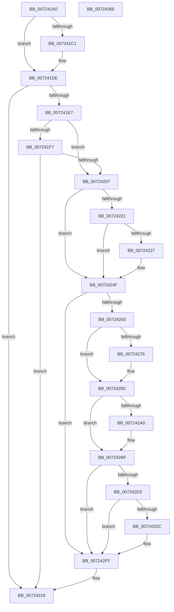

# IoAcquireKsrPersistentMemoryEx

- RVA: `0x007241A0`–`0x00724367` (길이 `455` bytes)
- VA: `0x00000001407241A0`
- 실행 섹션: `PAGE`
- PDB 이름 있음: `예`; PDB Function 태그: `아니요`
- unwind 정보 RVA: `0x0006F874`
- 디코드: `112`개 명령, `455/455` bytes 표시
- 미해석 바이트: `0` (있으면 어셈블리에 `.byte`로 보존)

> 이 문서는 커널 이미지의 기계어와 PDB 기호를 분석해 생성했습니다. 4번과 5번은 함수 원형과 자료형을 바이너리 사용 방식에서 추정한 C 해석이며 원본 소스 복구 결과는 아닙니다.

## 1. Dependencies

- 직접 호출 지점: **14**; 고유 호출 대상: **3**
- 직접 호출자로 확인된 함수: **1**
- RIP 상대 이미지 참조: **0**

### Outgoing calls
- `0x007241D8` → [KeBugCheckEx](../../text/4F/KeBugCheckEx_function_004FD660.md) (function, `0x004FD660`)
- `0x0072420E` → [IoAddTriageDumpDataBlock](../../text/42/IoAddTriageDumpDataBlock_function_00428374.md) (function, `0x00428374`)
- `0x00724225` → [IoAddTriageDumpDataBlock](../../text/42/IoAddTriageDumpDataBlock_function_00428374.md) (function, `0x00428374`)
- `0x00724239` → [IoAddTriageDumpDataBlock](../../text/42/IoAddTriageDumpDataBlock_function_00428374.md) (function, `0x00428374`)
- `0x0072424A` → [IoAddTriageDumpDataBlock](../../text/42/IoAddTriageDumpDataBlock_function_00428374.md) (function, `0x00428374`)
- `0x0072426C` → [IoAddTriageDumpDataBlock](../../text/42/IoAddTriageDumpDataBlock_function_00428374.md) (function, `0x00428374`)
- `0x0072427B` → [IoAddTriageDumpDataBlock](../../text/42/IoAddTriageDumpDataBlock_function_00428374.md) (function, `0x00428374`)
- `0x00724287` → [IoAddTriageDumpDataBlock](../../text/42/IoAddTriageDumpDataBlock_function_00428374.md) (function, `0x00428374`)
- `0x007242A2` → [IoAddTriageDumpDataBlock](../../text/42/IoAddTriageDumpDataBlock_function_00428374.md) (function, `0x00428374`)
- `0x007242BA` → [IoAddTriageDumpDataBlock](../../text/42/IoAddTriageDumpDataBlock_function_00428374.md) (function, `0x00428374`)
- `0x007242DE` → [IoAddTriageDumpDataBlock](../../text/42/IoAddTriageDumpDataBlock_function_00428374.md) (function, `0x00428374`)
- `0x007242FA` → [IoAddTriageDumpDataBlock](../../text/42/IoAddTriageDumpDataBlock_function_00428374.md) (function, `0x00428374`)
- `0x00724312` → [KeBugCheckEx](../../text/4F/KeBugCheckEx_function_004FD660.md) (function, `0x004FD660`)
- `0x0072434C` → [PipGetPersistentMemory](PipGetPersistentMemory_function_00725290.md) (function, `0x00725290`)

### Direct callers
- [IoAcquireKsrPersistentMemory](IoAcquireKsrPersistentMemory_function_00724170.md) at `0x0072418A`

### Static image references
- 디코드된 RIP-relative 메모리 참조가 없습니다.

## 2. Other-region calls and transfers

- 다른 실행 섹션으로 향하는 call: **13**
  - `0x007241D8` → [KeBugCheckEx](../../text/4F/KeBugCheckEx_function_004FD660.md) (`PAGE` → `.text`)
  - `0x0072420E` → [IoAddTriageDumpDataBlock](../../text/42/IoAddTriageDumpDataBlock_function_00428374.md) (`PAGE` → `.text`)
  - `0x00724225` → [IoAddTriageDumpDataBlock](../../text/42/IoAddTriageDumpDataBlock_function_00428374.md) (`PAGE` → `.text`)
  - `0x00724239` → [IoAddTriageDumpDataBlock](../../text/42/IoAddTriageDumpDataBlock_function_00428374.md) (`PAGE` → `.text`)
  - `0x0072424A` → [IoAddTriageDumpDataBlock](../../text/42/IoAddTriageDumpDataBlock_function_00428374.md) (`PAGE` → `.text`)
  - `0x0072426C` → [IoAddTriageDumpDataBlock](../../text/42/IoAddTriageDumpDataBlock_function_00428374.md) (`PAGE` → `.text`)
  - `0x0072427B` → [IoAddTriageDumpDataBlock](../../text/42/IoAddTriageDumpDataBlock_function_00428374.md) (`PAGE` → `.text`)
  - `0x00724287` → [IoAddTriageDumpDataBlock](../../text/42/IoAddTriageDumpDataBlock_function_00428374.md) (`PAGE` → `.text`)
  - `0x007242A2` → [IoAddTriageDumpDataBlock](../../text/42/IoAddTriageDumpDataBlock_function_00428374.md) (`PAGE` → `.text`)
  - `0x007242BA` → [IoAddTriageDumpDataBlock](../../text/42/IoAddTriageDumpDataBlock_function_00428374.md) (`PAGE` → `.text`)
  - `0x007242DE` → [IoAddTriageDumpDataBlock](../../text/42/IoAddTriageDumpDataBlock_function_00428374.md) (`PAGE` → `.text`)
  - `0x007242FA` → [IoAddTriageDumpDataBlock](../../text/42/IoAddTriageDumpDataBlock_function_00428374.md) (`PAGE` → `.text`)
  - `0x00724312` → [KeBugCheckEx](../../text/4F/KeBugCheckEx_function_004FD660.md) (`PAGE` → `.text`)
- 별도 외부 분기/꼬리 이동을 확인하지 못했습니다.

## 3. Assembly (complete function range)

```asm
007241A0  4C 8B DC                        mov r11, rsp
007241A3  49 89 5B 08                     mov qword ptr [r11 + 8], rbx
007241A7  49 89 6B 10                     mov qword ptr [r11 + 0x10], rbp
007241AB  49 89 73 18                     mov qword ptr [r11 + 0x18], rsi
007241AF  57                              push rdi
007241B0  48 83 EC 50                     sub rsp, 0x50
007241B4  48 8B DA                        mov rbx, rdx
007241B7  44 0F 20 C0                     mov rax, cr8
007241BB  33 F6                           xor esi, esi
007241BD  84 C0                           test al, al
007241BF  74 1D                           je 0x1407241de
007241C1  44 0F 20 C0                     mov rax, cr8
007241C5  44 0F B6 C0                     movzx r8d, al
007241C9  8D 56 01                        lea edx, [rsi + 1]
007241CC  45 33 C9                        xor r9d, r9d
007241CF  49 89 73 C8                     mov qword ptr [r11 - 0x38], rsi
007241D3  B9 21 01 00 00                  mov ecx, 0x121
007241D8  E8 83 94 DD FF                  call 0x1404fd660
007241DD  CC                              int3
007241DE  48 85 DB                        test rbx, rbx
007241E1  0F 84 31 01 00 00               je 0x140724318
007241E7  48 8B 82 38 01 00 00            mov rax, qword ptr [rdx + 0x138]
007241EE  48 8B 40 28                     mov rax, qword ptr [rax + 0x28]
007241F2  48 85 C0                        test rax, rax
007241F5  74 10                           je 0x140724207
007241F7  F7 80 8C 01 00 00 00 00 02 00   test dword ptr [rax + 0x18c], 0x20000
00724201  0F 84 11 01 00 00               je 0x140724318
00724207  0F B7 52 02                     movzx edx, word ptr [rdx + 2]
0072420B  48 8B CB                        mov rcx, rbx
0072420E  E8 61 41 D0 FF                  call 0x140428374
00724213  48 8B 4B 08                     mov rcx, qword ptr [rbx + 8]
00724217  BD 02 00 00 00                  mov ebp, 2
0072421C  48 85 C9                        test rcx, rcx
0072421F  74 2E                           je 0x14072424f
00724221  0F BF 51 02                     movsx edx, word ptr [rcx + 2]
00724225  E8 4A 41 D0 FF                  call 0x140428374
0072422A  48 8B 4B 08                     mov rcx, qword ptr [rbx + 8]
0072422E  48 83 C1 38                     add rcx, 0x38
00724232  66 39 31                        cmp word ptr [rcx], si
00724235  74 18                           je 0x14072424f
00724237  8B D5                           mov edx, ebp
00724239  E8 36 41 D0 FF                  call 0x140428374
0072423E  48 8B 4B 08                     mov rcx, qword ptr [rbx + 8]
00724242  0F B7 51 38                     movzx edx, word ptr [rcx + 0x38]
00724246  48 8B 49 40                     mov rcx, qword ptr [rcx + 0x40]
0072424A  E8 25 41 D0 FF                  call 0x140428374
0072424F  48 8B 83 38 01 00 00            mov rax, qword ptr [rbx + 0x138]
00724256  48 8B 48 28                     mov rcx, qword ptr [rax + 0x28]
0072425A  48 85 C9                        test rcx, rcx
0072425D  0F 84 9C 00 00 00               je 0x1407242ff
00724263  BA 88 03 00 00                  mov edx, 0x388
00724268  48 8D 79 28                     lea rdi, [rcx + 0x28]
0072426C  E8 03 41 D0 FF                  call 0x140428374
00724271  66 39 37                        cmp word ptr [rdi], si
00724274  74 16                           je 0x14072428c
00724276  8B D5                           mov edx, ebp
00724278  48 8B CF                        mov rcx, rdi
0072427B  E8 F4 40 D0 FF                  call 0x140428374
00724280  0F B7 17                        movzx edx, word ptr [rdi]
00724283  48 8B 4F 08                     mov rcx, qword ptr [rdi + 8]
00724287  E8 E8 40 D0 FF                  call 0x140428374
0072428C  48 8B 83 38 01 00 00            mov rax, qword ptr [rbx + 0x138]
00724293  48 8B 48 28                     mov rcx, qword ptr [rax + 0x28]
00724297  48 83 C1 38                     add rcx, 0x38
0072429B  66 39 31                        cmp word ptr [rcx], si
0072429E  74 1F                           je 0x1407242bf
007242A0  8B D5                           mov edx, ebp
007242A2  E8 CD 40 D0 FF                  call 0x140428374
007242A7  48 8B 83 38 01 00 00            mov rax, qword ptr [rbx + 0x138]
007242AE  48 8B 48 28                     mov rcx, qword ptr [rax + 0x28]
007242B2  0F B7 51 38                     movzx edx, word ptr [rcx + 0x38]
007242B6  48 8B 49 40                     mov rcx, qword ptr [rcx + 0x40]
007242BA  E8 B5 40 D0 FF                  call 0x140428374
007242BF  48 8B 83 38 01 00 00            mov rax, qword ptr [rbx + 0x138]
007242C6  48 8B 48 28                     mov rcx, qword ptr [rax + 0x28]
007242CA  48 8B 41 10                     mov rax, qword ptr [rcx + 0x10]
007242CE  48 85 C0                        test rax, rax
007242D1  74 2C                           je 0x1407242ff
007242D3  48 8D 48 38                     lea rcx, [rax + 0x38]
007242D7  66 39 31                        cmp word ptr [rcx], si
007242DA  74 23                           je 0x1407242ff
007242DC  8B D5                           mov edx, ebp
007242DE  E8 91 40 D0 FF                  call 0x140428374
007242E3  48 8B 83 38 01 00 00            mov rax, qword ptr [rbx + 0x138]
007242EA  48 8B 48 28                     mov rcx, qword ptr [rax + 0x28]
007242EE  48 8B 49 10                     mov rcx, qword ptr [rcx + 0x10]
007242F2  0F B7 51 38                     movzx edx, word ptr [rcx + 0x38]
007242F6  48 8B 49 40                     mov rcx, qword ptr [rcx + 0x40]
007242FA  E8 75 40 D0 FF                  call 0x140428374
007242FF  45 33 C9                        xor r9d, r9d
00724302  48 89 74 24 20                  mov qword ptr [rsp + 0x20], rsi
00724307  4C 8B C3                        mov r8, rbx
0072430A  48 8B D5                        mov rdx, rbp
0072430D  B9 CA 00 00 00                  mov ecx, 0xca
00724312  E8 49 93 DD FF                  call 0x1404fd660
00724317  CC                              int3
00724318  48 8B 84 24 88 00 00 00         mov rax, qword ptr [rsp + 0x88]
00724320  C7 44 24 40 01 00 00 00         mov dword ptr [rsp + 0x40], 1
00724328  48 89 74 24 38                  mov qword ptr [rsp + 0x38], rsi
0072432D  48 89 44 24 30                  mov qword ptr [rsp + 0x30], rax
00724332  48 8B 84 24 90 00 00 00         mov rax, qword ptr [rsp + 0x90]
0072433A  48 89 44 24 28                  mov qword ptr [rsp + 0x28], rax
0072433F  48 8B 84 24 80 00 00 00         mov rax, qword ptr [rsp + 0x80]
00724347  48 89 44 24 20                  mov qword ptr [rsp + 0x20], rax
0072434C  E8 3F 0F 00 00                  call 0x140725290
00724351  48 8B 5C 24 60                  mov rbx, qword ptr [rsp + 0x60]
00724356  48 8B 6C 24 68                  mov rbp, qword ptr [rsp + 0x68]
0072435B  48 8B 74 24 70                  mov rsi, qword ptr [rsp + 0x70]
00724360  48 83 C4 50                     add rsp, 0x50
00724364  5F                              pop rdi
00724365  C3                              ret
00724366  CC                              int3
```

## 4. C-style interpretation (structured pseudocode)

```c
__int64 __fastcall IoAcquireKsrPersistentMemoryEx(__int64 a1, __int64 a2, __int64 a3, int a4, __int64 a5, __int64 a6, __int64 a7)
{
    __int64 result;
    __int64 v_rsi;
    __int64 v_rsp;
    unsigned int v_stack_m18;
    unsigned __int64 v_stack_m20;
    unsigned __int64 v_stack_m28;
    unsigned __int64 v_stack_m30;
    unsigned __int64 v_stack_m38;
    unsigned __int64 v_stack_p10;
    unsigned __int64 v_stack_p18;
    unsigned __int64 v_stack_p8;

    *(unsigned __int64 *)(v_rsp + 8) = v_rbx;
    *(unsigned __int64 *)(v_rsp + 16) = v_rbp;
    *(unsigned __int64 *)(v_rsp + 24) = v_rsi;
    v_rsp = (v_rsp) - (80);
    v_rsi = 0;
    result = v_cr8;
    if ((unsigned __int8)(v_cr8) != 0) {
        result = v_cr8;
        a3 = (unsigned __int8)(result);
        a2 = v_rsi + 1;
        a4 = 0;
        *(unsigned __int64 *)(v_rsp - 56) = 0;
        a1 = 289;
        result = KeBugCheckEx(a1, a2, a3, a4);
    }
    if (a2 == 0) goto loc_00724318;
    if (*(unsigned __int64 *)(*(unsigned __int64 *)(a2 + 312) + 40) == 0) goto loc_00724207;
    if (((*(unsigned int *)(*(unsigned __int64 *)(*(unsigned __int64 *)(a2 + 312) + 40) + 396)) & (0x20000ULL)) == 0) goto loc_00724318;
loc_00724207:
    result = IoAddTriageDumpDataBlock(a2, *(unsigned __int16 *)(a2 + 2), a3, a4);
    if (*(unsigned __int64 *)(a2 + 8) == 0) goto loc_0072424F;
    result = IoAddTriageDumpDataBlock(*(unsigned __int64 *)(a2 + 8), (__int16)(*(unsigned __int16 *)(*(unsigned __int64 *)(a2 + 8) + 2)), a3, a4);
    a1 = (*(unsigned __int64 *)(a2 + 8)) + (56);
    if ((*(unsigned __int16 *)(a1)) != 0) {
        a2 = 2;
        result = IoAddTriageDumpDataBlock(a1, a2, a3, a4);
        a1 = *(unsigned __int64 *)(a2 + 8);
        a2 = *(unsigned __int16 *)(a1 + 56);
        a1 = *(unsigned __int64 *)(a1 + 64);
        result = IoAddTriageDumpDataBlock(a1, a2, a3, a4);
    }
    if (*(unsigned __int64 *)(*(unsigned __int64 *)(a2 + 312) + 40) == 0) goto loc_007242FF;
    result = IoAddTriageDumpDataBlock(*(unsigned __int64 *)(*(unsigned __int64 *)(a2 + 312) + 40), 904, a3, a4);
    if ((*(unsigned __int16 *)(*(unsigned __int64 *)(*(unsigned __int64 *)(a2 + 312) + 40) + 40)) != 0) {
        a2 = 2;
        a1 = *(unsigned __int64 *)(*(unsigned __int64 *)(a2 + 312) + 40) + 40;
        result = IoAddTriageDumpDataBlock(a1, a2, a3, a4);
        a2 = *(unsigned __int16 *)(*(unsigned __int64 *)(*(unsigned __int64 *)(a2 + 312) + 40) + 40);
        a1 = *(unsigned __int64 *)(*(unsigned __int64 *)(*(unsigned __int64 *)(a2 + 312) + 40) + 40 + 8);
        result = IoAddTriageDumpDataBlock(a1, a2, a3, a4);
    }
    a1 = (*(unsigned __int64 *)(*(unsigned __int64 *)(a2 + 312) + 40)) + (56);
    result = *(unsigned __int64 *)(a2 + 312);
    if ((*(unsigned __int16 *)(a1)) != 0) {
        a2 = 2;
        result = IoAddTriageDumpDataBlock(a1, a2, a3, a4);
        result = *(unsigned __int64 *)(a2 + 312);
        a1 = *(unsigned __int64 *)(result + 40);
        a2 = *(unsigned __int16 *)(a1 + 56);
        a1 = *(unsigned __int64 *)(a1 + 64);
        result = IoAddTriageDumpDataBlock(a1, a2, a3, a4);
    }
    if (*(unsigned __int64 *)(*(unsigned __int64 *)(*(unsigned __int64 *)(a2 + 312) + 40) + 16) == 0) goto loc_007242FF;
    result = *(unsigned __int64 *)(*(unsigned __int64 *)(*(unsigned __int64 *)(a2 + 312) + 40) + 16);
    if ((*(unsigned __int16 *)(*(unsigned __int64 *)(*(unsigned __int64 *)(*(unsigned __int64 *)(a2 + 312) + 40) + 16) + 56)) != 0) {
        a2 = 2;
        result = IoAddTriageDumpDataBlock(*(unsigned __int64 *)(*(unsigned __int64 *)(*(unsigned __int64 *)(a2 + 312) + 40) + 16) + 56, a2, a3, a4);
        result = *(unsigned __int64 *)(a2 + 312);
        a1 = *(unsigned __int64 *)(result + 40);
        a1 = *(unsigned __int64 *)(a1 + 16);
        a2 = *(unsigned __int16 *)(a1 + 56);
        a1 = *(unsigned __int64 *)(a1 + 64);
        result = IoAddTriageDumpDataBlock(a1, a2, a3, a4);
    }
    a4 = 0;
    v_stack_m38 = 0;
    result = KeBugCheckEx(202, 2, a2, a4);
loc_00724318:
    v_stack_m18 = 1;
    v_stack_m20 = 0;
    v_stack_m28 = a6;
    v_stack_m30 = a7;
    v_stack_m38 = a5;
    result = PipGetPersistentMemory(202, 2, a2, a4);
    v_rsp = (v_rsp) + (80);
    return result;
}
```

## 5. (Beta) C Style

```c
int64_t IoAcquireKsrPersistentMemoryEx(int64_t Arg1, int64_t Arg2, int64_t Arg3, int32_t Arg4, int64_t Arg5, int64_t Arg6, int64_t Arg7)
{
    int64_t result;
    int64_t local_rsi;
    int64_t local_rsp;
    uint32_t v_stack_m18;
    uint64_t v_stack_m20;
    uint64_t v_stack_m28;
    uint64_t v_stack_m30;
    uint64_t v_stack_m38;
    uint64_t v_stack_p10;
    uint64_t v_stack_p18;
    uint64_t v_stack_p8;

    *(uint64_t *)(local_rsp + 0x8) = local_rbx;
    *(uint64_t *)(local_rsp + 0x10) = local_rbp;
    *(uint64_t *)(local_rsp + 0x18) = local_rsi;
    local_rsp = (local_rsp) - (80);
    local_rsi = 0;
    result = v_cr8;
    if ((uint8_t)(v_cr8) != 0) {
        result = v_cr8;
        Arg3 = (uint8_t)(result);
        Arg2 = local_rsi + 1;
        Arg4 = 0;
        *(uint64_t *)(local_rsp - 0x38) = 0;
        Arg1 = 289;
        result = KeBugCheckEx(Arg1, Arg2, Arg3, Arg4);
    }
    if (Arg2 == 0) goto loc_00724318;
    if (*(uint64_t *)(*(uint64_t *)(Arg2 + 0x138) + 0x28) == 0) goto loc_00724207;
    if (((*(uint32_t *)(*(uint64_t *)(*(uint64_t *)(Arg2 + 0x138) + 0x28) + 0x18C)) & (0x20000ULL)) == 0) goto loc_00724318;
loc_00724207:
    result = IoAddTriageDumpDataBlock(Arg2, *(uint16_t *)(Arg2 + 0x2), Arg3, Arg4);
    if (*(uint64_t *)(Arg2 + 0x8) == 0) goto loc_0072424F;
    result = IoAddTriageDumpDataBlock(*(uint64_t *)(Arg2 + 0x8), (int16_t)(*(uint16_t *)(*(uint64_t *)(Arg2 + 0x8) + 0x2)), Arg3, Arg4);
    Arg1 = (*(uint64_t *)(Arg2 + 0x8)) + (56);
    if ((*(uint16_t *)(Arg1)) != 0) {
        Arg2 = 2;
        result = IoAddTriageDumpDataBlock(Arg1, Arg2, Arg3, Arg4);
        Arg1 = *(uint64_t *)(Arg2 + 0x8);
        Arg2 = *(uint16_t *)(Arg1 + 0x38);
        Arg1 = *(uint64_t *)(Arg1 + 0x40);
        result = IoAddTriageDumpDataBlock(Arg1, Arg2, Arg3, Arg4);
    }
    if (*(uint64_t *)(*(uint64_t *)(Arg2 + 0x138) + 0x28) == 0) goto loc_007242FF;
    result = IoAddTriageDumpDataBlock(*(uint64_t *)(*(uint64_t *)(Arg2 + 0x138) + 0x28), 904, Arg3, Arg4);
    if ((*(uint16_t *)(*(uint64_t *)(*(uint64_t *)(Arg2 + 0x138) + 0x28) + 0x28)) != 0) {
        Arg2 = 2;
        Arg1 = *(uint64_t *)(*(uint64_t *)(Arg2 + 0x138) + 0x28) + 40;
        result = IoAddTriageDumpDataBlock(Arg1, Arg2, Arg3, Arg4);
        Arg2 = *(uint16_t *)(*(uint64_t *)(*(uint64_t *)(Arg2 + 0x138) + 0x28) + 0x28);
        Arg1 = *(uint64_t *)(*(uint64_t *)(*(uint64_t *)(Arg2 + 0x138) + 0x28) + 0x28 + 0x8);
        result = IoAddTriageDumpDataBlock(Arg1, Arg2, Arg3, Arg4);
    }
    Arg1 = (*(uint64_t *)(*(uint64_t *)(Arg2 + 0x138) + 0x28)) + (56);
    result = *(uint64_t *)(Arg2 + 0x138);
    if ((*(uint16_t *)(Arg1)) != 0) {
        Arg2 = 2;
        result = IoAddTriageDumpDataBlock(Arg1, Arg2, Arg3, Arg4);
        result = *(uint64_t *)(Arg2 + 0x138);
        Arg1 = *(uint64_t *)(result + 0x28);
        Arg2 = *(uint16_t *)(Arg1 + 0x38);
        Arg1 = *(uint64_t *)(Arg1 + 0x40);
        result = IoAddTriageDumpDataBlock(Arg1, Arg2, Arg3, Arg4);
    }
    if (*(uint64_t *)(*(uint64_t *)(*(uint64_t *)(Arg2 + 0x138) + 0x28) + 0x10) == 0) goto loc_007242FF;
    result = *(uint64_t *)(*(uint64_t *)(*(uint64_t *)(Arg2 + 0x138) + 0x28) + 0x10);
    if ((*(uint16_t *)(*(uint64_t *)(*(uint64_t *)(*(uint64_t *)(Arg2 + 0x138) + 0x28) + 0x10) + 0x38)) != 0) {
        Arg2 = 2;
        result = IoAddTriageDumpDataBlock(*(uint64_t *)(*(uint64_t *)(*(uint64_t *)(Arg2 + 0x138) + 0x28) + 0x10) + 56, Arg2, Arg3, Arg4);
        result = *(uint64_t *)(Arg2 + 0x138);
        Arg1 = *(uint64_t *)(result + 0x28);
        Arg1 = *(uint64_t *)(Arg1 + 0x10);
        Arg2 = *(uint16_t *)(Arg1 + 0x38);
        Arg1 = *(uint64_t *)(Arg1 + 0x40);
        result = IoAddTriageDumpDataBlock(Arg1, Arg2, Arg3, Arg4);
    }
    Arg4 = 0;
    v_stack_m38 = 0;
    result = KeBugCheckEx(202, 2, Arg2, Arg4);
loc_00724318:
    v_stack_m18 = 1;
    v_stack_m20 = 0;
    v_stack_m28 = Arg6;
    v_stack_m30 = Arg7;
    v_stack_m38 = Arg5;
    result = PipGetPersistentMemory(202, 2, Arg2, Arg4);
    local_rsp = (local_rsp) + (80);
    return result;
}
```

## 6. Execution-region graph

[열기: 2D/3D 그래프와 함수 탐색 컨트롤 패널](../../../control-panel.html?section=page&rva=0x007241A0&view=graph)

- 2D 그래프는 위에서 아래로 흐르고, 3D 그래프는 빈 공간을 드래그해 회전합니다. Shift+드래그는 이동, 휠은 확대·축소, 함수 노드 선택은 대상 보고서 이동입니다.

### Static fallback


