# IoAssignResources

- RVA: `0x00725AD0`–`0x00725CC3` (길이 `499` bytes)
- VA: `0x0000000140725AD0`
- 실행 섹션: `PAGE`
- PDB 이름 있음: `예`; PDB Function 태그: `아니요`
- unwind 정보 RVA: `0x000C82A0`
- 디코드: `122`개 명령, `499/499` bytes 표시
- 미해석 바이트: `0` (있으면 어셈블리에 `.byte`로 보존)

> 이 문서는 커널 이미지의 기계어와 PDB 기호를 분석해 생성했습니다. 4번과 5번은 함수 원형과 자료형을 바이너리 사용 방식에서 추정한 C 해석이며 원본 소스 복구 결과는 아닙니다.

## 1. Dependencies

- 직접 호출 지점: **16**; 고유 호출 대상: **3**
- 직접 호출자로 확인된 함수: **0**
- RIP 상대 이미지 참조: **0**

### Outgoing calls
- `0x00725B28` → [IoAddTriageDumpDataBlock](../../text/42/IoAddTriageDumpDataBlock_function_00428374.md) (function, `0x00428374`)
- `0x00725B3F` → [IoAddTriageDumpDataBlock](../../text/42/IoAddTriageDumpDataBlock_function_00428374.md) (function, `0x00428374`)
- `0x00725B4C` → [IoAddTriageDumpDataBlock](../../text/42/IoAddTriageDumpDataBlock_function_00428374.md) (function, `0x00428374`)
- `0x00725B58` → [IoAddTriageDumpDataBlock](../../text/42/IoAddTriageDumpDataBlock_function_00428374.md) (function, `0x00428374`)
- `0x00725B6A` → [IoAddTriageDumpDataBlock](../../text/42/IoAddTriageDumpDataBlock_function_00428374.md) (function, `0x00428374`)
- `0x00725B82` → [IoAddTriageDumpDataBlock](../../text/42/IoAddTriageDumpDataBlock_function_00428374.md) (function, `0x00428374`)
- `0x00725B93` → [IoAddTriageDumpDataBlock](../../text/42/IoAddTriageDumpDataBlock_function_00428374.md) (function, `0x00428374`)
- `0x00725BB5` → [IoAddTriageDumpDataBlock](../../text/42/IoAddTriageDumpDataBlock_function_00428374.md) (function, `0x00428374`)
- `0x00725BC9` → [IoAddTriageDumpDataBlock](../../text/42/IoAddTriageDumpDataBlock_function_00428374.md) (function, `0x00428374`)
- `0x00725BD6` → [IoAddTriageDumpDataBlock](../../text/42/IoAddTriageDumpDataBlock_function_00428374.md) (function, `0x00428374`)
- `0x00725BF5` → [IoAddTriageDumpDataBlock](../../text/42/IoAddTriageDumpDataBlock_function_00428374.md) (function, `0x00428374`)
- `0x00725C0D` → [IoAddTriageDumpDataBlock](../../text/42/IoAddTriageDumpDataBlock_function_00428374.md) (function, `0x00428374`)
- `0x00725C35` → [IoAddTriageDumpDataBlock](../../text/42/IoAddTriageDumpDataBlock_function_00428374.md) (function, `0x00428374`)
- `0x00725C51` → [IoAddTriageDumpDataBlock](../../text/42/IoAddTriageDumpDataBlock_function_00428374.md) (function, `0x00428374`)
- `0x00725C6B` → [KeBugCheckEx](../../text/4F/KeBugCheckEx_function_004FD660.md) (function, `0x004FD660`)
- `0x00725CA7` → [IopLegacyResourceAllocation](../A0/IopLegacyResourceAllocation_function_00A07224.md) (function, `0x00A07224`)

### Direct callers
- 이 함수 시작 RVA로 연결되는 직접 call은 확인되지 않았습니다. 간접 호출은 완전히 역산할 수 없습니다.

### Static image references
- 디코드된 RIP-relative 메모리 참조가 없습니다.

## 2. Other-region calls and transfers

- 다른 실행 섹션으로 향하는 call: **15**
  - `0x00725B28` → [IoAddTriageDumpDataBlock](../../text/42/IoAddTriageDumpDataBlock_function_00428374.md) (`PAGE` → `.text`)
  - `0x00725B3F` → [IoAddTriageDumpDataBlock](../../text/42/IoAddTriageDumpDataBlock_function_00428374.md) (`PAGE` → `.text`)
  - `0x00725B4C` → [IoAddTriageDumpDataBlock](../../text/42/IoAddTriageDumpDataBlock_function_00428374.md) (`PAGE` → `.text`)
  - `0x00725B58` → [IoAddTriageDumpDataBlock](../../text/42/IoAddTriageDumpDataBlock_function_00428374.md) (`PAGE` → `.text`)
  - `0x00725B6A` → [IoAddTriageDumpDataBlock](../../text/42/IoAddTriageDumpDataBlock_function_00428374.md) (`PAGE` → `.text`)
  - `0x00725B82` → [IoAddTriageDumpDataBlock](../../text/42/IoAddTriageDumpDataBlock_function_00428374.md) (`PAGE` → `.text`)
  - `0x00725B93` → [IoAddTriageDumpDataBlock](../../text/42/IoAddTriageDumpDataBlock_function_00428374.md) (`PAGE` → `.text`)
  - `0x00725BB5` → [IoAddTriageDumpDataBlock](../../text/42/IoAddTriageDumpDataBlock_function_00428374.md) (`PAGE` → `.text`)
  - `0x00725BC9` → [IoAddTriageDumpDataBlock](../../text/42/IoAddTriageDumpDataBlock_function_00428374.md) (`PAGE` → `.text`)
  - `0x00725BD6` → [IoAddTriageDumpDataBlock](../../text/42/IoAddTriageDumpDataBlock_function_00428374.md) (`PAGE` → `.text`)
  - `0x00725BF5` → [IoAddTriageDumpDataBlock](../../text/42/IoAddTriageDumpDataBlock_function_00428374.md) (`PAGE` → `.text`)
  - `0x00725C0D` → [IoAddTriageDumpDataBlock](../../text/42/IoAddTriageDumpDataBlock_function_00428374.md) (`PAGE` → `.text`)
  - `0x00725C35` → [IoAddTriageDumpDataBlock](../../text/42/IoAddTriageDumpDataBlock_function_00428374.md) (`PAGE` → `.text`)
  - `0x00725C51` → [IoAddTriageDumpDataBlock](../../text/42/IoAddTriageDumpDataBlock_function_00428374.md) (`PAGE` → `.text`)
  - `0x00725C6B` → [KeBugCheckEx](../../text/4F/KeBugCheckEx_function_004FD660.md) (`PAGE` → `.text`)
- 별도 외부 분기/꼬리 이동을 확인하지 못했습니다.

## 3. Assembly (complete function range)

```asm
00725AD0  48 89 5C 24 08                  mov qword ptr [rsp + 8], rbx
00725AD5  48 89 6C 24 10                  mov qword ptr [rsp + 0x10], rbp
00725ADA  48 89 74 24 18                  mov qword ptr [rsp + 0x18], rsi
00725ADF  41 56                           push r14
00725AE1  48 83 EC 30                     sub rsp, 0x30
00725AE5  45 33 F6                        xor r14d, r14d
00725AE8  49 8B D9                        mov rbx, r9
00725AEB  49 8B F0                        mov rsi, r8
00725AEE  4D 85 C9                        test r9, r9
00725AF1  0F 84 7A 01 00 00               je 0x140725c71
00725AF7  49 8B 81 38 01 00 00            mov rax, qword ptr [r9 + 0x138]
00725AFE  48 8B 40 28                     mov rax, qword ptr [rax + 0x28]
00725B02  48 85 C0                        test rax, rax
00725B05  0F 84 66 01 00 00               je 0x140725c71
00725B0B  F7 80 8C 01 00 00 00 00 02 00   test dword ptr [rax + 0x18c], 0x20000
00725B15  0F 85 56 01 00 00               jne 0x140725c71
00725B1B  4D 85 C0                        test r8, r8
00725B1E  74 31                           je 0x140725b51
00725B20  41 0F BF 50 02                  movsx edx, word ptr [r8 + 2]
00725B25  49 8B C8                        mov rcx, r8
00725B28  E8 47 28 D0 FF                  call 0x140428374
00725B2D  48 8D 6E 38                     lea rbp, [rsi + 0x38]
00725B31  66 44 39 75 00                  cmp word ptr [rbp], r14w
00725B36  74 19                           je 0x140725b51
00725B38  41 8D 56 02                     lea edx, [r14 + 2]
00725B3C  48 8B CD                        mov rcx, rbp
00725B3F  E8 30 28 D0 FF                  call 0x140428374
00725B44  0F B7 55 00                     movzx edx, word ptr [rbp]
00725B48  48 8B 4E 40                     mov rcx, qword ptr [rsi + 0x40]
00725B4C  E8 23 28 D0 FF                  call 0x140428374
00725B51  0F B7 53 02                     movzx edx, word ptr [rbx + 2]
00725B55  48 8B CB                        mov rcx, rbx
00725B58  E8 17 28 D0 FF                  call 0x140428374
00725B5D  48 8B 4B 08                     mov rcx, qword ptr [rbx + 8]
00725B61  48 85 C9                        test rcx, rcx
00725B64  74 32                           je 0x140725b98
00725B66  0F BF 51 02                     movsx edx, word ptr [rcx + 2]
00725B6A  E8 05 28 D0 FF                  call 0x140428374
00725B6F  48 8B 4B 08                     mov rcx, qword ptr [rbx + 8]
00725B73  48 83 C1 38                     add rcx, 0x38
00725B77  66 44 39 31                     cmp word ptr [rcx], r14w
00725B7B  74 1B                           je 0x140725b98
00725B7D  BA 02 00 00 00                  mov edx, 2
00725B82  E8 ED 27 D0 FF                  call 0x140428374
00725B87  48 8B 4B 08                     mov rcx, qword ptr [rbx + 8]
00725B8B  0F B7 51 38                     movzx edx, word ptr [rcx + 0x38]
00725B8F  48 8B 49 40                     mov rcx, qword ptr [rcx + 0x40]
00725B93  E8 DC 27 D0 FF                  call 0x140428374
00725B98  48 8B 83 38 01 00 00            mov rax, qword ptr [rbx + 0x138]
00725B9F  48 8B 48 28                     mov rcx, qword ptr [rax + 0x28]
00725BA3  48 85 C9                        test rcx, rcx
00725BA6  0F 84 AA 00 00 00               je 0x140725c56
00725BAC  BA 88 03 00 00                  mov edx, 0x388
00725BB1  48 8D 69 28                     lea rbp, [rcx + 0x28]
00725BB5  E8 BA 27 D0 FF                  call 0x140428374
00725BBA  66 44 39 75 00                  cmp word ptr [rbp], r14w
00725BBF  74 1A                           je 0x140725bdb
00725BC1  BA 02 00 00 00                  mov edx, 2
00725BC6  48 8B CD                        mov rcx, rbp
00725BC9  E8 A6 27 D0 FF                  call 0x140428374
00725BCE  0F B7 55 00                     movzx edx, word ptr [rbp]
00725BD2  48 8B 4D 08                     mov rcx, qword ptr [rbp + 8]
00725BD6  E8 99 27 D0 FF                  call 0x140428374
00725BDB  48 8B 83 38 01 00 00            mov rax, qword ptr [rbx + 0x138]
00725BE2  48 8B 48 28                     mov rcx, qword ptr [rax + 0x28]
00725BE6  48 83 C1 38                     add rcx, 0x38
00725BEA  66 44 39 31                     cmp word ptr [rcx], r14w
00725BEE  74 22                           je 0x140725c12
00725BF0  BA 02 00 00 00                  mov edx, 2
00725BF5  E8 7A 27 D0 FF                  call 0x140428374
00725BFA  48 8B 83 38 01 00 00            mov rax, qword ptr [rbx + 0x138]
00725C01  48 8B 48 28                     mov rcx, qword ptr [rax + 0x28]
00725C05  0F B7 51 38                     movzx edx, word ptr [rcx + 0x38]
00725C09  48 8B 49 40                     mov rcx, qword ptr [rcx + 0x40]
00725C0D  E8 62 27 D0 FF                  call 0x140428374
00725C12  48 8B 83 38 01 00 00            mov rax, qword ptr [rbx + 0x138]
00725C19  48 8B 48 28                     mov rcx, qword ptr [rax + 0x28]
00725C1D  48 8B 41 10                     mov rax, qword ptr [rcx + 0x10]
00725C21  48 85 C0                        test rax, rax
00725C24  74 30                           je 0x140725c56
00725C26  48 8D 48 38                     lea rcx, [rax + 0x38]
00725C2A  66 44 39 31                     cmp word ptr [rcx], r14w
00725C2E  74 26                           je 0x140725c56
00725C30  BA 02 00 00 00                  mov edx, 2
00725C35  E8 3A 27 D0 FF                  call 0x140428374
00725C3A  48 8B 83 38 01 00 00            mov rax, qword ptr [rbx + 0x138]
00725C41  48 8B 48 28                     mov rcx, qword ptr [rax + 0x28]
00725C45  48 8B 49 10                     mov rcx, qword ptr [rcx + 0x10]
00725C49  0F B7 51 38                     movzx edx, word ptr [rcx + 0x38]
00725C4D  48 8B 49 40                     mov rcx, qword ptr [rcx + 0x40]
00725C51  E8 1E 27 D0 FF                  call 0x140428374
00725C56  4C 8B CE                        mov r9, rsi
00725C59  4C 89 74 24 20                  mov qword ptr [rsp + 0x20], r14
00725C5E  4C 8B C3                        mov r8, rbx
00725C61  BA 02 00 00 00                  mov edx, 2
00725C66  B9 CA 00 00 00                  mov ecx, 0xca
00725C6B  E8 F0 79 DD FF                  call 0x1404fd660
00725C70  CC                              int3
00725C71  4C 8B 4C 24 60                  mov r9, qword ptr [rsp + 0x60]
00725C76  4D 85 C9                        test r9, r9
00725C79  74 0F                           je 0x140725c8a
00725C7B  45 39 71 1C                     cmp dword ptr [r9 + 0x1c], r14d
00725C7F  74 06                           je 0x140725c87
00725C81  45 39 71 24                     cmp dword ptr [r9 + 0x24], r14d
00725C85  75 03                           jne 0x140725c8a
00725C87  4D 8B CE                        mov r9, r14
00725C8A  48 8B 44 24 68                  mov rax, qword ptr [rsp + 0x68]
00725C8F  48 85 C0                        test rax, rax
00725C92  74 03                           je 0x140725c97
00725C94  4C 89 30                        mov qword ptr [rax], r14
00725C97  4C 8B C3                        mov r8, rbx
00725C9A  48 89 44 24 20                  mov qword ptr [rsp + 0x20], rax
00725C9F  48 8B D6                        mov rdx, rsi
00725CA2  B9 02 00 00 00                  mov ecx, 2
00725CA7  E8 78 15 2E 00                  call 0x140a07224
00725CAC  48 8B 5C 24 40                  mov rbx, qword ptr [rsp + 0x40]
00725CB1  48 8B 6C 24 48                  mov rbp, qword ptr [rsp + 0x48]
00725CB6  48 8B 74 24 50                  mov rsi, qword ptr [rsp + 0x50]
00725CBB  48 83 C4 30                     add rsp, 0x30
00725CBF  41 5E                           pop r14
00725CC1  C3                              ret
00725CC2  CC                              int3
```

## 4. C-style interpretation (structured pseudocode)

```c
__int64 __fastcall IoAssignResources(__int64 a1, __int64 a2, __int64 a3, __int64 a4, __int64 a5, __int64 a6)
{
    __int64 result;
    __int64 v_r14;
    __int64 v_rsp;
    unsigned __int64 v_stack_m18;
    unsigned __int64 v_stack_p10;
    unsigned __int64 v_stack_p18;
    unsigned __int64 v_stack_p8;

    v_stack_p8 = v_rbx;
    v_stack_p10 = v_rbp;
    v_stack_p18 = v_rsi;
    v_rsp = (v_rsp) - (48);
    v_r14 = 0;
    if (a4 == 0) goto loc_00725C71;
    if (*(unsigned __int64 *)(*(unsigned __int64 *)(a4 + 312) + 40) == 0) goto loc_00725C71;
    if (((*(unsigned int *)(*(unsigned __int64 *)(*(unsigned __int64 *)(a4 + 312) + 40) + 396)) & (0x20000ULL)) != 0) goto loc_00725C71;
    if (a3 == 0) goto loc_00725B51;
    result = IoAddTriageDumpDataBlock(a3, (__int16)(*(unsigned __int16 *)(a3 + 2)), a3, a4);
    if ((*(unsigned __int16 *)(a3 + 56)) != 0) {
        a2 = v_r14 + 2;
        a1 = a3 + 56;
        result = IoAddTriageDumpDataBlock(a1, a2, a3, a4);
        a2 = *(unsigned __int16 *)(a3 + 56);
        a1 = *(unsigned __int64 *)(a3 + 64);
        result = IoAddTriageDumpDataBlock(a1, a2, a3, a4);
    }
    result = IoAddTriageDumpDataBlock(a4, *(unsigned __int16 *)(a4 + 2), a3, a4);
    if (*(unsigned __int64 *)(a4 + 8) == 0) goto loc_00725B98;
    result = IoAddTriageDumpDataBlock(*(unsigned __int64 *)(a4 + 8), (__int16)(*(unsigned __int16 *)(*(unsigned __int64 *)(a4 + 8) + 2)), a3, a4);
    a1 = (*(unsigned __int64 *)(a4 + 8)) + (56);
    if ((*(unsigned __int16 *)(a1)) != 0) {
        a2 = 2;
        result = IoAddTriageDumpDataBlock(a1, a2, a3, a4);
        a1 = *(unsigned __int64 *)(a4 + 8);
        a2 = *(unsigned __int16 *)(a1 + 56);
        a1 = *(unsigned __int64 *)(a1 + 64);
        result = IoAddTriageDumpDataBlock(a1, a2, a3, a4);
    }
    if (*(unsigned __int64 *)(*(unsigned __int64 *)(a4 + 312) + 40) == 0) goto loc_00725C56;
    result = IoAddTriageDumpDataBlock(*(unsigned __int64 *)(*(unsigned __int64 *)(a4 + 312) + 40), 904, a3, a4);
    if ((*(unsigned __int16 *)(*(unsigned __int64 *)(*(unsigned __int64 *)(a4 + 312) + 40) + 40)) != 0) {
        a2 = 2;
        a1 = *(unsigned __int64 *)(*(unsigned __int64 *)(a4 + 312) + 40) + 40;
        result = IoAddTriageDumpDataBlock(a1, a2, a3, a4);
        a2 = *(unsigned __int16 *)(*(unsigned __int64 *)(*(unsigned __int64 *)(a4 + 312) + 40) + 40);
        a1 = *(unsigned __int64 *)(*(unsigned __int64 *)(*(unsigned __int64 *)(a4 + 312) + 40) + 40 + 8);
        result = IoAddTriageDumpDataBlock(a1, a2, a3, a4);
    }
    a1 = (*(unsigned __int64 *)(*(unsigned __int64 *)(a4 + 312) + 40)) + (56);
    result = *(unsigned __int64 *)(a4 + 312);
    if ((*(unsigned __int16 *)(a1)) != 0) {
        a2 = 2;
        result = IoAddTriageDumpDataBlock(a1, a2, a3, a4);
        result = *(unsigned __int64 *)(a4 + 312);
        a1 = *(unsigned __int64 *)(result + 40);
        a2 = *(unsigned __int16 *)(a1 + 56);
        a1 = *(unsigned __int64 *)(a1 + 64);
        result = IoAddTriageDumpDataBlock(a1, a2, a3, a4);
    }
    if (*(unsigned __int64 *)(*(unsigned __int64 *)(*(unsigned __int64 *)(a4 + 312) + 40) + 16) == 0) goto loc_00725C56;
    result = *(unsigned __int64 *)(*(unsigned __int64 *)(*(unsigned __int64 *)(a4 + 312) + 40) + 16);
    if ((*(unsigned __int16 *)(*(unsigned __int64 *)(*(unsigned __int64 *)(*(unsigned __int64 *)(a4 + 312) + 40) + 16) + 56)) != 0) {
        a2 = 2;
        result = IoAddTriageDumpDataBlock(*(unsigned __int64 *)(*(unsigned __int64 *)(*(unsigned __int64 *)(a4 + 312) + 40) + 16) + 56, a2, a3, a4);
        result = *(unsigned __int64 *)(a4 + 312);
        a1 = *(unsigned __int64 *)(result + 40);
        a1 = *(unsigned __int64 *)(a1 + 16);
        a2 = *(unsigned __int16 *)(a1 + 56);
        a1 = *(unsigned __int64 *)(a1 + 64);
        result = IoAddTriageDumpDataBlock(a1, a2, a3, a4);
    }
    v_stack_m18 = 0;
    result = KeBugCheckEx(202, 2, a4, a3);
loc_00725C71:
    if (a5 == 0) goto loc_00725C8A;
    if ((*(unsigned int *)(a5 + 28)) == 0) goto loc_00725C87;
    if ((*(unsigned int *)(a5 + 36)) == 0) {
        a4 = 0;
    }
    if (a6 != 0) {
        *(unsigned __int64 *)(a6) = 0;
    }
    v_stack_m18 = a6;
    result = IopLegacyResourceAllocation(2, a3, a4, a4);
    v_rsp = (v_rsp) + (48);
    return result;
}
```

## 5. (Beta) C Style

```c
int64_t IoAssignResources(int64_t Arg1, int64_t Arg2, void *Arg3, void *Arg4, int64_t Arg5, int64_t Arg6)
{
    uint8_t *arg3 = (uint8_t *)Arg3;
    uint8_t *arg4 = (uint8_t *)Arg4;

    int64_t result;
    int64_t local_r14;
    int64_t local_rsp;
    uint64_t v_stack_m18;
    uint64_t v_stack_p10;
    uint64_t v_stack_p18;
    uint64_t v_stack_p8;

    v_stack_p8 = local_rbx;
    v_stack_p10 = local_rbp;
    v_stack_p18 = local_rsi;
    local_rsp = (local_rsp) - (48);
    local_r14 = 0;
    if (Arg4 == NULL) goto loc_00725C71;
    if (*(uint64_t *)(*(uint64_t *)(arg4 + 0x138) + 0x28) == 0) goto loc_00725C71;
    if (((*(uint32_t *)(*(uint64_t *)(*(uint64_t *)(arg4 + 0x138) + 0x28) + 0x18C)) & (0x20000ULL)) != 0) goto loc_00725C71;
    if (Arg3 == NULL) goto loc_00725B51;
    result = IoAddTriageDumpDataBlock(Arg3, (int16_t)(*(uint16_t *)(arg3 + 0x2)), Arg3, Arg4);
    if ((*(uint16_t *)(arg3 + 0x38)) != 0) {
        Arg2 = local_r14 + 2;
        Arg1 = Arg3 + 56;
        result = IoAddTriageDumpDataBlock(Arg1, Arg2, Arg3, Arg4);
        Arg2 = *(uint16_t *)(arg3 + 0x38);
        Arg1 = *(uint64_t *)(arg3 + 0x40);
        result = IoAddTriageDumpDataBlock(Arg1, Arg2, Arg3, Arg4);
    }
    result = IoAddTriageDumpDataBlock(Arg4, *(uint16_t *)(arg4 + 0x2), Arg3, Arg4);
    if (*(uint64_t *)(arg4 + 0x8) == 0) goto loc_00725B98;
    result = IoAddTriageDumpDataBlock(*(uint64_t *)(arg4 + 0x8), (int16_t)(*(uint16_t *)(*(uint64_t *)(arg4 + 0x8) + 0x2)), Arg3, Arg4);
    Arg1 = (*(uint64_t *)(arg4 + 0x8)) + (56);
    if ((*(uint16_t *)(Arg1)) != 0) {
        Arg2 = 2;
        result = IoAddTriageDumpDataBlock(Arg1, Arg2, Arg3, Arg4);
        Arg1 = *(uint64_t *)(arg4 + 0x8);
        Arg2 = *(uint16_t *)(Arg1 + 0x38);
        Arg1 = *(uint64_t *)(Arg1 + 0x40);
        result = IoAddTriageDumpDataBlock(Arg1, Arg2, Arg3, Arg4);
    }
    if (*(uint64_t *)(*(uint64_t *)(arg4 + 0x138) + 0x28) == 0) goto loc_00725C56;
    result = IoAddTriageDumpDataBlock(*(uint64_t *)(*(uint64_t *)(arg4 + 0x138) + 0x28), 904, Arg3, Arg4);
    if ((*(uint16_t *)(*(uint64_t *)(*(uint64_t *)(arg4 + 0x138) + 0x28) + 0x28)) != 0) {
        Arg2 = 2;
        Arg1 = *(uint64_t *)(*(uint64_t *)(arg4 + 0x138) + 0x28) + 40;
        result = IoAddTriageDumpDataBlock(Arg1, Arg2, Arg3, Arg4);
        Arg2 = *(uint16_t *)(*(uint64_t *)(*(uint64_t *)(arg4 + 0x138) + 0x28) + 0x28);
        Arg1 = *(uint64_t *)(*(uint64_t *)(*(uint64_t *)(arg4 + 0x138) + 0x28) + 0x28 + 0x8);
        result = IoAddTriageDumpDataBlock(Arg1, Arg2, Arg3, Arg4);
    }
    Arg1 = (*(uint64_t *)(*(uint64_t *)(arg4 + 0x138) + 0x28)) + (56);
    result = *(uint64_t *)(arg4 + 0x138);
    if ((*(uint16_t *)(Arg1)) != 0) {
        Arg2 = 2;
        result = IoAddTriageDumpDataBlock(Arg1, Arg2, Arg3, Arg4);
        result = *(uint64_t *)(arg4 + 0x138);
        Arg1 = *(uint64_t *)(result + 0x28);
        Arg2 = *(uint16_t *)(Arg1 + 0x38);
        Arg1 = *(uint64_t *)(Arg1 + 0x40);
        result = IoAddTriageDumpDataBlock(Arg1, Arg2, Arg3, Arg4);
    }
    if (*(uint64_t *)(*(uint64_t *)(*(uint64_t *)(arg4 + 0x138) + 0x28) + 0x10) == 0) goto loc_00725C56;
    result = *(uint64_t *)(*(uint64_t *)(*(uint64_t *)(arg4 + 0x138) + 0x28) + 0x10);
    if ((*(uint16_t *)(*(uint64_t *)(*(uint64_t *)(*(uint64_t *)(arg4 + 0x138) + 0x28) + 0x10) + 0x38)) != 0) {
        Arg2 = 2;
        result = IoAddTriageDumpDataBlock(*(uint64_t *)(*(uint64_t *)(*(uint64_t *)(arg4 + 0x138) + 0x28) + 0x10) + 56, Arg2, Arg3, Arg4);
        result = *(uint64_t *)(arg4 + 0x138);
        Arg1 = *(uint64_t *)(result + 0x28);
        Arg1 = *(uint64_t *)(Arg1 + 0x10);
        Arg2 = *(uint16_t *)(Arg1 + 0x38);
        Arg1 = *(uint64_t *)(Arg1 + 0x40);
        result = IoAddTriageDumpDataBlock(Arg1, Arg2, Arg3, Arg4);
    }
    v_stack_m18 = 0;
    result = KeBugCheckEx(202, 2, Arg4, Arg3);
loc_00725C71:
    if (Arg5 == 0) goto loc_00725C8A;
    if ((*(uint32_t *)(Arg5 + 0x1C)) == 0) goto loc_00725C87;
    if ((*(uint32_t *)(Arg5 + 0x24)) == 0) {
        Arg4 = 0;
    }
    if (Arg6 != 0) {
        *(uint64_t *)(Arg6) = 0;
    }
    v_stack_m18 = Arg6;
    result = IopLegacyResourceAllocation(2, Arg3, Arg4, Arg4);
    local_rsp = (local_rsp) + (48);
    return result;
}
```

### 관측된 메모리 오프셋

구조체 형식이 확인되지 않은 접근은 인자 기준의 오프셋으로만 기록했습니다.

| 기준 인자 | 오프셋 표현 | 폭 (bit) | 접근 |
|---|---:|---:|---|
| `Arg3` | `+ 0x0` | `16` | `R` |
| `Arg3` | `+ 0x38` | `64` | `R` |
| `Arg3` | `+ 0x40` | `64` | `R` |
| `Arg4` | `+ 0x2` | `16` | `R` |
| `Arg4` | `+ 0x8` | `64` | `R` |
| `Arg4` | `+ 0x138` | `64` | `R` |

## 6. Execution-region graph

[열기: 2D/3D 그래프와 함수 탐색 컨트롤 패널](../../../control-panel.html?section=page&rva=0x00725AD0&view=graph)

- 2D 그래프는 위에서 아래로 흐르고, 3D 그래프는 빈 공간을 드래그해 회전합니다. Shift+드래그는 이동, 휠은 확대·축소, 함수 노드 선택은 대상 보고서 이동입니다.

### Static fallback

```mermaid
flowchart TD
  bb_00725AD0[BB_00725AD0]
  bb_00725AF7[BB_00725AF7]
  bb_00725B0B[BB_00725B0B]
  bb_00725B1B[BB_00725B1B]
  bb_00725B20[BB_00725B20]
  bb_00725B38[BB_00725B38]
  bb_00725B51[BB_00725B51]
  bb_00725B66[BB_00725B66]
  bb_00725B7D[BB_00725B7D]
  bb_00725B98[BB_00725B98]
  bb_00725BAC[BB_00725BAC]
  bb_00725BC1[BB_00725BC1]
  bb_00725BDB[BB_00725BDB]
  bb_00725BF0[BB_00725BF0]
  bb_00725C12[BB_00725C12]
  bb_00725C26[BB_00725C26]
  bb_00725C30[BB_00725C30]
  bb_00725C56[BB_00725C56]
  bb_00725C71[BB_00725C71]
  bb_00725C7B[BB_00725C7B]
  bb_00725C81[BB_00725C81]
  bb_00725C87[BB_00725C87]
  bb_00725C8A[BB_00725C8A]
  bb_00725C94[BB_00725C94]
  bb_00725C97[BB_00725C97]
  bb_00725CC2[BB_00725CC2]
  bb_00725AD0 -->|branch| bb_00725C71
  bb_00725AD0 -->|fallthrough| bb_00725AF7
  bb_00725AF7 -->|branch| bb_00725C71
  bb_00725AF7 -->|fallthrough| bb_00725B0B
  bb_00725B0B -->|branch| bb_00725C71
  bb_00725B0B -->|fallthrough| bb_00725B1B
  bb_00725B1B -->|branch| bb_00725B51
  bb_00725B1B -->|fallthrough| bb_00725B20
  bb_00725B20 -->|branch| bb_00725B51
  bb_00725B20 -->|fallthrough| bb_00725B38
  bb_00725B38 -->|flow| bb_00725B51
  bb_00725B51 -->|branch| bb_00725B98
  bb_00725B51 -->|fallthrough| bb_00725B66
  bb_00725B66 -->|branch| bb_00725B98
  bb_00725B66 -->|fallthrough| bb_00725B7D
  bb_00725B7D -->|flow| bb_00725B98
  bb_00725B98 -->|branch| bb_00725C56
  bb_00725B98 -->|fallthrough| bb_00725BAC
  bb_00725BAC -->|branch| bb_00725BDB
  bb_00725BAC -->|fallthrough| bb_00725BC1
  bb_00725BC1 -->|flow| bb_00725BDB
  bb_00725BDB -->|branch| bb_00725C12
  bb_00725BDB -->|fallthrough| bb_00725BF0
  bb_00725BF0 -->|flow| bb_00725C12
  bb_00725C12 -->|branch| bb_00725C56
  bb_00725C12 -->|fallthrough| bb_00725C26
  bb_00725C26 -->|branch| bb_00725C56
  bb_00725C26 -->|fallthrough| bb_00725C30
  bb_00725C30 -->|flow| bb_00725C56
  bb_00725C56 -->|flow| bb_00725C71
  bb_00725C71 -->|branch| bb_00725C8A
  bb_00725C71 -->|fallthrough| bb_00725C7B
  bb_00725C7B -->|branch| bb_00725C87
  bb_00725C7B -->|fallthrough| bb_00725C81
  bb_00725C81 -->|branch| bb_00725C8A
  bb_00725C81 -->|fallthrough| bb_00725C87
  bb_00725C87 -->|flow| bb_00725C8A
  bb_00725C8A -->|branch| bb_00725C97
  bb_00725C8A -->|fallthrough| bb_00725C94
  bb_00725C94 -->|flow| bb_00725C97
```


