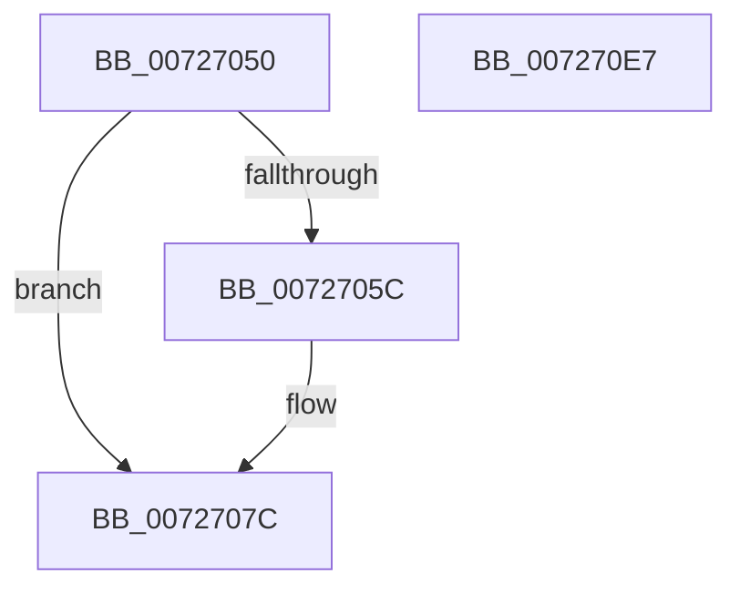

# IoConnectInterrupt

- RVA: `0x00727050`–`0x007270E8` (길이 `152` bytes)
- VA: `0x0000000140727050`
- 실행 섹션: `PAGE`
- PDB 이름 있음: `예`; PDB Function 태그: `아니요`
- unwind 정보 RVA: `0x000BCD28`
- 디코드: `35`개 명령, `152/152` bytes 표시
- 미해석 바이트: `0` (있으면 어셈블리에 `.byte`로 보존)

> 이 문서는 커널 이미지의 기계어와 PDB 기호를 분석해 생성했습니다. 4번과 5번은 함수 원형과 자료형을 바이너리 사용 방식에서 추정한 C 해석이며 원본 소스 복구 결과는 아닙니다.

## 1. Dependencies

- 직접 호출 지점: **2**; 고유 호출 대상: **2**
- 직접 호출자로 확인된 함수: **1**
- RIP 상대 이미지 참조: **0**

### Outgoing calls
- `0x00727076` → [KeBugCheckEx](../../text/4F/KeBugCheckEx_function_004FD660.md) (function, `0x004FD660`)
- `0x007270DD` → [IopConnectInterruptFullySpecified](IopConnectInterruptFullySpecified_function_007273E8.md) (function, `0x007273E8`)

### Direct callers
- [DifIoConnectInterruptWrapper](../../text/62/DifIoConnectInterruptWrapper_function_006288F0.md) at `0x00628A4A`

### Static image references
- 디코드된 RIP-relative 메모리 참조가 없습니다.

## 2. Other-region calls and transfers

- 다른 실행 섹션으로 향하는 call: **1**
  - `0x00727076` → [KeBugCheckEx](../../text/4F/KeBugCheckEx_function_004FD660.md) (`PAGE` → `.text`)
- 별도 외부 분기/꼬리 이동을 확인하지 못했습니다.

## 3. Assembly (complete function range)

```asm
00727050  48 83 EC 78                     sub rsp, 0x78
00727054  44 0F 20 C0                     mov rax, cr8
00727058  84 C0                           test al, al
0072705A  74 20                           je 0x14072707c
0072705C  44 0F 20 C0                     mov rax, cr8
00727060  48 83 64 24 20 00               and qword ptr [rsp + 0x20], 0
00727066  45 33 C9                        xor r9d, r9d
00727069  44 0F B6 C0                     movzx r8d, al
0072706D  B9 21 01 00 00                  mov ecx, 0x121
00727072  41 8D 51 01                     lea edx, [r9 + 1]
00727076  E8 E5 65 DD FF                  call 0x1404fd660
0072707B  CC                              int3
0072707C  48 8B 84 24 C8 00 00 00         mov rax, qword ptr [rsp + 0xc8]
00727084  48 83 64 24 68 00               and qword ptr [rsp + 0x68], 0
0072708A  48 89 44 24 60                  mov qword ptr [rsp + 0x60], rax
0072708F  48 8D 44 24 60                  lea rax, [rsp + 0x60]
00727094  48 89 44 24 50                  mov qword ptr [rsp + 0x50], rax
00727099  8A 84 24 C0 00 00 00            mov al, byte ptr [rsp + 0xc0]
007270A0  88 44 24 48                     mov byte ptr [rsp + 0x48], al
007270A4  8B 84 24 B8 00 00 00            mov eax, dword ptr [rsp + 0xb8]
007270AB  89 44 24 40                     mov dword ptr [rsp + 0x40], eax
007270AF  8A 84 24 B0 00 00 00            mov al, byte ptr [rsp + 0xb0]
007270B6  88 44 24 38                     mov byte ptr [rsp + 0x38], al
007270BA  8A 84 24 A8 00 00 00            mov al, byte ptr [rsp + 0xa8]
007270C1  88 44 24 30                     mov byte ptr [rsp + 0x30], al
007270C5  8B 84 24 A0 00 00 00            mov eax, dword ptr [rsp + 0xa0]
007270CC  89 44 24 28                     mov dword ptr [rsp + 0x28], eax
007270D0  4C 89 4C 24 20                  mov qword ptr [rsp + 0x20], r9
007270D5  4D 8B C8                        mov r9, r8
007270D8  4C 8B C2                        mov r8, rdx
007270DB  33 D2                           xor edx, edx
007270DD  E8 06 03 00 00                  call 0x1407273e8
007270E2  48 83 C4 78                     add rsp, 0x78
007270E6  C3                              ret
007270E7  CC                              int3
```

## 4. C-style interpretation (structured pseudocode)

```c
__int64 __fastcall IoConnectInterrupt(__int64 a1, __int64 a2, __int64 a3, int a4, unsigned int a5, unsigned __int8 a6, unsigned __int8 a7, unsigned int a8, unsigned __int8 a9, __int64 a10)
{
    __int64 result;
    __int64 v_rsp;
    unsigned __int64 v_stack_m10;
    unsigned __int64 v_stack_m18;
    unsigned __int64 v_stack_m28;
    unsigned __int8 v_stack_m30;
    unsigned int v_stack_m38;
    unsigned __int8 v_stack_m40;
    unsigned __int8 v_stack_m48;
    unsigned int v_stack_m50;
    unsigned __int64 v_stack_m58;

    v_rsp = (v_rsp) - (120);
    result = v_cr8;
    if ((unsigned __int8)(v_cr8) != 0) {
        result = v_cr8;
        a4 = 0;
        a3 = (unsigned __int8)(result);
        a1 = 289;
        a2 = a4 + 1;
        result = KeBugCheckEx(a1, a2, a3, a4);
    }
    v_stack_m18 = a10;
    v_stack_m28 = v_stack_m18;
    v_stack_m30 = a9;
    v_stack_m38 = (unsigned int)((unsigned int)(a8));
    v_stack_m40 = a7;
    v_stack_m48 = a6;
    v_stack_m50 = (unsigned int)((unsigned int)(a5));
    v_stack_m58 = 0;
    a2 = 0;
    result = IopConnectInterruptFullySpecified(a1, a2, a2, a3);
    v_rsp = (v_rsp) + (120);
    return result;
}
```

## 5. (Beta) C Style

```c
int64_t IoConnectInterrupt(int64_t Arg1, int64_t Arg2, int64_t Arg3, int32_t Arg4, uint32_t Arg5, uint8_t Arg6, uint8_t Arg7, uint32_t Arg8, uint8_t Arg9, int64_t Arg10)
{
    int64_t result;
    int64_t local_rsp;
    uint64_t v_stack_m10;
    uint64_t v_stack_m18;
    uint64_t v_stack_m28;
    uint8_t v_stack_m30;
    uint32_t v_stack_m38;
    uint8_t v_stack_m40;
    uint8_t v_stack_m48;
    uint32_t v_stack_m50;
    uint64_t v_stack_m58;

    local_rsp = (local_rsp) - (120);
    result = v_cr8;
    if ((uint8_t)(v_cr8) != 0) {
        result = v_cr8;
        Arg4 = 0;
        Arg3 = (uint8_t)(result);
        Arg1 = 289;
        Arg2 = Arg4 + 1;
        result = KeBugCheckEx(Arg1, Arg2, Arg3, Arg4);
    }
    v_stack_m18 = Arg10;
    v_stack_m28 = v_stack_m18;
    v_stack_m30 = Arg9;
    v_stack_m38 = (uint32_t)((uint32_t)(Arg8));
    v_stack_m40 = Arg7;
    v_stack_m48 = Arg6;
    v_stack_m50 = (uint32_t)((uint32_t)(Arg5));
    v_stack_m58 = 0;
    Arg2 = 0;
    result = IopConnectInterruptFullySpecified(Arg1, Arg2, Arg2, Arg3);
    local_rsp = (local_rsp) + (120);
    return result;
}
```

## 6. Execution-region graph

[열기: 2D/3D 그래프와 함수 탐색 컨트롤 패널](../../../control-panel.html?section=page&rva=0x00727050&view=graph)

- 2D 그래프는 위에서 아래로 흐르고, 3D 그래프는 빈 공간을 드래그해 회전합니다. Shift+드래그는 이동, 휠은 확대·축소, 함수 노드 선택은 대상 보고서 이동입니다.

### Static fallback


