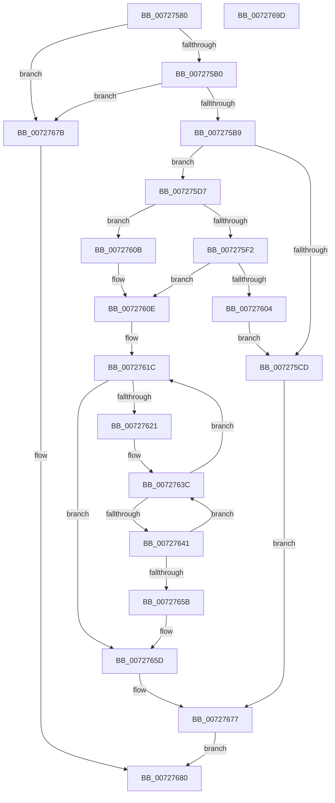

# IoDuplicateDependency

- RVA: `0x00727580`–`0x0072769E` (길이 `286` bytes)
- VA: `0x0000000140727580`
- 실행 섹션: `PAGE`
- PDB 이름 있음: `예`; PDB Function 태그: `아니요`
- unwind 정보 RVA: `0x0008C20C`
- 디코드: `84`개 명령, `286/286` bytes 표시
- 미해석 바이트: `0` (있으면 어셈블리에 `.byte`로 보존)

> 이 문서는 커널 이미지의 기계어와 PDB 기호를 분석해 생성했습니다. 4번과 5번은 함수 원형과 자료형을 바이너리 사용 방식에서 추정한 C 해석이며 원본 소스 복구 결과는 아닙니다.

## 1. Dependencies

- 직접 호출 지점: **11**; 고유 호출 대상: **10**
- 직접 호출자로 확인된 함수: **0**
- RIP 상대 이미지 참조: **0**

### Outgoing calls
- `0x007275BB` → [PnpAcquireDependencyRelationsLock](../A0/PnpAcquireDependencyRelationsLock_function_00A06788.md) (function, `0x00A06788`)
- `0x007275CD` → [PnpReleaseDependencyRelationsLock](../A0/PnpReleaseDependencyRelationsLock_function_00A06E14.md) (function, `0x00A06E14`)
- `0x007275E5` → [PipQueryBindingResolution](../A8/PipQueryBindingResolution_function_00A85310.md) (function, `0x00A85310`)
- `0x007275F7` → [PipCreateDependencyNode](PipCreateDependencyNode_function_00727B0C.md) (function, `0x00727B0C`)
- `0x00727611` → [PiGetDependentList](../A0/PiGetDependentList_function_00A074BC.md) (function, `0x00A074BC`)
- `0x00727629` → [PiListEntryToDependencyEdge](../../text/4F/PiListEntryToDependencyEdge_function_004F9648.md) (function, `0x004F9648`)
- `0x00727652` → [PipAddDependencyEdgeBetweenNodes](../../text/5A/PipAddDependencyEdgeBetweenNodes_function_005A5520.md) (function, `0x005A5520`)
- `0x00727660` → [PipDereferenceDependencyNode](../AC/PipDereferenceDependencyNode_function_00ACD5A0.md) (function, `0x00ACD5A0`)
- `0x00727668` → [PipAddDependentsToRebuildPowerRelationsQueue](../A0/PipAddDependentsToRebuildPowerRelationsQueue_function_00A067D8.md) (function, `0x00A067D8`)
- `0x0072766D` → [PnpReleaseDependencyRelationsLock](../A0/PnpReleaseDependencyRelationsLock_function_00A06E14.md) (function, `0x00A06E14`)
- `0x00727672` → [PipProcessRebuildPowerRelationsQueue](../A0/PipProcessRebuildPowerRelationsQueue_function_00A06844.md) (function, `0x00A06844`)

### Direct callers
- 이 함수 시작 RVA로 연결되는 직접 call은 확인되지 않았습니다. 간접 호출은 완전히 역산할 수 없습니다.

### Static image references
- 디코드된 RIP-relative 메모리 참조가 없습니다.

## 2. Other-region calls and transfers

- 다른 실행 섹션으로 향하는 call: **2**
  - `0x00727629` → [PiListEntryToDependencyEdge](../../text/4F/PiListEntryToDependencyEdge_function_004F9648.md) (`PAGE` → `.text`)
  - `0x00727652` → [PipAddDependencyEdgeBetweenNodes](../../text/5A/PipAddDependencyEdgeBetweenNodes_function_005A5520.md) (`PAGE` → `.text`)
- 별도 외부 분기/꼬리 이동을 확인하지 못했습니다.

## 3. Assembly (complete function range)

```asm
00727580  48 8B C4                        mov rax, rsp
00727583  48 89 58 08                     mov qword ptr [rax + 8], rbx
00727587  48 89 68 10                     mov qword ptr [rax + 0x10], rbp
0072758B  48 89 70 18                     mov qword ptr [rax + 0x18], rsi
0072758F  57                              push rdi
00727590  41 54                           push r12
00727592  41 55                           push r13
00727594  41 56                           push r14
00727596  41 57                           push r15
00727598  48 83 EC 30                     sub rsp, 0x30
0072759C  33 DB                           xor ebx, ebx
0072759E  48 8B EA                        mov rbp, rdx
007275A1  89 58 CC                        mov dword ptr [rax - 0x34], ebx
007275A4  48 8B F1                        mov rsi, rcx
007275A7  48 85 C9                        test rcx, rcx
007275AA  0F 84 CB 00 00 00               je 0x14072767b
007275B0  48 85 D2                        test rdx, rdx
007275B3  0F 84 C2 00 00 00               je 0x14072767b
007275B9  B1 01                           mov cl, 1
007275BB  E8 C8 F1 2D 00                  call 0x140a06788
007275C0  48 8B 86 38 01 00 00            mov rax, qword ptr [rsi + 0x138]
007275C7  48 39 58 50                     cmp qword ptr [rax + 0x50], rbx
007275CB  75 0A                           jne 0x1407275d7
007275CD  E8 42 F8 2D 00                  call 0x140a06e14
007275D2  E9 A0 00 00 00                  jmp 0x140727677
007275D7  48 8D 4C 24 20                  lea rcx, [rsp + 0x20]
007275DC  89 5C 24 20                     mov dword ptr [rsp + 0x20], ebx
007275E0  48 89 6C 24 28                  mov qword ptr [rsp + 0x28], rbp
007275E5  E8 26 DD 35 00                  call 0x140a85310
007275EA  48 8B F8                        mov rdi, rax
007275ED  48 85 C0                        test rax, rax
007275F0  75 19                           jne 0x14072760b
007275F2  48 8D 4C 24 20                  lea rcx, [rsp + 0x20]
007275F7  E8 10 05 00 00                  call 0x140727b0c
007275FC  48 8B F8                        mov rdi, rax
007275FF  48 85 C0                        test rax, rax
00727602  75 0A                           jne 0x14072760e
00727604  BB 9A 00 00 C0                  mov ebx, 0xc000009a
00727609  EB C2                           jmp 0x1407275cd
0072760B  FF 40 58                        inc dword ptr [rax + 0x58]
0072760E  48 8B CE                        mov rcx, rsi
00727611  E8 A6 FE 2D 00                  call 0x140a074bc
00727616  4C 8B F8                        mov r15, rax
00727619  48 8B 30                        mov rsi, qword ptr [rax]
0072761C  49 3B F7                        cmp rsi, r15
0072761F  74 3C                           je 0x14072765d
00727621  BA 01 00 00 00                  mov edx, 1
00727626  48 8B CE                        mov rcx, rsi
00727629  E8 1A 20 DD FF                  call 0x1404f9648
0072762E  48 8B 36                        mov rsi, qword ptr [rsi]
00727631  4C 8B E8                        mov r13, rax
00727634  4C 8D 60 38                     lea r12, [rax + 0x38]
00727638  4D 8B 34 24                     mov r14, qword ptr [r12]
0072763C  4D 3B F4                        cmp r14, r12
0072763F  74 DB                           je 0x14072761c
00727641  49 8B 4D 28                     mov rcx, qword ptr [r13 + 0x28]
00727645  4D 8B C6                        mov r8, r14
00727648  4D 8B 36                        mov r14, qword ptr [r14]
0072764B  49 83 C0 10                     add r8, 0x10
0072764F  48 8B D7                        mov rdx, rdi
00727652  E8 C9 DE E7 FF                  call 0x1405a5520
00727657  85 C0                           test eax, eax
00727659  79 E1                           jns 0x14072763c
0072765B  8B D8                           mov ebx, eax
0072765D  48 8B CF                        mov rcx, rdi
00727660  E8 3B 5F 3A 00                  call 0x140acd5a0
00727665  48 8B CD                        mov rcx, rbp
00727668  E8 6B F1 2D 00                  call 0x140a067d8
0072766D  E8 A2 F7 2D 00                  call 0x140a06e14
00727672  E8 CD F1 2D 00                  call 0x140a06844
00727677  8B C3                           mov eax, ebx
00727679  EB 05                           jmp 0x140727680
0072767B  B8 0D 00 00 C0                  mov eax, 0xc000000d
00727680  48 8B 5C 24 60                  mov rbx, qword ptr [rsp + 0x60]
00727685  48 8B 6C 24 68                  mov rbp, qword ptr [rsp + 0x68]
0072768A  48 8B 74 24 70                  mov rsi, qword ptr [rsp + 0x70]
0072768F  48 83 C4 30                     add rsp, 0x30
00727693  41 5F                           pop r15
00727695  41 5E                           pop r14
00727697  41 5D                           pop r13
00727699  41 5C                           pop r12
0072769B  5F                              pop rdi
0072769C  C3                              ret
0072769D  CC                              int3
```

## 4. C-style interpretation (structured pseudocode)

```c
__int64 __fastcall IoDuplicateDependency(__int64 a1, __int64 a2)
{
    __int64 result;
    __int64 v_rbx;
    __int64 v_rsp;
    unsigned __int64 v_stack_m30;
    unsigned __int64 v_stack_m38;
    unsigned __int64 v_stack_p10;
    unsigned __int64 v_stack_p18;
    unsigned __int64 v_stack_p8;

    *(unsigned __int64 *)(v_rsp + 8) = v_rbx;
    *(unsigned __int64 *)(v_rsp + 16) = v_rbp;
    *(unsigned __int64 *)(v_rsp + 24) = v_rsi;
    v_rsp = (v_rsp) - (48);
    v_rbx = 0;
    *(unsigned int *)(v_rsp - 52) = 0;
    if (a1 == 0) goto loc_0072767B;
    if (a2 == 0) goto loc_0072767B;
    result = PnpAcquireDependencyRelationsLock(1, a2, a3, a4);
    if ((*(unsigned __int64 *)(*(unsigned __int64 *)(a1 + 312) + 80)) != 0) goto loc_007275D7;
loc_007275CD:
    result = PnpReleaseDependencyRelationsLock(1, a2, a3, a4);
    goto loc_00727677;
loc_007275D7:
    v_stack_m38 = 0;
    v_stack_m30 = a2;
    result = PipQueryBindingResolution(v_stack_m38, a2, a3, a4);
    if (result != 0) goto loc_0072760B;
    result = PipCreateDependencyNode(v_stack_m38, a2, a3, a4);
    if (result != 0) goto loc_0072760E;
    goto loc_007275CD;
loc_0072760B:
loc_0072760E:
    result = PiGetDependentList(a1, a2, a3, a4);
loc_0072761C:
    if ((*(unsigned __int64 *)(result)) == result) goto loc_0072765D;
    result = PiListEntryToDependencyEdge(*(unsigned __int64 *)(result), 1, a3, a4);
loc_0072763C:
    if ((*(unsigned __int64 *)(result + 56)) == (result + 56)) goto loc_0072761C;
    a3 = (*(unsigned __int64 *)(result + 56)) + (16);
    result = PipAddDependencyEdgeBetweenNodes(*(unsigned __int64 *)(result + 40), result, a3, a4);
    if (!sign_flag) goto loc_0072763C;
loc_0072765D:
    result = PipDereferenceDependencyNode(result, result, a3, a4);
    result = PipAddDependentsToRebuildPowerRelationsQueue(a2, result, a3, a4);
    result = PnpReleaseDependencyRelationsLock(a2, result, a3, a4);
    result = PipProcessRebuildPowerRelationsQueue(a2, result, a3, a4);
loc_00727677:
    goto loc_00727680;
loc_0072767B:
loc_00727680:
    v_rsp = (v_rsp) + (48);
    return (unsigned int)(0xC000000DULL);
}
```

## 5. (Beta) C Style

```c
int64_t IoDuplicateDependency(void *Arg1, int64_t Arg2)
{
    uint8_t *arg1 = (uint8_t *)Arg1;

    int64_t result;
    int64_t local_rbx;
    int64_t local_rsp;
    uint64_t v_stack_m30;
    uint64_t v_stack_m38;
    uint64_t v_stack_p10;
    uint64_t v_stack_p18;
    uint64_t v_stack_p8;

    *(uint64_t *)(local_rsp + 0x8) = local_rbx;
    *(uint64_t *)(local_rsp + 0x10) = local_rbp;
    *(uint64_t *)(local_rsp + 0x18) = local_rsi;
    local_rsp = (local_rsp) - (48);
    local_rbx = 0;
    *(uint32_t *)(local_rsp - 0x34) = 0;
    if (Arg1 == NULL) goto loc_0072767B;
    if (Arg2 == 0) goto loc_0072767B;
    result = PnpAcquireDependencyRelationsLock(1, Arg2, a3, a4);
    if ((*(uint64_t *)(*(uint64_t *)(arg1 + 0x138) + 0x50)) != 0) goto loc_007275D7;
loc_007275CD:
    result = PnpReleaseDependencyRelationsLock(1, Arg2, a3, a4);
    goto loc_00727677;
loc_007275D7:
    v_stack_m38 = 0;
    v_stack_m30 = Arg2;
    result = PipQueryBindingResolution(v_stack_m38, Arg2, a3, a4);
    if (result != 0) goto loc_0072760B;
    result = PipCreateDependencyNode(v_stack_m38, Arg2, a3, a4);
    if (result != 0) goto loc_0072760E;
    goto loc_007275CD;
loc_0072760B:
loc_0072760E:
    result = PiGetDependentList(Arg1, Arg2, a3, a4);
loc_0072761C:
    if ((*(uint64_t *)(result)) == result) goto loc_0072765D;
    result = PiListEntryToDependencyEdge(*(uint64_t *)(result), 1, a3, a4);
loc_0072763C:
    if ((*(uint64_t *)(result + 0x38)) == (result + 56)) goto loc_0072761C;
    a3 = (*(uint64_t *)(result + 0x38)) + (16);
    result = PipAddDependencyEdgeBetweenNodes(*(uint64_t *)(result + 0x28), result, a3, a4);
    if (!sign_flag) goto loc_0072763C;
loc_0072765D:
    result = PipDereferenceDependencyNode(result, result, a3, a4);
    result = PipAddDependentsToRebuildPowerRelationsQueue(Arg2, result, a3, a4);
    result = PnpReleaseDependencyRelationsLock(Arg2, result, a3, a4);
    result = PipProcessRebuildPowerRelationsQueue(Arg2, result, a3, a4);
loc_00727677:
    goto loc_00727680;
loc_0072767B:
loc_00727680:
    local_rsp = (local_rsp) + (48);
    return (uint32_t)(0xC000000DULL);
}
```

### 관측된 메모리 오프셋

구조체 형식이 확인되지 않은 접근은 인자 기준의 오프셋으로만 기록했습니다.

| 기준 인자 | 오프셋 표현 | 폭 (bit) | 접근 |
|---|---:|---:|---|
| `Arg1` | `+ 0x138` | `64` | `R` |

## 6. Execution-region graph

[열기: 2D/3D 그래프와 함수 탐색 컨트롤 패널](../../../control-panel.html?section=page&rva=0x00727580&view=graph)

- 2D 그래프는 위에서 아래로 흐르고, 3D 그래프는 빈 공간을 드래그해 회전합니다. Shift+드래그는 이동, 휠은 확대·축소, 함수 노드 선택은 대상 보고서 이동입니다.

### Static fallback


