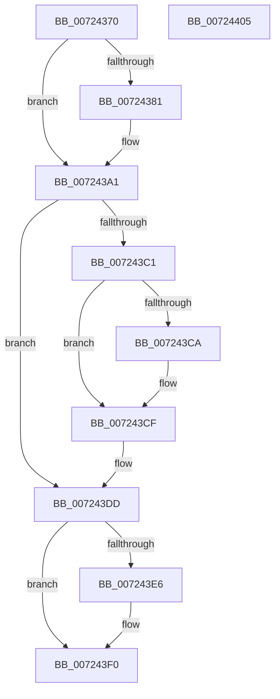

# IoFreeKsrPersistentMemory

- RVA: `0x00724370`–`0x00724406` (길이 `150` bytes)
- VA: `0x0000000140724370`
- 실행 섹션: `PAGE`
- PDB 이름 있음: `예`; PDB Function 태그: `아니요`
- unwind 정보 RVA: `0x00064C80`
- 디코드: `42`개 명령, `150/150` bytes 표시
- 미해석 바이트: `0` (있으면 어셈블리에 `.byte`로 보존)

> 이 문서는 커널 이미지의 기계어와 PDB 기호를 분석해 생성했습니다. 4번과 5번은 함수 원형과 자료형을 바이너리 사용 방식에서 추정한 C 해석이며 원본 소스 복구 결과는 아닙니다.

## 1. Dependencies

- 직접 호출 지점: **6**; 고유 호출 대상: **4**
- 직접 호출자로 확인된 함수: **0**
- RIP 상대 이미지 참조: **1**

### Outgoing calls
- `0x0072439B` → [KeBugCheckEx](../../text/4F/KeBugCheckEx_function_004FD660.md) (function, `0x004FD660`)
- `0x007243AC` → `ext-ms-win-ntos-ksr-l1-1-5.dll!KsrFreePersistedMemoryBlock` (import, 간접 대상; import `ext-ms-win-ntos-ksr-l1-1-5.dll!KsrFreePersistedMemoryBlock`)
- `0x007243CA` → [MmUnmapLockedPages](../../text/24/MmUnmapLockedPages_function_00246E60.md) (function, `0x00246E60`)
- `0x007243D8` → [ExFreePoolWithTag](../../poolcode/B8/ExFreePoolWithTag_function_00B82870.md) (function, `0x00B82870`)
- `0x007243EB` → [ExFreePoolWithTag](../../poolcode/B8/ExFreePoolWithTag_function_00B82870.md) (function, `0x00B82870`)
- `0x007243F8` → [ExFreePoolWithTag](../../poolcode/B8/ExFreePoolWithTag_function_00B82870.md) (function, `0x00B82870`)

### Direct callers
- 이 함수 시작 RVA로 연결되는 직접 call은 확인되지 않았습니다. 간접 호출은 완전히 역산할 수 없습니다.

### Static image references
- `0x007243AC` → RVA `0x00151320` (`ext-ms-win-ntos-ksr-l1-1-5.dll!KsrFreePersistedMemoryBlock (IAT)`; read)

## 2. Other-region calls and transfers

- 다른 실행 섹션으로 향하는 call: **5**
  - `0x0072439B` → [KeBugCheckEx](../../text/4F/KeBugCheckEx_function_004FD660.md) (`PAGE` → `.text`)
  - `0x007243CA` → [MmUnmapLockedPages](../../text/24/MmUnmapLockedPages_function_00246E60.md) (`PAGE` → `.text`)
  - `0x007243D8` → [ExFreePoolWithTag](../../poolcode/B8/ExFreePoolWithTag_function_00B82870.md) (`PAGE` → `POOLCODE`)
  - `0x007243EB` → [ExFreePoolWithTag](../../poolcode/B8/ExFreePoolWithTag_function_00B82870.md) (`PAGE` → `POOLCODE`)
  - `0x007243F8` → [ExFreePoolWithTag](../../poolcode/B8/ExFreePoolWithTag_function_00B82870.md) (`PAGE` → `POOLCODE`)
- 별도 외부 분기/꼬리 이동을 확인하지 못했습니다.

## 3. Assembly (complete function range)

```asm
00724370  40 53                           push rbx
00724372  48 83 EC 30                     sub rsp, 0x30
00724376  48 8B D9                        mov rbx, rcx
00724379  44 0F 20 C0                     mov rax, cr8
0072437D  84 C0                           test al, al
0072437F  74 20                           je 0x1407243a1
00724381  44 0F 20 C0                     mov rax, cr8
00724385  48 83 64 24 20 00               and qword ptr [rsp + 0x20], 0
0072438B  45 33 C9                        xor r9d, r9d
0072438E  44 0F B6 C0                     movzx r8d, al
00724392  B9 21 01 00 00                  mov ecx, 0x121
00724397  41 8D 51 01                     lea edx, [r9 + 1]
0072439B  E8 C0 92 DD FF                  call 0x1404fd660
007243A0  CC                              int3
007243A1  48 8B 53 20                     mov rdx, qword ptr [rbx + 0x20]
007243A5  48 83 C1 10                     add rcx, 0x10
007243A9  41 B0 01                        mov r8b, 1
007243AC  48 FF 15 6D CF A2 FF            call qword ptr [rip - 0x5d3093]
007243B3  0F 1F 44 00 00                  nop dword ptr [rax + rax]
007243B8  48 8B 53 08                     mov rdx, qword ptr [rbx + 8]
007243BC  48 85 D2                        test rdx, rdx
007243BF  74 1C                           je 0x1407243dd
007243C1  48 8B 4B 28                     mov rcx, qword ptr [rbx + 0x28]
007243C5  48 85 C9                        test rcx, rcx
007243C8  74 05                           je 0x1407243cf
007243CA  E8 91 2A B2 FF                  call 0x140246e60
007243CF  48 8B 4B 08                     mov rcx, qword ptr [rbx + 8]
007243D3  BA 50 6E 70 61                  mov edx, 0x61706e50
007243D8  E8 93 E4 45 00                  call 0x140b82870
007243DD  48 8B 4B 30                     mov rcx, qword ptr [rbx + 0x30]
007243E1  48 85 C9                        test rcx, rcx
007243E4  74 0A                           je 0x1407243f0
007243E6  BA 50 6E 70 61                  mov edx, 0x61706e50
007243EB  E8 80 E4 45 00                  call 0x140b82870
007243F0  BA 50 6E 70 61                  mov edx, 0x61706e50
007243F5  48 8B CB                        mov rcx, rbx
007243F8  E8 73 E4 45 00                  call 0x140b82870
007243FD  33 C0                           xor eax, eax
007243FF  48 83 C4 30                     add rsp, 0x30
00724403  5B                              pop rbx
00724404  C3                              ret
00724405  CC                              int3
```

## 4. C-style interpretation (structured pseudocode)

```c
__int64 __fastcall IoFreeKsrPersistentMemory(__int64 a1, __int64 a2, __int64 a3, int a4)
{
    __int64 result;
    __int64 v_rsp;
    unsigned __int64 v_stack_m18;

    v_rsp = (v_rsp) - (48);
    result = v_cr8;
    if ((unsigned __int8)(v_cr8) != 0) {
        result = v_cr8;
        a4 = 0;
        a3 = (unsigned __int8)(result);
        a1 = 289;
        a2 = a4 + 1;
        result = KeBugCheckEx(a1, a2, a3, a4);
    }
    a1 = (a1) + (16);
    result = ext_ms_win_ntos_ksr_l1_1_5_dll_KsrFreePersistedMemoryBlock(a1, *(unsigned __int64 *)(a1 + 32), 1, a4);
    if (*(unsigned __int64 *)(a1 + 8) == 0) goto loc_007243DD;
    if (*(unsigned __int64 *)(a1 + 40) != 0) {
        result = MmUnmapLockedPages(*(unsigned __int64 *)(a1 + 40), *(unsigned __int64 *)(a1 + 8), 1, a4);
    }
    result = ExFreePoolWithTag(*(unsigned __int64 *)(a1 + 8), (unsigned int)(0x61706E50ULL), 1, a4);
loc_007243DD:
    if (*(unsigned __int64 *)(a1 + 48) != 0) {
        a2 = 0x61706E50ULL;
        result = ExFreePoolWithTag(*(unsigned __int64 *)(a1 + 48), a2, 1, a4);
    }
    result = ExFreePoolWithTag(a1, (unsigned int)(0x61706E50ULL), 1, a4);
    result = 0;
    v_rsp = (v_rsp) + (48);
    return result;
}
```

## 5. (Beta) C Style

```c
int64_t IoFreeKsrPersistentMemory(void *Arg1, int64_t Arg2, int64_t Arg3, int32_t Arg4)
{
    uint8_t *arg1 = (uint8_t *)Arg1;

    int64_t result;
    int64_t local_rsp;
    uint64_t v_stack_m18;

    local_rsp = (local_rsp) - (48);
    result = v_cr8;
    if ((uint8_t)(v_cr8) != 0) {
        result = v_cr8;
        Arg4 = 0;
        Arg3 = (uint8_t)(result);
        Arg1 = 289;
        Arg2 = Arg4 + 1;
        result = KeBugCheckEx(Arg1, Arg2, Arg3, Arg4);
    }
    Arg1 = (Arg1) + (16);
    result = kernel_indirect_call(Arg1, *(uint64_t *)(arg1 + 0x20), 1, Arg4);
    if (*(uint64_t *)(arg1 + 0x8) == 0) goto loc_007243DD;
    if (*(uint64_t *)(arg1 + 0x28) != 0) {
        result = MmUnmapLockedPages(*(uint64_t *)(arg1 + 0x28), *(uint64_t *)(arg1 + 0x8), 1, Arg4);
    }
    result = ExFreePoolWithTag(*(uint64_t *)(arg1 + 0x8), (uint32_t)(0x61706E50ULL), 1, Arg4);
loc_007243DD:
    if (*(uint64_t *)(arg1 + 0x30) != 0) {
        Arg2 = 0x61706E50ULL;
        result = ExFreePoolWithTag(*(uint64_t *)(arg1 + 0x30), Arg2, 1, Arg4);
    }
    result = ExFreePoolWithTag(Arg1, (uint32_t)(0x61706E50ULL), 1, Arg4);
    result = 0;
    local_rsp = (local_rsp) + (48);
    return result;
}
```

### 관측된 메모리 오프셋

구조체 형식이 확인되지 않은 접근은 인자 기준의 오프셋으로만 기록했습니다.

| 기준 인자 | 오프셋 표현 | 폭 (bit) | 접근 |
|---|---:|---:|---|
| `Arg1` | `+ 0x8` | `64` | `R` |
| `Arg1` | `+ 0x20` | `64` | `R` |
| `Arg1` | `+ 0x28` | `64` | `R` |
| `Arg1` | `+ 0x30` | `64` | `R` |

## 6. Execution-region graph

[열기: 2D/3D 그래프와 함수 탐색 컨트롤 패널](../../../control-panel.html?section=page&rva=0x00724370&view=graph)

- 2D 그래프는 위에서 아래로 흐르고, 3D 그래프는 빈 공간을 드래그해 회전합니다. Shift+드래그는 이동, 휠은 확대·축소, 함수 노드 선택은 대상 보고서 이동입니다.

### Static fallback


