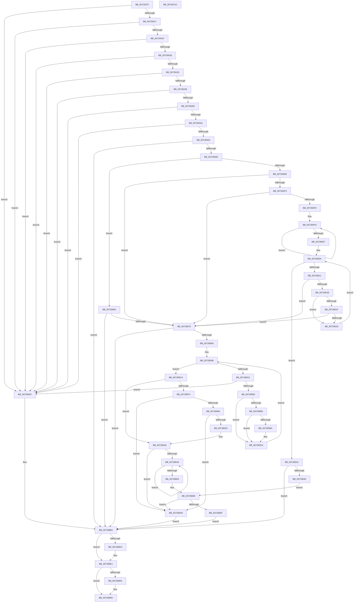

# IoGetDeviceDirectory

- RVA: `0x00728370`–`0x0072871E` (길이 `942` bytes)
- VA: `0x0000000140728370`
- 실행 섹션: `PAGE`
- PDB 이름 있음: `예`; PDB Function 태그: `아니요`
- unwind 정보 RVA: `0x000C76BC`
- 디코드: `249`개 명령, `942/942` bytes 표시
- 미해석 바이트: `0` (있으면 어셈블리에 `.byte`로 보존)

> 이 문서는 커널 이미지의 기계어와 PDB 기호를 분석해 생성했습니다. 4번과 5번은 함수 원형과 자료형을 바이너리 사용 방식에서 추정한 C 해석이며 원본 소스 복구 결과는 아닙니다.

## 1. Dependencies

- 직접 호출 지점: **20**; 고유 호출 대상: **13**
- 직접 호출자로 확인된 함수: **1**
- RIP 상대 이미지 참조: **7**

### Outgoing calls
- `0x007283E6` → [RtlInitUnicodeString](../../text/42/RtlInitUnicodeString_function_0042A780.md) (function, `0x0042A780`)
- `0x007283F1` → [RtlInitUnicodeString](../../text/42/RtlInitUnicodeString_function_0042A780.md) (function, `0x0042A780`)
- `0x007283FC` → [RtlInitUnicodeString](../../text/42/RtlInitUnicodeString_function_0042A780.md) (function, `0x0042A780`)
- `0x00728407` → [RtlInitUnicodeString](../../text/42/RtlInitUnicodeString_function_0042A780.md) (function, `0x0042A780`)
- `0x0072847C` → [PiGetStateRootPath](../A6/PiGetStateRootPath_function_00A67A70.md) (function, `0x00A67A70`)
- `0x007284D1` → [PnpGetObjectProperty](../8E/PnpGetObjectProperty_function_008E1110.md) (function, `0x008E1110`)
- `0x00728531` → [RtlInitUnicodeStringEx](../../text/46/RtlInitUnicodeStringEx_function_00463960.md) (function, `0x00463960`)
- `0x0072855B` → [PiBuildAndOpenDeviceDirectoryPath](PiBuildAndOpenDeviceDirectoryPath_function_00728724.md) (function, `0x00728724`)
- `0x00728578` → [PnpConcatenateUnicodeStrings](../95/PnpConcatenateUnicodeStrings_function_00951ED0.md) (function, `0x00951ED0`)
- `0x007285E5` → [PiBuildAndOpenDeviceDirectoryPath](PiBuildAndOpenDeviceDirectoryPath_function_00728724.md) (function, `0x00728724`)
- `0x007285F7` → [ExUuidCreate](../91/ExUuidCreate_function_00917500.md) (function, `0x00917500`)
- `0x00728611` → [RtlStringFromGUIDEx](../91/RtlStringFromGUIDEx_function_00915450.md) (function, `0x00915450`)
- `0x0072863F` → [PiBuildAndOpenDeviceDirectoryPath](PiBuildAndOpenDeviceDirectoryPath_function_00728724.md) (function, `0x00728724`)
- `0x00728694` → [PnpSetObjectProperty](../8F/PnpSetObjectProperty_function_008F66E8.md) (function, `0x008F66E8`)
- `0x007286B8` → [RtlFreeAnsiString](../9C/RtlFreeAnsiString_function_009C0800.md) (function, `0x009C0800`)
- `0x007286C1` → [RtlFreeAnsiString](../9C/RtlFreeAnsiString_function_009C0800.md) (function, `0x009C0800`)
- `0x007286CA` → [RtlFreeAnsiString](../9C/RtlFreeAnsiString_function_009C0800.md) (function, `0x009C0800`)
- `0x007286DC` → [ExFreePoolWithTag](../../poolcode/B8/ExFreePoolWithTag_function_00B82870.md) (function, `0x00B82870`)
- `0x007286E9` → [ZwClose](../../text/6A/ZwClose_function_006AD2B0.md) (function, `0x006AD2B0`)
- `0x007286F7` → [_security_check_cookie](../../text/6A/_security_check_cookie_function_006AC640.md) (function, `0x006AC640`)

### Direct callers
- [DifIoGetDeviceDirectoryWrapper](../../text/62/DifIoGetDeviceDirectoryWrapper_function_0062A880.md) at `0x0062A984`

### Static image references
- `0x00728393` → RVA `0x00E0A740` (`.data`; read)
- `0x0072846E` → RVA `0x00AFD770` (` ?? ::NNGAKEGL::`string'`; read)
- `0x00728475` → RVA `0x00AFD7C0` (` ?? ::NNGAKEGL::`string'`; read)
- `0x007284B6` → RVA `0x00021988` (`.rdata`; read)
- `0x007284DA` → RVA `0x00013E90` (`.rdata`; read)
- `0x00728547` → RVA `0x00AFD610` (` ?? ::NNGAKEGL::`string'`; read)
- `0x00728660` → RVA `0x00E66398` (`.data`; read)

## 2. Other-region calls and transfers

- 다른 실행 섹션으로 향하는 call: **8**
  - `0x007283E6` → [RtlInitUnicodeString](../../text/42/RtlInitUnicodeString_function_0042A780.md) (`PAGE` → `.text`)
  - `0x007283F1` → [RtlInitUnicodeString](../../text/42/RtlInitUnicodeString_function_0042A780.md) (`PAGE` → `.text`)
  - `0x007283FC` → [RtlInitUnicodeString](../../text/42/RtlInitUnicodeString_function_0042A780.md) (`PAGE` → `.text`)
  - `0x00728407` → [RtlInitUnicodeString](../../text/42/RtlInitUnicodeString_function_0042A780.md) (`PAGE` → `.text`)
  - `0x00728531` → [RtlInitUnicodeStringEx](../../text/46/RtlInitUnicodeStringEx_function_00463960.md) (`PAGE` → `.text`)
  - `0x007286DC` → [ExFreePoolWithTag](../../poolcode/B8/ExFreePoolWithTag_function_00B82870.md) (`PAGE` → `POOLCODE`)
  - `0x007286E9` → [ZwClose](../../text/6A/ZwClose_function_006AD2B0.md) (`PAGE` → `.text`)
  - `0x007286F7` → [_security_check_cookie](../../text/6A/_security_check_cookie_function_006AC640.md) (`PAGE` → `.text`)
- 별도 외부 분기/꼬리 이동을 확인하지 못했습니다.

## 3. Assembly (complete function range)

```asm
00728370  48 8B C4                        mov rax, rsp
00728373  48 89 58 10                     mov qword ptr [rax + 0x10], rbx
00728377  48 89 70 18                     mov qword ptr [rax + 0x18], rsi
0072837B  48 89 78 20                     mov qword ptr [rax + 0x20], rdi
0072837F  55                              push rbp
00728380  41 54                           push r12
00728382  41 55                           push r13
00728384  41 56                           push r14
00728386  41 57                           push r15
00728388  48 8D 68 A9                     lea rbp, [rax - 0x57]
0072838C  48 81 EC D0 00 00 00            sub rsp, 0xd0
00728393  48 8B 05 A6 23 6E 00            mov rax, qword ptr [rip + 0x6e23a6]
0072839A  48 33 C4                        xor rax, rsp
0072839D  48 89 45 27                     mov qword ptr [rbp + 0x27], rax
007283A1  4C 8B 6D 7F                     mov r13, qword ptr [rbp + 0x7f]
007283A5  33 C0                           xor eax, eax
007283A7  0F 57 C0                        xorps xmm0, xmm0
007283AA  89 45 BF                        mov dword ptr [rbp - 0x41], eax
007283AD  0F 57 C9                        xorps xmm1, xmm1
007283B0  48 89 45 C7                     mov qword ptr [rbp - 0x39], rax
007283B4  44 8B E2                        mov r12d, edx
007283B7  89 45 C3                        mov dword ptr [rbp - 0x3d], eax
007283BA  48 8B D9                        mov rbx, rcx
007283BD  48 89 45 EF                     mov qword ptr [rbp - 0x11], rax
007283C1  33 D2                           xor edx, edx
007283C3  48 8D 4D DF                     lea rcx, [rbp - 0x21]
007283C7  0F 11 45 DF                     movups xmmword ptr [rbp - 0x21], xmm0
007283CB  8B F0                           mov esi, eax
007283CD  44 8B F8                        mov r15d, eax
007283D0  0F 11 4D F7                     movups xmmword ptr [rbp - 9], xmm1
007283D4  4D 8B F1                        mov r14, r9
007283D7  41 8B F8                        mov edi, r8d
007283DA  0F 11 45 17                     movups xmmword ptr [rbp + 0x17], xmm0
007283DE  0F 11 4D CF                     movups xmmword ptr [rbp - 0x31], xmm1
007283E2  0F 11 45 07                     movups xmmword ptr [rbp + 7], xmm0
007283E6  E8 95 23 D0 FF                  call 0x14042a780
007283EB  33 D2                           xor edx, edx
007283ED  48 8D 4D F7                     lea rcx, [rbp - 9]
007283F1  E8 8A 23 D0 FF                  call 0x14042a780
007283F6  33 D2                           xor edx, edx
007283F8  48 8D 4D CF                     lea rcx, [rbp - 0x31]
007283FC  E8 7F 23 D0 FF                  call 0x14042a780
00728401  33 D2                           xor edx, edx
00728403  48 8D 4D 07                     lea rcx, [rbp + 7]
00728407  E8 74 23 D0 FF                  call 0x14042a780
0072840C  33 C9                           xor ecx, ecx
0072840E  48 85 DB                        test rbx, rbx
00728411  0F 84 98 02 00 00               je 0x1407286af
00728417  85 FF                           test edi, edi
00728419  0F 85 90 02 00 00               jne 0x1407286af
0072841F  4D 85 F6                        test r14, r14
00728422  0F 85 87 02 00 00               jne 0x1407286af
00728428  4D 85 ED                        test r13, r13
0072842B  0F 84 7E 02 00 00               je 0x1407286af
00728431  48 8B 83 38 01 00 00            mov rax, qword ptr [rbx + 0x138]
00728438  4C 8B 70 28                     mov r14, qword ptr [rax + 0x28]
0072843C  4D 85 F6                        test r14, r14
0072843F  0F 84 6A 02 00 00               je 0x1407286af
00728445  66 41 39 4E 28                  cmp word ptr [r14 + 0x28], cx
0072844A  0F 84 5F 02 00 00               je 0x1407286af
00728450  49 39 4E 30                     cmp qword ptr [r14 + 0x30], rcx
00728454  0F 84 55 02 00 00               je 0x1407286af
0072845A  45 85 E4                        test r12d, r12d
0072845D  0F 85 4C 02 00 00               jne 0x1407286af
00728463  45 8D 67 01                     lea r12d, [r15 + 1]
00728467  45 8B C4                        mov r8d, r12d
0072846A  4C 8D 4D DF                     lea r9, [rbp - 0x21]
0072846E  48 8D 15 FB 52 3D 00            lea rdx, [rip + 0x3d52fb]
00728475  48 8D 0D 44 53 3D 00            lea rcx, [rip + 0x3d5344]
0072847C  E8 EF F5 33 00                  call 0x140a67a70
00728481  33 C9                           xor ecx, ecx
00728483  8B D8                           mov ebx, eax
00728485  85 C0                           test eax, eax
00728487  0F 88 27 02 00 00               js 0x1407286b4
0072848D  4D 8B 46 30                     mov r8, qword ptr [r14 + 0x30]
00728491  48 8D 45 C3                     lea rax, [rbp - 0x3d]
00728495  89 4C 24 50                     mov dword ptr [rsp + 0x50], ecx
00728499  8D 57 4E                        lea edx, [rdi + 0x4e]
0072849C  48 89 44 24 48                  mov qword ptr [rsp + 0x48], rax
007284A1  45 8B CC                        mov r9d, r12d
007284A4  48 8D 45 EF                     lea rax, [rbp - 0x11]
007284A8  48 89 44 24 40                  mov qword ptr [rsp + 0x40], rax
007284AD  48 8D 45 BF                     lea rax, [rbp - 0x41]
007284B1  48 89 44 24 38                  mov qword ptr [rsp + 0x38], rax
007284B6  48 8D 05 CB 94 8F FF            lea rax, [rip - 0x706b35]
007284BD  48 89 44 24 30                  mov qword ptr [rsp + 0x30], rax
007284C2  48 89 4C 24 28                  mov qword ptr [rsp + 0x28], rcx
007284C7  48 89 4C 24 20                  mov qword ptr [rsp + 0x20], rcx
007284CC  B9 50 70 69 6F                  mov ecx, 0x6f697050
007284D1  E8 3A 8C 1B 00                  call 0x1408e1110
007284D6  4C 8B 7D EF                     mov r15, qword ptr [rbp - 0x11]
007284DA  4C 8D 0D AF B9 8E FF            lea r9, [rip - 0x714651]
007284E1  45 33 C0                        xor r8d, r8d
007284E4  49 83 CC FF                     or r12, 0xffffffffffffffff
007284E8  8B D8                           mov ebx, eax
007284EA  85 C0                           test eax, eax
007284EC  78 77                           js 0x140728565
007284EE  83 7D BF 12                     cmp dword ptr [rbp - 0x41], 0x12
007284F2  75 7C                           jne 0x140728570
007284F4  83 7D C3 02                     cmp dword ptr [rbp - 0x3d], 2
007284F8  72 76                           jb 0x140728570
007284FA  49 8B CC                        mov rcx, r12
007284FD  48 FF C1                        inc rcx
00728500  66 45 39 04 4F                  cmp word ptr [r15 + rcx*2], r8w
00728505  75 F6                           jne 0x1407284fd
00728507  41 8B D0                        mov edx, r8d
0072850A  8B C2                           mov eax, edx
0072850C  48 3B C1                        cmp rax, rcx
0072850F  73 19                           jae 0x14072852a
00728511  41 0F B7 04 47                  movzx eax, word ptr [r15 + rax*2]
00728516  83 F8 7F                        cmp eax, 0x7f
00728519  77 55                           ja 0x140728570
0072851B  84 C0                           test al, al
0072851D  78 07                           js 0x140728526
0072851F  42 F6 04 08 01                  test byte ptr [rax + r9], 1
00728524  74 4A                           je 0x140728570
00728526  FF C2                           inc edx
00728528  EB E0                           jmp 0x14072850a
0072852A  49 8B D7                        mov rdx, r15
0072852D  48 8D 4D 07                     lea rcx, [rbp + 7]
00728531  E8 2A B4 D3 FF                  call 0x140463960
00728536  8B D8                           mov ebx, eax
00728538  85 C0                           test eax, eax
0072853A  0F 88 74 01 00 00               js 0x1407286b4
00728540  48 8D 45 C7                     lea rax, [rbp - 0x39]
00728544  41 B1 01                        mov r9b, 1
00728547  4C 8D 05 C2 50 3D 00            lea r8, [rip + 0x3d50c2]
0072854E  48 89 44 24 20                  mov qword ptr [rsp + 0x20], rax
00728553  48 8D 55 07                     lea rdx, [rbp + 7]
00728557  48 8D 4D DF                     lea rcx, [rbp - 0x21]
0072855B  E8 C4 01 00 00                  call 0x140728724
00728560  E9 34 01 00 00                  jmp 0x140728699
00728565  3D 25 02 00 C0                  cmp eax, 0xc0000225
0072856A  0F 85 44 01 00 00               jne 0x1407286b4
00728570  49 8D 56 28                     lea rdx, [r14 + 0x28]
00728574  48 8D 4D CF                     lea rcx, [rbp - 0x31]
00728578  E8 53 99 22 00                  call 0x140951ed0
0072857D  45 33 C0                        xor r8d, r8d
00728580  8B D8                           mov ebx, eax
00728582  85 C0                           test eax, eax
00728584  0F 88 2A 01 00 00               js 0x1407286b4
0072858A  48 8B 7D D7                     mov rdi, qword ptr [rbp - 0x29]
0072858E  4C 8D 0D FB B8 8E FF            lea r9, [rip - 0x714705]
00728595  41 8B C8                        mov ecx, r8d
00728598  0F B7 45 CF                     movzx eax, word ptr [rbp - 0x31]
0072859C  D1 E8                           shr eax, 1
0072859E  3B C8                           cmp ecx, eax
007285A0  73 28                           jae 0x1407285ca
007285A2  8B D1                           mov edx, ecx
007285A4  0F B7 04 57                     movzx eax, word ptr [rdi + rdx*2]
007285A8  83 F8 7F                        cmp eax, 0x7f
007285AB  0F 87 FE 00 00 00               ja 0x1407286af
007285B1  84 C0                           test al, al
007285B3  78 11                           js 0x1407285c6
007285B5  42 F6 04 08 01                  test byte ptr [rax + r9], 1
007285BA  75 0A                           jne 0x1407285c6
007285BC  66 C7 04 57 23 00               mov word ptr [rdi + rdx*2], 0x23
007285C2  48 8B 7D D7                     mov rdi, qword ptr [rbp - 0x29]
007285C6  FF C1                           inc ecx
007285C8  EB CE                           jmp 0x140728598
007285CA  48 8D 45 C7                     lea rax, [rbp - 0x39]
007285CE  45 33 C9                        xor r9d, r9d
007285D1  4C 8D 05 38 50 3D 00            lea r8, [rip + 0x3d5038]
007285D8  48 89 44 24 20                  mov qword ptr [rsp + 0x20], rax
007285DD  48 8D 55 CF                     lea rdx, [rbp - 0x31]
007285E1  48 8D 4D DF                     lea rcx, [rbp - 0x21]
007285E5  E8 3A 01 00 00                  call 0x140728724
007285EA  8B D8                           mov ebx, eax
007285EC  3D 3A 00 00 C0                  cmp eax, 0xc000003a
007285F1  75 53                           jne 0x140728646
007285F3  48 8D 4D 17                     lea rcx, [rbp + 0x17]
007285F7  E8 04 EF 1E 00                  call 0x140917500
007285FC  8B D8                           mov ebx, eax
007285FE  85 C0                           test eax, eax
00728600  0F 88 A3 00 00 00               js 0x1407286a9
00728606  41 B0 01                        mov r8b, 1
00728609  48 8D 55 F7                     lea rdx, [rbp - 9]
0072860D  48 8D 4D 17                     lea rcx, [rbp + 0x17]
00728611  E8 3A CE 1E 00                  call 0x140915450
00728616  8B D8                           mov ebx, eax
00728618  85 C0                           test eax, eax
0072861A  0F 88 89 00 00 00               js 0x1407286a9
00728620  48 8B 7D FF                     mov rdi, qword ptr [rbp - 1]
00728624  48 8D 45 C7                     lea rax, [rbp - 0x39]
00728628  41 B1 01                        mov r9b, 1
0072862B  48 89 44 24 20                  mov qword ptr [rsp + 0x20], rax
00728630  4C 8D 05 D9 4F 3D 00            lea r8, [rip + 0x3d4fd9]
00728637  48 8D 55 F7                     lea rdx, [rbp - 9]
0072863B  48 8D 4D DF                     lea rcx, [rbp - 0x21]
0072863F  E8 E0 00 00 00                  call 0x140728724
00728644  8B D8                           mov ebx, eax
00728646  85 C0                           test eax, eax
00728648  78 5F                           js 0x1407286a9
0072864A  49 FF C4                        inc r12
0072864D  66 42 39 34 67                  cmp word ptr [rdi + r12*2], si
00728652  75 F6                           jne 0x14072864a
00728654  49 8B 56 30                     mov rdx, qword ptr [r14 + 0x30]
00728658  42 8D 04 65 02 00 00 00         lea eax, [r12*2 + 2]
00728660  48 8B 0D 31 DD 73 00            mov rcx, qword ptr [rip + 0x73dd31]
00728667  45 33 C9                        xor r9d, r9d
0072866A  89 74 24 48                     mov dword ptr [rsp + 0x48], esi
0072866E  89 44 24 40                     mov dword ptr [rsp + 0x40], eax
00728672  48 8D 05 0F 93 8F FF            lea rax, [rip - 0x706cf1]
00728679  48 89 7C 24 38                  mov qword ptr [rsp + 0x38], rdi
0072867E  C7 44 24 30 12 00 00 00         mov dword ptr [rsp + 0x30], 0x12
00728686  45 8D 41 01                     lea r8d, [r9 + 1]
0072868A  48 89 44 24 28                  mov qword ptr [rsp + 0x28], rax
0072868F  48 89 74 24 20                  mov qword ptr [rsp + 0x20], rsi
00728694  E8 4F E0 1C 00                  call 0x1408f66e8
00728699  8B D8                           mov ebx, eax
0072869B  85 C0                           test eax, eax
0072869D  78 0A                           js 0x1407286a9
0072869F  48 8B 45 C7                     mov rax, qword ptr [rbp - 0x39]
007286A3  49 89 45 00                     mov qword ptr [r13], rax
007286A7  EB 0B                           jmp 0x1407286b4
007286A9  48 8B 75 C7                     mov rsi, qword ptr [rbp - 0x39]
007286AD  EB 05                           jmp 0x1407286b4
007286AF  BB 0D 00 00 C0                  mov ebx, 0xc000000d
007286B4  48 8D 4D DF                     lea rcx, [rbp - 0x21]
007286B8  E8 43 81 29 00                  call 0x1409c0800
007286BD  48 8D 4D F7                     lea rcx, [rbp - 9]
007286C1  E8 3A 81 29 00                  call 0x1409c0800
007286C6  48 8D 4D CF                     lea rcx, [rbp - 0x31]
007286CA  E8 31 81 29 00                  call 0x1409c0800
007286CF  4D 85 FF                        test r15, r15
007286D2  74 0D                           je 0x1407286e1
007286D4  BA 50 70 69 6F                  mov edx, 0x6f697050
007286D9  49 8B CF                        mov rcx, r15
007286DC  E8 8F A1 45 00                  call 0x140b82870
007286E1  48 85 F6                        test rsi, rsi
007286E4  74 08                           je 0x1407286ee
007286E6  48 8B CE                        mov rcx, rsi
007286E9  E8 C2 4B F8 FF                  call 0x1406ad2b0
007286EE  8B C3                           mov eax, ebx
007286F0  48 8B 4D 27                     mov rcx, qword ptr [rbp + 0x27]
007286F4  48 33 CC                        xor rcx, rsp
007286F7  E8 44 3F F8 FF                  call 0x1406ac640
007286FC  4C 8D 9C 24 D0 00 00 00         lea r11, [rsp + 0xd0]
00728704  49 8B 5B 38                     mov rbx, qword ptr [r11 + 0x38]
00728708  49 8B 73 40                     mov rsi, qword ptr [r11 + 0x40]
0072870C  49 8B 7B 48                     mov rdi, qword ptr [r11 + 0x48]
00728710  49 8B E3                        mov rsp, r11
00728713  41 5F                           pop r15
00728715  41 5E                           pop r14
00728717  41 5D                           pop r13
00728719  41 5C                           pop r12
0072871B  5D                              pop rbp
0072871C  C3                              ret
0072871D  CC                              int3
```

## 4. C-style interpretation (structured pseudocode)

```c
__int64 __fastcall IoGetDeviceDirectory(__int64 a1, int a2, int a3, __int64 a4)
{
    __int64 result;
    __int64 v_r12;
    __int64 v_rdi;
    __int64 v_rsp;
    unsigned __int64 v_stack_m28;
    unsigned int v_stack_mA8;
    unsigned __int64 v_stack_mB0;
    unsigned __int64 v_stack_mB8;
    unsigned __int64 v_stack_mC0;
    unsigned __int64 v_stack_mC8;
    unsigned __int64 v_stack_mD0;
    unsigned __int64 v_stack_mD8;

    *(unsigned __int64 *)(v_rsp + 16) = v_rbx;
    *(unsigned __int64 *)(v_rsp + 24) = v_rsi;
    *(unsigned __int64 *)(v_rsp + 32) = v_rdi;
    v_rsp = (v_rsp) - (208);
    result = (*(unsigned __int64 *)(v_rip + 7218086)) ^ (v_rsp);
    *(unsigned __int64 *)(v_rsp - 87 + 39) = result;
    result = 0;
    *(unsigned int *)(v_rsp - 87 - 65) = 0;
    *(unsigned __int64 *)(v_rsp - 87 - 57) = 0;
    *(unsigned int *)(v_rsp - 87 - 61) = 0;
    *(unsigned __int64 *)(v_rsp - 87 - 17) = 0;
    a2 = 0;
    *(unsigned __int64 *)(v_rsp - 87 - 33) = v_xmm0;
    *(unsigned __int64 *)(v_rsp - 87 - 9) = v_xmm1;
    *(unsigned __int64 *)(v_rsp - 87 + 23) = v_xmm0;
    *(unsigned __int64 *)(v_rsp - 87 - 49) = v_xmm1;
    *(unsigned __int64 *)(v_rsp - 87 + 7) = v_xmm0;
    result = RtlInitUnicodeString(v_rsp - 87 - 33, a2, a3, a4);
    a2 = 0;
    result = RtlInitUnicodeString(v_rsp - 87 - 9, a2, a3, a4);
    a2 = 0;
    result = RtlInitUnicodeString(v_rsp - 87 - 49, a2, a3, a4);
    a2 = 0;
    result = RtlInitUnicodeString(v_rsp - 87 + 7, a2, a3, a4);
    a1 = 0;
    if (0 == 0) goto loc_007286AF;
    if ((unsigned int)((unsigned int)(a3)) != 0) goto loc_007286AF;
    if (a4 != 0) goto loc_007286AF;
    if (*(unsigned __int64 *)(v_rsp - 87 + 127) == 0) goto loc_007286AF;
    if (*(unsigned __int64 *)(*(unsigned __int64 *)(a1 + 312) + 40) == 0) goto loc_007286AF;
    if ((*(unsigned __int16 *)(*(unsigned __int64 *)(*(unsigned __int64 *)(a1 + 312) + 40) + 40)) == 0) goto loc_007286AF;
    if ((*(unsigned __int64 *)(*(unsigned __int64 *)(*(unsigned __int64 *)(a1 + 312) + 40) + 48)) == 0) goto loc_007286AF;
    if ((unsigned int)((unsigned int)(a2)) != 0) goto loc_007286AF;
    result = PiGetStateRootPath(v_rip + 4019012, v_rip + 4018939, (unsigned int)((unsigned int)(0 + 1)), v_rsp - 87 - 33);
    a1 = 0;
    if (sign_flag) goto loc_007286B4;
    v_stack_mA8 = 0;
    v_stack_mB0 = v_rsp - 87 - 61;
    v_stack_mB8 = v_rsp - 87 - 17;
    v_stack_mC0 = v_rsp - 87 - 65;
    v_stack_mC8 = v_rip - 7367477;
    v_stack_mD0 = 0;
    v_stack_mD8 = 0;
    result = PnpGetObjectProperty((unsigned int)(0x6F697050ULL), (unsigned int)(a3) + 78, *(unsigned __int64 *)(*(unsigned __int64 *)(*(unsigned __int64 *)(a1 + 312) + 40) + 48), (unsigned int)((unsigned int)(0 + 1)));
    a3 = 0;
    v_r12 = (0 + 1) | (-1);
    if (sign_flag) goto loc_00728565;
    if ((*(unsigned int *)(v_rsp - 87 - 65)) != 18) goto loc_00728570;
    if ((*(unsigned int *)(v_rsp - 87 - 61)) < 2) goto loc_00728570;
loc_007284FD:
    a1 = (v_r12) + 1;
    if ((*(unsigned __int16 *)(*(unsigned __int64 *)(v_rsp - 87 - 17) + a1 * 2)) != 0) goto loc_007284FD;
loc_0072850A:
    if (0 >= a1) goto loc_0072852A;
    if (((unsigned int)(*(unsigned __int16 *)(*(unsigned __int64 *)(v_rsp - 87 - 17) + 0 * 2))) > 127) goto loc_00728570;
    if (sign_flag) goto loc_00728526;
    if (((*(unsigned __int8 *)(*(unsigned __int16 *)(*(unsigned __int64 *)(v_rsp - 87 - 17) + 0 * 2) + v_rip - 7423569 * 1)) & (1)) == 0) goto loc_00728570;
loc_00728526:
    a2 = (unsigned int)((0) + 1);
    goto loc_0072850A;
loc_0072852A:
    result = RtlInitUnicodeStringEx(v_rsp - 87 + 7, *(unsigned __int64 *)(v_rsp - 87 - 17), a3, v_rip - 7423569);
    if (sign_flag) goto loc_007286B4;
    v_stack_mD8 = v_rsp - 87 - 57;
    result = PiBuildAndOpenDeviceDirectoryPath(v_rsp - 87 - 33, v_rsp - 87 + 7, v_rip + 4018370, 1);
    goto loc_00728699;
loc_00728565:
    if (((unsigned int)(result)) != 0xC0000225ULL) goto loc_007286B4;
loc_00728570:
    result = PnpConcatenateUnicodeStrings(v_rsp - 87 - 49, *(unsigned __int64 *)(*(unsigned __int64 *)(a1 + 312) + 40) + 40, v_rip + 4018370, 1);
    a3 = 0;
    if (sign_flag) goto loc_007286B4;
loc_00728598:
    result = (unsigned int)((*(unsigned __int16 *)(v_rsp - 87 - 49)) >> (1));
    if (0 >= ((unsigned int)(result))) goto loc_007285CA;
    if (((unsigned int)(*(unsigned __int16 *)(*(unsigned __int64 *)(v_rsp - 87 - 41) + 0 * 2))) > 127) goto loc_007286AF;
    if (sign_flag) goto loc_007285C6;
    v_rdi = *(unsigned __int64 *)(v_rsp - 87 - 41);
    if (((*(unsigned __int8 *)(*(unsigned __int16 *)(*(unsigned __int64 *)(v_rsp - 87 - 41) + 0 * 2) + v_rip - 7423749 * 1)) & (1)) == 0) {
        *(unsigned __int16 *)(*(unsigned __int64 *)(v_rsp - 87 - 41) + 0 * 2) = 35;
        v_rdi = *(unsigned __int64 *)(v_rsp - 87 - 41);
    }
    a1 = (unsigned int)((0) + 1);
    goto loc_00728598;
loc_007285CA:
    a4 = 0;
    v_stack_mD8 = v_rsp - 87 - 57;
    result = PiBuildAndOpenDeviceDirectoryPath(v_rsp - 87 - 33, v_rsp - 87 - 49, v_rip + 4018232, a4);
    if (((unsigned int)(result)) != 0xC000003AULL) goto loc_00728646;
    result = ExUuidCreate(v_rsp - 87 + 23, v_rsp - 87 - 49, v_rip + 4018232, a4);
    if (sign_flag) goto loc_007286A9;
    result = RtlStringFromGUIDEx(v_rsp - 87 + 23, v_rsp - 87 - 9, 1, a4);
    if (sign_flag) goto loc_007286A9;
    v_stack_mD8 = v_rsp - 87 - 57;
    result = PiBuildAndOpenDeviceDirectoryPath(v_rsp - 87 - 33, v_rsp - 87 - 9, v_rip + 4018137, 1);
loc_00728646:
    if (sign_flag) goto loc_007286A9;
loc_0072864A:
    v_r12 = (v_r12) + 1;
    if ((*(unsigned __int16 *)(*(unsigned __int64 *)(v_rsp - 87 - 1) + v_r12 * 2)) != 0) goto loc_0072864A;
    a4 = 0;
    v_stack_mB0 = 0;
    v_stack_mB8 = (unsigned int)(v_r12 * 2 + 2);
    v_stack_mC0 = *(unsigned __int64 *)(v_rsp - 87 - 1);
    v_stack_mC8 = 18;
    v_stack_mD0 = v_rip - 7367921;
    v_stack_mD8 = 0;
    result = PnpSetObjectProperty(*(unsigned __int64 *)(v_rip + 7593265), *(unsigned __int64 *)(*(unsigned __int64 *)(*(unsigned __int64 *)(a1 + 312) + 40) + 48), a4 + 1, a4);
loc_00728699:
    if (sign_flag) goto loc_007286A9;
    *(unsigned __int64 *)(*(unsigned __int64 *)(v_rsp - 87 + 127)) = *(unsigned __int64 *)(v_rsp - 87 - 57);
    goto loc_007286B4;
loc_007286A9:
    goto loc_007286B4;
loc_007286AF:
loc_007286B4:
    result = RtlFreeAnsiString(v_rsp - 87 - 33, *(unsigned __int64 *)(*(unsigned __int64 *)(*(unsigned __int64 *)(a1 + 312) + 40) + 48), a4 + 1, a4);
    result = RtlFreeAnsiString(v_rsp - 87 - 9, *(unsigned __int64 *)(*(unsigned __int64 *)(*(unsigned __int64 *)(a1 + 312) + 40) + 48), a4 + 1, a4);
    result = RtlFreeAnsiString(v_rsp - 87 - 49, *(unsigned __int64 *)(*(unsigned __int64 *)(*(unsigned __int64 *)(a1 + 312) + 40) + 48), a4 + 1, a4);
    if (*(unsigned __int64 *)(v_rsp - 87 - 17) != 0) {
        a2 = 0x6F697050ULL;
        a1 = *(unsigned __int64 *)(v_rsp - 87 - 17);
        result = ExFreePoolWithTag(a1, a2, a4 + 1, a4);
    }
    if (*(unsigned __int64 *)(v_rsp - 87 - 57) != 0) {
        a1 = *(unsigned __int64 *)(v_rsp - 87 - 57);
        result = ZwClose(a1, a2, a4 + 1, a4);
    }
    a1 = (*(unsigned __int64 *)(v_rsp - 87 + 39)) ^ (v_rsp);
    result = _security_check_cookie(a1, a2, a4 + 1, a4);
    return result;
}
```

## 5. (Beta) C Style

```c
int64_t IoGetDeviceDirectory(int64_t Arg1, int32_t Arg2, int32_t Arg3, int64_t Arg4)
{
    int64_t result;
    int64_t local_r12;
    int64_t local_rdi;
    int64_t local_rsp;
    uint64_t v_stack_m28;
    uint32_t v_stack_mA8;
    uint64_t v_stack_mB0;
    uint64_t v_stack_mB8;
    uint64_t v_stack_mC0;
    uint64_t v_stack_mC8;
    uint64_t v_stack_mD0;
    uint64_t v_stack_mD8;

    *(uint64_t *)(local_rsp + 0x10) = local_rbx;
    *(uint64_t *)(local_rsp + 0x18) = local_rsi;
    *(uint64_t *)(local_rsp + 0x20) = local_rdi;
    local_rsp = (local_rsp) - (208);
    result = (*(uint64_t *)(v_rip + 0x6E23A6)) ^ (local_rsp);
    *(uint64_t *)(local_rsp - 0x57 + 0x27) = result;
    result = 0;
    *(uint32_t *)(local_rsp - 0x57 - 0x41) = 0;
    *(uint64_t *)(local_rsp - 0x57 - 0x39) = 0;
    *(uint32_t *)(local_rsp - 0x57 - 0x3D) = 0;
    *(uint64_t *)(local_rsp - 0x57 - 0x11) = 0;
    Arg2 = 0;
    *(uint64_t *)(local_rsp - 0x57 - 0x21) = v_xmm0;
    *(uint64_t *)(local_rsp - 0x57 - 0x9) = v_xmm1;
    *(uint64_t *)(local_rsp - 0x57 + 0x17) = v_xmm0;
    *(uint64_t *)(local_rsp - 0x57 - 0x31) = v_xmm1;
    *(uint64_t *)(local_rsp - 0x57 + 0x7) = v_xmm0;
    result = RtlInitUnicodeString(local_rsp - 87 - 33, Arg2, Arg3, Arg4);
    Arg2 = 0;
    result = RtlInitUnicodeString(local_rsp - 87 - 9, Arg2, Arg3, Arg4);
    Arg2 = 0;
    result = RtlInitUnicodeString(local_rsp - 87 - 49, Arg2, Arg3, Arg4);
    Arg2 = 0;
    result = RtlInitUnicodeString(local_rsp - 87 + 7, Arg2, Arg3, Arg4);
    Arg1 = 0;
    if (0 == 0) goto loc_007286AF;
    if ((uint32_t)((uint32_t)(Arg3)) != 0) goto loc_007286AF;
    if (Arg4 != 0) goto loc_007286AF;
    if (*(uint64_t *)(local_rsp - 0x57 + 0x7F) == 0) goto loc_007286AF;
    if (*(uint64_t *)(*(uint64_t *)(Arg1 + 0x138) + 0x28) == 0) goto loc_007286AF;
    if ((*(uint16_t *)(*(uint64_t *)(*(uint64_t *)(Arg1 + 0x138) + 0x28) + 0x28)) == 0) goto loc_007286AF;
    if ((*(uint64_t *)(*(uint64_t *)(*(uint64_t *)(Arg1 + 0x138) + 0x28) + 0x30)) == 0) goto loc_007286AF;
    if ((uint32_t)((uint32_t)(Arg2)) != 0) goto loc_007286AF;
    result = PiGetStateRootPath(v_rip + 4019012, v_rip + 4018939, (uint32_t)((uint32_t)(0 + 1)), local_rsp - 87 - 33);
    Arg1 = 0;
    if (sign_flag) goto loc_007286B4;
    v_stack_mA8 = 0;
    v_stack_mB0 = local_rsp - 87 - 61;
    v_stack_mB8 = local_rsp - 87 - 17;
    v_stack_mC0 = local_rsp - 87 - 65;
    v_stack_mC8 = v_rip - 7367477;
    v_stack_mD0 = 0;
    v_stack_mD8 = 0;
    result = PnpGetObjectProperty((uint32_t)(0x6F697050ULL), (uint32_t)(Arg3) + 78, *(uint64_t *)(*(uint64_t *)(*(uint64_t *)(Arg1 + 0x138) + 0x28) + 0x30), (uint32_t)((uint32_t)(0 + 1)));
    Arg3 = 0;
    local_r12 = (0 + 1) | (-1);
    if (sign_flag) goto loc_00728565;
    if ((*(uint32_t *)(local_rsp - 0x57 - 0x41)) != 18) goto loc_00728570;
    if ((*(uint32_t *)(local_rsp - 0x57 - 0x3D)) < 2) goto loc_00728570;
loc_007284FD:
    Arg1 = (local_r12) + 1;
    if ((*(uint16_t *)(*(uint64_t *)(local_rsp - 0x57 - 0x11) + Arg1 * 2)) != 0) goto loc_007284FD;
loc_0072850A:
    if (0 >= Arg1) goto loc_0072852A;
    if (((uint32_t)(*(uint16_t *)(*(uint64_t *)(local_rsp - 0x57 - 0x11) + 0x0 * 2))) > 127) goto loc_00728570;
    if (sign_flag) goto loc_00728526;
    if (((*(uint8_t *)(*(uint16_t *)(*(uint64_t *)(local_rsp - 0x57 - 0x11) + 0x0 * 2) + v_rip - 0x714651 * 1)) & (1)) == 0) goto loc_00728570;
loc_00728526:
    Arg2 = (uint32_t)((0) + 1);
    goto loc_0072850A;
loc_0072852A:
    result = RtlInitUnicodeStringEx(local_rsp - 87 + 7, *(uint64_t *)(local_rsp - 0x57 - 0x11), Arg3, v_rip - 7423569);
    if (sign_flag) goto loc_007286B4;
    v_stack_mD8 = local_rsp - 87 - 57;
    result = PiBuildAndOpenDeviceDirectoryPath(local_rsp - 87 - 33, local_rsp - 87 + 7, v_rip + 4018370, 1);
    goto loc_00728699;
loc_00728565:
    if (((uint32_t)(result)) != 0xC0000225ULL) goto loc_007286B4;
loc_00728570:
    result = PnpConcatenateUnicodeStrings(local_rsp - 87 - 49, *(uint64_t *)(*(uint64_t *)(Arg1 + 0x138) + 0x28) + 40, v_rip + 4018370, 1);
    Arg3 = 0;
    if (sign_flag) goto loc_007286B4;
loc_00728598:
    result = (uint32_t)((*(uint16_t *)(local_rsp - 0x57 - 0x31)) >> (1));
    if (0 >= ((uint32_t)(result))) goto loc_007285CA;
    if (((uint32_t)(*(uint16_t *)(*(uint64_t *)(local_rsp - 0x57 - 0x29) + 0x0 * 2))) > 127) goto loc_007286AF;
    if (sign_flag) goto loc_007285C6;
    local_rdi = *(uint64_t *)(local_rsp - 0x57 - 0x29);
    if (((*(uint8_t *)(*(uint16_t *)(*(uint64_t *)(local_rsp - 0x57 - 0x29) + 0x0 * 2) + v_rip - 0x714705 * 1)) & (1)) == 0) {
        *(uint16_t *)(*(uint64_t *)(local_rsp - 0x57 - 0x29) + 0x0 * 2) = 35;
        local_rdi = *(uint64_t *)(local_rsp - 0x57 - 0x29);
    }
    Arg1 = (uint32_t)((0) + 1);
    goto loc_00728598;
loc_007285CA:
    Arg4 = 0;
    v_stack_mD8 = local_rsp - 87 - 57;
    result = PiBuildAndOpenDeviceDirectoryPath(local_rsp - 87 - 33, local_rsp - 87 - 49, v_rip + 4018232, Arg4);
    if (((uint32_t)(result)) != 0xC000003AULL) goto loc_00728646;
    result = ExUuidCreate(local_rsp - 87 + 23, local_rsp - 87 - 49, v_rip + 4018232, Arg4);
    if (sign_flag) goto loc_007286A9;
    result = RtlStringFromGUIDEx(local_rsp - 87 + 23, local_rsp - 87 - 9, 1, Arg4);
    if (sign_flag) goto loc_007286A9;
    v_stack_mD8 = local_rsp - 87 - 57;
    result = PiBuildAndOpenDeviceDirectoryPath(local_rsp - 87 - 33, local_rsp - 87 - 9, v_rip + 4018137, 1);
loc_00728646:
    if (sign_flag) goto loc_007286A9;
loc_0072864A:
    local_r12 = (local_r12) + 1;
    if ((*(uint16_t *)(*(uint64_t *)(local_rsp - 0x57 - 0x1) + local_r12 * 2)) != 0) goto loc_0072864A;
    Arg4 = 0;
    v_stack_mB0 = 0;
    v_stack_mB8 = (uint32_t)(local_r12 * 2 + 2);
    v_stack_mC0 = *(uint64_t *)(local_rsp - 0x57 - 0x1);
    v_stack_mC8 = 18;
    v_stack_mD0 = v_rip - 7367921;
    v_stack_mD8 = 0;
    result = PnpSetObjectProperty(*(uint64_t *)(v_rip + 0x73DD31), *(uint64_t *)(*(uint64_t *)(*(uint64_t *)(Arg1 + 0x138) + 0x28) + 0x30), Arg4 + 1, Arg4);
loc_00728699:
    if (sign_flag) goto loc_007286A9;
    *(uint64_t *)(*(uint64_t *)(local_rsp - 0x57 + 0x7F)) = *(uint64_t *)(local_rsp - 0x57 - 0x39);
    goto loc_007286B4;
loc_007286A9:
    goto loc_007286B4;
loc_007286AF:
loc_007286B4:
    result = RtlFreeAnsiString(local_rsp - 87 - 33, *(uint64_t *)(*(uint64_t *)(*(uint64_t *)(Arg1 + 0x138) + 0x28) + 0x30), Arg4 + 1, Arg4);
    result = RtlFreeAnsiString(local_rsp - 87 - 9, *(uint64_t *)(*(uint64_t *)(*(uint64_t *)(Arg1 + 0x138) + 0x28) + 0x30), Arg4 + 1, Arg4);
    result = RtlFreeAnsiString(local_rsp - 87 - 49, *(uint64_t *)(*(uint64_t *)(*(uint64_t *)(Arg1 + 0x138) + 0x28) + 0x30), Arg4 + 1, Arg4);
    if (*(uint64_t *)(local_rsp - 0x57 - 0x11) != 0) {
        Arg2 = 0x6F697050ULL;
        Arg1 = *(uint64_t *)(local_rsp - 0x57 - 0x11);
        result = ExFreePoolWithTag(Arg1, Arg2, Arg4 + 1, Arg4);
    }
    if (*(uint64_t *)(local_rsp - 0x57 - 0x39) != 0) {
        Arg1 = *(uint64_t *)(local_rsp - 0x57 - 0x39);
        result = ZwClose(Arg1, Arg2, Arg4 + 1, Arg4);
    }
    Arg1 = (*(uint64_t *)(local_rsp - 0x57 + 0x27)) ^ (local_rsp);
    result = _security_check_cookie(Arg1, Arg2, Arg4 + 1, Arg4);
    return result;
}
```

## 6. Execution-region graph

[열기: 2D/3D 그래프와 함수 탐색 컨트롤 패널](../../../control-panel.html?section=page&rva=0x00728370&view=graph)

- 2D 그래프는 위에서 아래로 흐르고, 3D 그래프는 빈 공간을 드래그해 회전합니다. Shift+드래그는 이동, 휠은 확대·축소, 함수 노드 선택은 대상 보고서 이동입니다.

### Static fallback


