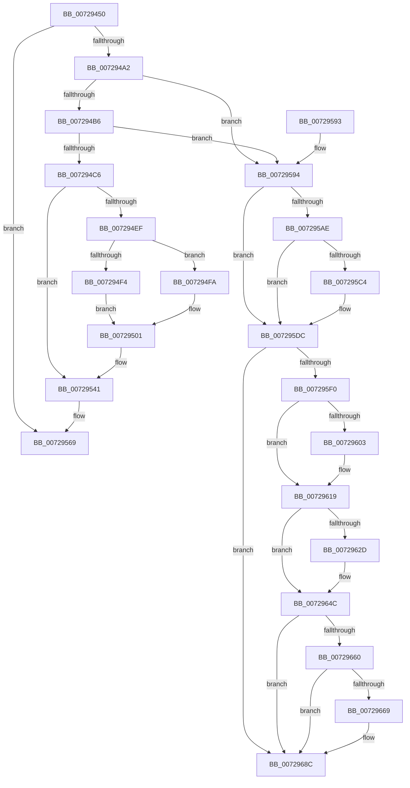

# IoGetDmaAdapter

- RVA: `0x00729450`–`0x007296A5` (길이 `597` bytes)
- VA: `0x0000000140729450`
- 실행 섹션: `PAGE`
- PDB 이름 있음: `예`; PDB Function 태그: `아니요`
- unwind 정보 RVA: `0x000C841C`
- 디코드: `149`개 명령, `597/597` bytes 표시
- 미해석 바이트: `0` (있으면 어셈블리에 `.byte`로 보존)

> 이 문서는 커널 이미지의 기계어와 PDB 기호를 분석해 생성했습니다. 4번과 5번은 함수 원형과 자료형을 바이너리 사용 방식에서 추정한 C 해석이며 원본 소스 복구 결과는 아닙니다.

## 1. Dependencies

- 직접 호출 지점: **19**; 고유 호출 대상: **8**
- 직접 호출자로 확인된 함수: **2**
- RIP 상대 이미지 참조: **2**

### Outgoing calls
- `0x0072948E` → [memset](../../text/6C/memset_function_006C6C40.md) (function, `0x006C6C40`)
- `0x007294D9` → [guard_dispatch_icall](../../text/6B/guard_dispatch_icall_function_006BAAD0.md) (function, `0x006BAAD0`)
- `0x00729509` → [memcpy](../../text/6C/memcpy_function_006C6840.md) (function, `0x006C6840`)
- `0x00729529` → [IoGetDeviceProperty](../8F/IoGetDeviceProperty_function_008FA720.md) (function, `0x008FA720`)
- `0x0072954A` → [PiGetDmaAdapterFromBusInterface](PiGetDmaAdapterFromBusInterface_function_00729744.md) (function, `0x00729744`)
- `0x00729564` → [guard_dispatch_icall](../../text/6B/guard_dispatch_icall_function_006BAAD0.md) (function, `0x006BAAD0`)
- `0x00729577` → [_security_check_cookie](../../text/6A/_security_check_cookie_function_006AC640.md) (function, `0x006AC640`)
- `0x0072959B` → [IoAddTriageDumpDataBlock](../../text/42/IoAddTriageDumpDataBlock_function_00428374.md) (function, `0x00428374`)
- `0x007295B2` → [IoAddTriageDumpDataBlock](../../text/42/IoAddTriageDumpDataBlock_function_00428374.md) (function, `0x00428374`)
- `0x007295C6` → [IoAddTriageDumpDataBlock](../../text/42/IoAddTriageDumpDataBlock_function_00428374.md) (function, `0x00428374`)
- `0x007295D7` → [IoAddTriageDumpDataBlock](../../text/42/IoAddTriageDumpDataBlock_function_00428374.md) (function, `0x00428374`)
- `0x007295F9` → [IoAddTriageDumpDataBlock](../../text/42/IoAddTriageDumpDataBlock_function_00428374.md) (function, `0x00428374`)
- `0x00729608` → [IoAddTriageDumpDataBlock](../../text/42/IoAddTriageDumpDataBlock_function_00428374.md) (function, `0x00428374`)
- `0x00729614` → [IoAddTriageDumpDataBlock](../../text/42/IoAddTriageDumpDataBlock_function_00428374.md) (function, `0x00428374`)
- `0x0072962F` → [IoAddTriageDumpDataBlock](../../text/42/IoAddTriageDumpDataBlock_function_00428374.md) (function, `0x00428374`)
- `0x00729647` → [IoAddTriageDumpDataBlock](../../text/42/IoAddTriageDumpDataBlock_function_00428374.md) (function, `0x00428374`)
- `0x0072966B` → [IoAddTriageDumpDataBlock](../../text/42/IoAddTriageDumpDataBlock_function_00428374.md) (function, `0x00428374`)
- `0x00729687` → [IoAddTriageDumpDataBlock](../../text/42/IoAddTriageDumpDataBlock_function_00428374.md) (function, `0x00428374`)
- `0x0072969F` → [KeBugCheckEx](../../text/4F/KeBugCheckEx_function_004FD660.md) (function, `0x004FD660`)

### Direct callers
- [DifIoGetDmaAdapterWrapper](../../text/62/DifIoGetDmaAdapterWrapper_function_0062AD20.md) at `0x0062AE05`
- [VfGetDmaAdapter](../../pagevrfy/B9/VfGetDmaAdapter_function_00B96930.md) at `0x00B96AA2`

### Static image references
- `0x00729463` → RVA `0x00E0A740` (`.data`; read)
- `0x007294D2` → RVA `0x00E00B68` (`.data`; read)

## 2. Other-region calls and transfers

- 다른 실행 섹션으로 향하는 call: **17**
  - `0x0072948E` → [memset](../../text/6C/memset_function_006C6C40.md) (`PAGE` → `.text`)
  - `0x007294D9` → [guard_dispatch_icall](../../text/6B/guard_dispatch_icall_function_006BAAD0.md) (`PAGE` → `.text`)
  - `0x00729509` → [memcpy](../../text/6C/memcpy_function_006C6840.md) (`PAGE` → `.text`)
  - `0x00729564` → [guard_dispatch_icall](../../text/6B/guard_dispatch_icall_function_006BAAD0.md) (`PAGE` → `.text`)
  - `0x00729577` → [_security_check_cookie](../../text/6A/_security_check_cookie_function_006AC640.md) (`PAGE` → `.text`)
  - `0x0072959B` → [IoAddTriageDumpDataBlock](../../text/42/IoAddTriageDumpDataBlock_function_00428374.md) (`PAGE` → `.text`)
  - `0x007295B2` → [IoAddTriageDumpDataBlock](../../text/42/IoAddTriageDumpDataBlock_function_00428374.md) (`PAGE` → `.text`)
  - `0x007295C6` → [IoAddTriageDumpDataBlock](../../text/42/IoAddTriageDumpDataBlock_function_00428374.md) (`PAGE` → `.text`)
  - `0x007295D7` → [IoAddTriageDumpDataBlock](../../text/42/IoAddTriageDumpDataBlock_function_00428374.md) (`PAGE` → `.text`)
  - `0x007295F9` → [IoAddTriageDumpDataBlock](../../text/42/IoAddTriageDumpDataBlock_function_00428374.md) (`PAGE` → `.text`)
  - `0x00729608` → [IoAddTriageDumpDataBlock](../../text/42/IoAddTriageDumpDataBlock_function_00428374.md) (`PAGE` → `.text`)
  - `0x00729614` → [IoAddTriageDumpDataBlock](../../text/42/IoAddTriageDumpDataBlock_function_00428374.md) (`PAGE` → `.text`)
  - `0x0072962F` → [IoAddTriageDumpDataBlock](../../text/42/IoAddTriageDumpDataBlock_function_00428374.md) (`PAGE` → `.text`)
  - `0x00729647` → [IoAddTriageDumpDataBlock](../../text/42/IoAddTriageDumpDataBlock_function_00428374.md) (`PAGE` → `.text`)
  - `0x0072966B` → [IoAddTriageDumpDataBlock](../../text/42/IoAddTriageDumpDataBlock_function_00428374.md) (`PAGE` → `.text`)
  - `0x00729687` → [IoAddTriageDumpDataBlock](../../text/42/IoAddTriageDumpDataBlock_function_00428374.md) (`PAGE` → `.text`)
  - `0x0072969F` → [KeBugCheckEx](../../text/4F/KeBugCheckEx_function_004FD660.md) (`PAGE` → `.text`)
- 별도 외부 분기/꼬리 이동을 확인하지 못했습니다.

## 3. Assembly (complete function range)

```asm
00729450  48 89 5C 24 20                  mov qword ptr [rsp + 0x20], rbx
00729455  55                              push rbp
00729456  56                              push rsi
00729457  57                              push rdi
00729458  41 56                           push r14
0072945A  41 57                           push r15
0072945C  48 81 EC 90 00 00 00            sub rsp, 0x90
00729463  48 8B 05 D6 12 6E 00            mov rax, qword ptr [rip + 0x6e12d6]
0072946A  48 33 C4                        xor rax, rsp
0072946D  48 89 84 24 80 00 00 00         mov qword ptr [rsp + 0x80], rax
00729475  49 8B E8                        mov rbp, r8
00729478  48 8B F2                        mov rsi, rdx
0072947B  48 8B D9                        mov rbx, rcx
0072947E  41 BE 40 00 00 00               mov r14d, 0x40
00729484  45 8B C6                        mov r8d, r14d
00729487  48 8D 4C 24 40                  lea rcx, [rsp + 0x40]
0072948C  33 D2                           xor edx, edx
0072948E  E8 AD D7 F9 FF                  call 0x1406c6c40
00729493  33 FF                           xor edi, edi
00729495  89 7C 24 30                     mov dword ptr [rsp + 0x30], edi
00729499  48 85 DB                        test rbx, rbx
0072949C  0F 84 C7 00 00 00               je 0x140729569
007294A2  48 8B 83 38 01 00 00            mov rax, qword ptr [rbx + 0x138]
007294A9  48 8B 40 28                     mov rax, qword ptr [rax + 0x28]
007294AD  48 85 C0                        test rax, rax
007294B0  0F 84 DE 00 00 00               je 0x140729594
007294B6  F7 80 8C 01 00 00 00 00 02 00   test dword ptr [rax + 0x18c], 0x20000
007294C0  0F 85 CE 00 00 00               jne 0x140729594
007294C6  65 48 8B 0C 25 88 01 00 00      mov rcx, qword ptr gs:[0x188]
007294CF  48 8B D3                        mov rdx, rbx
007294D2  48 8B 05 8F 76 6D 00            mov rax, qword ptr [rip + 0x6d768f]
007294D9  E8 F2 15 F9 FF                  call 0x1406baad0
007294DE  8B 46 14                        mov eax, dword ptr [rsi + 0x14]
007294E1  45 8D 7E C1                     lea r15d, [r14 - 0x3f]
007294E5  41 03 C7                        add eax, r15d
007294E8  A9 EF FF FF FF                  test eax, 0xffffffef
007294ED  75 52                           jne 0x140729541
007294EF  83 3E 03                        cmp dword ptr [rsi], 3
007294F2  73 06                           jae 0x1407294fa
007294F4  45 8D 46 E8                     lea r8d, [r14 - 0x18]
007294F8  EB 07                           jmp 0x140729501
007294FA  4C 8B C7                        mov r8, rdi
007294FD  4D 0F 44 C6                     cmove r8, r14
00729501  48 8B D6                        mov rdx, rsi
00729504  48 8D 4C 24 40                  lea rcx, [rsp + 0x40]
00729509  E8 32 D3 F9 FF                  call 0x1406c6840
0072950E  BA 0D 00 00 00                  mov edx, 0xd
00729513  48 8D 44 24 30                  lea rax, [rsp + 0x30]
00729518  4C 8D 4C 24 54                  lea r9, [rsp + 0x54]
0072951D  48 89 44 24 20                  mov qword ptr [rsp + 0x20], rax
00729522  48 8B CB                        mov rcx, rbx
00729525  44 8D 42 F7                     lea r8d, [rdx - 9]
00729529  E8 F2 11 1D 00                  call 0x1408fa720
0072952E  8B 54 24 54                     mov edx, dword ptr [rsp + 0x54]
00729532  48 8D 74 24 40                  lea rsi, [rsp + 0x40]
00729537  85 C0                           test eax, eax
00729539  41 0F 48 D7                     cmovs edx, r15d
0072953D  89 54 24 54                     mov dword ptr [rsp + 0x54], edx
00729541  4C 8B C5                        mov r8, rbp
00729544  48 8B D6                        mov rdx, rsi
00729547  48 8B CB                        mov rcx, rbx
0072954A  E8 F5 01 00 00                  call 0x140729744
0072954F  65 48 8B 0C 25 88 01 00 00      mov rcx, qword ptr gs:[0x188]
00729558  48 8B F8                        mov rdi, rax
0072955B  48 8B 05 06 76 6D 00            mov rax, qword ptr [rip + 0x6d7606]
00729562  33 D2                           xor edx, edx
00729564  E8 67 15 F9 FF                  call 0x1406baad0
00729569  48 8B C7                        mov rax, rdi
0072956C  48 8B 8C 24 80 00 00 00         mov rcx, qword ptr [rsp + 0x80]
00729574  48 33 CC                        xor rcx, rsp
00729577  E8 C4 30 F8 FF                  call 0x1406ac640
0072957C  48 8B 9C 24 D8 00 00 00         mov rbx, qword ptr [rsp + 0xd8]
00729584  48 81 C4 90 00 00 00            add rsp, 0x90
0072958B  41 5F                           pop r15
0072958D  41 5E                           pop r14
0072958F  5F                              pop rdi
00729590  5E                              pop rsi
00729591  5D                              pop rbp
00729592  C3                              ret
00729593  CC                              int3
00729594  0F B7 53 02                     movzx edx, word ptr [rbx + 2]
00729598  48 8B CB                        mov rcx, rbx
0072959B  E8 D4 ED CF FF                  call 0x140428374
007295A0  48 8B 4B 08                     mov rcx, qword ptr [rbx + 8]
007295A4  BD 02 00 00 00                  mov ebp, 2
007295A9  48 85 C9                        test rcx, rcx
007295AC  74 2E                           je 0x1407295dc
007295AE  0F BF 51 02                     movsx edx, word ptr [rcx + 2]
007295B2  E8 BD ED CF FF                  call 0x140428374
007295B7  48 8B 4B 08                     mov rcx, qword ptr [rbx + 8]
007295BB  48 83 C1 38                     add rcx, 0x38
007295BF  66 39 39                        cmp word ptr [rcx], di
007295C2  74 18                           je 0x1407295dc
007295C4  8B D5                           mov edx, ebp
007295C6  E8 A9 ED CF FF                  call 0x140428374
007295CB  48 8B 4B 08                     mov rcx, qword ptr [rbx + 8]
007295CF  0F B7 51 38                     movzx edx, word ptr [rcx + 0x38]
007295D3  48 8B 49 40                     mov rcx, qword ptr [rcx + 0x40]
007295D7  E8 98 ED CF FF                  call 0x140428374
007295DC  48 8B 83 38 01 00 00            mov rax, qword ptr [rbx + 0x138]
007295E3  48 8B 48 28                     mov rcx, qword ptr [rax + 0x28]
007295E7  48 85 C9                        test rcx, rcx
007295EA  0F 84 9C 00 00 00               je 0x14072968c
007295F0  BA 88 03 00 00                  mov edx, 0x388
007295F5  48 8D 71 28                     lea rsi, [rcx + 0x28]
007295F9  E8 76 ED CF FF                  call 0x140428374
007295FE  66 39 3E                        cmp word ptr [rsi], di
00729601  74 16                           je 0x140729619
00729603  8B D5                           mov edx, ebp
00729605  48 8B CE                        mov rcx, rsi
00729608  E8 67 ED CF FF                  call 0x140428374
0072960D  0F B7 16                        movzx edx, word ptr [rsi]
00729610  48 8B 4E 08                     mov rcx, qword ptr [rsi + 8]
00729614  E8 5B ED CF FF                  call 0x140428374
00729619  48 8B 83 38 01 00 00            mov rax, qword ptr [rbx + 0x138]
00729620  48 8B 48 28                     mov rcx, qword ptr [rax + 0x28]
00729624  48 83 C1 38                     add rcx, 0x38
00729628  66 39 39                        cmp word ptr [rcx], di
0072962B  74 1F                           je 0x14072964c
0072962D  8B D5                           mov edx, ebp
0072962F  E8 40 ED CF FF                  call 0x140428374
00729634  48 8B 83 38 01 00 00            mov rax, qword ptr [rbx + 0x138]
0072963B  48 8B 48 28                     mov rcx, qword ptr [rax + 0x28]
0072963F  0F B7 51 38                     movzx edx, word ptr [rcx + 0x38]
00729643  48 8B 49 40                     mov rcx, qword ptr [rcx + 0x40]
00729647  E8 28 ED CF FF                  call 0x140428374
0072964C  48 8B 83 38 01 00 00            mov rax, qword ptr [rbx + 0x138]
00729653  48 8B 48 28                     mov rcx, qword ptr [rax + 0x28]
00729657  48 8B 41 10                     mov rax, qword ptr [rcx + 0x10]
0072965B  48 85 C0                        test rax, rax
0072965E  74 2C                           je 0x14072968c
00729660  48 8D 48 38                     lea rcx, [rax + 0x38]
00729664  66 39 39                        cmp word ptr [rcx], di
00729667  74 23                           je 0x14072968c
00729669  8B D5                           mov edx, ebp
0072966B  E8 04 ED CF FF                  call 0x140428374
00729670  48 8B 83 38 01 00 00            mov rax, qword ptr [rbx + 0x138]
00729677  48 8B 48 28                     mov rcx, qword ptr [rax + 0x28]
0072967B  48 8B 49 10                     mov rcx, qword ptr [rcx + 0x10]
0072967F  0F B7 51 38                     movzx edx, word ptr [rcx + 0x38]
00729683  48 8B 49 40                     mov rcx, qword ptr [rcx + 0x40]
00729687  E8 E8 EC CF FF                  call 0x140428374
0072968C  45 33 C9                        xor r9d, r9d
0072968F  48 89 7C 24 20                  mov qword ptr [rsp + 0x20], rdi
00729694  4C 8B C3                        mov r8, rbx
00729697  48 8B D5                        mov rdx, rbp
0072969A  B9 CA 00 00 00                  mov ecx, 0xca
0072969F  E8 BC 3F DD FF                  call 0x1404fd660
007296A4  CC                              int3
```

## 4. C-style interpretation (structured pseudocode)

```c
__int64 __fastcall IoGetDmaAdapter(__int64 a1, __int64 a2, __int64 a3)
{
    __int64 result;
    __int64 v_rdi;
    __int64 v_rsp;
    unsigned __int64 v_stack_m38;
    unsigned __int64 v_stack_m64;
    unsigned __int64 v_stack_m78;
    unsigned int v_stack_m88;
    unsigned __int64 v_stack_m98;
    unsigned __int64 v_stack_p20;

    v_stack_p20 = v_rbx;
    v_rsp = (v_rsp) - (144);
    result = (*(unsigned __int64 *)(v_rip + 7213782)) ^ (v_rsp);
    v_stack_m38 = result;
    a2 = 0;
    result = memset(v_stack_m78, a2, 64, a4);
    v_rdi = 0;
    v_stack_m88 = 0;
    if (a1 == 0) goto loc_00729569;
    if (*(unsigned __int64 *)(*(unsigned __int64 *)(a1 + 312) + 40) == 0) goto loc_00729594;
    if (((*(unsigned int *)(*(unsigned __int64 *)(*(unsigned __int64 *)(a1 + 312) + 40) + 396)) & (0x20000ULL)) != 0) goto loc_00729594;
    result = guard_dispatch_icall(*(unsigned __int64 *)(gs_base + (0 + 392)), a1, 64, a4);
    result = (unsigned int)(((unsigned int)(*(unsigned int *)(a2 + 20))) + ((unsigned int)(64 - 63)));
    if ((((unsigned int)(result)) & (0xFFFFFFEFULL)) != 0) goto loc_00729541;
    if ((*(unsigned int *)(a2)) >= 3) goto loc_007294FA;
    goto loc_00729501;
loc_007294FA:
    a3 = 0;
    if ((*(unsigned int *)(a2)) == 3) { a3 = 64; }
loc_00729501:
    result = memcpy(v_stack_m78, 0, a3, a4);
    v_stack_m98 = v_stack_m88;
    result = IoGetDeviceProperty(a1, 13, 13 - 9, v_stack_m64);
    a2 = (unsigned int)(v_stack_m64);
    if (sign_flag) { a2 = (unsigned int)(64 - 63); }
    v_stack_m64 = (unsigned int)(a2);
loc_00729541:
    result = PiGetDmaAdapterFromBusInterface(a1, v_stack_m78, a3, v_stack_m64);
    a2 = 0;
    result = guard_dispatch_icall(*(unsigned __int64 *)(gs_base + (0 + 392)), a2, a3, v_stack_m64);
loc_00729569:
    a1 = (v_stack_m38) ^ (v_rsp);
    result = _security_check_cookie(a1, a2, a3, v_stack_m64);
    v_rsp = (v_rsp) + (144);
    return result;
loc_00729594:
    result = IoAddTriageDumpDataBlock(v_stack_p20, *(unsigned __int16 *)(v_stack_p20 + 2), a3, v_stack_m64);
    if (*(unsigned __int64 *)(v_stack_p20 + 8) == 0) goto loc_007295DC;
    result = IoAddTriageDumpDataBlock(*(unsigned __int64 *)(v_stack_p20 + 8), (__int16)(*(unsigned __int16 *)(*(unsigned __int64 *)(v_stack_p20 + 8) + 2)), a3, v_stack_m64);
    a1 = (*(unsigned __int64 *)(v_stack_p20 + 8)) + (56);
    if ((*(unsigned __int16 *)(a1)) != ((unsigned __int16)(result))) {
        a2 = 2;
        result = IoAddTriageDumpDataBlock(a1, a2, a3, v_stack_m64);
        a1 = *(unsigned __int64 *)(v_stack_p20 + 8);
        a2 = *(unsigned __int16 *)(a1 + 56);
        a1 = *(unsigned __int64 *)(a1 + 64);
        result = IoAddTriageDumpDataBlock(a1, a2, a3, v_stack_m64);
    }
    if (*(unsigned __int64 *)(*(unsigned __int64 *)(v_stack_p20 + 312) + 40) == 0) goto loc_0072968C;
    result = IoAddTriageDumpDataBlock(*(unsigned __int64 *)(*(unsigned __int64 *)(v_stack_p20 + 312) + 40), 904, a3, v_stack_m64);
    if ((*(unsigned __int16 *)(*(unsigned __int64 *)(*(unsigned __int64 *)(v_stack_p20 + 312) + 40) + 40)) != ((unsigned __int16)(result))) {
        a2 = 2;
        a1 = *(unsigned __int64 *)(*(unsigned __int64 *)(v_stack_p20 + 312) + 40) + 40;
        result = IoAddTriageDumpDataBlock(a1, a2, a3, v_stack_m64);
        a2 = *(unsigned __int16 *)(*(unsigned __int64 *)(*(unsigned __int64 *)(v_stack_p20 + 312) + 40) + 40);
        a1 = *(unsigned __int64 *)(*(unsigned __int64 *)(*(unsigned __int64 *)(v_stack_p20 + 312) + 40) + 40 + 8);
        result = IoAddTriageDumpDataBlock(a1, a2, a3, v_stack_m64);
    }
    a1 = (*(unsigned __int64 *)(*(unsigned __int64 *)(v_stack_p20 + 312) + 40)) + (56);
    result = *(unsigned __int64 *)(v_stack_p20 + 312);
    if ((*(unsigned __int16 *)(a1)) != ((unsigned __int16)(result))) {
        a2 = 2;
        result = IoAddTriageDumpDataBlock(a1, a2, a3, v_stack_m64);
        result = *(unsigned __int64 *)(v_stack_p20 + 312);
        a1 = *(unsigned __int64 *)(result + 40);
        a2 = *(unsigned __int16 *)(a1 + 56);
        a1 = *(unsigned __int64 *)(a1 + 64);
        result = IoAddTriageDumpDataBlock(a1, a2, a3, v_stack_m64);
    }
    if (*(unsigned __int64 *)(*(unsigned __int64 *)(*(unsigned __int64 *)(v_stack_p20 + 312) + 40) + 16) == 0) goto loc_0072968C;
    result = *(unsigned __int64 *)(*(unsigned __int64 *)(*(unsigned __int64 *)(v_stack_p20 + 312) + 40) + 16);
    if ((*(unsigned __int16 *)(*(unsigned __int64 *)(*(unsigned __int64 *)(*(unsigned __int64 *)(v_stack_p20 + 312) + 40) + 16) + 56)) != ((unsigned __int16)(result))) {
        a2 = 2;
        result = IoAddTriageDumpDataBlock(*(unsigned __int64 *)(*(unsigned __int64 *)(*(unsigned __int64 *)(v_stack_p20 + 312) + 40) + 16) + 56, a2, a3, v_stack_m64);
        result = *(unsigned __int64 *)(v_stack_p20 + 312);
        a1 = *(unsigned __int64 *)(result + 40);
        a1 = *(unsigned __int64 *)(a1 + 16);
        a2 = *(unsigned __int16 *)(a1 + 56);
        a1 = *(unsigned __int64 *)(a1 + 64);
        result = IoAddTriageDumpDataBlock(a1, a2, a3, v_stack_m64);
    }
    a4 = 0;
    v_stack_p20 = result;
    result = KeBugCheckEx(202, 2, v_stack_p20, a4);
    return result;
}
```

## 5. (Beta) C Style

```c
int64_t IoGetDmaAdapter(int64_t Arg1, void *Arg2, int64_t Arg3)
{
    uint8_t *arg2 = (uint8_t *)Arg2;

    int64_t result;
    int64_t local_rdi;
    int64_t local_rsp;
    uint64_t v_stack_m38;
    uint64_t v_stack_m64;
    uint64_t v_stack_m78;
    uint32_t v_stack_m88;
    uint64_t v_stack_m98;
    uint64_t v_stack_p20;

    v_stack_p20 = local_rbx;
    local_rsp = (local_rsp) - (144);
    result = (*(uint64_t *)(v_rip + 0x6E12D6)) ^ (local_rsp);
    v_stack_m38 = result;
    Arg2 = 0;
    result = memset(v_stack_m78, Arg2, 64, a4);
    local_rdi = 0;
    v_stack_m88 = 0;
    if (Arg1 == 0) goto loc_00729569;
    if (*(uint64_t *)(*(uint64_t *)(Arg1 + 0x138) + 0x28) == 0) goto loc_00729594;
    if (((*(uint32_t *)(*(uint64_t *)(*(uint64_t *)(Arg1 + 0x138) + 0x28) + 0x18C)) & (0x20000ULL)) != 0) goto loc_00729594;
    result = guard_dispatch_icall(*(uint64_t *)(gs_base + (0 + 0x188)), Arg1, 64, a4);
    result = (uint32_t)(((uint32_t)(*(uint32_t *)(arg2 + 0x14))) + ((uint32_t)(64 - 63)));
    if ((((uint32_t)(result)) & (0xFFFFFFEFULL)) != 0) goto loc_00729541;
    if ((*(uint32_t *)(arg2)) >= 3) goto loc_007294FA;
    goto loc_00729501;
loc_007294FA:
    Arg3 = 0;
    if ((*(uint32_t *)(arg2)) == 3) { Arg3 = 64; }
loc_00729501:
    result = memcpy(v_stack_m78, 0, Arg3, a4);
    v_stack_m98 = v_stack_m88;
    result = IoGetDeviceProperty(Arg1, 13, 13 - 9, v_stack_m64);
    Arg2 = (uint32_t)(v_stack_m64);
    if (sign_flag) { Arg2 = (uint32_t)(64 - 63); }
    v_stack_m64 = (uint32_t)(Arg2);
loc_00729541:
    result = PiGetDmaAdapterFromBusInterface(Arg1, v_stack_m78, Arg3, v_stack_m64);
    Arg2 = 0;
    result = guard_dispatch_icall(*(uint64_t *)(gs_base + (0 + 0x188)), Arg2, Arg3, v_stack_m64);
loc_00729569:
    Arg1 = (v_stack_m38) ^ (local_rsp);
    result = _security_check_cookie(Arg1, Arg2, Arg3, v_stack_m64);
    local_rsp = (local_rsp) + (144);
    return result;
loc_00729594:
    result = IoAddTriageDumpDataBlock(v_stack_p20, *(uint16_t *)(v_stack_p20 + 0x2), Arg3, v_stack_m64);
    if (*(uint64_t *)(v_stack_p20 + 0x8) == 0) goto loc_007295DC;
    result = IoAddTriageDumpDataBlock(*(uint64_t *)(v_stack_p20 + 0x8), (int16_t)(*(uint16_t *)(*(uint64_t *)(v_stack_p20 + 0x8) + 0x2)), Arg3, v_stack_m64);
    Arg1 = (*(uint64_t *)(v_stack_p20 + 0x8)) + (56);
    if ((*(uint16_t *)(Arg1)) != ((uint16_t)(result))) {
        Arg2 = 2;
        result = IoAddTriageDumpDataBlock(Arg1, Arg2, Arg3, v_stack_m64);
        Arg1 = *(uint64_t *)(v_stack_p20 + 0x8);
        Arg2 = *(uint16_t *)(Arg1 + 0x38);
        Arg1 = *(uint64_t *)(Arg1 + 0x40);
        result = IoAddTriageDumpDataBlock(Arg1, Arg2, Arg3, v_stack_m64);
    }
    if (*(uint64_t *)(*(uint64_t *)(v_stack_p20 + 0x138) + 0x28) == 0) goto loc_0072968C;
    result = IoAddTriageDumpDataBlock(*(uint64_t *)(*(uint64_t *)(v_stack_p20 + 0x138) + 0x28), 904, Arg3, v_stack_m64);
    if ((*(uint16_t *)(*(uint64_t *)(*(uint64_t *)(v_stack_p20 + 0x138) + 0x28) + 0x28)) != ((uint16_t)(result))) {
        Arg2 = 2;
        Arg1 = *(uint64_t *)(*(uint64_t *)(v_stack_p20 + 0x138) + 0x28) + 40;
        result = IoAddTriageDumpDataBlock(Arg1, Arg2, Arg3, v_stack_m64);
        Arg2 = *(uint16_t *)(*(uint64_t *)(*(uint64_t *)(v_stack_p20 + 0x138) + 0x28) + 0x28);
        Arg1 = *(uint64_t *)(*(uint64_t *)(*(uint64_t *)(v_stack_p20 + 0x138) + 0x28) + 0x28 + 0x8);
        result = IoAddTriageDumpDataBlock(Arg1, Arg2, Arg3, v_stack_m64);
    }
    Arg1 = (*(uint64_t *)(*(uint64_t *)(v_stack_p20 + 0x138) + 0x28)) + (56);
    result = *(uint64_t *)(v_stack_p20 + 0x138);
    if ((*(uint16_t *)(Arg1)) != ((uint16_t)(result))) {
        Arg2 = 2;
        result = IoAddTriageDumpDataBlock(Arg1, Arg2, Arg3, v_stack_m64);
        result = *(uint64_t *)(v_stack_p20 + 0x138);
        Arg1 = *(uint64_t *)(result + 0x28);
        Arg2 = *(uint16_t *)(Arg1 + 0x38);
        Arg1 = *(uint64_t *)(Arg1 + 0x40);
        result = IoAddTriageDumpDataBlock(Arg1, Arg2, Arg3, v_stack_m64);
    }
    if (*(uint64_t *)(*(uint64_t *)(*(uint64_t *)(v_stack_p20 + 0x138) + 0x28) + 0x10) == 0) goto loc_0072968C;
    result = *(uint64_t *)(*(uint64_t *)(*(uint64_t *)(v_stack_p20 + 0x138) + 0x28) + 0x10);
    if ((*(uint16_t *)(*(uint64_t *)(*(uint64_t *)(*(uint64_t *)(v_stack_p20 + 0x138) + 0x28) + 0x10) + 0x38)) != ((uint16_t)(result))) {
        Arg2 = 2;
        result = IoAddTriageDumpDataBlock(*(uint64_t *)(*(uint64_t *)(*(uint64_t *)(v_stack_p20 + 0x138) + 0x28) + 0x10) + 56, Arg2, Arg3, v_stack_m64);
        result = *(uint64_t *)(v_stack_p20 + 0x138);
        Arg1 = *(uint64_t *)(result + 0x28);
        Arg1 = *(uint64_t *)(Arg1 + 0x10);
        Arg2 = *(uint16_t *)(Arg1 + 0x38);
        Arg1 = *(uint64_t *)(Arg1 + 0x40);
        result = IoAddTriageDumpDataBlock(Arg1, Arg2, Arg3, v_stack_m64);
    }
    a4 = 0;
    v_stack_p20 = result;
    result = KeBugCheckEx(202, 2, v_stack_p20, a4);
    return result;
}
```

### 관측된 메모리 오프셋

구조체 형식이 확인되지 않은 접근은 인자 기준의 오프셋으로만 기록했습니다.

| 기준 인자 | 오프셋 표현 | 폭 (bit) | 접근 |
|---|---:|---:|---|
| `Arg2` | `+ 0x0` | `32` | `R` |
| `Arg2` | `+ 0x14` | `32` | `R` |

## 6. Execution-region graph

[열기: 2D/3D 그래프와 함수 탐색 컨트롤 패널](../../../control-panel.html?section=page&rva=0x00729450&view=graph)

- 2D 그래프는 위에서 아래로 흐르고, 3D 그래프는 빈 공간을 드래그해 회전합니다. Shift+드래그는 이동, 휠은 확대·축소, 함수 노드 선택은 대상 보고서 이동입니다.

### Static fallback


