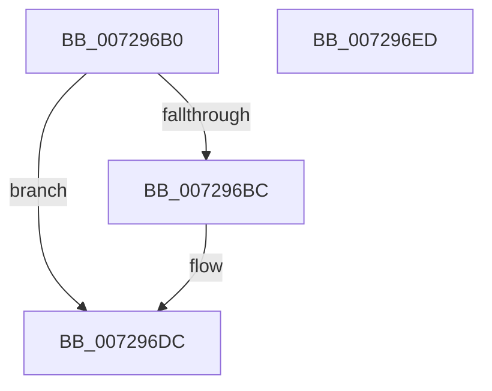

# IoGetIommuInterface

- RVA: `0x007296B0`–`0x007296EE` (길이 `62` bytes)
- VA: `0x00000001407296B0`
- 실행 섹션: `PAGE`
- PDB 이름 있음: `예`; PDB Function 태그: `아니요`
- unwind 정보 RVA: `0x0005D2F4`
- 디코드: `17`개 명령, `62/62` bytes 표시
- 미해석 바이트: `0` (있으면 어셈블리에 `.byte`로 보존)

> 이 문서는 커널 이미지의 기계어와 PDB 기호를 분석해 생성했습니다. 4번과 5번은 함수 원형과 자료형을 바이너리 사용 방식에서 추정한 C 해석이며 원본 소스 복구 결과는 아닙니다.

## 1. Dependencies

- 직접 호출 지점: **2**; 고유 호출 대상: **2**
- 직접 호출자로 확인된 함수: **0**
- RIP 상대 이미지 참조: **1**

### Outgoing calls
- `0x007296D6` → [KeBugCheckEx](../../text/4F/KeBugCheckEx_function_004FD660.md) (function, `0x004FD660`)
- `0x007296E3` → [guard_dispatch_icall](../../text/6B/guard_dispatch_icall_function_006BAAD0.md) (function, `0x006BAAD0`)

### Direct callers
- 이 함수 시작 RVA로 연결되는 직접 call은 확인되지 않았습니다. 간접 호출은 완전히 역산할 수 없습니다.

### Static image references
- `0x007296DC` → RVA `0x00E00C30` (`.data`; read)

## 2. Other-region calls and transfers

- 다른 실행 섹션으로 향하는 call: **2**
  - `0x007296D6` → [KeBugCheckEx](../../text/4F/KeBugCheckEx_function_004FD660.md) (`PAGE` → `.text`)
  - `0x007296E3` → [guard_dispatch_icall](../../text/6B/guard_dispatch_icall_function_006BAAD0.md) (`PAGE` → `.text`)
- 별도 외부 분기/꼬리 이동을 확인하지 못했습니다.

## 3. Assembly (complete function range)

```asm
007296B0  48 83 EC 38                     sub rsp, 0x38
007296B4  44 0F 20 C0                     mov rax, cr8
007296B8  84 C0                           test al, al
007296BA  74 20                           je 0x1407296dc
007296BC  44 0F 20 C0                     mov rax, cr8
007296C0  48 83 64 24 20 00               and qword ptr [rsp + 0x20], 0
007296C6  45 33 C9                        xor r9d, r9d
007296C9  44 0F B6 C0                     movzx r8d, al
007296CD  B9 21 01 00 00                  mov ecx, 0x121
007296D2  41 8D 51 01                     lea edx, [r9 + 1]
007296D6  E8 85 3F DD FF                  call 0x1404fd660
007296DB  CC                              int3
007296DC  48 8B 05 4D 75 6D 00            mov rax, qword ptr [rip + 0x6d754d]
007296E3  E8 E8 13 F9 FF                  call 0x1406baad0
007296E8  48 83 C4 38                     add rsp, 0x38
007296EC  C3                              ret
007296ED  CC                              int3
```

## 4. C-style interpretation (structured pseudocode)

```c
__int64 __fastcall IoGetIommuInterface(__int64 a1, __int64 a2, __int64 a3, int a4)
{
    __int64 result;
    __int64 v_rsp;
    unsigned __int64 v_stack_m18;

    v_rsp = (v_rsp) - (56);
    result = v_cr8;
    if ((unsigned __int8)(v_cr8) != 0) {
        result = v_cr8;
        a4 = 0;
        a3 = (unsigned __int8)(result);
        a1 = 289;
        a2 = a4 + 1;
        result = KeBugCheckEx(a1, a2, a3, a4);
    }
    result = guard_dispatch_icall(a1, a2, a3, a4);
    v_rsp = (v_rsp) + (56);
    return result;
}
```

## 5. (Beta) C Style

```c
int64_t IoGetIommuInterface(int64_t Arg1, int64_t Arg2, int64_t Arg3, int32_t Arg4)
{
    int64_t result;
    int64_t local_rsp;
    uint64_t v_stack_m18;

    local_rsp = (local_rsp) - (56);
    result = v_cr8;
    if ((uint8_t)(v_cr8) != 0) {
        result = v_cr8;
        Arg4 = 0;
        Arg3 = (uint8_t)(result);
        Arg1 = 289;
        Arg2 = Arg4 + 1;
        result = KeBugCheckEx(Arg1, Arg2, Arg3, Arg4);
    }
    result = guard_dispatch_icall(Arg1, Arg2, Arg3, Arg4);
    local_rsp = (local_rsp) + (56);
    return result;
}
```

## 6. Execution-region graph

[열기: 2D/3D 그래프와 함수 탐색 컨트롤 패널](../../../control-panel.html?section=page&rva=0x007296B0&view=graph)

- 2D 그래프는 위에서 아래로 흐르고, 3D 그래프는 빈 공간을 드래그해 회전합니다. Shift+드래그는 이동, 휠은 확대·축소, 함수 노드 선택은 대상 보고서 이동입니다.

### Static fallback


