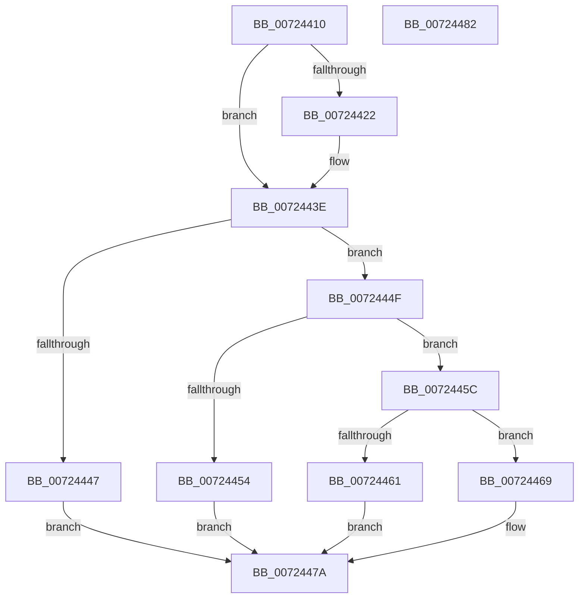

# IoGetKsrPersistentMemoryBuffer

- RVA: `0x00724410`–`0x00724483` (길이 `115` bytes)
- VA: `0x0000000140724410`
- 실행 섹션: `PAGE`
- PDB 이름 있음: `예`; PDB Function 태그: `아니요`
- unwind 정보 RVA: `0x0005D2F4`
- 디코드: `36`개 명령, `115/115` bytes 표시
- 미해석 바이트: `0` (있으면 어셈블리에 `.byte`로 보존)

> 이 문서는 커널 이미지의 기계어와 PDB 기호를 분석해 생성했습니다. 4번과 5번은 함수 원형과 자료형을 바이너리 사용 방식에서 추정한 C 해석이며 원본 소스 복구 결과는 아닙니다.

## 1. Dependencies

- 직접 호출 지점: **1**; 고유 호출 대상: **1**
- 직접 호출자로 확인된 함수: **0**
- RIP 상대 이미지 참조: **0**

### Outgoing calls
- `0x00724438` → [KeBugCheckEx](../../text/4F/KeBugCheckEx_function_004FD660.md) (function, `0x004FD660`)

### Direct callers
- 이 함수 시작 RVA로 연결되는 직접 call은 확인되지 않았습니다. 간접 호출은 완전히 역산할 수 없습니다.

### Static image references
- 디코드된 RIP-relative 메모리 참조가 없습니다.

## 2. Other-region calls and transfers

- 다른 실행 섹션으로 향하는 call: **1**
  - `0x00724438` → [KeBugCheckEx](../../text/4F/KeBugCheckEx_function_004FD660.md) (`PAGE` → `.text`)
- 별도 외부 분기/꼬리 이동을 확인하지 못했습니다.

## 3. Assembly (complete function range)

```asm
00724410  48 83 EC 38                     sub rsp, 0x38
00724414  4C 8B D2                        mov r10, rdx
00724417  45 33 C9                        xor r9d, r9d
0072441A  44 0F 20 C0                     mov rax, cr8
0072441E  84 C0                           test al, al
00724420  74 1C                           je 0x14072443e
00724422  44 0F 20 C0                     mov rax, cr8
00724426  44 0F B6 C0                     movzx r8d, al
0072442A  41 8D 51 01                     lea edx, [r9 + 1]
0072442E  B9 21 01 00 00                  mov ecx, 0x121
00724433  4C 89 4C 24 20                  mov qword ptr [rsp + 0x20], r9
00724438  E8 23 92 DD FF                  call 0x1404fd660
0072443D  CC                              int3
0072443E  8B 01                           mov eax, dword ptr [rcx]
00724440  FF C8                           dec eax
00724442  83 F8 01                        cmp eax, 1
00724445  76 08                           jbe 0x14072444f
00724447  41 B9 EF 00 00 C0               mov r9d, 0xc00000ef
0072444D  EB 2B                           jmp 0x14072447a
0072444F  4D 85 C0                        test r8, r8
00724452  75 08                           jne 0x14072445c
00724454  41 B9 F0 00 00 C0               mov r9d, 0xc00000f0
0072445A  EB 1E                           jmp 0x14072447a
0072445C  4D 85 D2                        test r10, r10
0072445F  75 08                           jne 0x140724469
00724461  41 B9 F1 00 00 C0               mov r9d, 0xc00000f1
00724467  EB 11                           jmp 0x14072447a
00724469  48 8B 51 28                     mov rdx, qword ptr [rcx + 0x28]
0072446D  48 8B 0A                        mov rcx, qword ptr [rdx]
00724470  49 89 08                        mov qword ptr [r8], rcx
00724473  48 8D 4A 08                     lea rcx, [rdx + 8]
00724477  49 89 0A                        mov qword ptr [r10], rcx
0072447A  41 8B C1                        mov eax, r9d
0072447D  48 83 C4 38                     add rsp, 0x38
00724481  C3                              ret
00724482  CC                              int3
```

## 4. C-style interpretation (structured pseudocode)

```c
__int64 __fastcall IoGetKsrPersistentMemoryBuffer(__int64 a1, __int64 a2, __int64 a3, int a4)
{
    __int64 result;
    __int64 v_rsp;
    unsigned __int64 v_stack_m18;

    v_rsp = (v_rsp) - (56);
    a4 = 0;
    result = v_cr8;
    if ((unsigned __int8)(v_cr8) != 0) {
        result = v_cr8;
        a3 = (unsigned __int8)(result);
        a2 = a4 + 1;
        a1 = 289;
        v_stack_m18 = 0;
        result = KeBugCheckEx(a1, a2, a3, a4);
    }
    result = (unsigned int)(((unsigned int)(*(unsigned int *)(a1))) - 1);
    if (((unsigned int)(result)) <= 1) goto loc_0072444F;
    goto loc_0072447A;
loc_0072444F:
    if (a3 != 0) goto loc_0072445C;
    goto loc_0072447A;
loc_0072445C:
    if (a2 != 0) goto loc_00724469;
    goto loc_0072447A;
loc_00724469:
    *(unsigned __int64 *)(a3) = *(unsigned __int64 *)(*(unsigned __int64 *)(a1 + 40));
    *(unsigned __int64 *)(a2) = *(unsigned __int64 *)(a1 + 40) + 8;
loc_0072447A:
    v_rsp = (v_rsp) + (56);
    return (unsigned int)((unsigned int)((unsigned int)(0xC00000F1ULL)));
}
```

## 5. (Beta) C Style

```c
int64_t IoGetKsrPersistentMemoryBuffer(int64_t Arg1, int64_t Arg2, int64_t Arg3, int32_t Arg4)
{
    int64_t result;
    int64_t local_rsp;
    uint64_t v_stack_m18;

    local_rsp = (local_rsp) - (56);
    Arg4 = 0;
    result = v_cr8;
    if ((uint8_t)(v_cr8) != 0) {
        result = v_cr8;
        Arg3 = (uint8_t)(result);
        Arg2 = Arg4 + 1;
        Arg1 = 289;
        v_stack_m18 = 0;
        result = KeBugCheckEx(Arg1, Arg2, Arg3, Arg4);
    }
    result = (uint32_t)(((uint32_t)(*(uint32_t *)(Arg1))) - 1);
    if (((uint32_t)(result)) <= 1) goto loc_0072444F;
    goto loc_0072447A;
loc_0072444F:
    if (Arg3 != 0) goto loc_0072445C;
    goto loc_0072447A;
loc_0072445C:
    if (Arg2 != 0) goto loc_00724469;
    goto loc_0072447A;
loc_00724469:
    *(uint64_t *)(Arg3) = *(uint64_t *)(*(uint64_t *)(Arg1 + 0x28));
    *(uint64_t *)(Arg2) = *(uint64_t *)(Arg1 + 0x28) + 8;
loc_0072447A:
    local_rsp = (local_rsp) + (56);
    return (uint32_t)((uint32_t)((uint32_t)(0xC00000F1ULL)));
}
```

## 6. Execution-region graph

[열기: 2D/3D 그래프와 함수 탐색 컨트롤 패널](../../../control-panel.html?section=page&rva=0x00724410&view=graph)

- 2D 그래프는 위에서 아래로 흐르고, 3D 그래프는 빈 공간을 드래그해 회전합니다. Shift+드래그는 이동, 휠은 확대·축소, 함수 노드 선택은 대상 보고서 이동입니다.

### Static fallback


