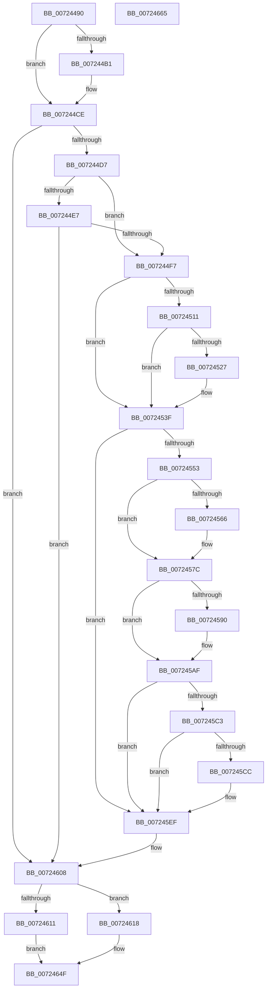

# IoMapKsrPersistentMemoryEx

- RVA: `0x00724490`–`0x00724666` (길이 `470` bytes)
- VA: `0x0000000140724490`
- 실행 섹션: `PAGE`
- PDB 이름 있음: `예`; PDB Function 태그: `아니요`
- unwind 정보 RVA: `0x000BE9D0`
- 디코드: `118`개 명령, `470/470` bytes 표시
- 미해석 바이트: `0` (있으면 어셈블리에 `.byte`로 보존)

> 이 문서는 커널 이미지의 기계어와 PDB 기호를 분석해 생성했습니다. 4번과 5번은 함수 원형과 자료형을 바이너리 사용 방식에서 추정한 C 해석이며 원본 소스 복구 결과는 아닙니다.

## 1. Dependencies

- 직접 호출 지점: **14**; 고유 호출 대상: **3**
- 직접 호출자로 확인된 함수: **0**
- RIP 상대 이미지 참조: **1**

### Outgoing calls
- `0x007244C8` → [KeBugCheckEx](../../text/4F/KeBugCheckEx_function_004FD660.md) (function, `0x004FD660`)
- `0x007244FE` → [IoAddTriageDumpDataBlock](../../text/42/IoAddTriageDumpDataBlock_function_00428374.md) (function, `0x00428374`)
- `0x00724515` → [IoAddTriageDumpDataBlock](../../text/42/IoAddTriageDumpDataBlock_function_00428374.md) (function, `0x00428374`)
- `0x00724529` → [IoAddTriageDumpDataBlock](../../text/42/IoAddTriageDumpDataBlock_function_00428374.md) (function, `0x00428374`)
- `0x0072453A` → [IoAddTriageDumpDataBlock](../../text/42/IoAddTriageDumpDataBlock_function_00428374.md) (function, `0x00428374`)
- `0x0072455C` → [IoAddTriageDumpDataBlock](../../text/42/IoAddTriageDumpDataBlock_function_00428374.md) (function, `0x00428374`)
- `0x0072456B` → [IoAddTriageDumpDataBlock](../../text/42/IoAddTriageDumpDataBlock_function_00428374.md) (function, `0x00428374`)
- `0x00724577` → [IoAddTriageDumpDataBlock](../../text/42/IoAddTriageDumpDataBlock_function_00428374.md) (function, `0x00428374`)
- `0x00724592` → [IoAddTriageDumpDataBlock](../../text/42/IoAddTriageDumpDataBlock_function_00428374.md) (function, `0x00428374`)
- `0x007245AA` → [IoAddTriageDumpDataBlock](../../text/42/IoAddTriageDumpDataBlock_function_00428374.md) (function, `0x00428374`)
- `0x007245CE` → [IoAddTriageDumpDataBlock](../../text/42/IoAddTriageDumpDataBlock_function_00428374.md) (function, `0x00428374`)
- `0x007245EA` → [IoAddTriageDumpDataBlock](../../text/42/IoAddTriageDumpDataBlock_function_00428374.md) (function, `0x00428374`)
- `0x00724602` → [KeBugCheckEx](../../text/4F/KeBugCheckEx_function_004FD660.md) (function, `0x004FD660`)
- `0x0072464A` → [PipGetPersistentMemory](PipGetPersistentMemory_function_00725290.md) (function, `0x00725290`)

### Direct callers
- 이 함수 시작 RVA로 연결되는 직접 call은 확인되지 않았습니다. 간접 호출은 완전히 역산할 수 없습니다.

### Static image references
- `0x00724608` → RVA `0x00F8A988` (`.data`; read)

## 2. Other-region calls and transfers

- 다른 실행 섹션으로 향하는 call: **13**
  - `0x007244C8` → [KeBugCheckEx](../../text/4F/KeBugCheckEx_function_004FD660.md) (`PAGE` → `.text`)
  - `0x007244FE` → [IoAddTriageDumpDataBlock](../../text/42/IoAddTriageDumpDataBlock_function_00428374.md) (`PAGE` → `.text`)
  - `0x00724515` → [IoAddTriageDumpDataBlock](../../text/42/IoAddTriageDumpDataBlock_function_00428374.md) (`PAGE` → `.text`)
  - `0x00724529` → [IoAddTriageDumpDataBlock](../../text/42/IoAddTriageDumpDataBlock_function_00428374.md) (`PAGE` → `.text`)
  - `0x0072453A` → [IoAddTriageDumpDataBlock](../../text/42/IoAddTriageDumpDataBlock_function_00428374.md) (`PAGE` → `.text`)
  - `0x0072455C` → [IoAddTriageDumpDataBlock](../../text/42/IoAddTriageDumpDataBlock_function_00428374.md) (`PAGE` → `.text`)
  - `0x0072456B` → [IoAddTriageDumpDataBlock](../../text/42/IoAddTriageDumpDataBlock_function_00428374.md) (`PAGE` → `.text`)
  - `0x00724577` → [IoAddTriageDumpDataBlock](../../text/42/IoAddTriageDumpDataBlock_function_00428374.md) (`PAGE` → `.text`)
  - `0x00724592` → [IoAddTriageDumpDataBlock](../../text/42/IoAddTriageDumpDataBlock_function_00428374.md) (`PAGE` → `.text`)
  - `0x007245AA` → [IoAddTriageDumpDataBlock](../../text/42/IoAddTriageDumpDataBlock_function_00428374.md) (`PAGE` → `.text`)
  - `0x007245CE` → [IoAddTriageDumpDataBlock](../../text/42/IoAddTriageDumpDataBlock_function_00428374.md) (`PAGE` → `.text`)
  - `0x007245EA` → [IoAddTriageDumpDataBlock](../../text/42/IoAddTriageDumpDataBlock_function_00428374.md) (`PAGE` → `.text`)
  - `0x00724602` → [KeBugCheckEx](../../text/4F/KeBugCheckEx_function_004FD660.md) (`PAGE` → `.text`)
- 별도 외부 분기/꼬리 이동을 확인하지 못했습니다.

## 3. Assembly (complete function range)

```asm
00724490  4C 8B DC                        mov r11, rsp
00724493  49 89 5B 08                     mov qword ptr [r11 + 8], rbx
00724497  49 89 6B 10                     mov qword ptr [r11 + 0x10], rbp
0072449B  49 89 73 18                     mov qword ptr [r11 + 0x18], rsi
0072449F  57                              push rdi
007244A0  48 83 EC 60                     sub rsp, 0x60
007244A4  48 8B DA                        mov rbx, rdx
007244A7  44 0F 20 C0                     mov rax, cr8
007244AB  33 F6                           xor esi, esi
007244AD  84 C0                           test al, al
007244AF  74 1D                           je 0x1407244ce
007244B1  44 0F 20 C0                     mov rax, cr8
007244B5  44 0F B6 C0                     movzx r8d, al
007244B9  8D 56 01                        lea edx, [rsi + 1]
007244BC  45 33 C9                        xor r9d, r9d
007244BF  49 89 73 B8                     mov qword ptr [r11 - 0x48], rsi
007244C3  B9 21 01 00 00                  mov ecx, 0x121
007244C8  E8 93 91 DD FF                  call 0x1404fd660
007244CD  CC                              int3
007244CE  48 85 DB                        test rbx, rbx
007244D1  0F 84 31 01 00 00               je 0x140724608
007244D7  48 8B 82 38 01 00 00            mov rax, qword ptr [rdx + 0x138]
007244DE  48 8B 40 28                     mov rax, qword ptr [rax + 0x28]
007244E2  48 85 C0                        test rax, rax
007244E5  74 10                           je 0x1407244f7
007244E7  F7 80 8C 01 00 00 00 00 02 00   test dword ptr [rax + 0x18c], 0x20000
007244F1  0F 84 11 01 00 00               je 0x140724608
007244F7  0F B7 52 02                     movzx edx, word ptr [rdx + 2]
007244FB  48 8B CB                        mov rcx, rbx
007244FE  E8 71 3E D0 FF                  call 0x140428374
00724503  48 8B 4B 08                     mov rcx, qword ptr [rbx + 8]
00724507  BD 02 00 00 00                  mov ebp, 2
0072450C  48 85 C9                        test rcx, rcx
0072450F  74 2E                           je 0x14072453f
00724511  0F BF 51 02                     movsx edx, word ptr [rcx + 2]
00724515  E8 5A 3E D0 FF                  call 0x140428374
0072451A  48 8B 4B 08                     mov rcx, qword ptr [rbx + 8]
0072451E  48 83 C1 38                     add rcx, 0x38
00724522  66 39 31                        cmp word ptr [rcx], si
00724525  74 18                           je 0x14072453f
00724527  8B D5                           mov edx, ebp
00724529  E8 46 3E D0 FF                  call 0x140428374
0072452E  48 8B 4B 08                     mov rcx, qword ptr [rbx + 8]
00724532  0F B7 51 38                     movzx edx, word ptr [rcx + 0x38]
00724536  48 8B 49 40                     mov rcx, qword ptr [rcx + 0x40]
0072453A  E8 35 3E D0 FF                  call 0x140428374
0072453F  48 8B 83 38 01 00 00            mov rax, qword ptr [rbx + 0x138]
00724546  48 8B 48 28                     mov rcx, qword ptr [rax + 0x28]
0072454A  48 85 C9                        test rcx, rcx
0072454D  0F 84 9C 00 00 00               je 0x1407245ef
00724553  BA 88 03 00 00                  mov edx, 0x388
00724558  48 8D 79 28                     lea rdi, [rcx + 0x28]
0072455C  E8 13 3E D0 FF                  call 0x140428374
00724561  66 39 37                        cmp word ptr [rdi], si
00724564  74 16                           je 0x14072457c
00724566  8B D5                           mov edx, ebp
00724568  48 8B CF                        mov rcx, rdi
0072456B  E8 04 3E D0 FF                  call 0x140428374
00724570  0F B7 17                        movzx edx, word ptr [rdi]
00724573  48 8B 4F 08                     mov rcx, qword ptr [rdi + 8]
00724577  E8 F8 3D D0 FF                  call 0x140428374
0072457C  48 8B 83 38 01 00 00            mov rax, qword ptr [rbx + 0x138]
00724583  48 8B 48 28                     mov rcx, qword ptr [rax + 0x28]
00724587  48 83 C1 38                     add rcx, 0x38
0072458B  66 39 31                        cmp word ptr [rcx], si
0072458E  74 1F                           je 0x1407245af
00724590  8B D5                           mov edx, ebp
00724592  E8 DD 3D D0 FF                  call 0x140428374
00724597  48 8B 83 38 01 00 00            mov rax, qword ptr [rbx + 0x138]
0072459E  48 8B 48 28                     mov rcx, qword ptr [rax + 0x28]
007245A2  0F B7 51 38                     movzx edx, word ptr [rcx + 0x38]
007245A6  48 8B 49 40                     mov rcx, qword ptr [rcx + 0x40]
007245AA  E8 C5 3D D0 FF                  call 0x140428374
007245AF  48 8B 83 38 01 00 00            mov rax, qword ptr [rbx + 0x138]
007245B6  48 8B 48 28                     mov rcx, qword ptr [rax + 0x28]
007245BA  48 8B 41 10                     mov rax, qword ptr [rcx + 0x10]
007245BE  48 85 C0                        test rax, rax
007245C1  74 2C                           je 0x1407245ef
007245C3  48 8D 48 38                     lea rcx, [rax + 0x38]
007245C7  66 39 31                        cmp word ptr [rcx], si
007245CA  74 23                           je 0x1407245ef
007245CC  8B D5                           mov edx, ebp
007245CE  E8 A1 3D D0 FF                  call 0x140428374
007245D3  48 8B 83 38 01 00 00            mov rax, qword ptr [rbx + 0x138]
007245DA  48 8B 48 28                     mov rcx, qword ptr [rax + 0x28]
007245DE  48 8B 49 10                     mov rcx, qword ptr [rcx + 0x10]
007245E2  0F B7 51 38                     movzx edx, word ptr [rcx + 0x38]
007245E6  48 8B 49 40                     mov rcx, qword ptr [rcx + 0x40]
007245EA  E8 85 3D D0 FF                  call 0x140428374
007245EF  45 33 C9                        xor r9d, r9d
007245F2  48 89 74 24 20                  mov qword ptr [rsp + 0x20], rsi
007245F7  4C 8B C3                        mov r8, rbx
007245FA  48 8B D5                        mov rdx, rbp
007245FD  B9 CA 00 00 00                  mov ecx, 0xca
00724602  E8 59 90 DD FF                  call 0x1404fd660
00724607  CC                              int3
00724608  40 38 35 79 63 86 00            cmp byte ptr [rip + 0x866379], sil
0072460F  75 07                           jne 0x140724618
00724611  B8 BB 00 00 C0                  mov eax, 0xc00000bb
00724616  EB 37                           jmp 0x14072464f
00724618  48 8B 84 24 98 00 00 00         mov rax, qword ptr [rsp + 0x98]
00724620  89 74 24 40                     mov dword ptr [rsp + 0x40], esi
00724624  48 89 44 24 38                  mov qword ptr [rsp + 0x38], rax
00724629  48 8D 44 24 50                  lea rax, [rsp + 0x50]
0072462E  48 89 74 24 30                  mov qword ptr [rsp + 0x30], rsi
00724633  48 89 44 24 28                  mov qword ptr [rsp + 0x28], rax
00724638  48 8B 84 24 90 00 00 00         mov rax, qword ptr [rsp + 0x90]
00724640  48 89 44 24 20                  mov qword ptr [rsp + 0x20], rax
00724645  48 89 74 24 50                  mov qword ptr [rsp + 0x50], rsi
0072464A  E8 41 0C 00 00                  call 0x140725290
0072464F  4C 8D 5C 24 60                  lea r11, [rsp + 0x60]
00724654  49 8B 5B 10                     mov rbx, qword ptr [r11 + 0x10]
00724658  49 8B 6B 18                     mov rbp, qword ptr [r11 + 0x18]
0072465C  49 8B 73 20                     mov rsi, qword ptr [r11 + 0x20]
00724660  49 8B E3                        mov rsp, r11
00724663  5F                              pop rdi
00724664  C3                              ret
00724665  CC                              int3
```

## 4. C-style interpretation (structured pseudocode)

```c
__int64 __fastcall IoMapKsrPersistentMemoryEx(__int64 a1, __int64 a2, __int64 a3, int a4, __int64 a5, __int64 a6)
{
    __int64 result;
    __int64 v_rsi;
    __int64 v_rsp;
    unsigned __int64 v_stack_m18;
    unsigned int v_stack_m28;
    unsigned __int64 v_stack_m30;
    unsigned __int64 v_stack_m38;
    unsigned __int64 v_stack_m40;
    unsigned __int64 v_stack_m48;
    unsigned __int64 v_stack_m8;

    *(unsigned __int64 *)(v_rsp + 8) = v_rbx;
    *(unsigned __int64 *)(v_rsp + 16) = v_rbp;
    *(unsigned __int64 *)(v_rsp + 24) = v_rsi;
    v_rsp = (v_rsp) - (96);
    v_rsi = 0;
    result = v_cr8;
    if ((unsigned __int8)(v_cr8) != 0) {
        result = v_cr8;
        a3 = (unsigned __int8)(result);
        a2 = v_rsi + 1;
        a4 = 0;
        *(unsigned __int64 *)(v_rsp - 72) = 0;
        a1 = 289;
        result = KeBugCheckEx(a1, a2, a3, a4);
    }
    if (a2 == 0) goto loc_00724608;
    if (*(unsigned __int64 *)(*(unsigned __int64 *)(a2 + 312) + 40) == 0) goto loc_007244F7;
    if (((*(unsigned int *)(*(unsigned __int64 *)(*(unsigned __int64 *)(a2 + 312) + 40) + 396)) & (0x20000ULL)) == 0) goto loc_00724608;
loc_007244F7:
    result = IoAddTriageDumpDataBlock(a2, *(unsigned __int16 *)(a2 + 2), a3, a4);
    if (*(unsigned __int64 *)(a2 + 8) == 0) goto loc_0072453F;
    result = IoAddTriageDumpDataBlock(*(unsigned __int64 *)(a2 + 8), (__int16)(*(unsigned __int16 *)(*(unsigned __int64 *)(a2 + 8) + 2)), a3, a4);
    a1 = (*(unsigned __int64 *)(a2 + 8)) + (56);
    if ((*(unsigned __int16 *)(a1)) != 0) {
        a2 = 2;
        result = IoAddTriageDumpDataBlock(a1, a2, a3, a4);
        a1 = *(unsigned __int64 *)(a2 + 8);
        a2 = *(unsigned __int16 *)(a1 + 56);
        a1 = *(unsigned __int64 *)(a1 + 64);
        result = IoAddTriageDumpDataBlock(a1, a2, a3, a4);
    }
    if (*(unsigned __int64 *)(*(unsigned __int64 *)(a2 + 312) + 40) == 0) goto loc_007245EF;
    result = IoAddTriageDumpDataBlock(*(unsigned __int64 *)(*(unsigned __int64 *)(a2 + 312) + 40), 904, a3, a4);
    if ((*(unsigned __int16 *)(*(unsigned __int64 *)(*(unsigned __int64 *)(a2 + 312) + 40) + 40)) != 0) {
        a2 = 2;
        a1 = *(unsigned __int64 *)(*(unsigned __int64 *)(a2 + 312) + 40) + 40;
        result = IoAddTriageDumpDataBlock(a1, a2, a3, a4);
        a2 = *(unsigned __int16 *)(*(unsigned __int64 *)(*(unsigned __int64 *)(a2 + 312) + 40) + 40);
        a1 = *(unsigned __int64 *)(*(unsigned __int64 *)(*(unsigned __int64 *)(a2 + 312) + 40) + 40 + 8);
        result = IoAddTriageDumpDataBlock(a1, a2, a3, a4);
    }
    a1 = (*(unsigned __int64 *)(*(unsigned __int64 *)(a2 + 312) + 40)) + (56);
    result = *(unsigned __int64 *)(a2 + 312);
    if ((*(unsigned __int16 *)(a1)) != 0) {
        a2 = 2;
        result = IoAddTriageDumpDataBlock(a1, a2, a3, a4);
        result = *(unsigned __int64 *)(a2 + 312);
        a1 = *(unsigned __int64 *)(result + 40);
        a2 = *(unsigned __int16 *)(a1 + 56);
        a1 = *(unsigned __int64 *)(a1 + 64);
        result = IoAddTriageDumpDataBlock(a1, a2, a3, a4);
    }
    if (*(unsigned __int64 *)(*(unsigned __int64 *)(*(unsigned __int64 *)(a2 + 312) + 40) + 16) == 0) goto loc_007245EF;
    result = *(unsigned __int64 *)(*(unsigned __int64 *)(*(unsigned __int64 *)(a2 + 312) + 40) + 16);
    if ((*(unsigned __int16 *)(*(unsigned __int64 *)(*(unsigned __int64 *)(*(unsigned __int64 *)(a2 + 312) + 40) + 16) + 56)) != 0) {
        a2 = 2;
        result = IoAddTriageDumpDataBlock(*(unsigned __int64 *)(*(unsigned __int64 *)(*(unsigned __int64 *)(a2 + 312) + 40) + 16) + 56, a2, a3, a4);
        result = *(unsigned __int64 *)(a2 + 312);
        a1 = *(unsigned __int64 *)(result + 40);
        a1 = *(unsigned __int64 *)(a1 + 16);
        a2 = *(unsigned __int16 *)(a1 + 56);
        a1 = *(unsigned __int64 *)(a1 + 64);
        result = IoAddTriageDumpDataBlock(a1, a2, a3, a4);
    }
    a4 = 0;
    v_stack_m48 = 0;
    result = KeBugCheckEx(202, 2, a2, a4);
loc_00724608:
    if ((*(unsigned __int8 *)(v_rip + 8807289)) != 0) goto loc_00724618;
    goto loc_0072464F;
loc_00724618:
    v_stack_m28 = 0;
    v_stack_m30 = a6;
    v_stack_m38 = 0;
    v_stack_m40 = v_stack_m18;
    v_stack_m48 = a5;
    v_stack_m18 = 0;
    result = PipGetPersistentMemory(202, 2, a2, a4);
loc_0072464F:
    return result;
}
```

## 5. (Beta) C Style

```c
int64_t IoMapKsrPersistentMemoryEx(int64_t Arg1, int64_t Arg2, int64_t Arg3, int32_t Arg4, int64_t Arg5, int64_t Arg6)
{
    int64_t result;
    int64_t local_rsi;
    int64_t local_rsp;
    uint64_t v_stack_m18;
    uint32_t v_stack_m28;
    uint64_t v_stack_m30;
    uint64_t v_stack_m38;
    uint64_t v_stack_m40;
    uint64_t v_stack_m48;
    uint64_t v_stack_m8;

    *(uint64_t *)(local_rsp + 0x8) = local_rbx;
    *(uint64_t *)(local_rsp + 0x10) = local_rbp;
    *(uint64_t *)(local_rsp + 0x18) = local_rsi;
    local_rsp = (local_rsp) - (96);
    local_rsi = 0;
    result = v_cr8;
    if ((uint8_t)(v_cr8) != 0) {
        result = v_cr8;
        Arg3 = (uint8_t)(result);
        Arg2 = local_rsi + 1;
        Arg4 = 0;
        *(uint64_t *)(local_rsp - 0x48) = 0;
        Arg1 = 289;
        result = KeBugCheckEx(Arg1, Arg2, Arg3, Arg4);
    }
    if (Arg2 == 0) goto loc_00724608;
    if (*(uint64_t *)(*(uint64_t *)(Arg2 + 0x138) + 0x28) == 0) goto loc_007244F7;
    if (((*(uint32_t *)(*(uint64_t *)(*(uint64_t *)(Arg2 + 0x138) + 0x28) + 0x18C)) & (0x20000ULL)) == 0) goto loc_00724608;
loc_007244F7:
    result = IoAddTriageDumpDataBlock(Arg2, *(uint16_t *)(Arg2 + 0x2), Arg3, Arg4);
    if (*(uint64_t *)(Arg2 + 0x8) == 0) goto loc_0072453F;
    result = IoAddTriageDumpDataBlock(*(uint64_t *)(Arg2 + 0x8), (int16_t)(*(uint16_t *)(*(uint64_t *)(Arg2 + 0x8) + 0x2)), Arg3, Arg4);
    Arg1 = (*(uint64_t *)(Arg2 + 0x8)) + (56);
    if ((*(uint16_t *)(Arg1)) != 0) {
        Arg2 = 2;
        result = IoAddTriageDumpDataBlock(Arg1, Arg2, Arg3, Arg4);
        Arg1 = *(uint64_t *)(Arg2 + 0x8);
        Arg2 = *(uint16_t *)(Arg1 + 0x38);
        Arg1 = *(uint64_t *)(Arg1 + 0x40);
        result = IoAddTriageDumpDataBlock(Arg1, Arg2, Arg3, Arg4);
    }
    if (*(uint64_t *)(*(uint64_t *)(Arg2 + 0x138) + 0x28) == 0) goto loc_007245EF;
    result = IoAddTriageDumpDataBlock(*(uint64_t *)(*(uint64_t *)(Arg2 + 0x138) + 0x28), 904, Arg3, Arg4);
    if ((*(uint16_t *)(*(uint64_t *)(*(uint64_t *)(Arg2 + 0x138) + 0x28) + 0x28)) != 0) {
        Arg2 = 2;
        Arg1 = *(uint64_t *)(*(uint64_t *)(Arg2 + 0x138) + 0x28) + 40;
        result = IoAddTriageDumpDataBlock(Arg1, Arg2, Arg3, Arg4);
        Arg2 = *(uint16_t *)(*(uint64_t *)(*(uint64_t *)(Arg2 + 0x138) + 0x28) + 0x28);
        Arg1 = *(uint64_t *)(*(uint64_t *)(*(uint64_t *)(Arg2 + 0x138) + 0x28) + 0x28 + 0x8);
        result = IoAddTriageDumpDataBlock(Arg1, Arg2, Arg3, Arg4);
    }
    Arg1 = (*(uint64_t *)(*(uint64_t *)(Arg2 + 0x138) + 0x28)) + (56);
    result = *(uint64_t *)(Arg2 + 0x138);
    if ((*(uint16_t *)(Arg1)) != 0) {
        Arg2 = 2;
        result = IoAddTriageDumpDataBlock(Arg1, Arg2, Arg3, Arg4);
        result = *(uint64_t *)(Arg2 + 0x138);
        Arg1 = *(uint64_t *)(result + 0x28);
        Arg2 = *(uint16_t *)(Arg1 + 0x38);
        Arg1 = *(uint64_t *)(Arg1 + 0x40);
        result = IoAddTriageDumpDataBlock(Arg1, Arg2, Arg3, Arg4);
    }
    if (*(uint64_t *)(*(uint64_t *)(*(uint64_t *)(Arg2 + 0x138) + 0x28) + 0x10) == 0) goto loc_007245EF;
    result = *(uint64_t *)(*(uint64_t *)(*(uint64_t *)(Arg2 + 0x138) + 0x28) + 0x10);
    if ((*(uint16_t *)(*(uint64_t *)(*(uint64_t *)(*(uint64_t *)(Arg2 + 0x138) + 0x28) + 0x10) + 0x38)) != 0) {
        Arg2 = 2;
        result = IoAddTriageDumpDataBlock(*(uint64_t *)(*(uint64_t *)(*(uint64_t *)(Arg2 + 0x138) + 0x28) + 0x10) + 56, Arg2, Arg3, Arg4);
        result = *(uint64_t *)(Arg2 + 0x138);
        Arg1 = *(uint64_t *)(result + 0x28);
        Arg1 = *(uint64_t *)(Arg1 + 0x10);
        Arg2 = *(uint16_t *)(Arg1 + 0x38);
        Arg1 = *(uint64_t *)(Arg1 + 0x40);
        result = IoAddTriageDumpDataBlock(Arg1, Arg2, Arg3, Arg4);
    }
    Arg4 = 0;
    v_stack_m48 = 0;
    result = KeBugCheckEx(202, 2, Arg2, Arg4);
loc_00724608:
    if ((*(uint8_t *)(v_rip + 0x866379)) != 0) goto loc_00724618;
    goto loc_0072464F;
loc_00724618:
    v_stack_m28 = 0;
    v_stack_m30 = Arg6;
    v_stack_m38 = 0;
    v_stack_m40 = v_stack_m18;
    v_stack_m48 = Arg5;
    v_stack_m18 = 0;
    result = PipGetPersistentMemory(202, 2, Arg2, Arg4);
loc_0072464F:
    return result;
}
```

## 6. Execution-region graph

[열기: 2D/3D 그래프와 함수 탐색 컨트롤 패널](../../../control-panel.html?section=page&rva=0x00724490&view=graph)

- 2D 그래프는 위에서 아래로 흐르고, 3D 그래프는 빈 공간을 드래그해 회전합니다. Shift+드래그는 이동, 휠은 확대·축소, 함수 노드 선택은 대상 보고서 이동입니다.

### Static fallback


