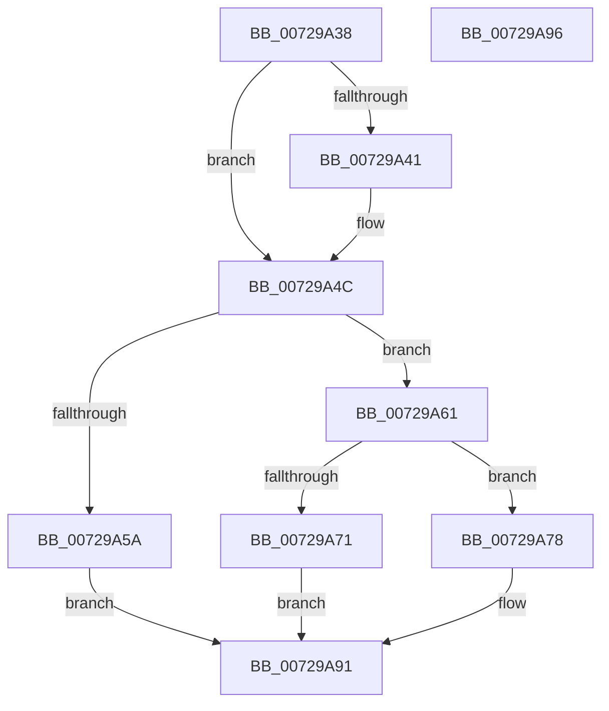

# IoNotifyPowerOperationVetoed

- RVA: `0x00729A38`–`0x00729A97` (길이 `95` bytes)
- VA: `0x0000000140729A38`
- 실행 섹션: `PAGE`
- PDB 이름 있음: `예`; PDB Function 태그: `아니요`
- unwind 정보 RVA: `0x0005D2F4`
- 디코드: `24`개 명령, `95/95` bytes 표시
- 미해석 바이트: `0` (있으면 어셈블리에 `.byte`로 보존)

> 이 문서는 커널 이미지의 기계어와 PDB 기호를 분석해 생성했습니다. 4번과 5번은 함수 원형과 자료형을 바이너리 사용 방식에서 추정한 C 해석이며 원본 소스 복구 결과는 아닙니다.

## 1. Dependencies

- 직접 호출 지점: **1**; 고유 호출 대상: **1**
- 직접 호출자로 확인된 함수: **1**
- RIP 상대 이미지 참조: **1**

### Outgoing calls
- `0x00729A8C` → [PnpSetPowerVetoEvent](../73/PnpSetPowerVetoEvent_function_007383E4.md) (function, `0x007383E4`)

### Direct callers
- [sub_00B80364](../../pagelk/B8/Unknown_function_00B80364.md) at `0x00B80425`

### Static image references
- `0x00729A41` → RVA `0x00F8C438` (`.data`; read)

## 2. Other-region calls and transfers

- 다른 실행 섹션으로 향하는 call: **0**
- 별도 외부 분기/꼬리 이동을 확인하지 못했습니다.

## 3. Assembly (complete function range)

```asm
00729A38  48 83 EC 38                     sub rsp, 0x38
00729A3C  48 85 D2                        test rdx, rdx
00729A3F  75 0B                           jne 0x140729a4c
00729A41  48 8B 05 F0 29 86 00            mov rax, qword ptr [rip + 0x8629f0]
00729A48  48 8B 50 20                     mov rdx, qword ptr [rax + 0x20]
00729A4C  48 8B 82 38 01 00 00            mov rax, qword ptr [rdx + 0x138]
00729A53  48 83 78 28 00                  cmp qword ptr [rax + 0x28], 0
00729A58  75 07                           jne 0x140729a61
00729A5A  B8 F0 00 00 C0                  mov eax, 0xc00000f0
00729A5F  EB 30                           jmp 0x140729a91
00729A61  49 8B 80 38 01 00 00            mov rax, qword ptr [r8 + 0x138]
00729A68  48 8B 40 28                     mov rax, qword ptr [rax + 0x28]
00729A6C  48 85 C0                        test rax, rax
00729A6F  75 07                           jne 0x140729a78
00729A71  B8 F1 00 00 C0                  mov eax, 0xc00000f1
00729A76  EB 19                           jmp 0x140729a91
00729A78  48 83 C0 28                     add rax, 0x28
00729A7C  4C 8B CA                        mov r9, rdx
00729A7F  48 89 44 24 28                  mov qword ptr [rsp + 0x28], rax
00729A84  C7 44 24 20 06 00 00 00         mov dword ptr [rsp + 0x20], 6
00729A8C  E8 53 E9 00 00                  call 0x1407383e4
00729A91  48 83 C4 38                     add rsp, 0x38
00729A95  C3                              ret
00729A96  CC                              int3
```

## 4. C-style interpretation (structured pseudocode)

```c
__int64 __fastcall IoNotifyPowerOperationVetoed(__int64 a1, __int64 a2, __int64 a3)
{
    __int64 result;
    __int64 v_rsp;
    unsigned __int64 v_stack_m10;
    unsigned int v_stack_m18;

    v_rsp = (v_rsp) - (56);
    if (a2 == 0) {
        result = *(unsigned __int64 *)(v_rip + 8792560);
        a2 = *(unsigned __int64 *)(result + 32);
    }
    if ((*(unsigned __int64 *)(*(unsigned __int64 *)(a2 + 312) + 40)) != 0) goto loc_00729A61;
    goto loc_00729A91;
loc_00729A61:
    if (*(unsigned __int64 *)(*(unsigned __int64 *)(a3 + 312) + 40) != 0) goto loc_00729A78;
    goto loc_00729A91;
loc_00729A78:
    result = ((unsigned int)(0xC00000F1ULL)) + (40);
    v_stack_m10 = result;
    v_stack_m18 = 6;
    result = PnpSetPowerVetoEvent(a1, a2, a3, a2);
loc_00729A91:
    v_rsp = (v_rsp) + (56);
    return result;
}
```

## 5. (Beta) C Style

```c
int64_t IoNotifyPowerOperationVetoed(int64_t Arg1, int64_t Arg2, void *Arg3)
{
    uint8_t *arg3 = (uint8_t *)Arg3;

    int64_t result;
    int64_t local_rsp;
    uint64_t v_stack_m10;
    uint32_t v_stack_m18;

    local_rsp = (local_rsp) - (56);
    if (Arg2 == 0) {
        result = *(uint64_t *)(v_rip + 0x8629F0);
        Arg2 = *(uint64_t *)(result + 0x20);
    }
    if ((*(uint64_t *)(*(uint64_t *)(Arg2 + 0x138) + 0x28)) != 0) goto loc_00729A61;
    goto loc_00729A91;
loc_00729A61:
    if (*(uint64_t *)(*(uint64_t *)(arg3 + 0x138) + 0x28) != 0) goto loc_00729A78;
    goto loc_00729A91;
loc_00729A78:
    result = ((uint32_t)(0xC00000F1ULL)) + (40);
    v_stack_m10 = result;
    v_stack_m18 = 6;
    result = PnpSetPowerVetoEvent(Arg1, Arg2, Arg3, Arg2);
loc_00729A91:
    local_rsp = (local_rsp) + (56);
    return result;
}
```

### 관측된 메모리 오프셋

구조체 형식이 확인되지 않은 접근은 인자 기준의 오프셋으로만 기록했습니다.

| 기준 인자 | 오프셋 표현 | 폭 (bit) | 접근 |
|---|---:|---:|---|
| `Arg3` | `+ 0x138` | `64` | `R` |

## 6. Execution-region graph

[열기: 2D/3D 그래프와 함수 탐색 컨트롤 패널](../../../control-panel.html?section=page&rva=0x00729A38&view=graph)

- 2D 그래프는 위에서 아래로 흐르고, 3D 그래프는 빈 공간을 드래그해 회전합니다. Shift+드래그는 이동, 휠은 확대·축소, 함수 노드 선택은 대상 보고서 이동입니다.

### Static fallback


