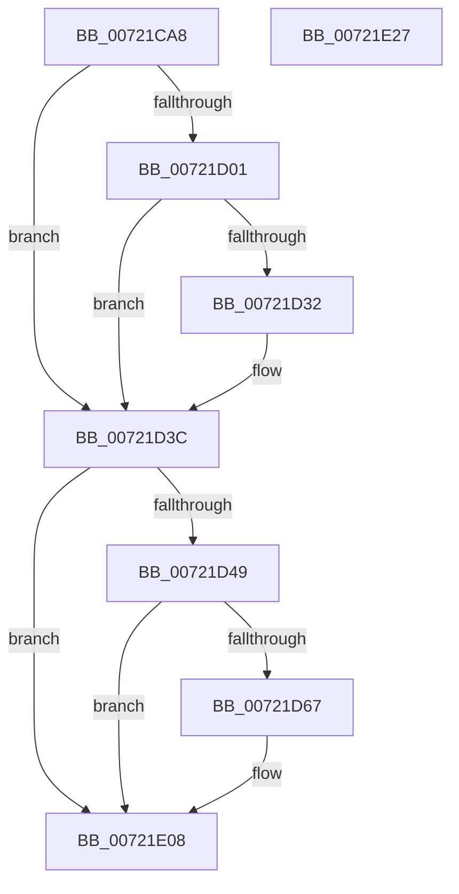

# IoQueryEnvironmentVariableInfoEx

- RVA: `0x00721CA8`–`0x00721E28` (길이 `384` bytes)
- VA: `0x0000000140721CA8`
- 실행 섹션: `PAGE`
- PDB 이름 있음: `예`; PDB Function 태그: `아니요`
- unwind 정보 RVA: `0x000C7D00`
- 디코드: `97`개 명령, `384/384` bytes 표시
- 미해석 바이트: `0` (있으면 어셈블리에 `.byte`로 보존)

> 이 문서는 커널 이미지의 기계어와 PDB 기호를 분석해 생성했습니다. 4번과 5번은 함수 원형과 자료형을 바이너리 사용 방식에서 추정한 C 해석이며 원본 소스 복구 결과는 아닙니다.

## 1. Dependencies

- 직접 호출 지점: **6**; 고유 호출 대상: **6**
- 직접 호출자로 확인된 함수: **1**
- RIP 상대 이미지 참조: **3**

### Outgoing calls
- `0x00721CF6` → [IopOpenSystemVariableDevice](../95/IopOpenSystemVariableDevice_function_00952910.md) (function, `0x00952910`)
- `0x00721D23` → [guard_dispatch_icall](../../text/6B/guard_dispatch_icall_function_006BAAD0.md) (function, `0x006BAAD0`)
- `0x00721D37` → [ObfDereferenceObject](../../text/2F/ObfDereferenceObject_function_002F9350.md) (function, `0x002F9350`)
- `0x00721D5A` → [tlgKeywordOn](../../text/42/tlgKeywordOn_function_0042EAA0.md) (function, `0x0042EAA0`)
- `0x00721E03` → [tlgWriteTransfer_EtwWriteTransfer](../../text/42/tlgWriteTransfer_EtwWriteTransfer_function_004260E0.md) (function, `0x004260E0`)
- `0x00721E11` → [_security_check_cookie](../../text/6A/_security_check_cookie_function_006AC640.md) (function, `0x006AC640`)

### Direct callers
- [NtQueryEnvironmentVariableInfoEx](../7C/NtQueryEnvironmentVariableInfoEx_function_007CDF00.md) at `0x007CDF70`

### Static image references
- `0x00721CBE` → RVA `0x00E0A740` (`.data`; read)
- `0x00721D3C` → RVA `0x00E06ED8` (`.data`; read)
- `0x00721DE0` → RVA `0x00046A74` (`.rdata`; read)

## 2. Other-region calls and transfers

- 다른 실행 섹션으로 향하는 call: **5**
  - `0x00721D23` → [guard_dispatch_icall](../../text/6B/guard_dispatch_icall_function_006BAAD0.md) (`PAGE` → `.text`)
  - `0x00721D37` → [ObfDereferenceObject](../../text/2F/ObfDereferenceObject_function_002F9350.md) (`PAGE` → `.text`)
  - `0x00721D5A` → [tlgKeywordOn](../../text/42/tlgKeywordOn_function_0042EAA0.md) (`PAGE` → `.text`)
  - `0x00721E03` → [tlgWriteTransfer_EtwWriteTransfer](../../text/42/tlgWriteTransfer_EtwWriteTransfer_function_004260E0.md) (`PAGE` → `.text`)
  - `0x00721E11` → [_security_check_cookie](../../text/6A/_security_check_cookie_function_006AC640.md) (`PAGE` → `.text`)
- 별도 외부 분기/꼬리 이동을 확인하지 못했습니다.

## 3. Assembly (complete function range)

```asm
00721CA8  40 55                           push rbp
00721CAA  53                              push rbx
00721CAB  56                              push rsi
00721CAC  41 54                           push r12
00721CAE  41 56                           push r14
00721CB0  41 57                           push r15
00721CB2  48 8D 6C 24 D1                  lea rbp, [rsp - 0x2f]
00721CB7  48 81 EC F8 00 00 00            sub rsp, 0xf8
00721CBE  48 8B 05 7B 8A 6E 00            mov rax, qword ptr [rip + 0x6e8a7b]
00721CC5  48 33 C4                        xor rax, rsp
00721CC8  48 89 45 17                     mov qword ptr [rbp + 0x17], rax
00721CCC  48 83 65 87 00                  and qword ptr [rbp - 0x79], 0
00721CD1  4D 8B F8                        mov r15, r8
00721CD4  48 83 64 24 40 00               and qword ptr [rsp + 0x40], 0
00721CDA  4C 8D 44 24 48                  lea r8, [rsp + 0x48]
00721CDF  48 83 64 24 48 00               and qword ptr [rsp + 0x48], 0
00721CE5  4C 8B F2                        mov r14, rdx
00721CE8  8B F1                           mov esi, ecx
00721CEA  48 8D 55 87                     lea rdx, [rbp - 0x79]
00721CEE  48 8D 4C 24 40                  lea rcx, [rsp + 0x40]
00721CF3  4D 8B E1                        mov r12, r9
00721CF6  E8 15 0C 23 00                  call 0x140952910
00721CFB  8B D8                           mov ebx, eax
00721CFD  85 C0                           test eax, eax
00721CFF  78 3B                           js 0x140721d3c
00721D01  48 8B 44 24 48                  mov rax, qword ptr [rsp + 0x48]
00721D06  4D 8B CE                        mov r9, r14
00721D09  48 8B 55 87                     mov rdx, qword ptr [rbp - 0x79]
00721D0D  44 8B C6                        mov r8d, esi
00721D10  48 8B 4C 24 40                  mov rcx, qword ptr [rsp + 0x40]
00721D15  4C 89 64 24 28                  mov qword ptr [rsp + 0x28], r12
00721D1A  48 8B 40 18                     mov rax, qword ptr [rax + 0x18]
00721D1E  4C 89 7C 24 20                  mov qword ptr [rsp + 0x20], r15
00721D23  E8 A8 8D F9 FF                  call 0x1406baad0
00721D28  48 83 7C 24 40 00               cmp qword ptr [rsp + 0x40], 0
00721D2E  8B D8                           mov ebx, eax
00721D30  74 0A                           je 0x140721d3c
00721D32  48 8B 4C 24 40                  mov rcx, qword ptr [rsp + 0x40]
00721D37  E8 14 76 BD FF                  call 0x1402f9350
00721D3C  83 3D 95 51 6E 00 05            cmp dword ptr [rip + 0x6e5195], 5
00721D43  0F 86 BF 00 00 00               jbe 0x140721e08
00721D49  48 BA 00 00 00 00 00 20 00 00   movabs rdx, 0x200000000000
00721D53  48 8D 0D 7E 51 6E 00            lea rcx, [rip + 0x6e517e]
00721D5A  E8 41 CD D0 FF                  call 0x14042eaa0
00721D5F  84 C0                           test al, al
00721D61  0F 84 A1 00 00 00               je 0x140721e08
00721D67  83 65 D3 00                     and dword ptr [rbp - 0x2d], 0
00721D6B  48 8D 44 24 48                  lea rax, [rsp + 0x48]
00721D70  83 65 E3 00                     and dword ptr [rbp - 0x1d], 0
00721D74  48 8D 0D 5D 51 6E 00            lea rcx, [rip + 0x6e515d]
00721D7B  83 65 F3 00                     and dword ptr [rbp - 0xd], 0
00721D7F  41 B8 04 00 00 00               mov r8d, 4
00721D85  83 65 03 00                     and dword ptr [rbp + 3], 0
00721D89  45 33 C9                        xor r9d, r9d
00721D8C  83 65 13 00                     and dword ptr [rbp + 0x13], 0
00721D90  48 89 45 C7                     mov qword ptr [rbp - 0x39], rax
00721D94  49 8B 06                        mov rax, qword ptr [r14]
00721D97  41 8D 50 04                     lea edx, [r8 + 4]
00721D9B  48 89 45 87                     mov qword ptr [rbp - 0x79], rax
00721D9F  48 8D 45 87                     lea rax, [rbp - 0x79]
00721DA3  48 89 45 D7                     mov qword ptr [rbp - 0x29], rax
00721DA7  49 8B 07                        mov rax, qword ptr [r15]
00721DAA  48 89 45 8F                     mov qword ptr [rbp - 0x71], rax
00721DAE  48 8D 45 8F                     lea rax, [rbp - 0x71]
00721DB2  48 89 45 E7                     mov qword ptr [rbp - 0x19], rax
00721DB6  49 8B 04 24                     mov rax, qword ptr [r12]
00721DBA  48 89 45 97                     mov qword ptr [rbp - 0x69], rax
00721DBE  48 8D 45 97                     lea rax, [rbp - 0x69]
00721DC2  48 89 45 F7                     mov qword ptr [rbp - 9], rax
00721DC6  48 8D 44 24 40                  lea rax, [rsp + 0x40]
00721DCB  48 89 45 07                     mov qword ptr [rbp + 7], rax
00721DCF  48 8D 45 A7                     lea rax, [rbp - 0x59]
00721DD3  44 89 45 CF                     mov dword ptr [rbp - 0x31], r8d
00721DD7  89 55 DF                        mov dword ptr [rbp - 0x21], edx
00721DDA  89 55 EF                        mov dword ptr [rbp - 0x11], edx
00721DDD  89 55 FF                        mov dword ptr [rbp - 1], edx
00721DE0  48 8D 15 8D 4C 92 FF            lea rdx, [rip - 0x6db373]
00721DE7  44 89 45 0F                     mov dword ptr [rbp + 0xf], r8d
00721DEB  45 33 C0                        xor r8d, r8d
00721DEE  48 89 44 24 28                  mov qword ptr [rsp + 0x28], rax
00721DF3  C7 44 24 20 07 00 00 00         mov dword ptr [rsp + 0x20], 7
00721DFB  89 74 24 48                     mov dword ptr [rsp + 0x48], esi
00721DFF  89 5C 24 40                     mov dword ptr [rsp + 0x40], ebx
00721E03  E8 D8 42 D0 FF                  call 0x1404260e0
00721E08  8B C3                           mov eax, ebx
00721E0A  48 8B 4D 17                     mov rcx, qword ptr [rbp + 0x17]
00721E0E  48 33 CC                        xor rcx, rsp
00721E11  E8 2A A8 F8 FF                  call 0x1406ac640
00721E16  48 81 C4 F8 00 00 00            add rsp, 0xf8
00721E1D  41 5F                           pop r15
00721E1F  41 5E                           pop r14
00721E21  41 5C                           pop r12
00721E23  5E                              pop rsi
00721E24  5B                              pop rbx
00721E25  5D                              pop rbp
00721E26  C3                              ret
00721E27  CC                              int3
```

## 4. C-style interpretation (structured pseudocode)

```c
__int64 __fastcall IoQueryEnvironmentVariableInfoEx(int a1, __int64 a2, __int64 a3, __int64 a4)
{
    __int64 result;
    __int64 v_rsp;
    unsigned __int64 v_stack_m100;
    unsigned __int64 v_stack_m108;
    unsigned __int64 v_stack_m48;
    unsigned int v_stack_m4C;
    unsigned int v_stack_m50;
    unsigned __int64 v_stack_m58;
    unsigned int v_stack_m5C;
    unsigned __int64 v_stack_m5F;
    unsigned int v_stack_m60;
    unsigned __int64 v_stack_m68;
    unsigned int v_stack_m6C;
    unsigned int v_stack_m70;
    unsigned __int64 v_stack_m78;
    unsigned int v_stack_m7C;
    unsigned int v_stack_m80;
    unsigned __int64 v_stack_m88;
    unsigned int v_stack_m8C;
    unsigned int v_stack_m90;
    unsigned __int64 v_stack_m98;
    unsigned __int64 v_stack_mB8;
    unsigned __int64 v_stack_mC8;
    unsigned __int64 v_stack_mD0;
    unsigned __int64 v_stack_mD8;
    unsigned __int64 v_stack_mE0;
    unsigned __int64 v_stack_mE8;

    v_rsp = (v_rsp) - (248);
    result = (*(unsigned __int64 *)(v_rip + 7244411)) ^ (v_rsp);
    v_stack_m48 = result;
    result = IopOpenSystemVariableDevice(v_stack_mE8, v_stack_mD8, v_stack_mE0, a4);
    if (sign_flag) goto loc_00721D3C;
    v_stack_m100 = a4;
    v_stack_m108 = a3;
    result = guard_dispatch_icall(v_stack_mE8, v_stack_mD8, (unsigned int)((unsigned int)((unsigned int)(a1))), a2);
    if (v_stack_mE8 != 0) {
        a1 = v_stack_mE8;
        result = ObfDereferenceObject(a1, v_stack_mD8, (unsigned int)((unsigned int)((unsigned int)(a1))), a2);
    }
    if ((*(unsigned int *)(v_rip + 7229845)) <= 5) goto loc_00721E08;
    result = tlgKeywordOn(v_rip + 7229822, v_stack_mD8, (unsigned int)((unsigned int)((unsigned int)(a1))), a2);
    if ((unsigned __int8)(result) != 0) {
        result = v_stack_mE0;
        a1 = v_rip + 7229789;
        a3 = 4;
        a4 = 0;
        v_stack_m98 = result;
        result = *(unsigned __int64 *)(a2);
        a2 = a3 + 4;
        v_stack_mD8 = result;
        result = v_stack_mD8;
        v_stack_m88 = result;
        result = *(unsigned __int64 *)(a3);
        v_stack_mD0 = result;
        result = v_stack_mD0;
        v_stack_m78 = result;
        result = *(unsigned __int64 *)(a4);
        v_stack_mC8 = result;
        result = v_stack_mC8;
        v_stack_m68 = result;
        result = v_stack_mE8;
        v_stack_m58 = result;
        result = v_stack_mB8;
        v_stack_m90 = (unsigned int)(a3);
        v_stack_m80 = (unsigned int)(a2);
        v_stack_m70 = (unsigned int)(a2);
        v_stack_m60 = (unsigned int)(a2);
        a2 = v_rip - 7189363;
        v_stack_m50 = (unsigned int)(a3);
        a3 = 0;
        v_stack_m100 = result;
        v_stack_m108 = 7;
        v_stack_mE0 = (unsigned int)((unsigned int)(a1));
        v_stack_mE8 = (unsigned int)((unsigned int)((unsigned int)(result)));
        result = tlgWriteTransfer_EtwWriteTransfer(a1, a2, a3, a4);
    }
    a1 = (v_stack_m48) ^ (v_rsp);
    result = _security_check_cookie(a1, a2, a3, a4);
    v_rsp = (v_rsp) + (248);
    return result;
}
```

## 5. (Beta) C Style

```c
int64_t IoQueryEnvironmentVariableInfoEx(int32_t Arg1, void *Arg2, void *Arg3, void *Arg4)
{
    uint8_t *arg2 = (uint8_t *)Arg2;
    uint8_t *arg3 = (uint8_t *)Arg3;
    uint8_t *arg4 = (uint8_t *)Arg4;

    int64_t result;
    int64_t local_rsp;
    uint64_t v_stack_m100;
    uint64_t v_stack_m108;
    uint64_t v_stack_m48;
    uint32_t v_stack_m4C;
    uint32_t v_stack_m50;
    uint64_t v_stack_m58;
    uint32_t v_stack_m5C;
    uint64_t v_stack_m5F;
    uint32_t v_stack_m60;
    uint64_t v_stack_m68;
    uint32_t v_stack_m6C;
    uint32_t v_stack_m70;
    uint64_t v_stack_m78;
    uint32_t v_stack_m7C;
    uint32_t v_stack_m80;
    uint64_t v_stack_m88;
    uint32_t v_stack_m8C;
    uint32_t v_stack_m90;
    uint64_t v_stack_m98;
    uint64_t v_stack_mB8;
    uint64_t v_stack_mC8;
    uint64_t v_stack_mD0;
    uint64_t v_stack_mD8;
    uint64_t v_stack_mE0;
    uint64_t v_stack_mE8;

    local_rsp = (local_rsp) - (248);
    result = (*(uint64_t *)(v_rip + 0x6E8A7B)) ^ (local_rsp);
    v_stack_m48 = result;
    result = IopOpenSystemVariableDevice(v_stack_mE8, v_stack_mD8, v_stack_mE0, Arg4);
    if (sign_flag) goto loc_00721D3C;
    v_stack_m100 = Arg4;
    v_stack_m108 = Arg3;
    result = guard_dispatch_icall(v_stack_mE8, v_stack_mD8, (uint32_t)((uint32_t)((uint32_t)(Arg1))), Arg2);
    if (v_stack_mE8 != 0) {
        Arg1 = v_stack_mE8;
        result = ObfDereferenceObject(Arg1, v_stack_mD8, (uint32_t)((uint32_t)((uint32_t)(Arg1))), Arg2);
    }
    if ((*(uint32_t *)(v_rip + 0x6E5195)) <= 5) goto loc_00721E08;
    result = tlgKeywordOn(v_rip + 7229822, v_stack_mD8, (uint32_t)((uint32_t)((uint32_t)(Arg1))), Arg2);
    if ((uint8_t)(result) != 0) {
        result = v_stack_mE0;
        Arg1 = v_rip + 7229789;
        Arg3 = 4;
        Arg4 = 0;
        v_stack_m98 = result;
        result = *(uint64_t *)(arg2);
        Arg2 = Arg3 + 4;
        v_stack_mD8 = result;
        result = v_stack_mD8;
        v_stack_m88 = result;
        result = *(uint64_t *)(arg3);
        v_stack_mD0 = result;
        result = v_stack_mD0;
        v_stack_m78 = result;
        result = *(uint64_t *)(arg4);
        v_stack_mC8 = result;
        result = v_stack_mC8;
        v_stack_m68 = result;
        result = v_stack_mE8;
        v_stack_m58 = result;
        result = v_stack_mB8;
        v_stack_m90 = (uint32_t)(Arg3);
        v_stack_m80 = (uint32_t)(Arg2);
        v_stack_m70 = (uint32_t)(Arg2);
        v_stack_m60 = (uint32_t)(Arg2);
        Arg2 = v_rip - 7189363;
        v_stack_m50 = (uint32_t)(Arg3);
        Arg3 = 0;
        v_stack_m100 = result;
        v_stack_m108 = 7;
        v_stack_mE0 = (uint32_t)((uint32_t)(Arg1));
        v_stack_mE8 = (uint32_t)((uint32_t)((uint32_t)(result)));
        result = tlgWriteTransfer_EtwWriteTransfer(Arg1, Arg2, Arg3, Arg4);
    }
    Arg1 = (v_stack_m48) ^ (local_rsp);
    result = _security_check_cookie(Arg1, Arg2, Arg3, Arg4);
    local_rsp = (local_rsp) + (248);
    return result;
}
```

### 관측된 메모리 오프셋

구조체 형식이 확인되지 않은 접근은 인자 기준의 오프셋으로만 기록했습니다.

| 기준 인자 | 오프셋 표현 | 폭 (bit) | 접근 |
|---|---:|---:|---|
| `Arg2` | `+ 0x0` | `64` | `R` |
| `Arg3` | `+ 0x0` | `64` | `R` |
| `Arg4` | `+ 0x0` | `64` | `R` |

## 6. Execution-region graph

[열기: 2D/3D 그래프와 함수 탐색 컨트롤 패널](../../../control-panel.html?section=page&rva=0x00721CA8&view=graph)

- 2D 그래프는 위에서 아래로 흐르고, 3D 그래프는 빈 공간을 드래그해 회전합니다. Shift+드래그는 이동, 휠은 확대·축소, 함수 노드 선택은 대상 보고서 이동입니다.

### Static fallback


