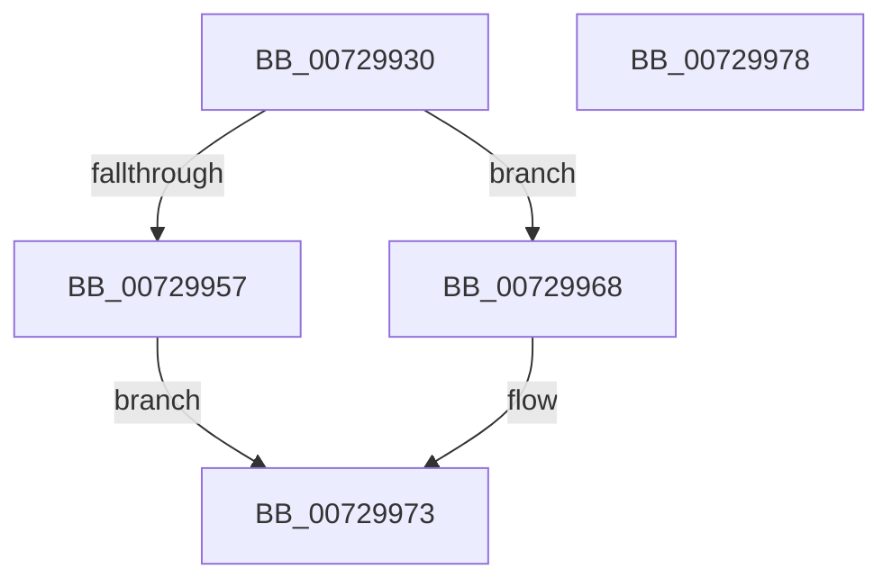

# IoQueryInterface

- RVA: `0x00729930`–`0x00729979` (길이 `73` bytes)
- VA: `0x0000000140729930`
- 실행 섹션: `PAGE`
- PDB 이름 있음: `예`; PDB Function 태그: `아니요`
- unwind 정보 RVA: `0x0005D2F4`
- 디코드: `19`개 명령, `73/73` bytes 표시
- 미해석 바이트: `0` (있으면 어셈블리에 `.byte`로 보존)

> 이 문서는 커널 이미지의 기계어와 PDB 기호를 분석해 생성했습니다. 4번과 5번은 함수 원형과 자료형을 바이너리 사용 방식에서 추정한 C 해석이며 원본 소스 복구 결과는 아닙니다.

## 1. Dependencies

- 직접 호출 지점: **2**; 고유 호출 대상: **2**
- 직접 호출자로 확인된 함수: **5**
- RIP 상대 이미지 참조: **0**

### Outgoing calls
- `0x00729961` → [IopQueryInterfaceRecurseUp](../A2/IopQueryInterfaceRecurseUp_function_00A283C8.md) (function, `0x00A283C8`)
- `0x0072996E` → [PnpQueryInterface](../A2/PnpQueryInterface_function_00A28D38.md) (function, `0x00A28D38`)

### Direct callers
- [HalpDmaGetIommuInterface](../../text/53/HalpDmaGetIommuInterface_function_0053E2A0.md) at `0x0053E2C9`
- [HalpIommuGetDeviceId](../../text/55/HalpIommuGetDeviceId_function_005536C0.md) at `0x0055372B`
- [ExInitializeDeviceAts](../../text/65/ExInitializeDeviceAts_function_00659B80.md) at `0x00659C04`
- [ExInitializeDeviceAts](../../text/65/ExInitializeDeviceAts_function_00659B80.md) at `0x00659C36`
- [ExpShareAddressSpaceWithDevice](../../text/65/ExpShareAddressSpaceWithDevice_function_0065B528.md) at `0x0065B606`
- [HalpGetCacheCoherency](../70/HalpGetCacheCoherency_function_00706FA0.md) at `0x00707002`

### Static image references
- 디코드된 RIP-relative 메모리 참조가 없습니다.

## 2. Other-region calls and transfers

- 다른 실행 섹션으로 향하는 call: **0**
- 별도 외부 분기/꼬리 이동을 확인하지 못했습니다.

## 3. Assembly (complete function range)

```asm
00729930  48 83 EC 38                     sub rsp, 0x38
00729934  48 8B 44 24 70                  mov rax, qword ptr [rsp + 0x70]
00729939  F6 C2 01                        test dl, 1
0072993C  48 89 44 24 28                  mov qword ptr [rsp + 0x28], rax
00729941  45 0F B7 D1                     movzx r10d, r9w
00729945  48 8B 44 24 68                  mov rax, qword ptr [rsp + 0x68]
0072994A  4D 8B D8                        mov r11, r8
0072994D  48 89 44 24 20                  mov qword ptr [rsp + 0x20], rax
00729952  49 8B D0                        mov rdx, r8
00729955  74 11                           je 0x140729968
00729957  44 0F B7 4C 24 60               movzx r9d, word ptr [rsp + 0x60]
0072995D  45 0F B7 C2                     movzx r8d, r10w
00729961  E8 62 EA 2F 00                  call 0x140a283c8
00729966  EB 0B                           jmp 0x140729973
00729968  44 0F B7 44 24 60               movzx r8d, word ptr [rsp + 0x60]
0072996E  E8 C5 F3 2F 00                  call 0x140a28d38
00729973  48 83 C4 38                     add rsp, 0x38
00729977  C3                              ret
00729978  CC                              int3
```

## 4. C-style interpretation (structured pseudocode)

```c
__int64 __fastcall IoQueryInterface(__int64 a1, unsigned __int8 a2, __int64 a3, unsigned __int16 a4, unsigned __int16 a5, __int64 a6, __int64 a7)
{
    __int64 result;
    __int64 v_rsp;
    unsigned __int64 v_stack_m10;
    unsigned __int64 v_stack_m18;

    v_rsp = (v_rsp) - (56);
    v_stack_m10 = a7;
    v_stack_m18 = a6;
    if (((a2) & (1)) == 0) goto loc_00729968;
    result = IopQueryInterfaceRecurseUp(a1, a3, a4, a5);
    goto loc_00729973;
loc_00729968:
    result = PnpQueryInterface(a1, a3, a5, a5);
loc_00729973:
    v_rsp = (v_rsp) + (56);
    return result;
}
```

## 5. (Beta) C Style

```c
int64_t IoQueryInterface(int64_t Arg1, uint8_t Arg2, int64_t Arg3, uint16_t Arg4, uint16_t Arg5, int64_t Arg6, int64_t Arg7)
{
    int64_t result;
    int64_t local_rsp;
    uint64_t v_stack_m10;
    uint64_t v_stack_m18;

    local_rsp = (local_rsp) - (56);
    v_stack_m10 = Arg7;
    v_stack_m18 = Arg6;
    if (((Arg2) & (1)) == 0) goto loc_00729968;
    result = IopQueryInterfaceRecurseUp(Arg1, Arg3, Arg4, Arg5);
    goto loc_00729973;
loc_00729968:
    result = PnpQueryInterface(Arg1, Arg3, Arg5, Arg5);
loc_00729973:
    local_rsp = (local_rsp) + (56);
    return result;
}
```

## 6. Execution-region graph

[열기: 2D/3D 그래프와 함수 탐색 컨트롤 패널](../../../control-panel.html?section=page&rva=0x00729930&view=graph)

- 2D 그래프는 위에서 아래로 흐르고, 3D 그래프는 빈 공간을 드래그해 회전합니다. Shift+드래그는 이동, 휠은 확대·축소, 함수 노드 선택은 대상 보고서 이동입니다.

### Static fallback


