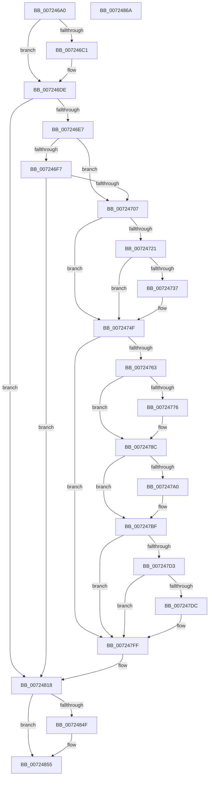

# IoQueryKsrPersistentMemorySizeEx

- RVA: `0x007246A0`–`0x0072486B` (길이 `459` bytes)
- VA: `0x00000001407246A0`
- 실행 섹션: `PAGE`
- PDB 이름 있음: `예`; PDB Function 태그: `아니요`
- unwind 정보 RVA: `0x0006F874`
- 디코드: `116`개 명령, `459/459` bytes 표시
- 미해석 바이트: `0` (있으면 어셈블리에 `.byte`로 보존)

> 이 문서는 커널 이미지의 기계어와 PDB 기호를 분석해 생성했습니다. 4번과 5번은 함수 원형과 자료형을 바이너리 사용 방식에서 추정한 C 해석이며 원본 소스 복구 결과는 아닙니다.

## 1. Dependencies

- 직접 호출 지점: **14**; 고유 호출 대상: **3**
- 직접 호출자로 확인된 함수: **1**
- RIP 상대 이미지 참조: **0**

### Outgoing calls
- `0x007246D8` → [KeBugCheckEx](../../text/4F/KeBugCheckEx_function_004FD660.md) (function, `0x004FD660`)
- `0x0072470E` → [IoAddTriageDumpDataBlock](../../text/42/IoAddTriageDumpDataBlock_function_00428374.md) (function, `0x00428374`)
- `0x00724725` → [IoAddTriageDumpDataBlock](../../text/42/IoAddTriageDumpDataBlock_function_00428374.md) (function, `0x00428374`)
- `0x00724739` → [IoAddTriageDumpDataBlock](../../text/42/IoAddTriageDumpDataBlock_function_00428374.md) (function, `0x00428374`)
- `0x0072474A` → [IoAddTriageDumpDataBlock](../../text/42/IoAddTriageDumpDataBlock_function_00428374.md) (function, `0x00428374`)
- `0x0072476C` → [IoAddTriageDumpDataBlock](../../text/42/IoAddTriageDumpDataBlock_function_00428374.md) (function, `0x00428374`)
- `0x0072477B` → [IoAddTriageDumpDataBlock](../../text/42/IoAddTriageDumpDataBlock_function_00428374.md) (function, `0x00428374`)
- `0x00724787` → [IoAddTriageDumpDataBlock](../../text/42/IoAddTriageDumpDataBlock_function_00428374.md) (function, `0x00428374`)
- `0x007247A2` → [IoAddTriageDumpDataBlock](../../text/42/IoAddTriageDumpDataBlock_function_00428374.md) (function, `0x00428374`)
- `0x007247BA` → [IoAddTriageDumpDataBlock](../../text/42/IoAddTriageDumpDataBlock_function_00428374.md) (function, `0x00428374`)
- `0x007247DE` → [IoAddTriageDumpDataBlock](../../text/42/IoAddTriageDumpDataBlock_function_00428374.md) (function, `0x00428374`)
- `0x007247FA` → [IoAddTriageDumpDataBlock](../../text/42/IoAddTriageDumpDataBlock_function_00428374.md) (function, `0x00428374`)
- `0x00724812` → [KeBugCheckEx](../../text/4F/KeBugCheckEx_function_004FD660.md) (function, `0x004FD660`)
- `0x00724843` → [PipGetPersistentMemory](PipGetPersistentMemory_function_00725290.md) (function, `0x00725290`)

### Direct callers
- [IoQueryKsrPersistentMemorySize](IoQueryKsrPersistentMemorySize_function_00724670.md) at `0x00724685`

### Static image references
- 디코드된 RIP-relative 메모리 참조가 없습니다.

## 2. Other-region calls and transfers

- 다른 실행 섹션으로 향하는 call: **13**
  - `0x007246D8` → [KeBugCheckEx](../../text/4F/KeBugCheckEx_function_004FD660.md) (`PAGE` → `.text`)
  - `0x0072470E` → [IoAddTriageDumpDataBlock](../../text/42/IoAddTriageDumpDataBlock_function_00428374.md) (`PAGE` → `.text`)
  - `0x00724725` → [IoAddTriageDumpDataBlock](../../text/42/IoAddTriageDumpDataBlock_function_00428374.md) (`PAGE` → `.text`)
  - `0x00724739` → [IoAddTriageDumpDataBlock](../../text/42/IoAddTriageDumpDataBlock_function_00428374.md) (`PAGE` → `.text`)
  - `0x0072474A` → [IoAddTriageDumpDataBlock](../../text/42/IoAddTriageDumpDataBlock_function_00428374.md) (`PAGE` → `.text`)
  - `0x0072476C` → [IoAddTriageDumpDataBlock](../../text/42/IoAddTriageDumpDataBlock_function_00428374.md) (`PAGE` → `.text`)
  - `0x0072477B` → [IoAddTriageDumpDataBlock](../../text/42/IoAddTriageDumpDataBlock_function_00428374.md) (`PAGE` → `.text`)
  - `0x00724787` → [IoAddTriageDumpDataBlock](../../text/42/IoAddTriageDumpDataBlock_function_00428374.md) (`PAGE` → `.text`)
  - `0x007247A2` → [IoAddTriageDumpDataBlock](../../text/42/IoAddTriageDumpDataBlock_function_00428374.md) (`PAGE` → `.text`)
  - `0x007247BA` → [IoAddTriageDumpDataBlock](../../text/42/IoAddTriageDumpDataBlock_function_00428374.md) (`PAGE` → `.text`)
  - `0x007247DE` → [IoAddTriageDumpDataBlock](../../text/42/IoAddTriageDumpDataBlock_function_00428374.md) (`PAGE` → `.text`)
  - `0x007247FA` → [IoAddTriageDumpDataBlock](../../text/42/IoAddTriageDumpDataBlock_function_00428374.md) (`PAGE` → `.text`)
  - `0x00724812` → [KeBugCheckEx](../../text/4F/KeBugCheckEx_function_004FD660.md) (`PAGE` → `.text`)
- 별도 외부 분기/꼬리 이동을 확인하지 못했습니다.

## 3. Assembly (complete function range)

```asm
007246A0  4C 8B DC                        mov r11, rsp
007246A3  49 89 5B 08                     mov qword ptr [r11 + 8], rbx
007246A7  49 89 6B 10                     mov qword ptr [r11 + 0x10], rbp
007246AB  49 89 73 18                     mov qword ptr [r11 + 0x18], rsi
007246AF  57                              push rdi
007246B0  48 83 EC 50                     sub rsp, 0x50
007246B4  48 8B DA                        mov rbx, rdx
007246B7  44 0F 20 C0                     mov rax, cr8
007246BB  33 F6                           xor esi, esi
007246BD  84 C0                           test al, al
007246BF  74 1D                           je 0x1407246de
007246C1  44 0F 20 C0                     mov rax, cr8
007246C5  44 0F B6 C0                     movzx r8d, al
007246C9  8D 56 01                        lea edx, [rsi + 1]
007246CC  45 33 C9                        xor r9d, r9d
007246CF  49 89 73 C8                     mov qword ptr [r11 - 0x38], rsi
007246D3  B9 21 01 00 00                  mov ecx, 0x121
007246D8  E8 83 8F DD FF                  call 0x1404fd660
007246DD  CC                              int3
007246DE  48 85 DB                        test rbx, rbx
007246E1  0F 84 31 01 00 00               je 0x140724818
007246E7  48 8B 82 38 01 00 00            mov rax, qword ptr [rdx + 0x138]
007246EE  48 8B 40 28                     mov rax, qword ptr [rax + 0x28]
007246F2  48 85 C0                        test rax, rax
007246F5  74 10                           je 0x140724707
007246F7  F7 80 8C 01 00 00 00 00 02 00   test dword ptr [rax + 0x18c], 0x20000
00724701  0F 84 11 01 00 00               je 0x140724818
00724707  0F B7 52 02                     movzx edx, word ptr [rdx + 2]
0072470B  48 8B CB                        mov rcx, rbx
0072470E  E8 61 3C D0 FF                  call 0x140428374
00724713  48 8B 4B 08                     mov rcx, qword ptr [rbx + 8]
00724717  BD 02 00 00 00                  mov ebp, 2
0072471C  48 85 C9                        test rcx, rcx
0072471F  74 2E                           je 0x14072474f
00724721  0F BF 51 02                     movsx edx, word ptr [rcx + 2]
00724725  E8 4A 3C D0 FF                  call 0x140428374
0072472A  48 8B 4B 08                     mov rcx, qword ptr [rbx + 8]
0072472E  48 83 C1 38                     add rcx, 0x38
00724732  66 39 31                        cmp word ptr [rcx], si
00724735  74 18                           je 0x14072474f
00724737  8B D5                           mov edx, ebp
00724739  E8 36 3C D0 FF                  call 0x140428374
0072473E  48 8B 4B 08                     mov rcx, qword ptr [rbx + 8]
00724742  0F B7 51 38                     movzx edx, word ptr [rcx + 0x38]
00724746  48 8B 49 40                     mov rcx, qword ptr [rcx + 0x40]
0072474A  E8 25 3C D0 FF                  call 0x140428374
0072474F  48 8B 83 38 01 00 00            mov rax, qword ptr [rbx + 0x138]
00724756  48 8B 48 28                     mov rcx, qword ptr [rax + 0x28]
0072475A  48 85 C9                        test rcx, rcx
0072475D  0F 84 9C 00 00 00               je 0x1407247ff
00724763  BA 88 03 00 00                  mov edx, 0x388
00724768  48 8D 79 28                     lea rdi, [rcx + 0x28]
0072476C  E8 03 3C D0 FF                  call 0x140428374
00724771  66 39 37                        cmp word ptr [rdi], si
00724774  74 16                           je 0x14072478c
00724776  8B D5                           mov edx, ebp
00724778  48 8B CF                        mov rcx, rdi
0072477B  E8 F4 3B D0 FF                  call 0x140428374
00724780  0F B7 17                        movzx edx, word ptr [rdi]
00724783  48 8B 4F 08                     mov rcx, qword ptr [rdi + 8]
00724787  E8 E8 3B D0 FF                  call 0x140428374
0072478C  48 8B 83 38 01 00 00            mov rax, qword ptr [rbx + 0x138]
00724793  48 8B 48 28                     mov rcx, qword ptr [rax + 0x28]
00724797  48 83 C1 38                     add rcx, 0x38
0072479B  66 39 31                        cmp word ptr [rcx], si
0072479E  74 1F                           je 0x1407247bf
007247A0  8B D5                           mov edx, ebp
007247A2  E8 CD 3B D0 FF                  call 0x140428374
007247A7  48 8B 83 38 01 00 00            mov rax, qword ptr [rbx + 0x138]
007247AE  48 8B 48 28                     mov rcx, qword ptr [rax + 0x28]
007247B2  0F B7 51 38                     movzx edx, word ptr [rcx + 0x38]
007247B6  48 8B 49 40                     mov rcx, qword ptr [rcx + 0x40]
007247BA  E8 B5 3B D0 FF                  call 0x140428374
007247BF  48 8B 83 38 01 00 00            mov rax, qword ptr [rbx + 0x138]
007247C6  48 8B 48 28                     mov rcx, qword ptr [rax + 0x28]
007247CA  48 8B 41 10                     mov rax, qword ptr [rcx + 0x10]
007247CE  48 85 C0                        test rax, rax
007247D1  74 2C                           je 0x1407247ff
007247D3  48 8D 48 38                     lea rcx, [rax + 0x38]
007247D7  66 39 31                        cmp word ptr [rcx], si
007247DA  74 23                           je 0x1407247ff
007247DC  8B D5                           mov edx, ebp
007247DE  E8 91 3B D0 FF                  call 0x140428374
007247E3  48 8B 83 38 01 00 00            mov rax, qword ptr [rbx + 0x138]
007247EA  48 8B 48 28                     mov rcx, qword ptr [rax + 0x28]
007247EE  48 8B 49 10                     mov rcx, qword ptr [rcx + 0x10]
007247F2  0F B7 51 38                     movzx edx, word ptr [rcx + 0x38]
007247F6  48 8B 49 40                     mov rcx, qword ptr [rcx + 0x40]
007247FA  E8 75 3B D0 FF                  call 0x140428374
007247FF  45 33 C9                        xor r9d, r9d
00724802  48 89 74 24 20                  mov qword ptr [rsp + 0x20], rsi
00724807  4C 8B C3                        mov r8, rbx
0072480A  48 8B D5                        mov rdx, rbp
0072480D  B9 CA 00 00 00                  mov ecx, 0xca
00724812  E8 49 8E DD FF                  call 0x1404fd660
00724817  CC                              int3
00724818  48 8B BC 24 88 00 00 00         mov rdi, qword ptr [rsp + 0x88]
00724820  48 8B 84 24 80 00 00 00         mov rax, qword ptr [rsp + 0x80]
00724828  89 74 24 40                     mov dword ptr [rsp + 0x40], esi
0072482C  48 89 74 24 38                  mov qword ptr [rsp + 0x38], rsi
00724831  48 89 74 24 30                  mov qword ptr [rsp + 0x30], rsi
00724836  48 89 7C 24 28                  mov qword ptr [rsp + 0x28], rdi
0072483B  48 89 37                        mov qword ptr [rdi], rsi
0072483E  48 89 44 24 20                  mov qword ptr [rsp + 0x20], rax
00724843  E8 48 0A 00 00                  call 0x140725290
00724848  3D 23 00 00 C0                  cmp eax, 0xc0000023
0072484D  75 06                           jne 0x140724855
0072484F  48 39 37                        cmp qword ptr [rdi], rsi
00724852  0F 45 C6                        cmovne eax, esi
00724855  48 8B 5C 24 60                  mov rbx, qword ptr [rsp + 0x60]
0072485A  48 8B 6C 24 68                  mov rbp, qword ptr [rsp + 0x68]
0072485F  48 8B 74 24 70                  mov rsi, qword ptr [rsp + 0x70]
00724864  48 83 C4 50                     add rsp, 0x50
00724868  5F                              pop rdi
00724869  C3                              ret
0072486A  CC                              int3
```

## 4. C-style interpretation (structured pseudocode)

```c
__int64 __fastcall IoQueryKsrPersistentMemorySizeEx(__int64 a1, __int64 a2, __int64 a3, int a4, __int64 a5, __int64 a6)
{
    __int64 result;
    __int64 v_rsi;
    __int64 v_rsp;
    unsigned int v_stack_m18;
    unsigned __int64 v_stack_m20;
    unsigned __int64 v_stack_m28;
    unsigned __int64 v_stack_m30;
    unsigned __int64 v_stack_m38;
    unsigned __int64 v_stack_p10;
    unsigned __int64 v_stack_p18;
    unsigned __int64 v_stack_p8;

    *(unsigned __int64 *)(v_rsp + 8) = v_rbx;
    *(unsigned __int64 *)(v_rsp + 16) = v_rbp;
    *(unsigned __int64 *)(v_rsp + 24) = v_rsi;
    v_rsp = (v_rsp) - (80);
    v_rsi = 0;
    result = v_cr8;
    if ((unsigned __int8)(v_cr8) != 0) {
        result = v_cr8;
        a3 = (unsigned __int8)(result);
        a2 = v_rsi + 1;
        a4 = 0;
        *(unsigned __int64 *)(v_rsp - 56) = 0;
        a1 = 289;
        result = KeBugCheckEx(a1, a2, a3, a4);
    }
    if (a2 == 0) goto loc_00724818;
    if (*(unsigned __int64 *)(*(unsigned __int64 *)(a2 + 312) + 40) == 0) goto loc_00724707;
    if (((*(unsigned int *)(*(unsigned __int64 *)(*(unsigned __int64 *)(a2 + 312) + 40) + 396)) & (0x20000ULL)) == 0) goto loc_00724818;
loc_00724707:
    result = IoAddTriageDumpDataBlock(a2, *(unsigned __int16 *)(a2 + 2), a3, a4);
    if (*(unsigned __int64 *)(a2 + 8) == 0) goto loc_0072474F;
    result = IoAddTriageDumpDataBlock(*(unsigned __int64 *)(a2 + 8), (__int16)(*(unsigned __int16 *)(*(unsigned __int64 *)(a2 + 8) + 2)), a3, a4);
    a1 = (*(unsigned __int64 *)(a2 + 8)) + (56);
    if ((*(unsigned __int16 *)(a1)) != 0) {
        a2 = 2;
        result = IoAddTriageDumpDataBlock(a1, a2, a3, a4);
        a1 = *(unsigned __int64 *)(a2 + 8);
        a2 = *(unsigned __int16 *)(a1 + 56);
        a1 = *(unsigned __int64 *)(a1 + 64);
        result = IoAddTriageDumpDataBlock(a1, a2, a3, a4);
    }
    if (*(unsigned __int64 *)(*(unsigned __int64 *)(a2 + 312) + 40) == 0) goto loc_007247FF;
    result = IoAddTriageDumpDataBlock(*(unsigned __int64 *)(*(unsigned __int64 *)(a2 + 312) + 40), 904, a3, a4);
    if ((*(unsigned __int16 *)(*(unsigned __int64 *)(*(unsigned __int64 *)(a2 + 312) + 40) + 40)) != 0) {
        a2 = 2;
        a1 = *(unsigned __int64 *)(*(unsigned __int64 *)(a2 + 312) + 40) + 40;
        result = IoAddTriageDumpDataBlock(a1, a2, a3, a4);
        a2 = *(unsigned __int16 *)(*(unsigned __int64 *)(*(unsigned __int64 *)(a2 + 312) + 40) + 40);
        a1 = *(unsigned __int64 *)(*(unsigned __int64 *)(*(unsigned __int64 *)(a2 + 312) + 40) + 40 + 8);
        result = IoAddTriageDumpDataBlock(a1, a2, a3, a4);
    }
    a1 = (*(unsigned __int64 *)(*(unsigned __int64 *)(a2 + 312) + 40)) + (56);
    result = *(unsigned __int64 *)(a2 + 312);
    if ((*(unsigned __int16 *)(a1)) != 0) {
        a2 = 2;
        result = IoAddTriageDumpDataBlock(a1, a2, a3, a4);
        result = *(unsigned __int64 *)(a2 + 312);
        a1 = *(unsigned __int64 *)(result + 40);
        a2 = *(unsigned __int16 *)(a1 + 56);
        a1 = *(unsigned __int64 *)(a1 + 64);
        result = IoAddTriageDumpDataBlock(a1, a2, a3, a4);
    }
    if (*(unsigned __int64 *)(*(unsigned __int64 *)(*(unsigned __int64 *)(a2 + 312) + 40) + 16) == 0) goto loc_007247FF;
    result = *(unsigned __int64 *)(*(unsigned __int64 *)(*(unsigned __int64 *)(a2 + 312) + 40) + 16);
    if ((*(unsigned __int16 *)(*(unsigned __int64 *)(*(unsigned __int64 *)(*(unsigned __int64 *)(a2 + 312) + 40) + 16) + 56)) != 0) {
        a2 = 2;
        result = IoAddTriageDumpDataBlock(*(unsigned __int64 *)(*(unsigned __int64 *)(*(unsigned __int64 *)(a2 + 312) + 40) + 16) + 56, a2, a3, a4);
        result = *(unsigned __int64 *)(a2 + 312);
        a1 = *(unsigned __int64 *)(result + 40);
        a1 = *(unsigned __int64 *)(a1 + 16);
        a2 = *(unsigned __int16 *)(a1 + 56);
        a1 = *(unsigned __int64 *)(a1 + 64);
        result = IoAddTriageDumpDataBlock(a1, a2, a3, a4);
    }
    a4 = 0;
    v_stack_m38 = 0;
    result = KeBugCheckEx(202, 2, a2, a4);
loc_00724818:
    v_stack_m18 = 0;
    v_stack_m20 = 0;
    v_stack_m28 = 0;
    v_stack_m30 = a6;
    *(unsigned __int64 *)(a6) = 0;
    v_stack_m38 = a5;
    result = PipGetPersistentMemory(202, 2, a2, a4);
    if (((unsigned int)(result)) == 0xC0000023ULL) {
        if ((*(unsigned __int64 *)(a6)) != 0) { result = 0; }
    }
    v_rsp = (v_rsp) + (80);
    return result;
}
```

## 5. (Beta) C Style

```c
int64_t IoQueryKsrPersistentMemorySizeEx(int64_t Arg1, int64_t Arg2, int64_t Arg3, int32_t Arg4, int64_t Arg5, void *Arg6)
{
    uint8_t *arg6 = (uint8_t *)Arg6;

    int64_t result;
    int64_t local_rsi;
    int64_t local_rsp;
    uint32_t v_stack_m18;
    uint64_t v_stack_m20;
    uint64_t v_stack_m28;
    uint64_t v_stack_m30;
    uint64_t v_stack_m38;
    uint64_t v_stack_p10;
    uint64_t v_stack_p18;
    uint64_t v_stack_p8;

    *(uint64_t *)(local_rsp + 0x8) = local_rbx;
    *(uint64_t *)(local_rsp + 0x10) = local_rbp;
    *(uint64_t *)(local_rsp + 0x18) = local_rsi;
    local_rsp = (local_rsp) - (80);
    local_rsi = 0;
    result = v_cr8;
    if ((uint8_t)(v_cr8) != 0) {
        result = v_cr8;
        Arg3 = (uint8_t)(result);
        Arg2 = local_rsi + 1;
        Arg4 = 0;
        *(uint64_t *)(local_rsp - 0x38) = 0;
        Arg1 = 289;
        result = KeBugCheckEx(Arg1, Arg2, Arg3, Arg4);
    }
    if (Arg2 == 0) goto loc_00724818;
    if (*(uint64_t *)(*(uint64_t *)(Arg2 + 0x138) + 0x28) == 0) goto loc_00724707;
    if (((*(uint32_t *)(*(uint64_t *)(*(uint64_t *)(Arg2 + 0x138) + 0x28) + 0x18C)) & (0x20000ULL)) == 0) goto loc_00724818;
loc_00724707:
    result = IoAddTriageDumpDataBlock(Arg2, *(uint16_t *)(Arg2 + 0x2), Arg3, Arg4);
    if (*(uint64_t *)(Arg2 + 0x8) == 0) goto loc_0072474F;
    result = IoAddTriageDumpDataBlock(*(uint64_t *)(Arg2 + 0x8), (int16_t)(*(uint16_t *)(*(uint64_t *)(Arg2 + 0x8) + 0x2)), Arg3, Arg4);
    Arg1 = (*(uint64_t *)(Arg2 + 0x8)) + (56);
    if ((*(uint16_t *)(Arg1)) != 0) {
        Arg2 = 2;
        result = IoAddTriageDumpDataBlock(Arg1, Arg2, Arg3, Arg4);
        Arg1 = *(uint64_t *)(Arg2 + 0x8);
        Arg2 = *(uint16_t *)(Arg1 + 0x38);
        Arg1 = *(uint64_t *)(Arg1 + 0x40);
        result = IoAddTriageDumpDataBlock(Arg1, Arg2, Arg3, Arg4);
    }
    if (*(uint64_t *)(*(uint64_t *)(Arg2 + 0x138) + 0x28) == 0) goto loc_007247FF;
    result = IoAddTriageDumpDataBlock(*(uint64_t *)(*(uint64_t *)(Arg2 + 0x138) + 0x28), 904, Arg3, Arg4);
    if ((*(uint16_t *)(*(uint64_t *)(*(uint64_t *)(Arg2 + 0x138) + 0x28) + 0x28)) != 0) {
        Arg2 = 2;
        Arg1 = *(uint64_t *)(*(uint64_t *)(Arg2 + 0x138) + 0x28) + 40;
        result = IoAddTriageDumpDataBlock(Arg1, Arg2, Arg3, Arg4);
        Arg2 = *(uint16_t *)(*(uint64_t *)(*(uint64_t *)(Arg2 + 0x138) + 0x28) + 0x28);
        Arg1 = *(uint64_t *)(*(uint64_t *)(*(uint64_t *)(Arg2 + 0x138) + 0x28) + 0x28 + 0x8);
        result = IoAddTriageDumpDataBlock(Arg1, Arg2, Arg3, Arg4);
    }
    Arg1 = (*(uint64_t *)(*(uint64_t *)(Arg2 + 0x138) + 0x28)) + (56);
    result = *(uint64_t *)(Arg2 + 0x138);
    if ((*(uint16_t *)(Arg1)) != 0) {
        Arg2 = 2;
        result = IoAddTriageDumpDataBlock(Arg1, Arg2, Arg3, Arg4);
        result = *(uint64_t *)(Arg2 + 0x138);
        Arg1 = *(uint64_t *)(result + 0x28);
        Arg2 = *(uint16_t *)(Arg1 + 0x38);
        Arg1 = *(uint64_t *)(Arg1 + 0x40);
        result = IoAddTriageDumpDataBlock(Arg1, Arg2, Arg3, Arg4);
    }
    if (*(uint64_t *)(*(uint64_t *)(*(uint64_t *)(Arg2 + 0x138) + 0x28) + 0x10) == 0) goto loc_007247FF;
    result = *(uint64_t *)(*(uint64_t *)(*(uint64_t *)(Arg2 + 0x138) + 0x28) + 0x10);
    if ((*(uint16_t *)(*(uint64_t *)(*(uint64_t *)(*(uint64_t *)(Arg2 + 0x138) + 0x28) + 0x10) + 0x38)) != 0) {
        Arg2 = 2;
        result = IoAddTriageDumpDataBlock(*(uint64_t *)(*(uint64_t *)(*(uint64_t *)(Arg2 + 0x138) + 0x28) + 0x10) + 56, Arg2, Arg3, Arg4);
        result = *(uint64_t *)(Arg2 + 0x138);
        Arg1 = *(uint64_t *)(result + 0x28);
        Arg1 = *(uint64_t *)(Arg1 + 0x10);
        Arg2 = *(uint16_t *)(Arg1 + 0x38);
        Arg1 = *(uint64_t *)(Arg1 + 0x40);
        result = IoAddTriageDumpDataBlock(Arg1, Arg2, Arg3, Arg4);
    }
    Arg4 = 0;
    v_stack_m38 = 0;
    result = KeBugCheckEx(202, 2, Arg2, Arg4);
loc_00724818:
    v_stack_m18 = 0;
    v_stack_m20 = 0;
    v_stack_m28 = 0;
    v_stack_m30 = Arg6;
    *(uint64_t *)(arg6) = 0;
    v_stack_m38 = Arg5;
    result = PipGetPersistentMemory(202, 2, Arg2, Arg4);
    if (((uint32_t)(result)) == 0xC0000023ULL) {
        if ((*(uint64_t *)(arg6)) != 0) { result = 0; }
    }
    local_rsp = (local_rsp) + (80);
    return result;
}
```

### 관측된 메모리 오프셋

구조체 형식이 확인되지 않은 접근은 인자 기준의 오프셋으로만 기록했습니다.

| 기준 인자 | 오프셋 표현 | 폭 (bit) | 접근 |
|---|---:|---:|---|
| `Arg6` | `+ 0x0` | `64` | `R` |
| `Arg6` | `+ 0x0` | `64` | `W` |

## 6. Execution-region graph

[열기: 2D/3D 그래프와 함수 탐색 컨트롤 패널](../../../control-panel.html?section=page&rva=0x007246A0&view=graph)

- 2D 그래프는 위에서 아래로 흐르고, 3D 그래프는 빈 공간을 드래그해 회전합니다. Shift+드래그는 이동, 휠은 확대·축소, 함수 노드 선택은 대상 보고서 이동입니다.

### Static fallback


