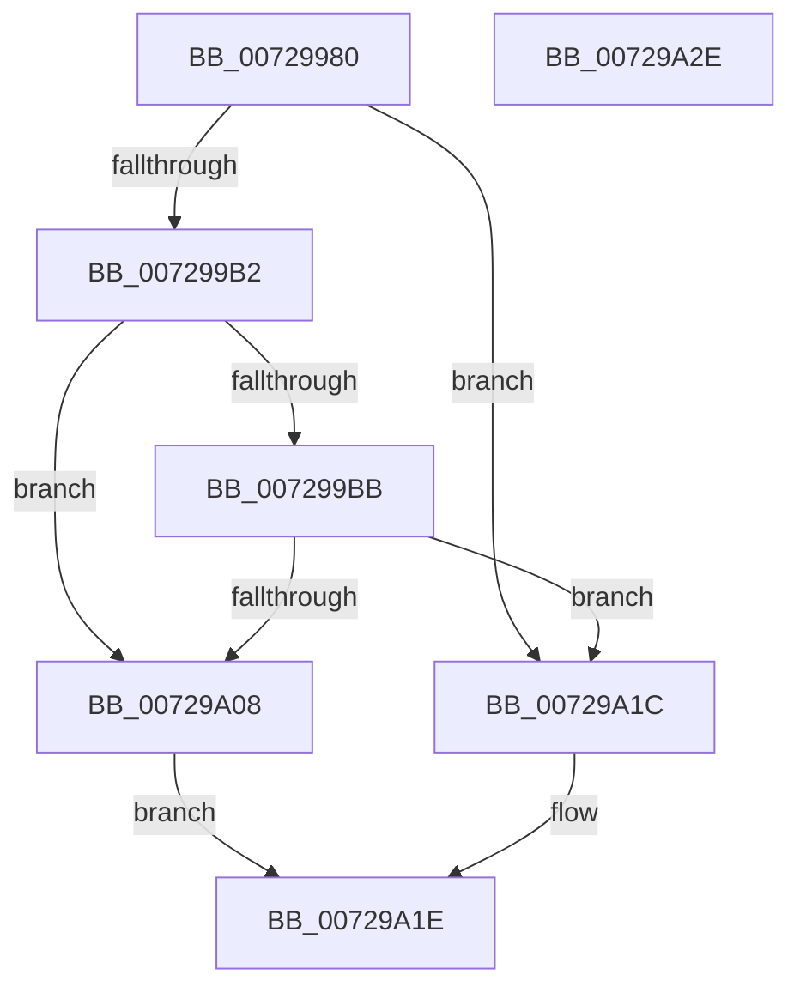

# IoRegisterBootDriverCallback

- RVA: `0x00729980`–`0x00729A2F` (길이 `175` bytes)
- VA: `0x0000000140729980`
- 실행 섹션: `PAGE`
- PDB 이름 있음: `예`; PDB Function 태그: `아니요`
- unwind 정보 RVA: `0x000BE5B4`
- 디코드: `46`개 명령, `175/175` bytes 표시
- 미해석 바이트: `0` (있으면 어셈블리에 `.byte`로 보존)

> 이 문서는 커널 이미지의 기계어와 PDB 기호를 분석해 생성했습니다. 4번과 5번은 함수 원형과 자료형을 바이너리 사용 방식에서 추정한 C 해석이며 원본 소스 복구 결과는 아닙니다.

## 1. Dependencies

- 직접 호출 지점: **3**; 고유 호출 대상: **3**
- 직접 호출자로 확인된 함수: **0**
- RIP 상대 이미지 참조: **3**

### Outgoing calls
- `0x007299C6` → [RtlInitUnicodeString](../../text/42/RtlInitUnicodeString_function_0042A780.md) (function, `0x0042A780`)
- `0x007299FF` → [ExCreateCallback](../A7/ExCreateCallback_function_00A7B9D0.md) (function, `0x00A7B9D0`)
- `0x00729A15` → [ExRegisterCallback](../../text/4B/ExRegisterCallback_function_004BDFC0.md) (function, `0x004BDFC0`)

### Direct callers
- 이 함수 시작 RVA로 연결되는 직접 call은 확인되지 않았습니다. 간접 호출은 완전히 역산할 수 없습니다.

### Static image references
- `0x007299A6` → RVA `0x00F8CDD8` (`.data`; read)
- `0x007299B2` → RVA `0x010086C0` (`INITDATA`; read)
- `0x007299BB` → RVA `0x00AFD940` (` ?? ::NNGAKEGL::`string'`; read)

## 2. Other-region calls and transfers

- 다른 실행 섹션으로 향하는 call: **2**
  - `0x007299C6` → [RtlInitUnicodeString](../../text/42/RtlInitUnicodeString_function_0042A780.md) (`PAGE` → `.text`)
  - `0x00729A15` → [ExRegisterCallback](../../text/4B/ExRegisterCallback_function_004BDFC0.md) (`PAGE` → `.text`)
- 별도 외부 분기/꼬리 이동을 확인하지 못했습니다.

## 3. Assembly (complete function range)

```asm
00729980  48 89 5C 24 08                  mov qword ptr [rsp + 8], rbx
00729985  48 89 7C 24 10                  mov qword ptr [rsp + 0x10], rdi
0072998A  55                              push rbp
0072998B  48 8B EC                        mov rbp, rsp
0072998E  48 83 EC 60                     sub rsp, 0x60
00729992  33 C0                           xor eax, eax
00729994  0F 57 C0                        xorps xmm0, xmm0
00729997  21 45 EC                        and dword ptr [rbp - 0x14], eax
0072999A  48 8B DA                        mov rbx, rdx
0072999D  89 45 D4                        mov dword ptr [rbp - 0x2c], eax
007299A0  48 8B F9                        mov rdi, rcx
007299A3  21 45 D4                        and dword ptr [rbp - 0x2c], eax
007299A6  38 05 2C 34 86 00               cmp byte ptr [rip + 0x86342c], al
007299AC  0F 11 45 C0                     movups xmmword ptr [rbp - 0x40], xmm0
007299B0  75 6A                           jne 0x140729a1c
007299B2  48 39 05 07 ED 8D 00            cmp qword ptr [rip + 0x8ded07], rax
007299B9  75 4D                           jne 0x140729a08
007299BB  48 8D 15 7E 3F 3D 00            lea rdx, [rip + 0x3d3f7e]
007299C2  48 8D 4D C0                     lea rcx, [rbp - 0x40]
007299C6  E8 B5 0D D0 FF                  call 0x14042a780
007299CB  48 83 65 D8 00                  and qword ptr [rbp - 0x28], 0
007299D0  48 8D 45 C0                     lea rax, [rbp - 0x40]
007299D4  41 B1 01                        mov r9b, 1
007299D7  C7 45 D0 30 00 00 00            mov dword ptr [rbp - 0x30], 0x30
007299DE  0F 57 C0                        xorps xmm0, xmm0
007299E1  C7 45 E8 40 02 00 00            mov dword ptr [rbp - 0x18], 0x240
007299E8  45 8A C1                        mov r8b, r9b
007299EB  48 89 45 E0                     mov qword ptr [rbp - 0x20], rax
007299EF  48 8D 55 D0                     lea rdx, [rbp - 0x30]
007299F3  48 8D 0D C6 EC 8D 00            lea rcx, [rip + 0x8decc6]
007299FA  F3 0F 7F 45 F0                  movdqu xmmword ptr [rbp - 0x10], xmm0
007299FF  E8 CC 1F 35 00                  call 0x140a7b9d0
00729A04  85 C0                           test eax, eax
00729A06  78 14                           js 0x140729a1c
00729A08  48 8B 0D B1 EC 8D 00            mov rcx, qword ptr [rip + 0x8decb1]
00729A0F  4C 8B C3                        mov r8, rbx
00729A12  48 8B D7                        mov rdx, rdi
00729A15  E8 A6 45 D9 FF                  call 0x1404bdfc0
00729A1A  EB 02                           jmp 0x140729a1e
00729A1C  33 C0                           xor eax, eax
00729A1E  48 8B 5C 24 70                  mov rbx, qword ptr [rsp + 0x70]
00729A23  48 8B 7C 24 78                  mov rdi, qword ptr [rsp + 0x78]
00729A28  48 83 C4 60                     add rsp, 0x60
00729A2C  5D                              pop rbp
00729A2D  C3                              ret
00729A2E  CC                              int3
```

## 4. C-style interpretation (structured pseudocode)

```c
__int64 __fastcall IoRegisterBootDriverCallback(__int64 a1, __int64 a2)
{
    __int64 result;
    __int64 v_rsp;
    unsigned __int64 v_stack_m18;
    unsigned int v_stack_m1C;
    unsigned int v_stack_m20;
    unsigned __int64 v_stack_m28;
    unsigned __int64 v_stack_m30;
    unsigned int v_stack_m34;
    unsigned int v_stack_m38;
    unsigned __int64 v_stack_m48;
    unsigned __int64 v_stack_p10;
    unsigned __int64 v_stack_p8;

    v_stack_p8 = v_rbx;
    v_stack_p10 = v_rdi;
    v_rsp = (v_rsp) - (96);
    result = 0;
    v_stack_m34 = 0;
    v_stack_m48 = v_xmm0;
    if ((*(unsigned __int8 *)(v_rip + 8795180)) != 0) goto loc_00729A1C;
    if ((*(unsigned __int64 *)(v_rip + 9301255)) != 0) goto loc_00729A08;
    result = RtlInitUnicodeString(v_stack_m48, v_rip + 4013950, a3, a4);
    v_stack_m38 = 48;
    v_stack_m20 = 576;
    v_stack_m28 = v_stack_m48;
    v_stack_m18 = v_xmm0;
    result = ExCreateCallback(v_rip + 9301190, v_stack_m38, 1, 1);
    if (sign_flag) goto loc_00729A1C;
loc_00729A08:
    result = ExRegisterCallback(*(unsigned __int64 *)(v_rip + 9301169), a1, a2, 1);
    goto loc_00729A1E;
loc_00729A1C:
    result = 0;
loc_00729A1E:
    v_rsp = (v_rsp) + (96);
    return result;
}
```

## 5. (Beta) C Style

```c
int64_t IoRegisterBootDriverCallback(int64_t Arg1, int64_t Arg2)
{
    int64_t result;
    int64_t local_rsp;
    uint64_t v_stack_m18;
    uint32_t v_stack_m1C;
    uint32_t v_stack_m20;
    uint64_t v_stack_m28;
    uint64_t v_stack_m30;
    uint32_t v_stack_m34;
    uint32_t v_stack_m38;
    uint64_t v_stack_m48;
    uint64_t v_stack_p10;
    uint64_t v_stack_p8;

    v_stack_p8 = local_rbx;
    v_stack_p10 = local_rdi;
    local_rsp = (local_rsp) - (96);
    result = 0;
    v_stack_m34 = 0;
    v_stack_m48 = v_xmm0;
    if ((*(uint8_t *)(v_rip + 0x86342C)) != 0) goto loc_00729A1C;
    if ((*(uint64_t *)(v_rip + 0x8DED07)) != 0) goto loc_00729A08;
    result = RtlInitUnicodeString(v_stack_m48, v_rip + 4013950, a3, a4);
    v_stack_m38 = 48;
    v_stack_m20 = 576;
    v_stack_m28 = v_stack_m48;
    v_stack_m18 = v_xmm0;
    result = ExCreateCallback(v_rip + 9301190, v_stack_m38, 1, 1);
    if (sign_flag) goto loc_00729A1C;
loc_00729A08:
    result = ExRegisterCallback(*(uint64_t *)(v_rip + 0x8DECB1), Arg1, Arg2, 1);
    goto loc_00729A1E;
loc_00729A1C:
    result = 0;
loc_00729A1E:
    local_rsp = (local_rsp) + (96);
    return result;
}
```

## 6. Execution-region graph

[열기: 2D/3D 그래프와 함수 탐색 컨트롤 패널](../../../control-panel.html?section=page&rva=0x00729980&view=graph)

- 2D 그래프는 위에서 아래로 흐르고, 3D 그래프는 빈 공간을 드래그해 회전합니다. Shift+드래그는 이동, 휠은 확대·축소, 함수 노드 선택은 대상 보고서 이동입니다.

### Static fallback


