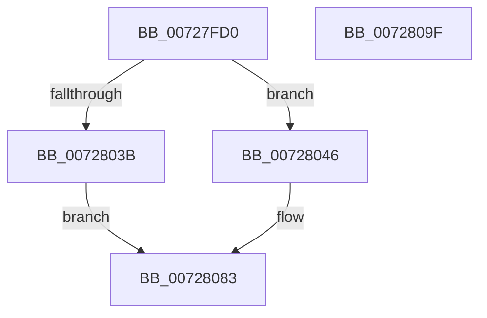

# IoReplacePartitionUnit

- RVA: `0x00727FD0`–`0x007280A0` (길이 `208` bytes)
- VA: `0x0000000140727FD0`
- 실행 섹션: `PAGE`
- PDB 이름 있음: `예`; PDB Function 태그: `아니요`
- unwind 정보 RVA: `0x000AC428`
- 디코드: `51`개 명령, `208/208` bytes 표시
- 미해석 바이트: `0` (있으면 어셈블리에 `.byte`로 보존)

> 이 문서는 커널 이미지의 기계어와 PDB 기호를 분석해 생성했습니다. 4번과 5번은 함수 원형과 자료형을 바이너리 사용 방식에서 추정한 C 해석이며 원본 소스 복구 결과는 아닙니다.

## 1. Dependencies

- 직접 호출 지점: **5**; 고유 호출 대상: **5**
- 직접 호출자로 확인된 함수: **1**
- RIP 상대 이미지 참조: **2**

### Outgoing calls
- `0x00727FFD` → [memset](../../text/6C/memset_function_006C6C40.md) (function, `0x006C6C40`)
- `0x0072801D` → [KeInitializeEvent](../../text/40/KeInitializeEvent_function_0040DD10.md) (function, `0x0040DD10`)
- `0x0072803F` → [PnpReplacePartitionUnit](../73/PnpReplacePartitionUnit_function_00738550.md) (function, `0x00738550`)
- `0x00728067` → [ExQueueWorkItem](../../text/2F/ExQueueWorkItem_function_002F9520.md) (function, `0x002F9520`)
- `0x0072807E` → [KeWaitForSingleObject](../../text/20/KeWaitForSingleObject_function_0020E6B0.md) (function, `0x0020E6B0`)

### Direct callers
- [NtReplacePartitionUnit](../../text/6A/NtReplacePartitionUnit_function_006A85A0.md) at `0x006A862E`

### Static image references
- `0x0072802B` → RVA `0x00FC6AB0` (`ALMOSTRO`; read)
- `0x0072804B` → RVA `0x00738550` (`PnpReplacePartitionUnit`; read)

## 2. Other-region calls and transfers

- 다른 실행 섹션으로 향하는 call: **4**
  - `0x00727FFD` → [memset](../../text/6C/memset_function_006C6C40.md) (`PAGE` → `.text`)
  - `0x0072801D` → [KeInitializeEvent](../../text/40/KeInitializeEvent_function_0040DD10.md) (`PAGE` → `.text`)
  - `0x00728067` → [ExQueueWorkItem](../../text/2F/ExQueueWorkItem_function_002F9520.md) (`PAGE` → `.text`)
  - `0x0072807E` → [KeWaitForSingleObject](../../text/20/KeWaitForSingleObject_function_0020E6B0.md) (`PAGE` → `.text`)
- 별도 외부 분기/꼬리 이동을 확인하지 못했습니다.

## 3. Assembly (complete function range)

```asm
00727FD0  48 89 5C 24 08                  mov qword ptr [rsp + 8], rbx
00727FD5  48 89 74 24 10                  mov qword ptr [rsp + 0x10], rsi
00727FDA  48 89 7C 24 18                  mov qword ptr [rsp + 0x18], rdi
00727FDF  55                              push rbp
00727FE0  48 8B EC                        mov rbp, rsp
00727FE3  48 81 EC 80 00 00 00            sub rsp, 0x80
00727FEA  48 8B FA                        mov rdi, rdx
00727FED  41 8B F0                        mov esi, r8d
00727FF0  33 D2                           xor edx, edx
00727FF2  48 8B D9                        mov rbx, rcx
00727FF5  48 8D 4D B0                     lea rcx, [rbp - 0x50]
00727FF9  44 8D 42 50                     lea r8d, [rdx + 0x50]
00727FFD  E8 3E EC F9 FF                  call 0x1406c6c40
00728002  45 33 C0                        xor r8d, r8d
00728005  48 89 5D B0                     mov qword ptr [rbp - 0x50], rbx
00728009  33 D2                           xor edx, edx
0072800B  48 89 7D B8                     mov qword ptr [rbp - 0x48], rdi
0072800F  48 8D 4D C8                     lea rcx, [rbp - 0x38]
00728013  89 75 C0                        mov dword ptr [rbp - 0x40], esi
00728016  C7 45 C4 01 00 00 C0            mov dword ptr [rbp - 0x3c], 0xc0000001
0072801D  E8 EE 5C CE FF                  call 0x14040dd10
00728022  65 48 8B 0C 25 88 01 00 00      mov rcx, qword ptr gs:[0x188]
0072802B  48 8B 05 7E EA 89 00            mov rax, qword ptr [rip + 0x89ea7e]
00728032  48 39 81 B8 00 00 00            cmp qword ptr [rcx + 0xb8], rax
00728039  75 0B                           jne 0x140728046
0072803B  48 8D 4D B0                     lea rcx, [rbp - 0x50]
0072803F  E8 0C 05 01 00                  call 0x140738550
00728044  EB 3D                           jmp 0x140728083
00728046  48 83 65 E0 00                  and qword ptr [rbp - 0x20], 0
0072804B  48 8D 05 FE 04 01 00            lea rax, [rip + 0x104fe]
00728052  48 89 45 F0                     mov qword ptr [rbp - 0x10], rax
00728056  48 8D 4D E0                     lea rcx, [rbp - 0x20]
0072805A  48 8D 45 B0                     lea rax, [rbp - 0x50]
0072805E  BA 01 00 00 00                  mov edx, 1
00728063  48 89 45 F8                     mov qword ptr [rbp - 8], rax
00728067  E8 B4 14 BD FF                  call 0x1402f9520
0072806C  48 83 64 24 20 00               and qword ptr [rsp + 0x20], 0
00728072  48 8D 4D C8                     lea rcx, [rbp - 0x38]
00728076  45 33 C9                        xor r9d, r9d
00728079  45 33 C0                        xor r8d, r8d
0072807C  33 D2                           xor edx, edx
0072807E  E8 2D 66 AE FF                  call 0x14020e6b0
00728083  8B 45 C4                        mov eax, dword ptr [rbp - 0x3c]
00728086  4C 8D 9C 24 80 00 00 00         lea r11, [rsp + 0x80]
0072808E  49 8B 5B 10                     mov rbx, qword ptr [r11 + 0x10]
00728092  49 8B 73 18                     mov rsi, qword ptr [r11 + 0x18]
00728096  49 8B 7B 20                     mov rdi, qword ptr [r11 + 0x20]
0072809A  49 8B E3                        mov rsp, r11
0072809D  5D                              pop rbp
0072809E  C3                              ret
0072809F  CC                              int3
```

## 4. C-style interpretation (structured pseudocode)

```c
__int64 __fastcall IoReplacePartitionUnit(__int64 a1, __int64 a2, int a3, int a4)
{
    __int64 result;
    __int64 v_rsp;
    unsigned __int64 v_stack_m10;
    unsigned __int64 v_stack_m18;
    unsigned __int64 v_stack_m28;
    unsigned __int64 v_stack_m40;
    unsigned int v_stack_m44;
    unsigned int v_stack_m48;
    unsigned __int64 v_stack_m50;
    unsigned __int64 v_stack_m58;
    unsigned __int64 v_stack_m68;
    unsigned __int64 v_stack_m8;
    unsigned __int64 v_stack_p10;
    unsigned __int64 v_stack_p18;
    unsigned __int64 v_stack_p8;

    v_stack_p8 = v_rbx;
    v_stack_p10 = v_rsi;
    v_stack_p18 = v_rdi;
    v_rsp = (v_rsp) - (128);
    a2 = 0;
    result = memset(v_stack_m58, a2, a2 + 80, a4);
    a3 = 0;
    v_stack_m58 = a1;
    a2 = 0;
    v_stack_m50 = 0;
    v_stack_m48 = (unsigned int)((unsigned int)(a3));
    v_stack_m44 = 0xC0000001ULL;
    result = KeInitializeEvent(v_stack_m40, a2, a3, a4);
    if ((*(unsigned __int64 *)(*(unsigned __int64 *)(gs_base + (0 + 392)) + 184)) != (*(unsigned __int64 *)(v_rip + 9038462))) goto loc_00728046;
    result = PnpReplacePartitionUnit(v_stack_m58, a2, a3, a4);
    goto loc_00728083;
loc_00728046:
    v_stack_m18 = v_rip + 66814;
    v_stack_m10 = v_stack_m58;
    result = ExQueueWorkItem(v_stack_m28, 1, a3, a4);
    a4 = 0;
    a3 = 0;
    a2 = 0;
    result = KeWaitForSingleObject(v_stack_m40, a2, a3, a4);
loc_00728083:
    return (unsigned int)(v_stack_m44);
}
```

## 5. (Beta) C Style

```c
int64_t IoReplacePartitionUnit(int64_t Arg1, int64_t Arg2, int32_t Arg3, int32_t Arg4)
{
    int64_t result;
    int64_t local_rsp;
    uint64_t v_stack_m10;
    uint64_t v_stack_m18;
    uint64_t v_stack_m28;
    uint64_t v_stack_m40;
    uint32_t v_stack_m44;
    uint32_t v_stack_m48;
    uint64_t v_stack_m50;
    uint64_t v_stack_m58;
    uint64_t v_stack_m68;
    uint64_t v_stack_m8;
    uint64_t v_stack_p10;
    uint64_t v_stack_p18;
    uint64_t v_stack_p8;

    v_stack_p8 = local_rbx;
    v_stack_p10 = local_rsi;
    v_stack_p18 = local_rdi;
    local_rsp = (local_rsp) - (128);
    Arg2 = 0;
    result = memset(v_stack_m58, Arg2, Arg2 + 80, Arg4);
    Arg3 = 0;
    v_stack_m58 = Arg1;
    Arg2 = 0;
    v_stack_m50 = 0;
    v_stack_m48 = (uint32_t)((uint32_t)(Arg3));
    v_stack_m44 = 0xC0000001ULL;
    result = KeInitializeEvent(v_stack_m40, Arg2, Arg3, Arg4);
    if ((*(uint64_t *)(*(uint64_t *)(gs_base + (0 + 0x188)) + 0xB8)) != (*(uint64_t *)(v_rip + 0x89EA7E))) goto loc_00728046;
    result = PnpReplacePartitionUnit(v_stack_m58, Arg2, Arg3, Arg4);
    goto loc_00728083;
loc_00728046:
    v_stack_m18 = v_rip + 66814;
    v_stack_m10 = v_stack_m58;
    result = ExQueueWorkItem(v_stack_m28, 1, Arg3, Arg4);
    Arg4 = 0;
    Arg3 = 0;
    Arg2 = 0;
    result = KeWaitForSingleObject(v_stack_m40, Arg2, Arg3, Arg4);
loc_00728083:
    return (uint32_t)(v_stack_m44);
}
```

## 6. Execution-region graph

[열기: 2D/3D 그래프와 함수 탐색 컨트롤 패널](../../../control-panel.html?section=page&rva=0x00727FD0&view=graph)

- 2D 그래프는 위에서 아래로 흐르고, 3D 그래프는 빈 공간을 드래그해 회전합니다. Shift+드래그는 이동, 휠은 확대·축소, 함수 노드 선택은 대상 보고서 이동입니다.

### Static fallback


