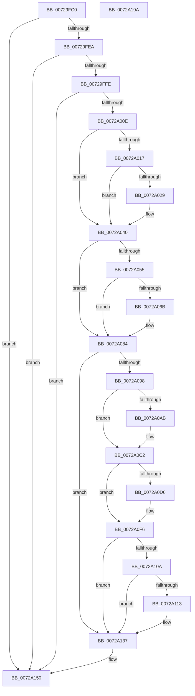

# IoReportResourceForDetection

- RVA: `0x00729FC0`–`0x0072A19B` (길이 `475` bytes)
- VA: `0x0000000140729FC0`
- 실행 섹션: `PAGE`
- PDB 이름 있음: `예`; PDB Function 태그: `아니요`
- unwind 정보 RVA: `0x00091ECC`
- 디코드: `117`개 명령, `475/475` bytes 표시
- 미해석 바이트: `0` (있으면 어셈블리에 `.byte`로 보존)

> 이 문서는 커널 이미지의 기계어와 PDB 기호를 분석해 생성했습니다. 4번과 5번은 함수 원형과 자료형을 바이너리 사용 방식에서 추정한 C 해석이며 원본 소스 복구 결과는 아닙니다.

## 1. Dependencies

- 직접 호출 지점: **16**; 고유 호출 대상: **3**
- 직접 호출자로 확인된 함수: **0**
- RIP 상대 이미지 참조: **0**

### Outgoing calls
- `0x0072A01B` → [IoAddTriageDumpDataBlock](../../text/42/IoAddTriageDumpDataBlock_function_00428374.md) (function, `0x00428374`)
- `0x0072A02F` → [IoAddTriageDumpDataBlock](../../text/42/IoAddTriageDumpDataBlock_function_00428374.md) (function, `0x00428374`)
- `0x0072A03B` → [IoAddTriageDumpDataBlock](../../text/42/IoAddTriageDumpDataBlock_function_00428374.md) (function, `0x00428374`)
- `0x0072A047` → [IoAddTriageDumpDataBlock](../../text/42/IoAddTriageDumpDataBlock_function_00428374.md) (function, `0x00428374`)
- `0x0072A059` → [IoAddTriageDumpDataBlock](../../text/42/IoAddTriageDumpDataBlock_function_00428374.md) (function, `0x00428374`)
- `0x0072A06E` → [IoAddTriageDumpDataBlock](../../text/42/IoAddTriageDumpDataBlock_function_00428374.md) (function, `0x00428374`)
- `0x0072A07F` → [IoAddTriageDumpDataBlock](../../text/42/IoAddTriageDumpDataBlock_function_00428374.md) (function, `0x00428374`)
- `0x0072A0A1` → [IoAddTriageDumpDataBlock](../../text/42/IoAddTriageDumpDataBlock_function_00428374.md) (function, `0x00428374`)
- `0x0072A0B1` → [IoAddTriageDumpDataBlock](../../text/42/IoAddTriageDumpDataBlock_function_00428374.md) (function, `0x00428374`)
- `0x0072A0BD` → [IoAddTriageDumpDataBlock](../../text/42/IoAddTriageDumpDataBlock_function_00428374.md) (function, `0x00428374`)
- `0x0072A0D9` → [IoAddTriageDumpDataBlock](../../text/42/IoAddTriageDumpDataBlock_function_00428374.md) (function, `0x00428374`)
- `0x0072A0F1` → [IoAddTriageDumpDataBlock](../../text/42/IoAddTriageDumpDataBlock_function_00428374.md) (function, `0x00428374`)
- `0x0072A116` → [IoAddTriageDumpDataBlock](../../text/42/IoAddTriageDumpDataBlock_function_00428374.md) (function, `0x00428374`)
- `0x0072A132` → [IoAddTriageDumpDataBlock](../../text/42/IoAddTriageDumpDataBlock_function_00428374.md) (function, `0x00428374`)
- `0x0072A14A` → [KeBugCheckEx](../../text/4F/KeBugCheckEx_function_004FD660.md) (function, `0x004FD660`)
- `0x0072A17A` → [IoReportResourceUsageInternal](IoReportResourceUsageInternal_function_0072A398.md) (function, `0x0072A398`)

### Direct callers
- 이 함수 시작 RVA로 연결되는 직접 call은 확인되지 않았습니다. 간접 호출은 완전히 역산할 수 없습니다.

### Static image references
- 디코드된 RIP-relative 메모리 참조가 없습니다.

## 2. Other-region calls and transfers

- 다른 실행 섹션으로 향하는 call: **15**
  - `0x0072A01B` → [IoAddTriageDumpDataBlock](../../text/42/IoAddTriageDumpDataBlock_function_00428374.md) (`PAGE` → `.text`)
  - `0x0072A02F` → [IoAddTriageDumpDataBlock](../../text/42/IoAddTriageDumpDataBlock_function_00428374.md) (`PAGE` → `.text`)
  - `0x0072A03B` → [IoAddTriageDumpDataBlock](../../text/42/IoAddTriageDumpDataBlock_function_00428374.md) (`PAGE` → `.text`)
  - `0x0072A047` → [IoAddTriageDumpDataBlock](../../text/42/IoAddTriageDumpDataBlock_function_00428374.md) (`PAGE` → `.text`)
  - `0x0072A059` → [IoAddTriageDumpDataBlock](../../text/42/IoAddTriageDumpDataBlock_function_00428374.md) (`PAGE` → `.text`)
  - `0x0072A06E` → [IoAddTriageDumpDataBlock](../../text/42/IoAddTriageDumpDataBlock_function_00428374.md) (`PAGE` → `.text`)
  - `0x0072A07F` → [IoAddTriageDumpDataBlock](../../text/42/IoAddTriageDumpDataBlock_function_00428374.md) (`PAGE` → `.text`)
  - `0x0072A0A1` → [IoAddTriageDumpDataBlock](../../text/42/IoAddTriageDumpDataBlock_function_00428374.md) (`PAGE` → `.text`)
  - `0x0072A0B1` → [IoAddTriageDumpDataBlock](../../text/42/IoAddTriageDumpDataBlock_function_00428374.md) (`PAGE` → `.text`)
  - `0x0072A0BD` → [IoAddTriageDumpDataBlock](../../text/42/IoAddTriageDumpDataBlock_function_00428374.md) (`PAGE` → `.text`)
  - `0x0072A0D9` → [IoAddTriageDumpDataBlock](../../text/42/IoAddTriageDumpDataBlock_function_00428374.md) (`PAGE` → `.text`)
  - `0x0072A0F1` → [IoAddTriageDumpDataBlock](../../text/42/IoAddTriageDumpDataBlock_function_00428374.md) (`PAGE` → `.text`)
  - `0x0072A116` → [IoAddTriageDumpDataBlock](../../text/42/IoAddTriageDumpDataBlock_function_00428374.md) (`PAGE` → `.text`)
  - `0x0072A132` → [IoAddTriageDumpDataBlock](../../text/42/IoAddTriageDumpDataBlock_function_00428374.md) (`PAGE` → `.text`)
  - `0x0072A14A` → [KeBugCheckEx](../../text/4F/KeBugCheckEx_function_004FD660.md) (`PAGE` → `.text`)
- 별도 외부 분기/꼬리 이동을 확인하지 못했습니다.

## 3. Assembly (complete function range)

```asm
00729FC0  48 8B C4                        mov rax, rsp
00729FC3  48 89 58 08                     mov qword ptr [rax + 8], rbx
00729FC7  48 89 68 10                     mov qword ptr [rax + 0x10], rbp
00729FCB  48 89 70 18                     mov qword ptr [rax + 0x18], rsi
00729FCF  48 89 78 20                     mov qword ptr [rax + 0x20], rdi
00729FD3  41 56                           push r14
00729FD5  48 83 EC 50                     sub rsp, 0x50
00729FD9  33 ED                           xor ebp, ebp
00729FDB  49 8B D9                        mov rbx, r9
00729FDE  48 8B F9                        mov rdi, rcx
00729FE1  4D 85 C9                        test r9, r9
00729FE4  0F 84 66 01 00 00               je 0x14072a150
00729FEA  49 8B 81 38 01 00 00            mov rax, qword ptr [r9 + 0x138]
00729FF1  48 8B 40 28                     mov rax, qword ptr [rax + 0x28]
00729FF5  48 85 C0                        test rax, rax
00729FF8  0F 84 52 01 00 00               je 0x14072a150
00729FFE  F7 80 8C 01 00 00 00 00 02 00   test dword ptr [rax + 0x18c], 0x20000
0072A008  0F 85 42 01 00 00               jne 0x14072a150
0072A00E  44 8D 75 02                     lea r14d, [rbp + 2]
0072A012  48 85 C9                        test rcx, rcx
0072A015  74 29                           je 0x14072a040
0072A017  0F BF 51 02                     movsx edx, word ptr [rcx + 2]
0072A01B  E8 54 E3 CF FF                  call 0x140428374
0072A020  48 8D 77 38                     lea rsi, [rdi + 0x38]
0072A024  66 39 2E                        cmp word ptr [rsi], bp
0072A027  74 17                           je 0x14072a040
0072A029  41 8B D6                        mov edx, r14d
0072A02C  48 8B CE                        mov rcx, rsi
0072A02F  E8 40 E3 CF FF                  call 0x140428374
0072A034  0F B7 16                        movzx edx, word ptr [rsi]
0072A037  48 8B 4F 40                     mov rcx, qword ptr [rdi + 0x40]
0072A03B  E8 34 E3 CF FF                  call 0x140428374
0072A040  0F B7 53 02                     movzx edx, word ptr [rbx + 2]
0072A044  48 8B CB                        mov rcx, rbx
0072A047  E8 28 E3 CF FF                  call 0x140428374
0072A04C  48 8B 4B 08                     mov rcx, qword ptr [rbx + 8]
0072A050  48 85 C9                        test rcx, rcx
0072A053  74 2F                           je 0x14072a084
0072A055  0F BF 51 02                     movsx edx, word ptr [rcx + 2]
0072A059  E8 16 E3 CF FF                  call 0x140428374
0072A05E  48 8B 4B 08                     mov rcx, qword ptr [rbx + 8]
0072A062  48 83 C1 38                     add rcx, 0x38
0072A066  66 39 29                        cmp word ptr [rcx], bp
0072A069  74 19                           je 0x14072a084
0072A06B  41 8B D6                        mov edx, r14d
0072A06E  E8 01 E3 CF FF                  call 0x140428374
0072A073  48 8B 4B 08                     mov rcx, qword ptr [rbx + 8]
0072A077  0F B7 51 38                     movzx edx, word ptr [rcx + 0x38]
0072A07B  48 8B 49 40                     mov rcx, qword ptr [rcx + 0x40]
0072A07F  E8 F0 E2 CF FF                  call 0x140428374
0072A084  48 8B 83 38 01 00 00            mov rax, qword ptr [rbx + 0x138]
0072A08B  48 8B 48 28                     mov rcx, qword ptr [rax + 0x28]
0072A08F  48 85 C9                        test rcx, rcx
0072A092  0F 84 9F 00 00 00               je 0x14072a137
0072A098  BA 88 03 00 00                  mov edx, 0x388
0072A09D  48 8D 71 28                     lea rsi, [rcx + 0x28]
0072A0A1  E8 CE E2 CF FF                  call 0x140428374
0072A0A6  66 39 2E                        cmp word ptr [rsi], bp
0072A0A9  74 17                           je 0x14072a0c2
0072A0AB  41 8B D6                        mov edx, r14d
0072A0AE  48 8B CE                        mov rcx, rsi
0072A0B1  E8 BE E2 CF FF                  call 0x140428374
0072A0B6  0F B7 16                        movzx edx, word ptr [rsi]
0072A0B9  48 8B 4E 08                     mov rcx, qword ptr [rsi + 8]
0072A0BD  E8 B2 E2 CF FF                  call 0x140428374
0072A0C2  48 8B 83 38 01 00 00            mov rax, qword ptr [rbx + 0x138]
0072A0C9  48 8B 48 28                     mov rcx, qword ptr [rax + 0x28]
0072A0CD  48 83 C1 38                     add rcx, 0x38
0072A0D1  66 39 29                        cmp word ptr [rcx], bp
0072A0D4  74 20                           je 0x14072a0f6
0072A0D6  41 8B D6                        mov edx, r14d
0072A0D9  E8 96 E2 CF FF                  call 0x140428374
0072A0DE  48 8B 83 38 01 00 00            mov rax, qword ptr [rbx + 0x138]
0072A0E5  48 8B 48 28                     mov rcx, qword ptr [rax + 0x28]
0072A0E9  0F B7 51 38                     movzx edx, word ptr [rcx + 0x38]
0072A0ED  48 8B 49 40                     mov rcx, qword ptr [rcx + 0x40]
0072A0F1  E8 7E E2 CF FF                  call 0x140428374
0072A0F6  48 8B 83 38 01 00 00            mov rax, qword ptr [rbx + 0x138]
0072A0FD  48 8B 48 28                     mov rcx, qword ptr [rax + 0x28]
0072A101  48 8B 41 10                     mov rax, qword ptr [rcx + 0x10]
0072A105  48 85 C0                        test rax, rax
0072A108  74 2D                           je 0x14072a137
0072A10A  48 8D 48 38                     lea rcx, [rax + 0x38]
0072A10E  66 39 29                        cmp word ptr [rcx], bp
0072A111  74 24                           je 0x14072a137
0072A113  41 8B D6                        mov edx, r14d
0072A116  E8 59 E2 CF FF                  call 0x140428374
0072A11B  48 8B 83 38 01 00 00            mov rax, qword ptr [rbx + 0x138]
0072A122  48 8B 48 28                     mov rcx, qword ptr [rax + 0x28]
0072A126  48 8B 49 10                     mov rcx, qword ptr [rcx + 0x10]
0072A12A  0F B7 51 38                     movzx edx, word ptr [rcx + 0x38]
0072A12E  48 8B 49 40                     mov rcx, qword ptr [rcx + 0x40]
0072A132  E8 3D E2 CF FF                  call 0x140428374
0072A137  4C 8B CF                        mov r9, rdi
0072A13A  48 89 6C 24 20                  mov qword ptr [rsp + 0x20], rbp
0072A13F  4C 8B C3                        mov r8, rbx
0072A142  49 8B D6                        mov rdx, r14
0072A145  B9 CA 00 00 00                  mov ecx, 0xca
0072A14A  E8 11 35 DD FF                  call 0x1404fd660
0072A14F  CC                              int3
0072A150  48 8B 84 24 90 00 00 00         mov rax, qword ptr [rsp + 0x90]
0072A158  4C 8B CA                        mov r9, rdx
0072A15B  48 89 44 24 48                  mov qword ptr [rsp + 0x48], rax
0072A160  4C 8B C7                        mov r8, rdi
0072A163  48 8B 84 24 80 00 00 00         mov rax, qword ptr [rsp + 0x80]
0072A16B  B9 03 00 00 00                  mov ecx, 3
0072A170  48 89 44 24 30                  mov qword ptr [rsp + 0x30], rax
0072A175  48 89 5C 24 28                  mov qword ptr [rsp + 0x28], rbx
0072A17A  E8 19 02 00 00                  call 0x14072a398
0072A17F  48 8B 5C 24 60                  mov rbx, qword ptr [rsp + 0x60]
0072A184  48 8B 6C 24 68                  mov rbp, qword ptr [rsp + 0x68]
0072A189  48 8B 74 24 70                  mov rsi, qword ptr [rsp + 0x70]
0072A18E  48 8B 7C 24 78                  mov rdi, qword ptr [rsp + 0x78]
0072A193  48 83 C4 50                     add rsp, 0x50
0072A197  41 5E                           pop r14
0072A199  C3                              ret
0072A19A  CC                              int3
```

## 4. C-style interpretation (structured pseudocode)

```c
__int64 __fastcall IoReportResourceForDetection(__int64 a1, __int64 a2, __int64 a3, __int64 a4, __int64 a5, __int64 a6, __int64 a7)
{
    __int64 result;
    __int64 v_rbp;
    __int64 v_rsp;
    unsigned __int64 v_stack_m10;
    unsigned __int64 v_stack_m28;
    unsigned __int64 v_stack_m30;
    unsigned __int64 v_stack_m38;
    unsigned __int64 v_stack_p10;
    unsigned __int64 v_stack_p18;
    unsigned __int64 v_stack_p20;
    unsigned __int64 v_stack_p8;

    *(unsigned __int64 *)(v_rsp + 8) = v_rbx;
    *(unsigned __int64 *)(v_rsp + 16) = v_rbp;
    *(unsigned __int64 *)(v_rsp + 24) = v_rsi;
    *(unsigned __int64 *)(v_rsp + 32) = v_rdi;
    v_rsp = (v_rsp) - (80);
    v_rbp = 0;
    if (a4 == 0) goto loc_0072A150;
    if (*(unsigned __int64 *)(*(unsigned __int64 *)(a4 + 312) + 40) == 0) goto loc_0072A150;
    if (((*(unsigned int *)(*(unsigned __int64 *)(*(unsigned __int64 *)(a4 + 312) + 40) + 396)) & (0x20000ULL)) != 0) goto loc_0072A150;
    if (a1 == 0) goto loc_0072A040;
    result = IoAddTriageDumpDataBlock(a1, (__int16)(*(unsigned __int16 *)(a1 + 2)), a3, a4);
    if ((*(unsigned __int16 *)(a1 + 56)) != 0) {
        a2 = (unsigned int)(v_rbp + 2);
        a1 = a1 + 56;
        result = IoAddTriageDumpDataBlock(a1, a2, a3, a4);
        a2 = *(unsigned __int16 *)(a1 + 56);
        a1 = *(unsigned __int64 *)(a1 + 64);
        result = IoAddTriageDumpDataBlock(a1, a2, a3, a4);
    }
    result = IoAddTriageDumpDataBlock(a4, *(unsigned __int16 *)(a4 + 2), a3, a4);
    if (*(unsigned __int64 *)(a4 + 8) == 0) goto loc_0072A084;
    result = IoAddTriageDumpDataBlock(*(unsigned __int64 *)(a4 + 8), (__int16)(*(unsigned __int16 *)(*(unsigned __int64 *)(a4 + 8) + 2)), a3, a4);
    a1 = (*(unsigned __int64 *)(a4 + 8)) + (56);
    if ((*(unsigned __int16 *)(a1)) != 0) {
        a2 = (unsigned int)(v_rbp + 2);
        result = IoAddTriageDumpDataBlock(a1, a2, a3, a4);
        a1 = *(unsigned __int64 *)(a4 + 8);
        a2 = *(unsigned __int16 *)(a1 + 56);
        a1 = *(unsigned __int64 *)(a1 + 64);
        result = IoAddTriageDumpDataBlock(a1, a2, a3, a4);
    }
    if (*(unsigned __int64 *)(*(unsigned __int64 *)(a4 + 312) + 40) == 0) goto loc_0072A137;
    result = IoAddTriageDumpDataBlock(*(unsigned __int64 *)(*(unsigned __int64 *)(a4 + 312) + 40), 904, a3, a4);
    if ((*(unsigned __int16 *)(*(unsigned __int64 *)(*(unsigned __int64 *)(a4 + 312) + 40) + 40)) != 0) {
        a2 = (unsigned int)(v_rbp + 2);
        a1 = *(unsigned __int64 *)(*(unsigned __int64 *)(a4 + 312) + 40) + 40;
        result = IoAddTriageDumpDataBlock(a1, a2, a3, a4);
        a2 = *(unsigned __int16 *)(*(unsigned __int64 *)(*(unsigned __int64 *)(a4 + 312) + 40) + 40);
        a1 = *(unsigned __int64 *)(*(unsigned __int64 *)(*(unsigned __int64 *)(a4 + 312) + 40) + 40 + 8);
        result = IoAddTriageDumpDataBlock(a1, a2, a3, a4);
    }
    a1 = (*(unsigned __int64 *)(*(unsigned __int64 *)(a4 + 312) + 40)) + (56);
    result = *(unsigned __int64 *)(a4 + 312);
    if ((*(unsigned __int16 *)(a1)) != 0) {
        a2 = (unsigned int)(v_rbp + 2);
        result = IoAddTriageDumpDataBlock(a1, a2, a3, a4);
        result = *(unsigned __int64 *)(a4 + 312);
        a1 = *(unsigned __int64 *)(result + 40);
        a2 = *(unsigned __int16 *)(a1 + 56);
        a1 = *(unsigned __int64 *)(a1 + 64);
        result = IoAddTriageDumpDataBlock(a1, a2, a3, a4);
    }
    if (*(unsigned __int64 *)(*(unsigned __int64 *)(*(unsigned __int64 *)(a4 + 312) + 40) + 16) == 0) goto loc_0072A137;
    result = *(unsigned __int64 *)(*(unsigned __int64 *)(*(unsigned __int64 *)(a4 + 312) + 40) + 16);
    if ((*(unsigned __int16 *)(*(unsigned __int64 *)(*(unsigned __int64 *)(*(unsigned __int64 *)(a4 + 312) + 40) + 16) + 56)) != 0) {
        a2 = (unsigned int)(v_rbp + 2);
        result = IoAddTriageDumpDataBlock(*(unsigned __int64 *)(*(unsigned __int64 *)(*(unsigned __int64 *)(a4 + 312) + 40) + 16) + 56, a2, a3, a4);
        result = *(unsigned __int64 *)(a4 + 312);
        a1 = *(unsigned __int64 *)(result + 40);
        a1 = *(unsigned __int64 *)(a1 + 16);
        a2 = *(unsigned __int16 *)(a1 + 56);
        a1 = *(unsigned __int64 *)(a1 + 64);
        result = IoAddTriageDumpDataBlock(a1, a2, a3, a4);
    }
    v_stack_m38 = 0;
    result = KeBugCheckEx(202, v_rbp + 2, a4, a1);
loc_0072A150:
    v_stack_m10 = a7;
    v_stack_m28 = a5;
    v_stack_m30 = a4;
    result = IoReportResourceUsageInternal(3, v_rbp + 2, a1, v_rbp + 2);
    v_rsp = (v_rsp) + (80);
    return result;
}
```

## 5. (Beta) C Style

```c
int64_t IoReportResourceForDetection(void *Arg1, int64_t Arg2, int64_t Arg3, void *Arg4, int64_t Arg5, uint64_t Arg6, int64_t Arg7)
{
    uint8_t *arg1 = (uint8_t *)Arg1;
    uint8_t *arg4 = (uint8_t *)Arg4;

    int64_t result;
    int64_t local_rbp;
    int64_t local_rsp;
    uint64_t v_stack_m10;
    uint64_t v_stack_m28;
    uint64_t v_stack_m30;
    uint64_t v_stack_m38;
    uint64_t v_stack_p10;
    uint64_t v_stack_p18;
    uint64_t v_stack_p20;
    uint64_t v_stack_p8;

    *(uint64_t *)(local_rsp + 0x8) = local_rbx;
    *(uint64_t *)(local_rsp + 0x10) = local_rbp;
    *(uint64_t *)(local_rsp + 0x18) = local_rsi;
    *(uint64_t *)(local_rsp + 0x20) = local_rdi;
    local_rsp = (local_rsp) - (80);
    local_rbp = 0;
    if (Arg4 == NULL) goto loc_0072A150;
    if (*(uint64_t *)(*(uint64_t *)(arg4 + 0x138) + 0x28) == 0) goto loc_0072A150;
    if (((*(uint32_t *)(*(uint64_t *)(*(uint64_t *)(arg4 + 0x138) + 0x28) + 0x18C)) & (0x20000ULL)) != 0) goto loc_0072A150;
    if (Arg1 == NULL) goto loc_0072A040;
    result = IoAddTriageDumpDataBlock(Arg1, (int16_t)(*(uint16_t *)(arg1 + 0x2)), Arg3, Arg4);
    if ((*(uint16_t *)(arg1 + 0x38)) != 0) {
        Arg2 = (uint32_t)(local_rbp + 2);
        Arg1 = Arg1 + 56;
        result = IoAddTriageDumpDataBlock(Arg1, Arg2, Arg3, Arg4);
        Arg2 = *(uint16_t *)(arg1 + 0x38);
        Arg1 = *(uint64_t *)(arg1 + 0x40);
        result = IoAddTriageDumpDataBlock(Arg1, Arg2, Arg3, Arg4);
    }
    result = IoAddTriageDumpDataBlock(Arg4, *(uint16_t *)(arg4 + 0x2), Arg3, Arg4);
    if (*(uint64_t *)(arg4 + 0x8) == 0) goto loc_0072A084;
    result = IoAddTriageDumpDataBlock(*(uint64_t *)(arg4 + 0x8), (int16_t)(*(uint16_t *)(*(uint64_t *)(arg4 + 0x8) + 0x2)), Arg3, Arg4);
    Arg1 = (*(uint64_t *)(arg4 + 0x8)) + (56);
    if ((*(uint16_t *)(arg1)) != 0) {
        Arg2 = (uint32_t)(local_rbp + 2);
        result = IoAddTriageDumpDataBlock(Arg1, Arg2, Arg3, Arg4);
        Arg1 = *(uint64_t *)(arg4 + 0x8);
        Arg2 = *(uint16_t *)(arg1 + 0x38);
        Arg1 = *(uint64_t *)(arg1 + 0x40);
        result = IoAddTriageDumpDataBlock(Arg1, Arg2, Arg3, Arg4);
    }
    if (*(uint64_t *)(*(uint64_t *)(arg4 + 0x138) + 0x28) == 0) goto loc_0072A137;
    result = IoAddTriageDumpDataBlock(*(uint64_t *)(*(uint64_t *)(arg4 + 0x138) + 0x28), 904, Arg3, Arg4);
    if ((*(uint16_t *)(*(uint64_t *)(*(uint64_t *)(arg4 + 0x138) + 0x28) + 0x28)) != 0) {
        Arg2 = (uint32_t)(local_rbp + 2);
        Arg1 = *(uint64_t *)(*(uint64_t *)(arg4 + 0x138) + 0x28) + 40;
        result = IoAddTriageDumpDataBlock(Arg1, Arg2, Arg3, Arg4);
        Arg2 = *(uint16_t *)(*(uint64_t *)(*(uint64_t *)(arg4 + 0x138) + 0x28) + 0x28);
        Arg1 = *(uint64_t *)(*(uint64_t *)(*(uint64_t *)(arg4 + 0x138) + 0x28) + 0x28 + 0x8);
        result = IoAddTriageDumpDataBlock(Arg1, Arg2, Arg3, Arg4);
    }
    Arg1 = (*(uint64_t *)(*(uint64_t *)(arg4 + 0x138) + 0x28)) + (56);
    result = *(uint64_t *)(arg4 + 0x138);
    if ((*(uint16_t *)(arg1)) != 0) {
        Arg2 = (uint32_t)(local_rbp + 2);
        result = IoAddTriageDumpDataBlock(Arg1, Arg2, Arg3, Arg4);
        result = *(uint64_t *)(arg4 + 0x138);
        Arg1 = *(uint64_t *)(result + 0x28);
        Arg2 = *(uint16_t *)(arg1 + 0x38);
        Arg1 = *(uint64_t *)(arg1 + 0x40);
        result = IoAddTriageDumpDataBlock(Arg1, Arg2, Arg3, Arg4);
    }
    if (*(uint64_t *)(*(uint64_t *)(*(uint64_t *)(arg4 + 0x138) + 0x28) + 0x10) == 0) goto loc_0072A137;
    result = *(uint64_t *)(*(uint64_t *)(*(uint64_t *)(arg4 + 0x138) + 0x28) + 0x10);
    if ((*(uint16_t *)(*(uint64_t *)(*(uint64_t *)(*(uint64_t *)(arg4 + 0x138) + 0x28) + 0x10) + 0x38)) != 0) {
        Arg2 = (uint32_t)(local_rbp + 2);
        result = IoAddTriageDumpDataBlock(*(uint64_t *)(*(uint64_t *)(*(uint64_t *)(arg4 + 0x138) + 0x28) + 0x10) + 56, Arg2, Arg3, Arg4);
        result = *(uint64_t *)(arg4 + 0x138);
        Arg1 = *(uint64_t *)(result + 0x28);
        Arg1 = *(uint64_t *)(arg1 + 0x10);
        Arg2 = *(uint16_t *)(arg1 + 0x38);
        Arg1 = *(uint64_t *)(arg1 + 0x40);
        result = IoAddTriageDumpDataBlock(Arg1, Arg2, Arg3, Arg4);
    }
    v_stack_m38 = 0;
    result = KeBugCheckEx(202, local_rbp + 2, Arg4, Arg1);
loc_0072A150:
    v_stack_m10 = Arg7;
    v_stack_m28 = Arg5;
    v_stack_m30 = Arg4;
    result = IoReportResourceUsageInternal(3, local_rbp + 2, Arg1, local_rbp + 2);
    local_rsp = (local_rsp) + (80);
    return result;
}
```

### 관측된 메모리 오프셋

구조체 형식이 확인되지 않은 접근은 인자 기준의 오프셋으로만 기록했습니다.

| 기준 인자 | 오프셋 표현 | 폭 (bit) | 접근 |
|---|---:|---:|---|
| `Arg1` | `+ 0x0` | `16` | `R` |
| `Arg1` | `+ 0x38` | `64` | `R` |
| `Arg1` | `+ 0x40` | `64` | `R` |
| `Arg4` | `+ 0x2` | `16` | `R` |
| `Arg4` | `+ 0x8` | `64` | `R` |
| `Arg4` | `+ 0x138` | `64` | `R` |

## 6. Execution-region graph

[열기: 2D/3D 그래프와 함수 탐색 컨트롤 패널](../../../control-panel.html?section=page&rva=0x00729FC0&view=graph)

- 2D 그래프는 위에서 아래로 흐르고, 3D 그래프는 빈 공간을 드래그해 회전합니다. Shift+드래그는 이동, 휠은 확대·축소, 함수 노드 선택은 대상 보고서 이동입니다.

### Static fallback


