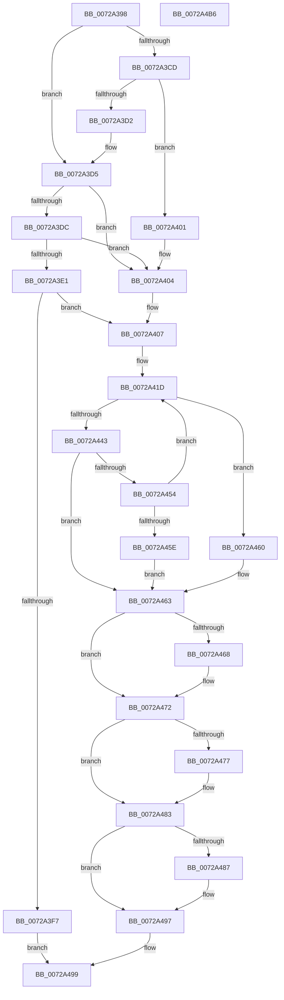

# IoReportResourceUsageInternal

- RVA: `0x0072A398`–`0x0072A4B7` (길이 `287` bytes)
- VA: `0x000000014072A398`
- 실행 섹션: `PAGE`
- PDB 이름 있음: `예`; PDB Function 태그: `아니요`
- unwind 정보 RVA: `0x000C5440`
- 디코드: `89`개 명령, `287/287` bytes 표시
- 미해석 바이트: `0` (있으면 어셈블리에 `.byte`로 보존)

> 이 문서는 커널 이미지의 기계어와 PDB 기호를 분석해 생성했습니다. 4번과 5번은 함수 원형과 자료형을 바이너리 사용 방식에서 추정한 C 해석이며 원본 소스 복구 결과는 아닙니다.

## 1. Dependencies

- 직접 호출 지점: **5**; 고유 호출 대상: **4**
- 직접 호출자로 확인된 함수: **3**
- RIP 상대 이미지 참조: **0**

### Outgoing calls
- `0x0072A3EA` → [PnpCmResourcesToIoResources](../73/PnpCmResourcesToIoResources_function_0073D584.md) (function, `0x0073D584`)
- `0x0072A438` → [IopLegacyResourceAllocation](../A0/IopLegacyResourceAllocation_function_00A07224.md) (function, `0x00A07224`)
- `0x0072A44B` → [IopChangeInterfaceType](IopChangeInterfaceType_function_0072A4C0.md) (function, `0x0072A4C0`)
- `0x0072A46D` → [ExFreePoolWithTag](../../poolcode/B8/ExFreePoolWithTag_function_00B82870.md) (function, `0x00B82870`)
- `0x0072A47E` → [ExFreePoolWithTag](../../poolcode/B8/ExFreePoolWithTag_function_00B82870.md) (function, `0x00B82870`)

### Direct callers
- [IoReportDetectedDevice](IoReportDetectedDevice_function_00725CD0.md) at `0x007266D1`
- [IoReportResourceForDetection](IoReportResourceForDetection_function_00729FC0.md) at `0x0072A17A`
- [IoReportResourceUsage](IoReportResourceUsage_function_0072A1B0.md) at `0x0072A36F`

### Static image references
- 디코드된 RIP-relative 메모리 참조가 없습니다.

## 2. Other-region calls and transfers

- 다른 실행 섹션으로 향하는 call: **2**
  - `0x0072A46D` → [ExFreePoolWithTag](../../poolcode/B8/ExFreePoolWithTag_function_00B82870.md) (`PAGE` → `POOLCODE`)
  - `0x0072A47E` → [ExFreePoolWithTag](../../poolcode/B8/ExFreePoolWithTag_function_00B82870.md) (`PAGE` → `POOLCODE`)
- 별도 외부 분기/꼬리 이동을 확인하지 못했습니다.

## 3. Assembly (complete function range)

```asm
0072A398  48 8B C4                        mov rax, rsp
0072A39B  48 89 58 08                     mov qword ptr [rax + 8], rbx
0072A39F  48 89 68 18                     mov qword ptr [rax + 0x18], rbp
0072A3A3  48 89 70 20                     mov qword ptr [rax + 0x20], rsi
0072A3A7  48 89 50 10                     mov qword ptr [rax + 0x10], rdx
0072A3AB  57                              push rdi
0072A3AC  41 54                           push r12
0072A3AE  41 55                           push r13
0072A3B0  41 56                           push r14
0072A3B2  41 57                           push r15
0072A3B4  48 83 EC 30                     sub rsp, 0x30
0072A3B8  48 8B BC 24 90 00 00 00         mov rdi, qword ptr [rsp + 0x90]
0072A3C0  33 DB                           xor ebx, ebx
0072A3C2  4D 8B E0                        mov r12, r8
0072A3C5  44 8B E9                        mov r13d, ecx
0072A3C8  48 85 FF                        test rdi, rdi
0072A3CB  75 08                           jne 0x14072a3d5
0072A3CD  4D 85 C9                        test r9, r9
0072A3D0  74 2F                           je 0x14072a401
0072A3D2  49 8B F9                        mov rdi, r9
0072A3D5  48 8B F3                        mov rsi, rbx
0072A3D8  39 1F                           cmp dword ptr [rdi], ebx
0072A3DA  74 28                           je 0x14072a404
0072A3DC  39 5F 10                        cmp dword ptr [rdi + 0x10], ebx
0072A3DF  74 23                           je 0x14072a404
0072A3E1  41 B8 00 30 00 00               mov r8d, 0x3000
0072A3E7  48 8B D7                        mov rdx, rdi
0072A3EA  E8 95 31 01 00                  call 0x14073d584
0072A3EF  48 8B F0                        mov rsi, rax
0072A3F2  48 85 C0                        test rax, rax
0072A3F5  75 10                           jne 0x14072a407
0072A3F7  B8 01 00 00 C0                  mov eax, 0xc0000001
0072A3FC  E9 98 00 00 00                  jmp 0x14072a499
0072A401  48 8B F3                        mov rsi, rbx
0072A404  48 8B FB                        mov rdi, rbx
0072A407  4C 8B BC 24 A8 00 00 00         mov r15, qword ptr [rsp + 0xa8]
0072A40F  8B EB                           mov ebp, ebx
0072A411  48 89 7C 24 68                  mov qword ptr [rsp + 0x68], rdi
0072A416  44 8A F3                        mov r14b, bl
0072A419  41 C6 07 01                     mov byte ptr [r15], 1
0072A41D  4C 8B 84 24 88 00 00 00         mov r8, qword ptr [rsp + 0x88]
0072A425  48 8D 44 24 68                  lea rax, [rsp + 0x68]
0072A42A  4C 8B CE                        mov r9, rsi
0072A42D  48 89 44 24 20                  mov qword ptr [rsp + 0x20], rax
0072A432  49 8B D4                        mov rdx, r12
0072A435  41 8B CD                        mov ecx, r13d
0072A438  E8 E7 CD 2D 00                  call 0x140a07224
0072A43D  8B F8                           mov edi, eax
0072A43F  85 C0                           test eax, eax
0072A441  79 1D                           jns 0x14072a460
0072A443  48 8D 54 24 68                  lea rdx, [rsp + 0x68]
0072A448  48 8B CE                        mov rcx, rsi
0072A44B  E8 70 00 00 00                  call 0x14072a4c0
0072A450  84 C0                           test al, al
0072A452  74 0F                           je 0x14072a463
0072A454  FF C5                           inc ebp
0072A456  41 B6 01                        mov r14b, 1
0072A459  83 FD 02                        cmp ebp, 2
0072A45C  72 BF                           jb 0x14072a41d
0072A45E  EB 03                           jmp 0x14072a463
0072A460  41 88 1F                        mov byte ptr [r15], bl
0072A463  48 85 F6                        test rsi, rsi
0072A466  74 0A                           je 0x14072a472
0072A468  33 D2                           xor edx, edx
0072A46A  48 8B CE                        mov rcx, rsi
0072A46D  E8 FE 83 45 00                  call 0x140b82870
0072A472  45 84 F6                        test r14b, r14b
0072A475  74 0C                           je 0x14072a483
0072A477  48 8B 4C 24 68                  mov rcx, qword ptr [rsp + 0x68]
0072A47C  33 D2                           xor edx, edx
0072A47E  E8 ED 83 45 00                  call 0x140b82870
0072A483  85 FF                           test edi, edi
0072A485  79 10                           jns 0x14072a497
0072A487  81 FF 9A 00 00 C0               cmp edi, 0xc000009a
0072A48D  B8 18 00 00 C0                  mov eax, 0xc0000018
0072A492  0F 45 F8                        cmovne edi, eax
0072A495  8B DF                           mov ebx, edi
0072A497  8B C3                           mov eax, ebx
0072A499  48 8B 5C 24 60                  mov rbx, qword ptr [rsp + 0x60]
0072A49E  48 8B 6C 24 70                  mov rbp, qword ptr [rsp + 0x70]
0072A4A3  48 8B 74 24 78                  mov rsi, qword ptr [rsp + 0x78]
0072A4A8  48 83 C4 30                     add rsp, 0x30
0072A4AC  41 5F                           pop r15
0072A4AE  41 5E                           pop r14
0072A4B0  41 5D                           pop r13
0072A4B2  41 5C                           pop r12
0072A4B4  5F                              pop rdi
0072A4B5  C3                              ret
0072A4B6  CC                              int3
```

## 4. C-style interpretation (structured pseudocode)

```c
__int64 __fastcall IoReportResourceUsageInternal(int a1, __int64 a2, __int64 a3, __int64 a4, __int64 a5, __int64 a6, __int64 a7, __int64 a8, __int64 a9, __int64 a10)
{
    __int64 result;
    __int64 v_rbp;
    __int64 v_rbx;
    __int64 v_rdi;
    __int64 v_rsp;
    unsigned __int64 v_stack_m38;
    unsigned __int64 v_stack_p10;
    unsigned __int64 v_stack_p18;
    unsigned __int64 v_stack_p20;
    unsigned __int64 v_stack_p8;

    *(unsigned __int64 *)(v_rsp + 8) = v_rbx;
    *(unsigned __int64 *)(v_rsp + 24) = v_rbp;
    *(unsigned __int64 *)(v_rsp + 32) = v_rsi;
    *(unsigned __int64 *)(v_rsp + 16) = a2;
    v_rsp = (v_rsp) - (48);
    v_rbx = 0;
    if (a7 != 0) goto loc_0072A3D5;
    if (a4 == 0) goto loc_0072A401;
loc_0072A3D5:
    if ((*(unsigned int *)(a4)) == 0) goto loc_0072A404;
    if ((*(unsigned int *)(a4 + 16)) == 0) goto loc_0072A404;
    result = PnpCmResourcesToIoResources(a1, a4, (unsigned int)(0x3000ULL), a4);
    if (result != 0) goto loc_0072A407;
    goto loc_0072A499;
loc_0072A401:
loc_0072A404:
loc_0072A407:
    v_stack_p10 = 0;
    *(unsigned __int8 *)(a10) = 1;
loc_0072A41D:
    v_stack_m38 = v_stack_p10;
    result = IopLegacyResourceAllocation((unsigned int)((unsigned int)((unsigned int)(a1))), a3, a6, 0);
    if (!sign_flag) goto loc_0072A460;
    result = IopChangeInterfaceType(0, v_stack_p10, a6, 0);
    if ((unsigned __int8)(result) == 0) goto loc_0072A463;
    v_rbp = (unsigned int)((0) + 1);
    if (((unsigned int)(v_rbp)) < 2) goto loc_0072A41D;
    goto loc_0072A463;
loc_0072A460:
    *(unsigned __int8 *)(a10) = 0;
loc_0072A463:
    if (0 != 0) {
        a2 = 0;
        a1 = 0;
        result = ExFreePoolWithTag(a1, a2, a6, 0);
    }
    if (1 != 0) {
        a1 = v_stack_p10;
        a2 = 0;
        result = ExFreePoolWithTag(a1, a2, a6, 0);
    }
    v_rdi = (unsigned int)((unsigned int)(result));
    if (sign_flag) {
        result = 0xC0000018ULL;
        v_rdi = (unsigned int)((unsigned int)(result));
        if (((unsigned int)((unsigned int)((unsigned int)(result)))) != 0xC000009AULL) { v_rdi = (unsigned int)(result); }
        v_rbx = (unsigned int)(v_rdi);
    }
loc_0072A499:
    v_rsp = (v_rsp) + (48);
    return (unsigned int)((unsigned int)(v_rbx));
}
```

## 5. (Beta) C Style

```c
int64_t IoReportResourceUsageInternal(int32_t Arg1, int64_t Arg2, int64_t Arg3, int64_t Arg4, uint64_t Arg5, int64_t Arg6, int64_t Arg7, uint64_t Arg8, uint64_t Arg9, void *Arg10)
{
    uint8_t *arg10 = (uint8_t *)Arg10;

    int64_t result;
    int64_t local_rbp;
    int64_t local_rbx;
    int64_t local_rdi;
    int64_t local_rsp;
    uint64_t v_stack_m38;
    uint64_t v_stack_p10;
    uint64_t v_stack_p18;
    uint64_t v_stack_p20;
    uint64_t v_stack_p8;

    *(uint64_t *)(local_rsp + 0x8) = local_rbx;
    *(uint64_t *)(local_rsp + 0x18) = local_rbp;
    *(uint64_t *)(local_rsp + 0x20) = local_rsi;
    *(uint64_t *)(local_rsp + 0x10) = Arg2;
    local_rsp = (local_rsp) - (48);
    local_rbx = 0;
    if (Arg7 != 0) goto loc_0072A3D5;
    if (Arg4 == 0) goto loc_0072A401;
loc_0072A3D5:
    if ((*(uint32_t *)(Arg4)) == 0) goto loc_0072A404;
    if ((*(uint32_t *)(Arg4 + 0x10)) == 0) goto loc_0072A404;
    result = PnpCmResourcesToIoResources(Arg1, Arg4, (uint32_t)(0x3000ULL), Arg4);
    if (result != 0) goto loc_0072A407;
    goto loc_0072A499;
loc_0072A401:
loc_0072A404:
loc_0072A407:
    v_stack_p10 = 0;
    *(uint8_t *)(arg10) = 1;
loc_0072A41D:
    v_stack_m38 = v_stack_p10;
    result = IopLegacyResourceAllocation((uint32_t)((uint32_t)((uint32_t)(Arg1))), Arg3, Arg6, 0);
    if (!sign_flag) goto loc_0072A460;
    result = IopChangeInterfaceType(0, v_stack_p10, Arg6, 0);
    if ((uint8_t)(result) == 0) goto loc_0072A463;
    local_rbp = (uint32_t)((0) + 1);
    if (((uint32_t)(local_rbp)) < 2) goto loc_0072A41D;
    goto loc_0072A463;
loc_0072A460:
    *(uint8_t *)(arg10) = 0;
loc_0072A463:
    if (0 != 0) {
        Arg2 = 0;
        Arg1 = 0;
        result = ExFreePoolWithTag(Arg1, Arg2, Arg6, 0);
    }
    if (1 != 0) {
        Arg1 = v_stack_p10;
        Arg2 = 0;
        result = ExFreePoolWithTag(Arg1, Arg2, Arg6, 0);
    }
    local_rdi = (uint32_t)((uint32_t)(result));
    if (sign_flag) {
        result = 0xC0000018ULL;
        local_rdi = (uint32_t)((uint32_t)(result));
        if (((uint32_t)((uint32_t)((uint32_t)(result)))) != 0xC000009AULL) { local_rdi = (uint32_t)(result); }
        local_rbx = (uint32_t)(local_rdi);
    }
loc_0072A499:
    local_rsp = (local_rsp) + (48);
    return (uint32_t)((uint32_t)(local_rbx));
}
```

### 관측된 메모리 오프셋

구조체 형식이 확인되지 않은 접근은 인자 기준의 오프셋으로만 기록했습니다.

| 기준 인자 | 오프셋 표현 | 폭 (bit) | 접근 |
|---|---:|---:|---|
| `Arg10` | `+ 0x0` | `8` | `W` |

## 6. Execution-region graph

[열기: 2D/3D 그래프와 함수 탐색 컨트롤 패널](../../../control-panel.html?section=page&rva=0x0072A398&view=graph)

- 2D 그래프는 위에서 아래로 흐르고, 3D 그래프는 빈 공간을 드래그해 회전합니다. Shift+드래그는 이동, 휠은 확대·축소, 함수 노드 선택은 대상 보고서 이동입니다.

### Static fallback


