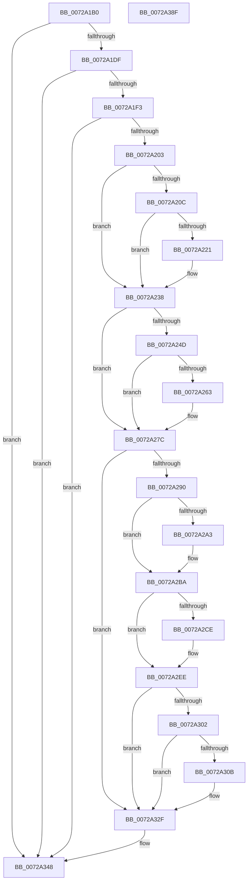

# IoReportResourceUsage

- RVA: `0x0072A1B0`–`0x0072A390` (길이 `480` bytes)
- VA: `0x000000014072A1B0`
- 실행 섹션: `PAGE`
- PDB 이름 있음: `예`; PDB Function 태그: `아니요`
- unwind 정보 RVA: `0x00091ECC`
- 디코드: `118`개 명령, `480/480` bytes 표시
- 미해석 바이트: `0` (있으면 어셈블리에 `.byte`로 보존)

> 이 문서는 커널 이미지의 기계어와 PDB 기호를 분석해 생성했습니다. 4번과 5번은 함수 원형과 자료형을 바이너리 사용 방식에서 추정한 C 해석이며 원본 소스 복구 결과는 아닙니다.

## 1. Dependencies

- 직접 호출 지점: **16**; 고유 호출 대상: **3**
- 직접 호출자로 확인된 함수: **0**
- RIP 상대 이미지 참조: **0**

### Outgoing calls
- `0x0072A213` → [IoAddTriageDumpDataBlock](../../text/42/IoAddTriageDumpDataBlock_function_00428374.md) (function, `0x00428374`)
- `0x0072A227` → [IoAddTriageDumpDataBlock](../../text/42/IoAddTriageDumpDataBlock_function_00428374.md) (function, `0x00428374`)
- `0x0072A233` → [IoAddTriageDumpDataBlock](../../text/42/IoAddTriageDumpDataBlock_function_00428374.md) (function, `0x00428374`)
- `0x0072A23F` → [IoAddTriageDumpDataBlock](../../text/42/IoAddTriageDumpDataBlock_function_00428374.md) (function, `0x00428374`)
- `0x0072A251` → [IoAddTriageDumpDataBlock](../../text/42/IoAddTriageDumpDataBlock_function_00428374.md) (function, `0x00428374`)
- `0x0072A266` → [IoAddTriageDumpDataBlock](../../text/42/IoAddTriageDumpDataBlock_function_00428374.md) (function, `0x00428374`)
- `0x0072A277` → [IoAddTriageDumpDataBlock](../../text/42/IoAddTriageDumpDataBlock_function_00428374.md) (function, `0x00428374`)
- `0x0072A299` → [IoAddTriageDumpDataBlock](../../text/42/IoAddTriageDumpDataBlock_function_00428374.md) (function, `0x00428374`)
- `0x0072A2A9` → [IoAddTriageDumpDataBlock](../../text/42/IoAddTriageDumpDataBlock_function_00428374.md) (function, `0x00428374`)
- `0x0072A2B5` → [IoAddTriageDumpDataBlock](../../text/42/IoAddTriageDumpDataBlock_function_00428374.md) (function, `0x00428374`)
- `0x0072A2D1` → [IoAddTriageDumpDataBlock](../../text/42/IoAddTriageDumpDataBlock_function_00428374.md) (function, `0x00428374`)
- `0x0072A2E9` → [IoAddTriageDumpDataBlock](../../text/42/IoAddTriageDumpDataBlock_function_00428374.md) (function, `0x00428374`)
- `0x0072A30E` → [IoAddTriageDumpDataBlock](../../text/42/IoAddTriageDumpDataBlock_function_00428374.md) (function, `0x00428374`)
- `0x0072A32A` → [IoAddTriageDumpDataBlock](../../text/42/IoAddTriageDumpDataBlock_function_00428374.md) (function, `0x00428374`)
- `0x0072A342` → [KeBugCheckEx](../../text/4F/KeBugCheckEx_function_004FD660.md) (function, `0x004FD660`)
- `0x0072A36F` → [IoReportResourceUsageInternal](IoReportResourceUsageInternal_function_0072A398.md) (function, `0x0072A398`)

### Direct callers
- 이 함수 시작 RVA로 연결되는 직접 call은 확인되지 않았습니다. 간접 호출은 완전히 역산할 수 없습니다.

### Static image references
- 디코드된 RIP-relative 메모리 참조가 없습니다.

## 2. Other-region calls and transfers

- 다른 실행 섹션으로 향하는 call: **15**
  - `0x0072A213` → [IoAddTriageDumpDataBlock](../../text/42/IoAddTriageDumpDataBlock_function_00428374.md) (`PAGE` → `.text`)
  - `0x0072A227` → [IoAddTriageDumpDataBlock](../../text/42/IoAddTriageDumpDataBlock_function_00428374.md) (`PAGE` → `.text`)
  - `0x0072A233` → [IoAddTriageDumpDataBlock](../../text/42/IoAddTriageDumpDataBlock_function_00428374.md) (`PAGE` → `.text`)
  - `0x0072A23F` → [IoAddTriageDumpDataBlock](../../text/42/IoAddTriageDumpDataBlock_function_00428374.md) (`PAGE` → `.text`)
  - `0x0072A251` → [IoAddTriageDumpDataBlock](../../text/42/IoAddTriageDumpDataBlock_function_00428374.md) (`PAGE` → `.text`)
  - `0x0072A266` → [IoAddTriageDumpDataBlock](../../text/42/IoAddTriageDumpDataBlock_function_00428374.md) (`PAGE` → `.text`)
  - `0x0072A277` → [IoAddTriageDumpDataBlock](../../text/42/IoAddTriageDumpDataBlock_function_00428374.md) (`PAGE` → `.text`)
  - `0x0072A299` → [IoAddTriageDumpDataBlock](../../text/42/IoAddTriageDumpDataBlock_function_00428374.md) (`PAGE` → `.text`)
  - `0x0072A2A9` → [IoAddTriageDumpDataBlock](../../text/42/IoAddTriageDumpDataBlock_function_00428374.md) (`PAGE` → `.text`)
  - `0x0072A2B5` → [IoAddTriageDumpDataBlock](../../text/42/IoAddTriageDumpDataBlock_function_00428374.md) (`PAGE` → `.text`)
  - `0x0072A2D1` → [IoAddTriageDumpDataBlock](../../text/42/IoAddTriageDumpDataBlock_function_00428374.md) (`PAGE` → `.text`)
  - `0x0072A2E9` → [IoAddTriageDumpDataBlock](../../text/42/IoAddTriageDumpDataBlock_function_00428374.md) (`PAGE` → `.text`)
  - `0x0072A30E` → [IoAddTriageDumpDataBlock](../../text/42/IoAddTriageDumpDataBlock_function_00428374.md) (`PAGE` → `.text`)
  - `0x0072A32A` → [IoAddTriageDumpDataBlock](../../text/42/IoAddTriageDumpDataBlock_function_00428374.md) (`PAGE` → `.text`)
  - `0x0072A342` → [KeBugCheckEx](../../text/4F/KeBugCheckEx_function_004FD660.md) (`PAGE` → `.text`)
- 별도 외부 분기/꼬리 이동을 확인하지 못했습니다.

## 3. Assembly (complete function range)

```asm
0072A1B0  48 8B C4                        mov rax, rsp
0072A1B3  48 89 58 08                     mov qword ptr [rax + 8], rbx
0072A1B7  48 89 68 10                     mov qword ptr [rax + 0x10], rbp
0072A1BB  48 89 70 18                     mov qword ptr [rax + 0x18], rsi
0072A1BF  48 89 78 20                     mov qword ptr [rax + 0x20], rdi
0072A1C3  41 56                           push r14
0072A1C5  48 83 EC 50                     sub rsp, 0x50
0072A1C9  48 8B 9C 24 80 00 00 00         mov rbx, qword ptr [rsp + 0x80]
0072A1D1  33 ED                           xor ebp, ebp
0072A1D3  48 8B FA                        mov rdi, rdx
0072A1D6  48 85 DB                        test rbx, rbx
0072A1D9  0F 84 69 01 00 00               je 0x14072a348
0072A1DF  48 8B 83 38 01 00 00            mov rax, qword ptr [rbx + 0x138]
0072A1E6  48 8B 40 28                     mov rax, qword ptr [rax + 0x28]
0072A1EA  48 85 C0                        test rax, rax
0072A1ED  0F 84 55 01 00 00               je 0x14072a348
0072A1F3  F7 80 8C 01 00 00 00 00 02 00   test dword ptr [rax + 0x18c], 0x20000
0072A1FD  0F 85 45 01 00 00               jne 0x14072a348
0072A203  44 8D 75 02                     lea r14d, [rbp + 2]
0072A207  48 85 D2                        test rdx, rdx
0072A20A  74 2C                           je 0x14072a238
0072A20C  0F BF 52 02                     movsx edx, word ptr [rdx + 2]
0072A210  48 8B CF                        mov rcx, rdi
0072A213  E8 5C E1 CF FF                  call 0x140428374
0072A218  48 8D 77 38                     lea rsi, [rdi + 0x38]
0072A21C  66 39 2E                        cmp word ptr [rsi], bp
0072A21F  74 17                           je 0x14072a238
0072A221  41 8B D6                        mov edx, r14d
0072A224  48 8B CE                        mov rcx, rsi
0072A227  E8 48 E1 CF FF                  call 0x140428374
0072A22C  0F B7 16                        movzx edx, word ptr [rsi]
0072A22F  48 8B 4F 40                     mov rcx, qword ptr [rdi + 0x40]
0072A233  E8 3C E1 CF FF                  call 0x140428374
0072A238  0F B7 53 02                     movzx edx, word ptr [rbx + 2]
0072A23C  48 8B CB                        mov rcx, rbx
0072A23F  E8 30 E1 CF FF                  call 0x140428374
0072A244  48 8B 4B 08                     mov rcx, qword ptr [rbx + 8]
0072A248  48 85 C9                        test rcx, rcx
0072A24B  74 2F                           je 0x14072a27c
0072A24D  0F BF 51 02                     movsx edx, word ptr [rcx + 2]
0072A251  E8 1E E1 CF FF                  call 0x140428374
0072A256  48 8B 4B 08                     mov rcx, qword ptr [rbx + 8]
0072A25A  48 83 C1 38                     add rcx, 0x38
0072A25E  66 39 29                        cmp word ptr [rcx], bp
0072A261  74 19                           je 0x14072a27c
0072A263  41 8B D6                        mov edx, r14d
0072A266  E8 09 E1 CF FF                  call 0x140428374
0072A26B  48 8B 4B 08                     mov rcx, qword ptr [rbx + 8]
0072A26F  0F B7 51 38                     movzx edx, word ptr [rcx + 0x38]
0072A273  48 8B 49 40                     mov rcx, qword ptr [rcx + 0x40]
0072A277  E8 F8 E0 CF FF                  call 0x140428374
0072A27C  48 8B 83 38 01 00 00            mov rax, qword ptr [rbx + 0x138]
0072A283  48 8B 48 28                     mov rcx, qword ptr [rax + 0x28]
0072A287  48 85 C9                        test rcx, rcx
0072A28A  0F 84 9F 00 00 00               je 0x14072a32f
0072A290  BA 88 03 00 00                  mov edx, 0x388
0072A295  48 8D 71 28                     lea rsi, [rcx + 0x28]
0072A299  E8 D6 E0 CF FF                  call 0x140428374
0072A29E  66 39 2E                        cmp word ptr [rsi], bp
0072A2A1  74 17                           je 0x14072a2ba
0072A2A3  41 8B D6                        mov edx, r14d
0072A2A6  48 8B CE                        mov rcx, rsi
0072A2A9  E8 C6 E0 CF FF                  call 0x140428374
0072A2AE  0F B7 16                        movzx edx, word ptr [rsi]
0072A2B1  48 8B 4E 08                     mov rcx, qword ptr [rsi + 8]
0072A2B5  E8 BA E0 CF FF                  call 0x140428374
0072A2BA  48 8B 83 38 01 00 00            mov rax, qword ptr [rbx + 0x138]
0072A2C1  48 8B 48 28                     mov rcx, qword ptr [rax + 0x28]
0072A2C5  48 83 C1 38                     add rcx, 0x38
0072A2C9  66 39 29                        cmp word ptr [rcx], bp
0072A2CC  74 20                           je 0x14072a2ee
0072A2CE  41 8B D6                        mov edx, r14d
0072A2D1  E8 9E E0 CF FF                  call 0x140428374
0072A2D6  48 8B 83 38 01 00 00            mov rax, qword ptr [rbx + 0x138]
0072A2DD  48 8B 48 28                     mov rcx, qword ptr [rax + 0x28]
0072A2E1  0F B7 51 38                     movzx edx, word ptr [rcx + 0x38]
0072A2E5  48 8B 49 40                     mov rcx, qword ptr [rcx + 0x40]
0072A2E9  E8 86 E0 CF FF                  call 0x140428374
0072A2EE  48 8B 83 38 01 00 00            mov rax, qword ptr [rbx + 0x138]
0072A2F5  48 8B 48 28                     mov rcx, qword ptr [rax + 0x28]
0072A2F9  48 8B 41 10                     mov rax, qword ptr [rcx + 0x10]
0072A2FD  48 85 C0                        test rax, rax
0072A300  74 2D                           je 0x14072a32f
0072A302  48 8D 48 38                     lea rcx, [rax + 0x38]
0072A306  66 39 29                        cmp word ptr [rcx], bp
0072A309  74 24                           je 0x14072a32f
0072A30B  41 8B D6                        mov edx, r14d
0072A30E  E8 61 E0 CF FF                  call 0x140428374
0072A313  48 8B 83 38 01 00 00            mov rax, qword ptr [rbx + 0x138]
0072A31A  48 8B 48 28                     mov rcx, qword ptr [rax + 0x28]
0072A31E  48 8B 49 10                     mov rcx, qword ptr [rcx + 0x10]
0072A322  0F B7 51 38                     movzx edx, word ptr [rcx + 0x38]
0072A326  48 8B 49 40                     mov rcx, qword ptr [rcx + 0x40]
0072A32A  E8 45 E0 CF FF                  call 0x140428374
0072A32F  4C 8B CF                        mov r9, rdi
0072A332  48 89 6C 24 20                  mov qword ptr [rsp + 0x20], rbp
0072A337  4C 8B C3                        mov r8, rbx
0072A33A  49 8B D6                        mov rdx, r14
0072A33D  B9 CA 00 00 00                  mov ecx, 0xca
0072A342  E8 19 33 DD FF                  call 0x1404fd660
0072A347  CC                              int3
0072A348  48 8B 84 24 A0 00 00 00         mov rax, qword ptr [rsp + 0xa0]
0072A350  4D 8B C8                        mov r9, r8
0072A353  48 89 44 24 48                  mov qword ptr [rsp + 0x48], rax
0072A358  4C 8B C7                        mov r8, rdi
0072A35B  48 8B 84 24 88 00 00 00         mov rax, qword ptr [rsp + 0x88]
0072A363  33 C9                           xor ecx, ecx
0072A365  48 89 44 24 30                  mov qword ptr [rsp + 0x30], rax
0072A36A  48 89 5C 24 28                  mov qword ptr [rsp + 0x28], rbx
0072A36F  E8 24 00 00 00                  call 0x14072a398
0072A374  48 8B 5C 24 60                  mov rbx, qword ptr [rsp + 0x60]
0072A379  48 8B 6C 24 68                  mov rbp, qword ptr [rsp + 0x68]
0072A37E  48 8B 74 24 70                  mov rsi, qword ptr [rsp + 0x70]
0072A383  48 8B 7C 24 78                  mov rdi, qword ptr [rsp + 0x78]
0072A388  48 83 C4 50                     add rsp, 0x50
0072A38C  41 5E                           pop r14
0072A38E  C3                              ret
0072A38F  CC                              int3
```

## 4. C-style interpretation (structured pseudocode)

```c
__int64 __fastcall IoReportResourceUsage(__int64 a1, __int64 a2, __int64 a3, __int64 a4, __int64 a5, __int64 a6, __int64 a7, __int64 a8, __int64 a9)
{
    __int64 result;
    __int64 v_rbp;
    __int64 v_rsp;
    unsigned __int64 v_stack_m10;
    unsigned __int64 v_stack_m28;
    unsigned __int64 v_stack_m30;
    unsigned __int64 v_stack_m38;
    unsigned __int64 v_stack_p10;
    unsigned __int64 v_stack_p18;
    unsigned __int64 v_stack_p20;
    unsigned __int64 v_stack_p8;

    *(unsigned __int64 *)(v_rsp + 8) = v_rbx;
    *(unsigned __int64 *)(v_rsp + 16) = v_rbp;
    *(unsigned __int64 *)(v_rsp + 24) = v_rsi;
    *(unsigned __int64 *)(v_rsp + 32) = v_rdi;
    v_rsp = (v_rsp) - (80);
    v_rbp = 0;
    if (a5 == 0) goto loc_0072A348;
    if (*(unsigned __int64 *)(*(unsigned __int64 *)(a5 + 312) + 40) == 0) goto loc_0072A348;
    if (((*(unsigned int *)(*(unsigned __int64 *)(*(unsigned __int64 *)(a5 + 312) + 40) + 396)) & (0x20000ULL)) != 0) goto loc_0072A348;
    if (a2 == 0) goto loc_0072A238;
    result = IoAddTriageDumpDataBlock(a2, (__int16)(*(unsigned __int16 *)(a2 + 2)), a3, a4);
    if ((*(unsigned __int16 *)(a2 + 56)) != 0) {
        a2 = (unsigned int)(v_rbp + 2);
        a1 = a2 + 56;
        result = IoAddTriageDumpDataBlock(a1, a2, a3, a4);
        a2 = *(unsigned __int16 *)(a2 + 56);
        a1 = *(unsigned __int64 *)(a2 + 64);
        result = IoAddTriageDumpDataBlock(a1, a2, a3, a4);
    }
    result = IoAddTriageDumpDataBlock(a5, *(unsigned __int16 *)(a5 + 2), a3, a4);
    if (*(unsigned __int64 *)(a5 + 8) == 0) goto loc_0072A27C;
    result = IoAddTriageDumpDataBlock(*(unsigned __int64 *)(a5 + 8), (__int16)(*(unsigned __int16 *)(*(unsigned __int64 *)(a5 + 8) + 2)), a3, a4);
    a1 = (*(unsigned __int64 *)(a5 + 8)) + (56);
    if ((*(unsigned __int16 *)(a1)) != 0) {
        a2 = (unsigned int)(v_rbp + 2);
        result = IoAddTriageDumpDataBlock(a1, a2, a3, a4);
        a1 = *(unsigned __int64 *)(a5 + 8);
        a2 = *(unsigned __int16 *)(a1 + 56);
        a1 = *(unsigned __int64 *)(a1 + 64);
        result = IoAddTriageDumpDataBlock(a1, a2, a3, a4);
    }
    if (*(unsigned __int64 *)(*(unsigned __int64 *)(a5 + 312) + 40) == 0) goto loc_0072A32F;
    result = IoAddTriageDumpDataBlock(*(unsigned __int64 *)(*(unsigned __int64 *)(a5 + 312) + 40), 904, a3, a4);
    if ((*(unsigned __int16 *)(*(unsigned __int64 *)(*(unsigned __int64 *)(a5 + 312) + 40) + 40)) != 0) {
        a2 = (unsigned int)(v_rbp + 2);
        a1 = *(unsigned __int64 *)(*(unsigned __int64 *)(a5 + 312) + 40) + 40;
        result = IoAddTriageDumpDataBlock(a1, a2, a3, a4);
        a2 = *(unsigned __int16 *)(*(unsigned __int64 *)(*(unsigned __int64 *)(a5 + 312) + 40) + 40);
        a1 = *(unsigned __int64 *)(*(unsigned __int64 *)(*(unsigned __int64 *)(a5 + 312) + 40) + 40 + 8);
        result = IoAddTriageDumpDataBlock(a1, a2, a3, a4);
    }
    a1 = (*(unsigned __int64 *)(*(unsigned __int64 *)(a5 + 312) + 40)) + (56);
    result = *(unsigned __int64 *)(a5 + 312);
    if ((*(unsigned __int16 *)(a1)) != 0) {
        a2 = (unsigned int)(v_rbp + 2);
        result = IoAddTriageDumpDataBlock(a1, a2, a3, a4);
        result = *(unsigned __int64 *)(a5 + 312);
        a1 = *(unsigned __int64 *)(result + 40);
        a2 = *(unsigned __int16 *)(a1 + 56);
        a1 = *(unsigned __int64 *)(a1 + 64);
        result = IoAddTriageDumpDataBlock(a1, a2, a3, a4);
    }
    if (*(unsigned __int64 *)(*(unsigned __int64 *)(*(unsigned __int64 *)(a5 + 312) + 40) + 16) == 0) goto loc_0072A32F;
    result = *(unsigned __int64 *)(*(unsigned __int64 *)(*(unsigned __int64 *)(a5 + 312) + 40) + 16);
    if ((*(unsigned __int16 *)(*(unsigned __int64 *)(*(unsigned __int64 *)(*(unsigned __int64 *)(a5 + 312) + 40) + 16) + 56)) != 0) {
        a2 = (unsigned int)(v_rbp + 2);
        result = IoAddTriageDumpDataBlock(*(unsigned __int64 *)(*(unsigned __int64 *)(*(unsigned __int64 *)(a5 + 312) + 40) + 16) + 56, a2, a3, a4);
        result = *(unsigned __int64 *)(a5 + 312);
        a1 = *(unsigned __int64 *)(result + 40);
        a1 = *(unsigned __int64 *)(a1 + 16);
        a2 = *(unsigned __int16 *)(a1 + 56);
        a1 = *(unsigned __int64 *)(a1 + 64);
        result = IoAddTriageDumpDataBlock(a1, a2, a3, a4);
    }
    v_stack_m38 = 0;
    result = KeBugCheckEx(202, v_rbp + 2, a5, a2);
loc_0072A348:
    v_stack_m10 = a9;
    a1 = 0;
    v_stack_m28 = a6;
    v_stack_m30 = a5;
    result = IoReportResourceUsageInternal(a1, v_rbp + 2, a2, a5);
    v_rsp = (v_rsp) + (80);
    return result;
}
```

## 5. (Beta) C Style

```c
int64_t IoReportResourceUsage(int64_t Arg1, void *Arg2, int64_t Arg3, int64_t Arg4, int64_t Arg5, int64_t Arg6, uint64_t Arg7, uint64_t Arg8, int64_t Arg9)
{
    uint8_t *arg2 = (uint8_t *)Arg2;

    int64_t result;
    int64_t local_rbp;
    int64_t local_rsp;
    uint64_t v_stack_m10;
    uint64_t v_stack_m28;
    uint64_t v_stack_m30;
    uint64_t v_stack_m38;
    uint64_t v_stack_p10;
    uint64_t v_stack_p18;
    uint64_t v_stack_p20;
    uint64_t v_stack_p8;

    *(uint64_t *)(local_rsp + 0x8) = local_rbx;
    *(uint64_t *)(local_rsp + 0x10) = local_rbp;
    *(uint64_t *)(local_rsp + 0x18) = local_rsi;
    *(uint64_t *)(local_rsp + 0x20) = local_rdi;
    local_rsp = (local_rsp) - (80);
    local_rbp = 0;
    if (Arg5 == 0) goto loc_0072A348;
    if (*(uint64_t *)(*(uint64_t *)(Arg5 + 0x138) + 0x28) == 0) goto loc_0072A348;
    if (((*(uint32_t *)(*(uint64_t *)(*(uint64_t *)(Arg5 + 0x138) + 0x28) + 0x18C)) & (0x20000ULL)) != 0) goto loc_0072A348;
    if (Arg2 == NULL) goto loc_0072A238;
    result = IoAddTriageDumpDataBlock(Arg2, (int16_t)(*(uint16_t *)(arg2 + 0x2)), Arg3, Arg4);
    if ((*(uint16_t *)(arg2 + 0x38)) != 0) {
        Arg2 = (uint32_t)(local_rbp + 2);
        Arg1 = Arg2 + 56;
        result = IoAddTriageDumpDataBlock(Arg1, Arg2, Arg3, Arg4);
        Arg2 = *(uint16_t *)(arg2 + 0x38);
        Arg1 = *(uint64_t *)(arg2 + 0x40);
        result = IoAddTriageDumpDataBlock(Arg1, Arg2, Arg3, Arg4);
    }
    result = IoAddTriageDumpDataBlock(Arg5, *(uint16_t *)(Arg5 + 0x2), Arg3, Arg4);
    if (*(uint64_t *)(Arg5 + 0x8) == 0) goto loc_0072A27C;
    result = IoAddTriageDumpDataBlock(*(uint64_t *)(Arg5 + 0x8), (int16_t)(*(uint16_t *)(*(uint64_t *)(Arg5 + 0x8) + 0x2)), Arg3, Arg4);
    Arg1 = (*(uint64_t *)(Arg5 + 0x8)) + (56);
    if ((*(uint16_t *)(Arg1)) != 0) {
        Arg2 = (uint32_t)(local_rbp + 2);
        result = IoAddTriageDumpDataBlock(Arg1, Arg2, Arg3, Arg4);
        Arg1 = *(uint64_t *)(Arg5 + 0x8);
        Arg2 = *(uint16_t *)(Arg1 + 0x38);
        Arg1 = *(uint64_t *)(Arg1 + 0x40);
        result = IoAddTriageDumpDataBlock(Arg1, Arg2, Arg3, Arg4);
    }
    if (*(uint64_t *)(*(uint64_t *)(Arg5 + 0x138) + 0x28) == 0) goto loc_0072A32F;
    result = IoAddTriageDumpDataBlock(*(uint64_t *)(*(uint64_t *)(Arg5 + 0x138) + 0x28), 904, Arg3, Arg4);
    if ((*(uint16_t *)(*(uint64_t *)(*(uint64_t *)(Arg5 + 0x138) + 0x28) + 0x28)) != 0) {
        Arg2 = (uint32_t)(local_rbp + 2);
        Arg1 = *(uint64_t *)(*(uint64_t *)(Arg5 + 0x138) + 0x28) + 40;
        result = IoAddTriageDumpDataBlock(Arg1, Arg2, Arg3, Arg4);
        Arg2 = *(uint16_t *)(*(uint64_t *)(*(uint64_t *)(Arg5 + 0x138) + 0x28) + 0x28);
        Arg1 = *(uint64_t *)(*(uint64_t *)(*(uint64_t *)(Arg5 + 0x138) + 0x28) + 0x28 + 0x8);
        result = IoAddTriageDumpDataBlock(Arg1, Arg2, Arg3, Arg4);
    }
    Arg1 = (*(uint64_t *)(*(uint64_t *)(Arg5 + 0x138) + 0x28)) + (56);
    result = *(uint64_t *)(Arg5 + 0x138);
    if ((*(uint16_t *)(Arg1)) != 0) {
        Arg2 = (uint32_t)(local_rbp + 2);
        result = IoAddTriageDumpDataBlock(Arg1, Arg2, Arg3, Arg4);
        result = *(uint64_t *)(Arg5 + 0x138);
        Arg1 = *(uint64_t *)(result + 0x28);
        Arg2 = *(uint16_t *)(Arg1 + 0x38);
        Arg1 = *(uint64_t *)(Arg1 + 0x40);
        result = IoAddTriageDumpDataBlock(Arg1, Arg2, Arg3, Arg4);
    }
    if (*(uint64_t *)(*(uint64_t *)(*(uint64_t *)(Arg5 + 0x138) + 0x28) + 0x10) == 0) goto loc_0072A32F;
    result = *(uint64_t *)(*(uint64_t *)(*(uint64_t *)(Arg5 + 0x138) + 0x28) + 0x10);
    if ((*(uint16_t *)(*(uint64_t *)(*(uint64_t *)(*(uint64_t *)(Arg5 + 0x138) + 0x28) + 0x10) + 0x38)) != 0) {
        Arg2 = (uint32_t)(local_rbp + 2);
        result = IoAddTriageDumpDataBlock(*(uint64_t *)(*(uint64_t *)(*(uint64_t *)(Arg5 + 0x138) + 0x28) + 0x10) + 56, Arg2, Arg3, Arg4);
        result = *(uint64_t *)(Arg5 + 0x138);
        Arg1 = *(uint64_t *)(result + 0x28);
        Arg1 = *(uint64_t *)(Arg1 + 0x10);
        Arg2 = *(uint16_t *)(Arg1 + 0x38);
        Arg1 = *(uint64_t *)(Arg1 + 0x40);
        result = IoAddTriageDumpDataBlock(Arg1, Arg2, Arg3, Arg4);
    }
    v_stack_m38 = 0;
    result = KeBugCheckEx(202, local_rbp + 2, Arg5, Arg2);
loc_0072A348:
    v_stack_m10 = Arg9;
    Arg1 = 0;
    v_stack_m28 = Arg6;
    v_stack_m30 = Arg5;
    result = IoReportResourceUsageInternal(Arg1, local_rbp + 2, Arg2, Arg5);
    local_rsp = (local_rsp) + (80);
    return result;
}
```

### 관측된 메모리 오프셋

구조체 형식이 확인되지 않은 접근은 인자 기준의 오프셋으로만 기록했습니다.

| 기준 인자 | 오프셋 표현 | 폭 (bit) | 접근 |
|---|---:|---:|---|
| `Arg2` | `+ 0x0` | `16` | `R` |
| `Arg2` | `+ 0x38` | `64` | `R` |
| `Arg2` | `+ 0x40` | `64` | `R` |

## 6. Execution-region graph

[열기: 2D/3D 그래프와 함수 탐색 컨트롤 패널](../../../control-panel.html?section=page&rva=0x0072A1B0&view=graph)

- 2D 그래프는 위에서 아래로 흐르고, 3D 그래프는 빈 공간을 드래그해 회전합니다. Shift+드래그는 이동, 휠은 확대·축소, 함수 노드 선택은 대상 보고서 이동입니다.

### Static fallback


