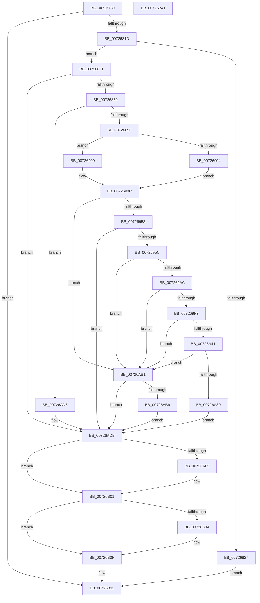

# IoReportRootDevice

- RVA: `0x00726780`–`0x00726B42` (길이 `962` bytes)
- VA: `0x0000000140726780`
- 실행 섹션: `PAGE`
- PDB 이름 있음: `예`; PDB Function 태그: `아니요`
- unwind 정보 RVA: `0x000C82B8`
- 디코드: `226`개 명령, `962/962` bytes 표시
- 미해석 바이트: `0` (있으면 어셈블리에 `.byte`로 보존)

> 이 문서는 커널 이미지의 기계어와 PDB 기호를 분석해 생성했습니다. 4번과 5번은 함수 원형과 자료형을 바이너리 사용 방식에서 추정한 C 해석이며 원본 소스 복구 결과는 아닙니다.

## 1. Dependencies

- 직접 호출 지점: **21**; 고유 호출 대상: **19**
- 직접 호출자로 확인된 함수: **0**
- RIP 상대 이미지 참조: **7**

### Outgoing calls
- `0x00726810` → [IopGetRootDeviceId](IopGetRootDeviceId_function_00726BD4.md) (function, `0x00726BD4`)
- `0x0072683B` → [RtlCopyUnicodeString](../../text/3F/RtlCopyUnicodeString_function_003FEF30.md) (function, `0x003FEF30`)
- `0x00726844` → [PiPnpRtlBeginOperation](../8E/PiPnpRtlBeginOperation_function_008E033C.md) (function, `0x008E033C`)
- `0x0072685C` → [PpDevNodeLockTree](../A1/PpDevNodeLockTree_function_00A19310.md) (function, `0x00A19310`)
- `0x0072687F` → [ExAcquireResourceExclusiveLite](../../text/21/ExAcquireResourceExclusiveLite_function_00214E20.md) (function, `0x00214E20`)
- `0x00726890` → [RtlAppendUnicodeToString](../../text/40/RtlAppendUnicodeToString_function_0040F990.md) (function, `0x0040F990`)
- `0x007268DD` → [RtlStringCchPrintfExW](../../text/42/RtlStringCchPrintfExW_function_0042B390.md) (function, `0x0042B390`)
- `0x0072693A` → [CmCreateDevice](../8F/CmCreateDevice_function_008FFABC.md) (function, `0x008FFABC`)
- `0x0072699D` → [CmSetDeviceRegProp](../8F/CmSetDeviceRegProp_function_008FD68C.md) (function, `0x008FD68C`)
- `0x007269E3` → [CmSetDeviceRegProp](../8F/CmSetDeviceRegProp_function_008FD68C.md) (function, `0x008FD68C`)
- `0x00726A36` → [PnpSetObjectProperty](../8F/PnpSetObjectProperty_function_008F66E8.md) (function, `0x008F66E8`)
- `0x00726A75` → [CmSetDeviceRegProp](../8F/CmSetDeviceRegProp_function_008FD68C.md) (function, `0x008FD68C`)
- `0x00726AAA` → [PnpRequestDeviceAction](../../text/47/PnpRequestDeviceAction_function_00477FF8.md) (function, `0x00477FF8`)
- `0x00726AC5` → [CmDeleteDevice](../82/CmDeleteDevice_function_00829BB8.md) (function, `0x00829BB8`)
- `0x00726ACF` → [PnpCleanupDeviceRegistryValues](../A0/PnpCleanupDeviceRegistryValues_function_00A0797C.md) (function, `0x00A0797C`)
- `0x00726AE2` → [ExReleaseResourceLite](../../text/25/ExReleaseResourceLite_function_0025FA10.md) (function, `0x0025FA10`)
- `0x00726AE7` → [KeLeaveCriticalRegion](../../text/25/KeLeaveCriticalRegion_function_0025D8B0.md) (function, `0x0025D8B0`)
- `0x00726AEF` → [PpDevNodeUnlockTree](../A2/PpDevNodeUnlockTree_function_00A21290.md) (function, `0x00A21290`)
- `0x00726AFC` → [ZwClose](../../text/6A/ZwClose_function_006AD2B0.md) (function, `0x006AD2B0`)
- `0x00726B0A` → [PiPnpRtlEndOperation](../8E/PiPnpRtlEndOperation_function_008E0518.md) (function, `0x008E0518`)
- `0x00726B1B` → [_security_check_cookie](../../text/6A/_security_check_cookie_function_006AC640.md) (function, `0x006AC640`)

### Direct callers
- 이 함수 시작 RVA로 연결되는 직접 call은 확인되지 않았습니다. 간접 호출은 완전히 역산할 수 없습니다.

### Static image references
- `0x007267A6` → RVA `0x00E0A740` (`.data`; read)
- `0x0072686A` → RVA `0x00F8C600` (`.data`; read)
- `0x00726884` → RVA `0x00AFC990` (` ?? ::NNGAKEGL::`string'`; read)
- `0x007268C8` → RVA `0x00AFD4D0` (` ?? ::NNGAKEGL::`string'`; read)
- `0x0072690C` → RVA `0x00E66398` (`.data`; read)
- `0x00726A18` → RVA `0x00014428` (`.rdata`; read)
- `0x00726A89` → RVA `0x00F8C438` (`.data`; read)

## 2. Other-region calls and transfers

- 다른 실행 섹션으로 향하는 call: **9**
  - `0x0072683B` → [RtlCopyUnicodeString](../../text/3F/RtlCopyUnicodeString_function_003FEF30.md) (`PAGE` → `.text`)
  - `0x0072687F` → [ExAcquireResourceExclusiveLite](../../text/21/ExAcquireResourceExclusiveLite_function_00214E20.md) (`PAGE` → `.text`)
  - `0x00726890` → [RtlAppendUnicodeToString](../../text/40/RtlAppendUnicodeToString_function_0040F990.md) (`PAGE` → `.text`)
  - `0x007268DD` → [RtlStringCchPrintfExW](../../text/42/RtlStringCchPrintfExW_function_0042B390.md) (`PAGE` → `.text`)
  - `0x00726AAA` → [PnpRequestDeviceAction](../../text/47/PnpRequestDeviceAction_function_00477FF8.md) (`PAGE` → `.text`)
  - `0x00726AE2` → [ExReleaseResourceLite](../../text/25/ExReleaseResourceLite_function_0025FA10.md) (`PAGE` → `.text`)
  - `0x00726AE7` → [KeLeaveCriticalRegion](../../text/25/KeLeaveCriticalRegion_function_0025D8B0.md) (`PAGE` → `.text`)
  - `0x00726AFC` → [ZwClose](../../text/6A/ZwClose_function_006AD2B0.md) (`PAGE` → `.text`)
  - `0x00726B1B` → [_security_check_cookie](../../text/6A/_security_check_cookie_function_006AC640.md) (`PAGE` → `.text`)
- 별도 외부 분기/꼬리 이동을 확인하지 못했습니다.

## 3. Assembly (complete function range)

```asm
00726780  48 8B C4                        mov rax, rsp
00726783  48 89 58 10                     mov qword ptr [rax + 0x10], rbx
00726787  48 89 70 18                     mov qword ptr [rax + 0x18], rsi
0072678B  48 89 78 20                     mov qword ptr [rax + 0x20], rdi
0072678F  55                              push rbp
00726790  41 54                           push r12
00726792  41 55                           push r13
00726794  41 56                           push r14
00726796  41 57                           push r15
00726798  48 8D A8 F8 FC FF FF            lea rbp, [rax - 0x308]
0072679F  48 81 EC E0 03 00 00            sub rsp, 0x3e0
007267A6  48 8B 05 93 3F 6E 00            mov rax, qword ptr [rip + 0x6e3f93]
007267AD  48 33 C4                        xor rax, rsp
007267B0  48 89 85 D0 02 00 00            mov qword ptr [rbp + 0x2d0], rax
007267B7  4C 8B 71 30                     mov r14, qword ptr [rcx + 0x30]
007267BB  48 8D 45 A0                     lea rax, [rbp - 0x60]
007267BF  45 33 E4                        xor r12d, r12d
007267C2  48 89 44 24 60                  mov qword ptr [rsp + 0x60], rax
007267C7  4C 8B F9                        mov r15, rcx
007267CA  44 88 64 24 51                  mov byte ptr [rsp + 0x51], r12b
007267CF  48 8D 85 30 01 00 00            lea rax, [rbp + 0x130]
007267D6  48 C7 44 24 78 00 00 92 01      mov qword ptr [rsp + 0x78], 0x1920000
007267DF  49 8D 4E 18                     lea rcx, [r14 + 0x18]
007267E3  48 C7 44 24 58 00 00 90 01      mov qword ptr [rsp + 0x58], 0x1900000
007267EC  48 8D 54 24 58                  lea rdx, [rsp + 0x58]
007267F1  44 89 64 24 68                  mov dword ptr [rsp + 0x68], r12d
007267F6  44 88 64 24 50                  mov byte ptr [rsp + 0x50], r12b
007267FB  41 8B FC                        mov edi, r12d
007267FE  4C 89 64 24 70                  mov qword ptr [rsp + 0x70], r12
00726803  BE 90 01 00 00                  mov esi, 0x190
00726808  48 89 45 80                     mov qword ptr [rbp - 0x80], rax
0072680C  4C 89 65 90                     mov qword ptr [rbp - 0x70], r12
00726810  E8 BF 03 00 00                  call 0x140726bd4
00726815  85 C0                           test eax, eax
00726817  0F 88 F4 02 00 00               js 0x140726b11
0072681D  8D 46 FE                        lea eax, [rsi - 2]
00726820  66 39 44 24 58                  cmp word ptr [rsp + 0x58], ax
00726825  76 0A                           jbe 0x140726831
00726827  B8 33 00 00 C0                  mov eax, 0xc0000033
0072682C  E9 E0 02 00 00                  jmp 0x140726b11
00726831  48 8D 54 24 58                  lea rdx, [rsp + 0x58]
00726836  48 8D 4C 24 78                  lea rcx, [rsp + 0x78]
0072683B  E8 F0 86 CD FF                  call 0x1403fef30
00726840  48 8D 4D 90                     lea rcx, [rbp - 0x70]
00726844  E8 F3 9A 1B 00                  call 0x1408e033c
00726849  8B D8                           mov ebx, eax
0072684B  41 BD 01 00 00 00               mov r13d, 1
00726851  85 C0                           test eax, eax
00726853  0F 88 82 02 00 00               js 0x140726adb
00726859  41 8B CD                        mov ecx, r13d
0072685C  E8 AF 2A 2F 00                  call 0x140a19310
00726861  65 48 8B 04 25 88 01 00 00      mov rax, qword ptr gs:[0x188]
0072686A  48 8D 0D 8F 5D 86 00            lea rcx, [rip + 0x865d8f]
00726871  83 CF FF                        or edi, 0xffffffff
00726874  41 8A D5                        mov dl, r13b
00726877  66 01 B8 E4 01 00 00            add word ptr [rax + 0x1e4], di
0072687E  90                              nop
0072687F  E8 9C E5 AE FF                  call 0x140214e20
00726884  48 8D 15 05 61 3D 00            lea rdx, [rip + 0x3d6105]
0072688B  48 8D 4C 24 58                  lea rcx, [rsp + 0x58]
00726890  E8 FB 90 CE FF                  call 0x14040f990
00726895  8B D8                           mov ebx, eax
00726897  85 C0                           test eax, eax
00726899  0F 88 37 02 00 00               js 0x140726ad6
0072689F  44 0F B7 44 24 58               movzx r8d, word ptr [rsp + 0x58]
007268A5  48 8D 4D A0                     lea rcx, [rbp - 0x60]
007268A9  41 8B C0                        mov eax, r8d
007268AC  4C 89 64 24 30                  mov qword ptr [rsp + 0x30], r12
007268B1  48 D1 E8                        shr rax, 1
007268B4  48 8B D6                        mov rdx, rsi
007268B7  49 2B D0                        sub rdx, r8
007268BA  45 33 C9                        xor r9d, r9d
007268BD  48 D1 EA                        shr rdx, 1
007268C0  4C 8D 45 88                     lea r8, [rbp - 0x78]
007268C4  48 8D 0C 41                     lea rcx, [rcx + rax*2]
007268C8  48 8D 05 01 6C 3D 00            lea rax, [rip + 0x3d6c01]
007268CF  48 89 4D 88                     mov qword ptr [rbp - 0x78], rcx
007268D3  48 89 44 24 28                  mov qword ptr [rsp + 0x28], rax
007268D8  4C 89 64 24 20                  mov qword ptr [rsp + 0x20], r12
007268DD  E8 AE 4A D0 FF                  call 0x14042b390
007268E2  0F B7 54 24 58                  movzx edx, word ptr [rsp + 0x58]
007268E7  48 8B 4D 88                     mov rcx, qword ptr [rbp - 0x78]
007268EB  8B C2                           mov eax, edx
007268ED  48 D1 E8                        shr rax, 1
007268F0  48 03 C0                        add rax, rax
007268F3  48 2B C8                        sub rcx, rax
007268F6  48 8D 45 A0                     lea rax, [rbp - 0x60]
007268FA  48 2B C8                        sub rcx, rax
007268FD  48 D1 F9                        sar rcx, 1
00726900  3B CF                           cmp ecx, edi
00726902  75 05                           jne 0x140726909
00726904  66 2B F2                        sub si, dx
00726907  EB 03                           jmp 0x14072690c
00726909  8D 34 09                        lea esi, [rcx + rcx]
0072690C  48 8B 0D 85 FA 73 00            mov rcx, qword ptr [rip + 0x73fa85]
00726913  48 8D 44 24 50                  lea rax, [rsp + 0x50]
00726918  66 03 D6                        add dx, si
0072691B  44 89 64 24 28                  mov dword ptr [rsp + 0x28], r12d
00726920  66 89 54 24 58                  mov word ptr [rsp + 0x58], dx
00726925  4C 8D 4C 24 70                  lea r9, [rsp + 0x70]
0072692A  48 8B 54 24 60                  mov rdx, qword ptr [rsp + 0x60]
0072692F  41 B8 3F 00 0F 00               mov r8d, 0xf003f
00726935  48 89 44 24 20                  mov qword ptr [rsp + 0x20], rax
0072693A  E8 7D 91 1D 00                  call 0x1408ffabc
0072693F  40 8A 74 24 50                  mov sil, byte ptr [rsp + 0x50]
00726944  8B D8                           mov ebx, eax
00726946  48 8B 7C 24 70                  mov rdi, qword ptr [rsp + 0x70]
0072694B  85 C0                           test eax, eax
0072694D  0F 88 5E 01 00 00               js 0x140726ab1
00726953  40 84 F6                        test sil, sil
00726956  0F 84 7F 01 00 00               je 0x140726adb
0072695C  48 8B 45 80                     mov rax, qword ptr [rbp - 0x80]
00726960  41 B9 02 00 00 00               mov r9d, 2
00726966  0F B7 54 24 78                  movzx edx, word ptr [rsp + 0x78]
0072696B  4C 8B C7                        mov r8, rdi
0072696E  83 C2 04                        add edx, 4
00726971  44 89 64 24 38                  mov dword ptr [rsp + 0x38], r12d
00726976  89 54 24 30                     mov dword ptr [rsp + 0x30], edx
0072697A  8B CA                           mov ecx, edx
0072697C  48 D1 E9                        shr rcx, 1
0072697F  48 89 44 24 28                  mov qword ptr [rsp + 0x28], rax
00726984  C7 44 24 20 07 00 00 00         mov dword ptr [rsp + 0x20], 7
0072698C  44 89 64 48 FC                  mov dword ptr [rax + rcx*2 - 4], r12d
00726991  48 8B 54 24 60                  mov rdx, qword ptr [rsp + 0x60]
00726996  48 8B 0D FB F9 73 00            mov rcx, qword ptr [rip + 0x73f9fb]
0072699D  E8 EA 6C 1D 00                  call 0x1408fd68c
007269A2  8B D8                           mov ebx, eax
007269A4  85 C0                           test eax, eax
007269A6  0F 88 05 01 00 00               js 0x140726ab1
007269AC  48 8B 54 24 60                  mov rdx, qword ptr [rsp + 0x60]
007269B1  48 8D 44 24 68                  lea rax, [rsp + 0x68]
007269B6  B9 04 00 00 00                  mov ecx, 4
007269BB  44 89 64 24 38                  mov dword ptr [rsp + 0x38], r12d
007269C0  89 4C 24 30                     mov dword ptr [rsp + 0x30], ecx
007269C4  4C 8B C7                        mov r8, rdi
007269C7  48 89 44 24 28                  mov qword ptr [rsp + 0x28], rax
007269CC  89 4C 24 20                     mov dword ptr [rsp + 0x20], ecx
007269D0  44 8D 49 07                     lea r9d, [rcx + 7]
007269D4  C7 44 24 68 20 00 00 00         mov dword ptr [rsp + 0x68], 0x20
007269DC  48 8B 0D B5 F9 73 00            mov rcx, qword ptr [rip + 0x73f9b5]
007269E3  E8 A4 6C 1D 00                  call 0x1408fd68c
007269E8  8B D8                           mov ebx, eax
007269EA  85 C0                           test eax, eax
007269EC  0F 88 BF 00 00 00               js 0x140726ab1
007269F2  48 8B 54 24 60                  mov rdx, qword ptr [rsp + 0x60]
007269F7  48 8D 44 24 51                  lea rax, [rsp + 0x51]
007269FC  48 8B 0D 95 F9 73 00            mov rcx, qword ptr [rip + 0x73f995]
00726A03  4C 8B CF                        mov r9, rdi
00726A06  44 89 64 24 48                  mov dword ptr [rsp + 0x48], r12d
00726A0B  45 8B C5                        mov r8d, r13d
00726A0E  44 89 6C 24 40                  mov dword ptr [rsp + 0x40], r13d
00726A13  48 89 44 24 38                  mov qword ptr [rsp + 0x38], rax
00726A18  48 8D 05 09 DA 8E FF            lea rax, [rip - 0x7125f7]
00726A1F  C7 44 24 30 11 00 00 00         mov dword ptr [rsp + 0x30], 0x11
00726A27  48 89 44 24 28                  mov qword ptr [rsp + 0x28], rax
00726A2C  4C 89 64 24 20                  mov qword ptr [rsp + 0x20], r12
00726A31  C6 44 24 51 FF                  mov byte ptr [rsp + 0x51], 0xff
00726A36  E8 AD FC 1C 00                  call 0x1408f66e8
00726A3B  8B D8                           mov ebx, eax
00726A3D  85 C0                           test eax, eax
00726A3F  78 70                           js 0x140726ab1
00726A41  41 0F B7 46 18                  movzx eax, word ptr [r14 + 0x18]
00726A46  41 B9 05 00 00 00               mov r9d, 5
00726A4C  48 8B 54 24 60                  mov rdx, qword ptr [rsp + 0x60]
00726A51  83 C0 02                        add eax, 2
00726A54  48 8B 0D 3D F9 73 00            mov rcx, qword ptr [rip + 0x73f93d]
00726A5B  4C 8B C7                        mov r8, rdi
00726A5E  44 89 64 24 38                  mov dword ptr [rsp + 0x38], r12d
00726A63  89 44 24 30                     mov dword ptr [rsp + 0x30], eax
00726A67  49 8B 46 20                     mov rax, qword ptr [r14 + 0x20]
00726A6B  48 89 44 24 28                  mov qword ptr [rsp + 0x28], rax
00726A70  44 89 6C 24 20                  mov dword ptr [rsp + 0x20], r13d
00726A75  E8 12 6C 1D 00                  call 0x1408fd68c
00726A7A  8B D8                           mov ebx, eax
00726A7C  85 C0                           test eax, eax
00726A7E  78 31                           js 0x140726ab1
00726A80  41 0F BA 6F 10 0B               bts dword ptr [r15 + 0x10], 0xb
00726A86  45 33 C9                        xor r9d, r9d
00726A89  48 8B 0D A8 59 86 00            mov rcx, qword ptr [rip + 0x8659a8]
00726A90  45 33 C0                        xor r8d, r8d
00726A93  4C 89 64 24 30                  mov qword ptr [rsp + 0x30], r12
00726A98  4C 89 64 24 28                  mov qword ptr [rsp + 0x28], r12
00726A9D  41 8D 51 08                     lea edx, [r9 + 8]
00726AA1  4C 89 64 24 20                  mov qword ptr [rsp + 0x20], r12
00726AA6  48 8B 49 20                     mov rcx, qword ptr [rcx + 0x20]
00726AAA  E8 49 15 D5 FF                  call 0x140477ff8
00726AAF  EB 2A                           jmp 0x140726adb
00726AB1  40 84 F6                        test sil, sil
00726AB4  74 25                           je 0x140726adb
00726AB6  48 8B 54 24 60                  mov rdx, qword ptr [rsp + 0x60]
00726ABB  45 33 C0                        xor r8d, r8d
00726ABE  48 8B 0D D3 F8 73 00            mov rcx, qword ptr [rip + 0x73f8d3]
00726AC5  E8 EE 30 10 00                  call 0x140829bb8
00726ACA  48 8D 4C 24 58                  lea rcx, [rsp + 0x58]
00726ACF  E8 A8 0E 2E 00                  call 0x140a0797c
00726AD4  EB 05                           jmp 0x140726adb
00726AD6  48 8B 7C 24 70                  mov rdi, qword ptr [rsp + 0x70]
00726ADB  48 8D 0D 1E 5B 86 00            lea rcx, [rip + 0x865b1e]
00726AE2  E8 29 8F B3 FF                  call 0x14025fa10
00726AE7  E8 C4 6D B3 FF                  call 0x14025d8b0
00726AEC  41 8B CD                        mov ecx, r13d
00726AEF  E8 9C A7 2F 00                  call 0x140a21290
00726AF4  48 85 FF                        test rdi, rdi
00726AF7  74 08                           je 0x140726b01
00726AF9  48 8B CF                        mov rcx, rdi
00726AFC  E8 AF 67 F8 FF                  call 0x1406ad2b0
00726B01  48 8B 4D 90                     mov rcx, qword ptr [rbp - 0x70]
00726B05  48 85 C9                        test rcx, rcx
00726B08  74 05                           je 0x140726b0f
00726B0A  E8 09 9A 1B 00                  call 0x1408e0518
00726B0F  8B C3                           mov eax, ebx
00726B11  48 8B 8D D0 02 00 00            mov rcx, qword ptr [rbp + 0x2d0]
00726B18  48 33 CC                        xor rcx, rsp
00726B1B  E8 20 5B F8 FF                  call 0x1406ac640
00726B20  4C 8D 9C 24 E0 03 00 00         lea r11, [rsp + 0x3e0]
00726B28  49 8B 5B 38                     mov rbx, qword ptr [r11 + 0x38]
00726B2C  49 8B 73 40                     mov rsi, qword ptr [r11 + 0x40]
00726B30  49 8B 7B 48                     mov rdi, qword ptr [r11 + 0x48]
00726B34  49 8B E3                        mov rsp, r11
00726B37  41 5F                           pop r15
00726B39  41 5E                           pop r14
00726B3B  41 5D                           pop r13
00726B3D  41 5C                           pop r12
00726B3F  5D                              pop rbp
00726B40  C3                              ret
00726B41  CC                              int3
```

## 4. C-style interpretation (structured pseudocode)

```c
__int64 __fastcall IoReportRootDevice(__int64 a1, __int64 a2, __int64 a3, int a4)
{
    __int64 result;
    __int64 v_r12;
    __int64 v_rdi;
    __int64 v_rsi;
    __int64 v_rsp;
    unsigned __int64 v_stack_m28;
    unsigned __int64 v_stack_m390;
    unsigned __int64 v_stack_m398;
    unsigned int v_stack_m3A0;
    unsigned __int64 v_stack_m3A8;
    unsigned __int64 v_stack_m3B0;
    unsigned __int8 v_stack_m3B7;
    unsigned __int8 v_stack_m3B8;
    unsigned int v_stack_m3C0;
    unsigned int v_stack_m3C8;
    unsigned int v_stack_m3D0;
    unsigned __int64 v_stack_m3D8;
    unsigned __int64 v_stack_m3E0;
    unsigned __int64 v_stack_m3E8;

    *(unsigned __int64 *)(v_rsp + 16) = v_rbx;
    *(unsigned __int64 *)(v_rsp + 24) = v_rsi;
    *(unsigned __int64 *)(v_rsp + 32) = v_rdi;
    v_rsp = (v_rsp) - (992);
    result = (*(unsigned __int64 *)(v_rip + 7225235)) ^ (v_rsp);
    *(unsigned __int64 *)(v_rsp - 776 + 720) = result;
    v_r12 = 0;
    v_stack_m3A8 = v_rsp - 776 - 96;
    v_stack_m3B7 = 0;
    v_stack_m390 = 0x1920000ULL;
    v_stack_m3B0 = 0x1900000ULL;
    v_stack_m3A0 = 0;
    v_stack_m3B8 = 0;
    v_stack_m398 = 0;
    *(unsigned __int64 *)(v_rsp - 776 - 128) = v_rsp - 776 + 304;
    *(unsigned __int64 *)(v_rsp - 776 - 112) = 0;
    result = IopGetRootDeviceId(*(unsigned __int64 *)(a1 + 48) + 24, v_stack_m3B0, a3, a4);
    if (sign_flag) goto loc_00726B11;
    if (v_stack_m3B0 <= ((unsigned __int16)(400 - 2))) goto loc_00726831;
    goto loc_00726B11;
loc_00726831:
    result = RtlCopyUnicodeString(v_stack_m390, v_stack_m3B0, a3, a4);
    result = PiPnpRtlBeginOperation(v_rsp - 776 - 112, v_stack_m3B0, a3, a4);
    if (sign_flag) goto loc_00726ADB;
    result = PpDevNodeLockTree(1, v_stack_m3B0, a3, a4);
    v_rdi = (unsigned int)((0) | (0xFFFFFFFFULL));
    result = ExAcquireResourceExclusiveLite(v_rip + 8805775, 1, a3, a4);
    result = RtlAppendUnicodeToString(v_stack_m3B0, v_rip + 4022533, a3, a4);
    if (sign_flag) goto loc_00726AD6;
    v_stack_m3D8 = 0;
    result = ((unsigned int)((unsigned int)(v_stack_m3B0))) >> (1);
    a2 = (400) - (v_stack_m3B0);
    a4 = 0;
    a2 = (a2) >> (1);
    *(unsigned __int64 *)(v_rsp - 776 - 120) = v_rsp - 776 - 96 + result * 2;
    v_stack_m3E0 = v_rip + 4025345;
    v_stack_m3E8 = 0;
    result = RtlStringCchPrintfExW(v_rsp - 776 - 96 + result * 2, a2, v_rsp - 776 - 120, a4);
    result = ((unsigned int)((unsigned int)(v_stack_m3B0))) >> (1);
    result = (result) + (result);
    a1 = (*(unsigned __int64 *)(v_rsp - 776 - 120)) - (result);
    a1 = (a1) - (v_rsp - 776 - 96);
    a1 = (a1) >> (1);
    if (((unsigned int)(a1)) != ((unsigned int)(v_rdi))) goto loc_00726909;
    v_rsi = (unsigned __int16)((400) - ((unsigned __int16)(v_stack_m3B0)));
    goto loc_0072690C;
loc_00726909:
loc_0072690C:
    a2 = (unsigned __int16)((v_stack_m3B0) + ((unsigned __int16)(a1 + a1 * 1)));
    v_stack_m3E0 = 0;
    v_stack_m3B0 = (unsigned __int16)(a2);
    v_stack_m3E8 = v_stack_m3B8;
    result = CmCreateDevice(*(unsigned __int64 *)(v_rip + 7600773), v_stack_m3A8, (unsigned int)(0xF003FULL), v_stack_m398);
    if (sign_flag) goto loc_00726AB1;
    if ((unsigned __int8)(v_stack_m3B8) == 0) goto loc_00726ADB;
    a2 = (unsigned int)((v_stack_m390) + (4));
    v_stack_m3D0 = 0;
    v_stack_m3D8 = (unsigned int)(a2);
    a1 = ((unsigned int)((unsigned int)(a2))) >> (1);
    v_stack_m3E0 = *(unsigned __int64 *)(v_rsp - 776 - 128);
    v_stack_m3E8 = 7;
    *(unsigned int *)(*(unsigned __int64 *)(v_rsp - 776 - 128) + a1 * 2 - 4) = 0;
    result = CmSetDeviceRegProp(*(unsigned __int64 *)(v_rip + 7600635), v_stack_m3A8, v_stack_m398, 2);
    if (sign_flag) goto loc_00726AB1;
    v_stack_m3D0 = 0;
    v_stack_m3D8 = 4;
    v_stack_m3E0 = v_stack_m3A0;
    v_stack_m3E8 = 4;
    v_stack_m3A0 = 32;
    result = CmSetDeviceRegProp(*(unsigned __int64 *)(v_rip + 7600565), v_stack_m3A8, v_stack_m398, 4 + 7);
    if (sign_flag) goto loc_00726AB1;
    v_stack_m3C0 = 0;
    v_stack_m3C8 = 1;
    v_stack_m3D0 = v_stack_m3B7;
    v_stack_m3D8 = 17;
    v_stack_m3E0 = v_rip - 7415287;
    v_stack_m3E8 = 0;
    v_stack_m3B7 = 255;
    result = PnpSetObjectProperty(*(unsigned __int64 *)(v_rip + 7600533), v_stack_m3A8, 1, v_stack_m398);
    if (sign_flag) goto loc_00726AB1;
    result = (unsigned int)((*(unsigned __int16 *)(*(unsigned __int64 *)(a1 + 48) + 24)) + (2));
    v_stack_m3D0 = 0;
    v_stack_m3D8 = (unsigned int)(result);
    v_stack_m3E0 = *(unsigned __int64 *)(*(unsigned __int64 *)(a1 + 48) + 32);
    v_stack_m3E8 = 1;
    result = CmSetDeviceRegProp(*(unsigned __int64 *)(v_rip + 7600445), v_stack_m3A8, v_stack_m398, 5);
    if (sign_flag) goto loc_00726AB1;
    a4 = 0;
    a3 = 0;
    v_stack_m3D8 = 0;
    v_stack_m3E0 = 0;
    v_stack_m3E8 = 0;
    result = PnpRequestDeviceAction(*(unsigned __int64 *)(*(unsigned __int64 *)(v_rip + 8804776) + 32), a4 + 8, a3, a4);
    goto loc_00726ADB;
loc_00726AB1:
    if ((unsigned __int8)(v_stack_m3B8) == 0) goto loc_00726ADB;
    a3 = 0;
    result = CmDeleteDevice(*(unsigned __int64 *)(v_rip + 7600339), v_stack_m3A8, a3, a4);
    result = PnpCleanupDeviceRegistryValues(v_stack_m3B0, v_stack_m3A8, a3, a4);
    goto loc_00726ADB;
loc_00726AD6:
loc_00726ADB:
    result = ExReleaseResourceLite(v_rip + 8805150, v_stack_m3A8, a3, a4);
    result = KeLeaveCriticalRegion(v_rip + 8805150, v_stack_m3A8, a3, a4);
    result = PpDevNodeUnlockTree(1, v_stack_m3A8, a3, a4);
    if (v_stack_m398 != 0) {
        a1 = v_stack_m398;
        result = ZwClose(a1, v_stack_m3A8, a3, a4);
    }
    if (*(unsigned __int64 *)(v_rsp - 776 - 112) != 0) {
        result = PiPnpRtlEndOperation(*(unsigned __int64 *)(v_rsp - 776 - 112), v_stack_m3A8, a3, a4);
    }
loc_00726B11:
    a1 = (*(unsigned __int64 *)(v_rsp - 776 + 720)) ^ (v_rsp);
    result = _security_check_cookie(a1, v_stack_m3A8, a3, a4);
    return result;
}
```

## 5. (Beta) C Style

```c
int64_t IoReportRootDevice(void *Arg1, int64_t Arg2, int64_t Arg3, int32_t Arg4)
{
    uint8_t *arg1 = (uint8_t *)Arg1;

    int64_t result;
    int64_t local_r12;
    int64_t local_rdi;
    int64_t local_rsi;
    int64_t local_rsp;
    uint64_t v_stack_m28;
    uint64_t v_stack_m390;
    uint64_t v_stack_m398;
    uint32_t v_stack_m3A0;
    uint64_t v_stack_m3A8;
    uint64_t v_stack_m3B0;
    uint8_t v_stack_m3B7;
    uint8_t v_stack_m3B8;
    uint32_t v_stack_m3C0;
    uint32_t v_stack_m3C8;
    uint32_t v_stack_m3D0;
    uint64_t v_stack_m3D8;
    uint64_t v_stack_m3E0;
    uint64_t v_stack_m3E8;

    *(uint64_t *)(local_rsp + 0x10) = local_rbx;
    *(uint64_t *)(local_rsp + 0x18) = local_rsi;
    *(uint64_t *)(local_rsp + 0x20) = local_rdi;
    local_rsp = (local_rsp) - (992);
    result = (*(uint64_t *)(v_rip + 0x6E3F93)) ^ (local_rsp);
    *(uint64_t *)(local_rsp - 0x308 + 0x2D0) = result;
    local_r12 = 0;
    v_stack_m3A8 = local_rsp - 776 - 96;
    v_stack_m3B7 = 0;
    v_stack_m390 = 0x1920000ULL;
    v_stack_m3B0 = 0x1900000ULL;
    v_stack_m3A0 = 0;
    v_stack_m3B8 = 0;
    v_stack_m398 = 0;
    *(uint64_t *)(local_rsp - 0x308 - 0x80) = local_rsp - 776 + 304;
    *(uint64_t *)(local_rsp - 0x308 - 0x70) = 0;
    result = IopGetRootDeviceId(*(uint64_t *)(arg1 + 0x30) + 24, v_stack_m3B0, Arg3, Arg4);
    if (sign_flag) goto loc_00726B11;
    if (v_stack_m3B0 <= ((uint16_t)(400 - 2))) goto loc_00726831;
    goto loc_00726B11;
loc_00726831:
    result = RtlCopyUnicodeString(v_stack_m390, v_stack_m3B0, Arg3, Arg4);
    result = PiPnpRtlBeginOperation(local_rsp - 776 - 112, v_stack_m3B0, Arg3, Arg4);
    if (sign_flag) goto loc_00726ADB;
    result = PpDevNodeLockTree(1, v_stack_m3B0, Arg3, Arg4);
    local_rdi = (uint32_t)((0) | (0xFFFFFFFFULL));
    result = ExAcquireResourceExclusiveLite(v_rip + 8805775, 1, Arg3, Arg4);
    result = RtlAppendUnicodeToString(v_stack_m3B0, v_rip + 4022533, Arg3, Arg4);
    if (sign_flag) goto loc_00726AD6;
    v_stack_m3D8 = 0;
    result = ((uint32_t)((uint32_t)(v_stack_m3B0))) >> (1);
    Arg2 = (400) - (v_stack_m3B0);
    Arg4 = 0;
    Arg2 = (Arg2) >> (1);
    *(uint64_t *)(local_rsp - 0x308 - 0x78) = local_rsp - 776 - 96 + result * 2;
    v_stack_m3E0 = v_rip + 4025345;
    v_stack_m3E8 = 0;
    result = RtlStringCchPrintfExW(local_rsp - 776 - 96 + result * 2, Arg2, local_rsp - 776 - 120, Arg4);
    result = ((uint32_t)((uint32_t)(v_stack_m3B0))) >> (1);
    result = (result) + (result);
    Arg1 = (*(uint64_t *)(local_rsp - 0x308 - 0x78)) - (result);
    Arg1 = (Arg1) - (local_rsp - 776 - 96);
    Arg1 = (Arg1) >> (1);
    if (((uint32_t)(Arg1)) != ((uint32_t)(local_rdi))) goto loc_00726909;
    local_rsi = (uint16_t)((400) - ((uint16_t)(v_stack_m3B0)));
    goto loc_0072690C;
loc_00726909:
loc_0072690C:
    Arg2 = (uint16_t)((v_stack_m3B0) + ((uint16_t)(Arg1 + Arg1 * 1)));
    v_stack_m3E0 = 0;
    v_stack_m3B0 = (uint16_t)(Arg2);
    v_stack_m3E8 = v_stack_m3B8;
    result = CmCreateDevice(*(uint64_t *)(v_rip + 0x73FA85), v_stack_m3A8, (uint32_t)(0xF003FULL), v_stack_m398);
    if (sign_flag) goto loc_00726AB1;
    if ((uint8_t)(v_stack_m3B8) == 0) goto loc_00726ADB;
    Arg2 = (uint32_t)((v_stack_m390) + (4));
    v_stack_m3D0 = 0;
    v_stack_m3D8 = (uint32_t)(Arg2);
    Arg1 = ((uint32_t)((uint32_t)(Arg2))) >> (1);
    v_stack_m3E0 = *(uint64_t *)(local_rsp - 0x308 - 0x80);
    v_stack_m3E8 = 7;
    *(uint32_t *)(*(uint64_t *)(local_rsp - 0x308 - 0x80) + arg1 * 2 - 0x4) = 0;
    result = CmSetDeviceRegProp(*(uint64_t *)(v_rip + 0x73F9FB), v_stack_m3A8, v_stack_m398, 2);
    if (sign_flag) goto loc_00726AB1;
    v_stack_m3D0 = 0;
    v_stack_m3D8 = 4;
    v_stack_m3E0 = v_stack_m3A0;
    v_stack_m3E8 = 4;
    v_stack_m3A0 = 32;
    result = CmSetDeviceRegProp(*(uint64_t *)(v_rip + 0x73F9B5), v_stack_m3A8, v_stack_m398, 4 + 7);
    if (sign_flag) goto loc_00726AB1;
    v_stack_m3C0 = 0;
    v_stack_m3C8 = 1;
    v_stack_m3D0 = v_stack_m3B7;
    v_stack_m3D8 = 17;
    v_stack_m3E0 = v_rip - 7415287;
    v_stack_m3E8 = 0;
    v_stack_m3B7 = 255;
    result = PnpSetObjectProperty(*(uint64_t *)(v_rip + 0x73F995), v_stack_m3A8, 1, v_stack_m398);
    if (sign_flag) goto loc_00726AB1;
    result = (uint32_t)((*(uint16_t *)(*(uint64_t *)(arg1 + 0x30) + 0x18)) + (2));
    v_stack_m3D0 = 0;
    v_stack_m3D8 = (uint32_t)(result);
    v_stack_m3E0 = *(uint64_t *)(*(uint64_t *)(arg1 + 0x30) + 0x20);
    v_stack_m3E8 = 1;
    result = CmSetDeviceRegProp(*(uint64_t *)(v_rip + 0x73F93D), v_stack_m3A8, v_stack_m398, 5);
    if (sign_flag) goto loc_00726AB1;
    Arg4 = 0;
    Arg3 = 0;
    v_stack_m3D8 = 0;
    v_stack_m3E0 = 0;
    v_stack_m3E8 = 0;
    result = PnpRequestDeviceAction(*(uint64_t *)(*(uint64_t *)(v_rip + 0x8659A8) + 0x20), Arg4 + 8, Arg3, Arg4);
    goto loc_00726ADB;
loc_00726AB1:
    if ((uint8_t)(v_stack_m3B8) == 0) goto loc_00726ADB;
    Arg3 = 0;
    result = CmDeleteDevice(*(uint64_t *)(v_rip + 0x73F8D3), v_stack_m3A8, Arg3, Arg4);
    result = PnpCleanupDeviceRegistryValues(v_stack_m3B0, v_stack_m3A8, Arg3, Arg4);
    goto loc_00726ADB;
loc_00726AD6:
loc_00726ADB:
    result = ExReleaseResourceLite(v_rip + 8805150, v_stack_m3A8, Arg3, Arg4);
    result = KeLeaveCriticalRegion(v_rip + 8805150, v_stack_m3A8, Arg3, Arg4);
    result = PpDevNodeUnlockTree(1, v_stack_m3A8, Arg3, Arg4);
    if (v_stack_m398 != 0) {
        Arg1 = v_stack_m398;
        result = ZwClose(Arg1, v_stack_m3A8, Arg3, Arg4);
    }
    if (*(uint64_t *)(local_rsp - 0x308 - 0x70) != 0) {
        result = PiPnpRtlEndOperation(*(uint64_t *)(local_rsp - 0x308 - 0x70), v_stack_m3A8, Arg3, Arg4);
    }
loc_00726B11:
    Arg1 = (*(uint64_t *)(local_rsp - 0x308 + 0x2D0)) ^ (local_rsp);
    result = _security_check_cookie(Arg1, v_stack_m3A8, Arg3, Arg4);
    return result;
}
```

### 관측된 메모리 오프셋

구조체 형식이 확인되지 않은 접근은 인자 기준의 오프셋으로만 기록했습니다.

| 기준 인자 | 오프셋 표현 | 폭 (bit) | 접근 |
|---|---:|---:|---|
| `Arg1` | `+ 0x10` | `32` | `R/W` |
| `Arg1` | `+ 0x30` | `64` | `R` |

## 6. Execution-region graph

[열기: 2D/3D 그래프와 함수 탐색 컨트롤 패널](../../../control-panel.html?section=page&rva=0x00726780&view=graph)

- 2D 그래프는 위에서 아래로 흐르고, 3D 그래프는 빈 공간을 드래그해 회전합니다. Shift+드래그는 이동, 휠은 확대·축소, 함수 노드 선택은 대상 보고서 이동입니다.

### Static fallback


