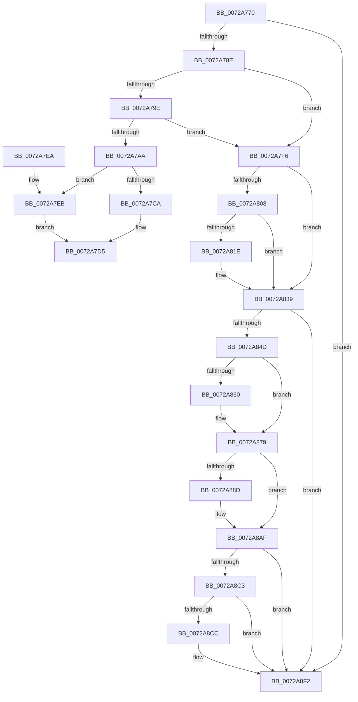

# IoRequestDeviceRemovalForReset

- RVA: `0x0072A770`–`0x0072A90C` (길이 `412` bytes)
- VA: `0x000000014072A770`
- 실행 섹션: `PAGE`
- PDB 이름 있음: `예`; PDB Function 태그: `아니요`
- unwind 정보 RVA: `0x000C8534`
- 디코드: `103`개 명령, `412/412` bytes 표시
- 미해석 바이트: `0` (있으면 어셈블리에 `.byte`로 보존)

> 이 문서는 커널 이미지의 기계어와 PDB 기호를 분석해 생성했습니다. 4번과 5번은 함수 원형과 자료형을 바이너리 사용 방식에서 추정한 C 해석이며 원본 소스 복구 결과는 아닙니다.

## 1. Dependencies

- 직접 호출 지점: **13**; 고유 호출 대상: **3**
- 직접 호출자로 확인된 함수: **0**
- RIP 상대 이미지 참조: **0**

### Outgoing calls
- `0x0072A7D5` → [PnpRequestDeviceAction](../../text/47/PnpRequestDeviceAction_function_00477FF8.md) (function, `0x00477FF8`)
- `0x0072A7FA` → [IoAddTriageDumpDataBlock](../../text/42/IoAddTriageDumpDataBlock_function_00428374.md) (function, `0x00428374`)
- `0x0072A80C` → [IoAddTriageDumpDataBlock](../../text/42/IoAddTriageDumpDataBlock_function_00428374.md) (function, `0x00428374`)
- `0x0072A823` → [IoAddTriageDumpDataBlock](../../text/42/IoAddTriageDumpDataBlock_function_00428374.md) (function, `0x00428374`)
- `0x0072A834` → [IoAddTriageDumpDataBlock](../../text/42/IoAddTriageDumpDataBlock_function_00428374.md) (function, `0x00428374`)
- `0x0072A856` → [IoAddTriageDumpDataBlock](../../text/42/IoAddTriageDumpDataBlock_function_00428374.md) (function, `0x00428374`)
- `0x0072A868` → [IoAddTriageDumpDataBlock](../../text/42/IoAddTriageDumpDataBlock_function_00428374.md) (function, `0x00428374`)
- `0x0072A874` → [IoAddTriageDumpDataBlock](../../text/42/IoAddTriageDumpDataBlock_function_00428374.md) (function, `0x00428374`)
- `0x0072A892` → [IoAddTriageDumpDataBlock](../../text/42/IoAddTriageDumpDataBlock_function_00428374.md) (function, `0x00428374`)
- `0x0072A8AA` → [IoAddTriageDumpDataBlock](../../text/42/IoAddTriageDumpDataBlock_function_00428374.md) (function, `0x00428374`)
- `0x0072A8D1` → [IoAddTriageDumpDataBlock](../../text/42/IoAddTriageDumpDataBlock_function_00428374.md) (function, `0x00428374`)
- `0x0072A8ED` → [IoAddTriageDumpDataBlock](../../text/42/IoAddTriageDumpDataBlock_function_00428374.md) (function, `0x00428374`)
- `0x0072A906` → [KeBugCheckEx](../../text/4F/KeBugCheckEx_function_004FD660.md) (function, `0x004FD660`)

### Direct callers
- 이 함수 시작 RVA로 연결되는 직접 call은 확인되지 않았습니다. 간접 호출은 완전히 역산할 수 없습니다.

### Static image references
- 디코드된 RIP-relative 메모리 참조가 없습니다.

## 2. Other-region calls and transfers

- 다른 실행 섹션으로 향하는 call: **13**
  - `0x0072A7D5` → [PnpRequestDeviceAction](../../text/47/PnpRequestDeviceAction_function_00477FF8.md) (`PAGE` → `.text`)
  - `0x0072A7FA` → [IoAddTriageDumpDataBlock](../../text/42/IoAddTriageDumpDataBlock_function_00428374.md) (`PAGE` → `.text`)
  - `0x0072A80C` → [IoAddTriageDumpDataBlock](../../text/42/IoAddTriageDumpDataBlock_function_00428374.md) (`PAGE` → `.text`)
  - `0x0072A823` → [IoAddTriageDumpDataBlock](../../text/42/IoAddTriageDumpDataBlock_function_00428374.md) (`PAGE` → `.text`)
  - `0x0072A834` → [IoAddTriageDumpDataBlock](../../text/42/IoAddTriageDumpDataBlock_function_00428374.md) (`PAGE` → `.text`)
  - `0x0072A856` → [IoAddTriageDumpDataBlock](../../text/42/IoAddTriageDumpDataBlock_function_00428374.md) (`PAGE` → `.text`)
  - `0x0072A868` → [IoAddTriageDumpDataBlock](../../text/42/IoAddTriageDumpDataBlock_function_00428374.md) (`PAGE` → `.text`)
  - `0x0072A874` → [IoAddTriageDumpDataBlock](../../text/42/IoAddTriageDumpDataBlock_function_00428374.md) (`PAGE` → `.text`)
  - `0x0072A892` → [IoAddTriageDumpDataBlock](../../text/42/IoAddTriageDumpDataBlock_function_00428374.md) (`PAGE` → `.text`)
  - `0x0072A8AA` → [IoAddTriageDumpDataBlock](../../text/42/IoAddTriageDumpDataBlock_function_00428374.md) (`PAGE` → `.text`)
  - `0x0072A8D1` → [IoAddTriageDumpDataBlock](../../text/42/IoAddTriageDumpDataBlock_function_00428374.md) (`PAGE` → `.text`)
  - `0x0072A8ED` → [IoAddTriageDumpDataBlock](../../text/42/IoAddTriageDumpDataBlock_function_00428374.md) (`PAGE` → `.text`)
  - `0x0072A906` → [KeBugCheckEx](../../text/4F/KeBugCheckEx_function_004FD660.md) (`PAGE` → `.text`)
- 별도 외부 분기/꼬리 이동을 확인하지 못했습니다.

## 3. Assembly (complete function range)

```asm
0072A770  4C 8B DC                        mov r11, rsp
0072A773  49 89 5B 08                     mov qword ptr [r11 + 8], rbx
0072A777  49 89 6B 10                     mov qword ptr [r11 + 0x10], rbp
0072A77B  56                              push rsi
0072A77C  48 83 EC 50                     sub rsp, 0x50
0072A780  33 ED                           xor ebp, ebp
0072A782  48 8B D9                        mov rbx, rcx
0072A785  48 85 C9                        test rcx, rcx
0072A788  0F 84 64 01 00 00               je 0x14072a8f2
0072A78E  48 8B 81 38 01 00 00            mov rax, qword ptr [rcx + 0x138]
0072A795  48 8B 40 28                     mov rax, qword ptr [rax + 0x28]
0072A799  48 85 C0                        test rax, rax
0072A79C  74 58                           je 0x14072a7f6
0072A79E  F7 80 8C 01 00 00 00 00 02 00   test dword ptr [rax + 0x18c], 0x20000
0072A7A8  75 4C                           jne 0x14072a7f6
0072A7AA  49 89 6B D8                     mov qword ptr [r11 - 0x28], rbp
0072A7AE  0F 57 C0                        xorps xmm0, xmm0
0072A7B1  49 89 6B D0                     mov qword ptr [r11 - 0x30], rbp
0072A7B5  4D 8D 4B E8                     lea r9, [r11 - 0x18]
0072A7B9  49 89 6B C8                     mov qword ptr [r11 - 0x38], rbp
0072A7BD  41 B0 01                        mov r8b, 1
0072A7C0  0F 11 44 24 40                  movups xmmword ptr [rsp + 0x40], xmm0
0072A7C5  F6 C2 04                        test dl, 4
0072A7C8  74 21                           je 0x14072a7eb
0072A7CA  C7 44 24 48 02 00 00 00         mov dword ptr [rsp + 0x48], 2
0072A7D2  8D 55 06                        lea edx, [rbp + 6]
0072A7D5  E8 1E D8 D4 FF                  call 0x140477ff8
0072A7DA  48 8B 5C 24 60                  mov rbx, qword ptr [rsp + 0x60]
0072A7DF  48 8B 6C 24 68                  mov rbp, qword ptr [rsp + 0x68]
0072A7E4  48 83 C4 50                     add rsp, 0x50
0072A7E8  5E                              pop rsi
0072A7E9  C3                              ret
0072A7EA  CC                              int3
0072A7EB  89 54 24 48                     mov dword ptr [rsp + 0x48], edx
0072A7EF  BA 1A 00 00 00                  mov edx, 0x1a
0072A7F4  EB DF                           jmp 0x14072a7d5
0072A7F6  0F B7 51 02                     movzx edx, word ptr [rcx + 2]
0072A7FA  E8 75 DB CF FF                  call 0x140428374
0072A7FF  48 8B 4B 08                     mov rcx, qword ptr [rbx + 8]
0072A803  48 85 C9                        test rcx, rcx
0072A806  74 31                           je 0x14072a839
0072A808  0F BF 51 02                     movsx edx, word ptr [rcx + 2]
0072A80C  E8 63 DB CF FF                  call 0x140428374
0072A811  48 8B 4B 08                     mov rcx, qword ptr [rbx + 8]
0072A815  48 83 C1 38                     add rcx, 0x38
0072A819  66 39 29                        cmp word ptr [rcx], bp
0072A81C  74 1B                           je 0x14072a839
0072A81E  BA 02 00 00 00                  mov edx, 2
0072A823  E8 4C DB CF FF                  call 0x140428374
0072A828  48 8B 4B 08                     mov rcx, qword ptr [rbx + 8]
0072A82C  0F B7 51 38                     movzx edx, word ptr [rcx + 0x38]
0072A830  48 8B 49 40                     mov rcx, qword ptr [rcx + 0x40]
0072A834  E8 3B DB CF FF                  call 0x140428374
0072A839  48 8B 83 38 01 00 00            mov rax, qword ptr [rbx + 0x138]
0072A840  48 8B 48 28                     mov rcx, qword ptr [rax + 0x28]
0072A844  48 85 C9                        test rcx, rcx
0072A847  0F 84 A5 00 00 00               je 0x14072a8f2
0072A84D  BA 88 03 00 00                  mov edx, 0x388
0072A852  48 8D 71 28                     lea rsi, [rcx + 0x28]
0072A856  E8 19 DB CF FF                  call 0x140428374
0072A85B  66 39 2E                        cmp word ptr [rsi], bp
0072A85E  74 19                           je 0x14072a879
0072A860  BA 02 00 00 00                  mov edx, 2
0072A865  48 8B CE                        mov rcx, rsi
0072A868  E8 07 DB CF FF                  call 0x140428374
0072A86D  0F B7 16                        movzx edx, word ptr [rsi]
0072A870  48 8B 4E 08                     mov rcx, qword ptr [rsi + 8]
0072A874  E8 FB DA CF FF                  call 0x140428374
0072A879  48 8B 83 38 01 00 00            mov rax, qword ptr [rbx + 0x138]
0072A880  48 8B 48 28                     mov rcx, qword ptr [rax + 0x28]
0072A884  48 83 C1 38                     add rcx, 0x38
0072A888  66 39 29                        cmp word ptr [rcx], bp
0072A88B  74 22                           je 0x14072a8af
0072A88D  BA 02 00 00 00                  mov edx, 2
0072A892  E8 DD DA CF FF                  call 0x140428374
0072A897  48 8B 83 38 01 00 00            mov rax, qword ptr [rbx + 0x138]
0072A89E  48 8B 48 28                     mov rcx, qword ptr [rax + 0x28]
0072A8A2  0F B7 51 38                     movzx edx, word ptr [rcx + 0x38]
0072A8A6  48 8B 49 40                     mov rcx, qword ptr [rcx + 0x40]
0072A8AA  E8 C5 DA CF FF                  call 0x140428374
0072A8AF  48 8B 83 38 01 00 00            mov rax, qword ptr [rbx + 0x138]
0072A8B6  48 8B 48 28                     mov rcx, qword ptr [rax + 0x28]
0072A8BA  48 8B 41 10                     mov rax, qword ptr [rcx + 0x10]
0072A8BE  48 85 C0                        test rax, rax
0072A8C1  74 2F                           je 0x14072a8f2
0072A8C3  48 8D 48 38                     lea rcx, [rax + 0x38]
0072A8C7  66 39 29                        cmp word ptr [rcx], bp
0072A8CA  74 26                           je 0x14072a8f2
0072A8CC  BA 02 00 00 00                  mov edx, 2
0072A8D1  E8 9E DA CF FF                  call 0x140428374
0072A8D6  48 8B 83 38 01 00 00            mov rax, qword ptr [rbx + 0x138]
0072A8DD  48 8B 48 28                     mov rcx, qword ptr [rax + 0x28]
0072A8E1  48 8B 49 10                     mov rcx, qword ptr [rcx + 0x10]
0072A8E5  0F B7 51 38                     movzx edx, word ptr [rcx + 0x38]
0072A8E9  48 8B 49 40                     mov rcx, qword ptr [rcx + 0x40]
0072A8ED  E8 82 DA CF FF                  call 0x140428374
0072A8F2  45 33 C9                        xor r9d, r9d
0072A8F5  48 89 6C 24 20                  mov qword ptr [rsp + 0x20], rbp
0072A8FA  4C 8B C3                        mov r8, rbx
0072A8FD  B9 CA 00 00 00                  mov ecx, 0xca
0072A902  41 8D 51 02                     lea edx, [r9 + 2]
0072A906  E8 55 2D DD FF                  call 0x1404fd660
0072A90B  CC                              int3
```

## 4. C-style interpretation (structured pseudocode)

```c
__int64 __fastcall IoRequestDeviceRemovalForReset(__int64 a1, unsigned __int8 a2)
{
    __int64 result;
    __int64 v_rbp;
    __int64 v_rsp;
    unsigned int v_stack_m10;
    unsigned __int64 v_stack_m18;
    unsigned __int64 v_stack_p10;
    unsigned __int64 v_stack_p20;
    unsigned int v_stack_p48;
    unsigned __int64 v_stack_p8;

    *(unsigned __int64 *)(v_rsp + 8) = v_rbx;
    *(unsigned __int64 *)(v_rsp + 16) = v_rbp;
    v_rsp = (v_rsp) - (80);
    v_rbp = 0;
    if (a1 == 0) goto loc_0072A8F2;
    if (*(unsigned __int64 *)(*(unsigned __int64 *)(a1 + 312) + 40) == 0) goto loc_0072A7F6;
    if (((*(unsigned int *)(*(unsigned __int64 *)(*(unsigned __int64 *)(a1 + 312) + 40) + 396)) & (0x20000ULL)) != 0) goto loc_0072A7F6;
    *(unsigned __int64 *)(v_rsp - 40) = 0;
    *(unsigned __int64 *)(v_rsp - 48) = 0;
    *(unsigned __int64 *)(v_rsp - 56) = 0;
    v_stack_m18 = v_xmm0;
    if (((a2) & (4)) == 0) goto loc_0072A7EB;
    v_stack_m10 = 2;
loc_0072A7D5:
    result = PnpRequestDeviceAction(a1, v_rbp + 6, 1, v_rsp - 24);
    v_rsp = (v_rsp) + (80);
    return result;
loc_0072A7EB:
    v_stack_p48 = (unsigned int)(v_rbp + 6);
    goto loc_0072A7D5;
loc_0072A7F6:
    result = IoAddTriageDumpDataBlock(a1, *(unsigned __int16 *)(a1 + 2), 1, v_rsp - 24);
    if (*(unsigned __int64 *)(v_stack_p8 + 8) == 0) goto loc_0072A839;
    result = IoAddTriageDumpDataBlock(*(unsigned __int64 *)(v_stack_p8 + 8), (__int16)(*(unsigned __int16 *)(*(unsigned __int64 *)(v_stack_p8 + 8) + 2)), 1, v_rsp - 24);
    a1 = (*(unsigned __int64 *)(v_stack_p8 + 8)) + (56);
    if ((*(unsigned __int16 *)(a1)) != ((unsigned __int16)(v_stack_p10))) {
        a2 = 2;
        result = IoAddTriageDumpDataBlock(a1, a2, 1, v_rsp - 24);
        a1 = *(unsigned __int64 *)(v_stack_p8 + 8);
        a2 = *(unsigned __int16 *)(a1 + 56);
        a1 = *(unsigned __int64 *)(a1 + 64);
        result = IoAddTriageDumpDataBlock(a1, a2, 1, v_rsp - 24);
    }
    if (*(unsigned __int64 *)(*(unsigned __int64 *)(v_stack_p8 + 312) + 40) == 0) goto loc_0072A8F2;
    result = IoAddTriageDumpDataBlock(*(unsigned __int64 *)(*(unsigned __int64 *)(v_stack_p8 + 312) + 40), 904, 1, v_rsp - 24);
    if ((*(unsigned __int16 *)(*(unsigned __int64 *)(*(unsigned __int64 *)(v_stack_p8 + 312) + 40) + 40)) != ((unsigned __int16)(v_stack_p10))) {
        a2 = 2;
        a1 = *(unsigned __int64 *)(*(unsigned __int64 *)(v_stack_p8 + 312) + 40) + 40;
        result = IoAddTriageDumpDataBlock(a1, a2, 1, v_rsp - 24);
        a2 = *(unsigned __int16 *)(*(unsigned __int64 *)(*(unsigned __int64 *)(v_stack_p8 + 312) + 40) + 40);
        a1 = *(unsigned __int64 *)(*(unsigned __int64 *)(*(unsigned __int64 *)(v_stack_p8 + 312) + 40) + 40 + 8);
        result = IoAddTriageDumpDataBlock(a1, a2, 1, v_rsp - 24);
    }
    a1 = (*(unsigned __int64 *)(*(unsigned __int64 *)(v_stack_p8 + 312) + 40)) + (56);
    result = *(unsigned __int64 *)(v_stack_p8 + 312);
    if ((*(unsigned __int16 *)(a1)) != ((unsigned __int16)(v_stack_p10))) {
        a2 = 2;
        result = IoAddTriageDumpDataBlock(a1, a2, 1, v_rsp - 24);
        result = *(unsigned __int64 *)(v_stack_p8 + 312);
        a1 = *(unsigned __int64 *)(result + 40);
        a2 = *(unsigned __int16 *)(a1 + 56);
        a1 = *(unsigned __int64 *)(a1 + 64);
        result = IoAddTriageDumpDataBlock(a1, a2, 1, v_rsp - 24);
    }
    if (*(unsigned __int64 *)(*(unsigned __int64 *)(*(unsigned __int64 *)(v_stack_p8 + 312) + 40) + 16) == 0) goto loc_0072A8F2;
    result = *(unsigned __int64 *)(*(unsigned __int64 *)(*(unsigned __int64 *)(v_stack_p8 + 312) + 40) + 16);
    if ((*(unsigned __int16 *)(*(unsigned __int64 *)(*(unsigned __int64 *)(*(unsigned __int64 *)(v_stack_p8 + 312) + 40) + 16) + 56)) != ((unsigned __int16)(v_stack_p10))) {
        a2 = 2;
        result = IoAddTriageDumpDataBlock(*(unsigned __int64 *)(*(unsigned __int64 *)(*(unsigned __int64 *)(v_stack_p8 + 312) + 40) + 16) + 56, a2, 1, v_rsp - 24);
        result = *(unsigned __int64 *)(v_stack_p8 + 312);
        a1 = *(unsigned __int64 *)(result + 40);
        a1 = *(unsigned __int64 *)(a1 + 16);
        a2 = *(unsigned __int16 *)(a1 + 56);
        a1 = *(unsigned __int64 *)(a1 + 64);
        result = IoAddTriageDumpDataBlock(a1, a2, 1, v_rsp - 24);
    }
    a4 = 0;
    v_stack_p20 = v_stack_p10;
    result = KeBugCheckEx(202, a4 + 2, v_stack_p8, a4);
    return result;
}
```

## 5. (Beta) C Style

```c
int64_t IoRequestDeviceRemovalForReset(void *Arg1, uint8_t Arg2)
{
    uint8_t *arg1 = (uint8_t *)Arg1;

    int64_t result;
    int64_t local_rbp;
    int64_t local_rsp;
    uint32_t v_stack_m10;
    uint64_t v_stack_m18;
    uint64_t v_stack_p10;
    uint64_t v_stack_p20;
    uint32_t v_stack_p48;
    uint64_t v_stack_p8;

    *(uint64_t *)(local_rsp + 0x8) = local_rbx;
    *(uint64_t *)(local_rsp + 0x10) = local_rbp;
    local_rsp = (local_rsp) - (80);
    local_rbp = 0;
    if (Arg1 == NULL) goto loc_0072A8F2;
    if (*(uint64_t *)(*(uint64_t *)(arg1 + 0x138) + 0x28) == 0) goto loc_0072A7F6;
    if (((*(uint32_t *)(*(uint64_t *)(*(uint64_t *)(arg1 + 0x138) + 0x28) + 0x18C)) & (0x20000ULL)) != 0) goto loc_0072A7F6;
    *(uint64_t *)(local_rsp - 0x28) = 0;
    *(uint64_t *)(local_rsp - 0x30) = 0;
    *(uint64_t *)(local_rsp - 0x38) = 0;
    v_stack_m18 = v_xmm0;
    if (((Arg2) & (4)) == 0) goto loc_0072A7EB;
    v_stack_m10 = 2;
loc_0072A7D5:
    result = PnpRequestDeviceAction(Arg1, local_rbp + 6, 1, local_rsp - 24);
    local_rsp = (local_rsp) + (80);
    return result;
loc_0072A7EB:
    v_stack_p48 = (uint32_t)(local_rbp + 6);
    goto loc_0072A7D5;
loc_0072A7F6:
    result = IoAddTriageDumpDataBlock(Arg1, *(uint16_t *)(arg1 + 0x2), 1, local_rsp - 24);
    if (*(uint64_t *)(v_stack_p8 + 0x8) == 0) goto loc_0072A839;
    result = IoAddTriageDumpDataBlock(*(uint64_t *)(v_stack_p8 + 0x8), (int16_t)(*(uint16_t *)(*(uint64_t *)(v_stack_p8 + 0x8) + 0x2)), 1, local_rsp - 24);
    Arg1 = (*(uint64_t *)(v_stack_p8 + 0x8)) + (56);
    if ((*(uint16_t *)(arg1)) != ((uint16_t)(v_stack_p10))) {
        Arg2 = 2;
        result = IoAddTriageDumpDataBlock(Arg1, Arg2, 1, local_rsp - 24);
        Arg1 = *(uint64_t *)(v_stack_p8 + 0x8);
        Arg2 = *(uint16_t *)(arg1 + 0x38);
        Arg1 = *(uint64_t *)(arg1 + 0x40);
        result = IoAddTriageDumpDataBlock(Arg1, Arg2, 1, local_rsp - 24);
    }
    if (*(uint64_t *)(*(uint64_t *)(v_stack_p8 + 0x138) + 0x28) == 0) goto loc_0072A8F2;
    result = IoAddTriageDumpDataBlock(*(uint64_t *)(*(uint64_t *)(v_stack_p8 + 0x138) + 0x28), 904, 1, local_rsp - 24);
    if ((*(uint16_t *)(*(uint64_t *)(*(uint64_t *)(v_stack_p8 + 0x138) + 0x28) + 0x28)) != ((uint16_t)(v_stack_p10))) {
        Arg2 = 2;
        Arg1 = *(uint64_t *)(*(uint64_t *)(v_stack_p8 + 0x138) + 0x28) + 40;
        result = IoAddTriageDumpDataBlock(Arg1, Arg2, 1, local_rsp - 24);
        Arg2 = *(uint16_t *)(*(uint64_t *)(*(uint64_t *)(v_stack_p8 + 0x138) + 0x28) + 0x28);
        Arg1 = *(uint64_t *)(*(uint64_t *)(*(uint64_t *)(v_stack_p8 + 0x138) + 0x28) + 0x28 + 0x8);
        result = IoAddTriageDumpDataBlock(Arg1, Arg2, 1, local_rsp - 24);
    }
    Arg1 = (*(uint64_t *)(*(uint64_t *)(v_stack_p8 + 0x138) + 0x28)) + (56);
    result = *(uint64_t *)(v_stack_p8 + 0x138);
    if ((*(uint16_t *)(arg1)) != ((uint16_t)(v_stack_p10))) {
        Arg2 = 2;
        result = IoAddTriageDumpDataBlock(Arg1, Arg2, 1, local_rsp - 24);
        result = *(uint64_t *)(v_stack_p8 + 0x138);
        Arg1 = *(uint64_t *)(result + 0x28);
        Arg2 = *(uint16_t *)(arg1 + 0x38);
        Arg1 = *(uint64_t *)(arg1 + 0x40);
        result = IoAddTriageDumpDataBlock(Arg1, Arg2, 1, local_rsp - 24);
    }
    if (*(uint64_t *)(*(uint64_t *)(*(uint64_t *)(v_stack_p8 + 0x138) + 0x28) + 0x10) == 0) goto loc_0072A8F2;
    result = *(uint64_t *)(*(uint64_t *)(*(uint64_t *)(v_stack_p8 + 0x138) + 0x28) + 0x10);
    if ((*(uint16_t *)(*(uint64_t *)(*(uint64_t *)(*(uint64_t *)(v_stack_p8 + 0x138) + 0x28) + 0x10) + 0x38)) != ((uint16_t)(v_stack_p10))) {
        Arg2 = 2;
        result = IoAddTriageDumpDataBlock(*(uint64_t *)(*(uint64_t *)(*(uint64_t *)(v_stack_p8 + 0x138) + 0x28) + 0x10) + 56, Arg2, 1, local_rsp - 24);
        result = *(uint64_t *)(v_stack_p8 + 0x138);
        Arg1 = *(uint64_t *)(result + 0x28);
        Arg1 = *(uint64_t *)(arg1 + 0x10);
        Arg2 = *(uint16_t *)(arg1 + 0x38);
        Arg1 = *(uint64_t *)(arg1 + 0x40);
        result = IoAddTriageDumpDataBlock(Arg1, Arg2, 1, local_rsp - 24);
    }
    a4 = 0;
    v_stack_p20 = v_stack_p10;
    result = KeBugCheckEx(202, a4 + 2, v_stack_p8, a4);
    return result;
}
```

### 관측된 메모리 오프셋

구조체 형식이 확인되지 않은 접근은 인자 기준의 오프셋으로만 기록했습니다.

| 기준 인자 | 오프셋 표현 | 폭 (bit) | 접근 |
|---|---:|---:|---|
| `Arg1` | `+ 0x8` | `64` | `R` |
| `Arg1` | `+ 0x138` | `64` | `R` |

## 6. Execution-region graph

[열기: 2D/3D 그래프와 함수 탐색 컨트롤 패널](../../../control-panel.html?section=page&rva=0x0072A770&view=graph)

- 2D 그래프는 위에서 아래로 흐르고, 3D 그래프는 빈 공간을 드래그해 회전합니다. Shift+드래그는 이동, 휠은 확대·축소, 함수 노드 선택은 대상 보고서 이동입니다.

### Static fallback


