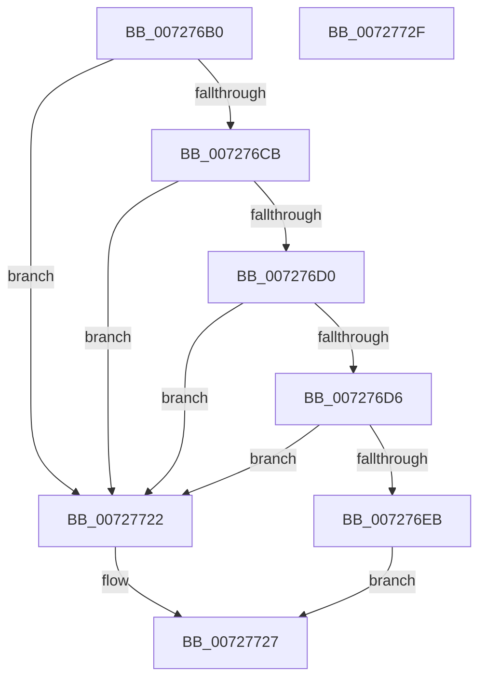

# IoReserveDependency

- RVA: `0x007276B0`–`0x00727730` (길이 `128` bytes)
- VA: `0x00000001407276B0`
- 실행 섹션: `PAGE`
- PDB 이름 있음: `예`; PDB Function 태그: `아니요`
- unwind 정보 RVA: `0x000AF0B0`
- 디코드: `38`개 명령, `128/128` bytes 표시
- 미해석 바이트: `0` (있으면 어셈블리에 `.byte`로 보존)

> 이 문서는 커널 이미지의 기계어와 PDB 기호를 분석해 생성했습니다. 4번과 5번은 함수 원형과 자료형을 바이너리 사용 방식에서 추정한 C 해석이며 원본 소스 복구 결과는 아닙니다.

## 1. Dependencies

- 직접 호출 지점: **3**; 고유 호출 대상: **3**
- 직접 호출자로 확인된 함수: **0**
- RIP 상대 이미지 참조: **0**

### Outgoing calls
- `0x00727705` → [PnpAcquireDependencyRelationsLock](../A0/PnpAcquireDependencyRelationsLock_function_00A06788.md) (function, `0x00A06788`)
- `0x00727714` → [PipSetDependency](PipSetDependency_function_00727F24.md) (function, `0x00727F24`)
- `0x0072771B` → [PnpReleaseDependencyRelationsLock](../A0/PnpReleaseDependencyRelationsLock_function_00A06E14.md) (function, `0x00A06E14`)

### Direct callers
- 이 함수 시작 RVA로 연결되는 직접 call은 확인되지 않았습니다. 간접 호출은 완전히 역산할 수 없습니다.

### Static image references
- 디코드된 RIP-relative 메모리 참조가 없습니다.

## 2. Other-region calls and transfers

- 다른 실행 섹션으로 향하는 call: **0**
- 별도 외부 분기/꼬리 이동을 확인하지 못했습니다.

## 3. Assembly (complete function range)

```asm
007276B0  4C 8B DC                        mov r11, rsp
007276B3  53                              push rbx
007276B4  48 83 EC 50                     sub rsp, 0x50
007276B8  45 33 D2                        xor r10d, r10d
007276BB  4C 8B C9                        mov r9, rcx
007276BE  45 89 53 CC                     mov dword ptr [r11 - 0x34], r10d
007276C2  45 89 53 DC                     mov dword ptr [r11 - 0x24], r10d
007276C6  48 85 C9                        test rcx, rcx
007276C9  74 57                           je 0x140727722
007276CB  48 85 D2                        test rdx, rdx
007276CE  74 52                           je 0x140727722
007276D0  66 44 39 12                     cmp word ptr [rdx], r10w
007276D4  74 4C                           je 0x140727722
007276D6  41 F6 C0 03                     test r8b, 3
007276DA  0F 95 C1                        setne cl
007276DD  41 F7 C0 FC FF FF FF            test r8d, 0xfffffffc
007276E4  0F 94 C0                        sete al
007276E7  84 C8                           test al, cl
007276E9  74 37                           je 0x140727722
007276EB  C7 44 24 30 01 00 00 00         mov dword ptr [rsp + 0x30], 1
007276F3  B1 01                           mov cl, 1
007276F5  49 89 53 E0                     mov qword ptr [r11 - 0x20], rdx
007276F9  45 89 43 E8                     mov dword ptr [r11 - 0x18], r8d
007276FD  45 89 53 C8                     mov dword ptr [r11 - 0x38], r10d
00727701  4D 89 4B D0                     mov qword ptr [r11 - 0x30], r9
00727705  E8 7E F0 2D 00                  call 0x140a06788
0072770A  48 8D 54 24 30                  lea rdx, [rsp + 0x30]
0072770F  48 8D 4C 24 20                  lea rcx, [rsp + 0x20]
00727714  E8 0B 08 00 00                  call 0x140727f24
00727719  8B D8                           mov ebx, eax
0072771B  E8 F4 F6 2D 00                  call 0x140a06e14
00727720  EB 05                           jmp 0x140727727
00727722  BB 0D 00 00 C0                  mov ebx, 0xc000000d
00727727  8B C3                           mov eax, ebx
00727729  48 83 C4 50                     add rsp, 0x50
0072772D  5B                              pop rbx
0072772E  C3                              ret
0072772F  CC                              int3
```

## 4. C-style interpretation (structured pseudocode)

```c
__int64 __fastcall IoReserveDependency(__int64 a1, __int64 a2, int a3)
{
    __int64 result;
    __int64 v_r10;
    __int64 v_rsp;
    unsigned int v_stack_m28;
    unsigned __int64 v_stack_m38;

    v_rsp = (v_rsp) - (80);
    v_r10 = 0;
    *(unsigned int *)(v_rsp - 52) = 0;
    *(unsigned int *)(v_rsp - 36) = 0;
    if (a1 == 0) goto loc_00727722;
    if (a2 == 0) goto loc_00727722;
    if ((*(unsigned __int16 *)(a2)) == 0) goto loc_00727722;
    a1 = ((((unsigned __int8)(a3)) & (3)) != 0) ? 1 : 0;
    result = (((a3) & (0xFFFFFFFCULL)) == 0) ? 1 : 0;
    if ((((unsigned __int8)(result)) & ((unsigned __int8)(a1))) == 0) goto loc_00727722;
    v_stack_m28 = 1;
    *(unsigned __int64 *)(v_rsp - 32) = a2;
    *(unsigned int *)(v_rsp - 24) = a3;
    *(unsigned int *)(v_rsp - 56) = 0;
    *(unsigned __int64 *)(v_rsp - 48) = a1;
    result = PnpAcquireDependencyRelationsLock(1, a2, a3, a1);
    result = PipSetDependency(v_stack_m38, v_stack_m28, a3, a1);
    result = PnpReleaseDependencyRelationsLock(v_stack_m38, v_stack_m28, a3, a1);
    goto loc_00727727;
loc_00727722:
loc_00727727:
    v_rsp = (v_rsp) + (80);
    return (unsigned int)((unsigned int)((unsigned int)(0xC000000DULL)));
}
```

## 5. (Beta) C Style

```c
int64_t IoReserveDependency(int64_t Arg1, int64_t Arg2, int32_t Arg3)
{
    int64_t result;
    int64_t local_r10;
    int64_t local_rsp;
    uint32_t v_stack_m28;
    uint64_t v_stack_m38;

    local_rsp = (local_rsp) - (80);
    local_r10 = 0;
    *(uint32_t *)(local_rsp - 0x34) = 0;
    *(uint32_t *)(local_rsp - 0x24) = 0;
    if (Arg1 == 0) goto loc_00727722;
    if (Arg2 == 0) goto loc_00727722;
    if ((*(uint16_t *)(Arg2)) == 0) goto loc_00727722;
    Arg1 = ((((uint8_t)(Arg3)) & (3)) != 0) ? 1 : 0;
    result = (((Arg3) & (0xFFFFFFFCULL)) == 0) ? 1 : 0;
    if ((((uint8_t)(result)) & ((uint8_t)(Arg1))) == 0) goto loc_00727722;
    v_stack_m28 = 1;
    *(uint64_t *)(local_rsp - 0x20) = Arg2;
    *(uint32_t *)(local_rsp - 0x18) = Arg3;
    *(uint32_t *)(local_rsp - 0x38) = 0;
    *(uint64_t *)(local_rsp - 0x30) = Arg1;
    result = PnpAcquireDependencyRelationsLock(1, Arg2, Arg3, Arg1);
    result = PipSetDependency(v_stack_m38, v_stack_m28, Arg3, Arg1);
    result = PnpReleaseDependencyRelationsLock(v_stack_m38, v_stack_m28, Arg3, Arg1);
    goto loc_00727727;
loc_00727722:
loc_00727727:
    local_rsp = (local_rsp) + (80);
    return (uint32_t)((uint32_t)((uint32_t)(0xC000000DULL)));
}
```

## 6. Execution-region graph

[열기: 2D/3D 그래프와 함수 탐색 컨트롤 패널](../../../control-panel.html?section=page&rva=0x007276B0&view=graph)

- 2D 그래프는 위에서 아래로 흐르고, 3D 그래프는 빈 공간을 드래그해 회전합니다. Shift+드래그는 이동, 휠은 확대·축소, 함수 노드 선택은 대상 보고서 이동입니다.

### Static fallback


