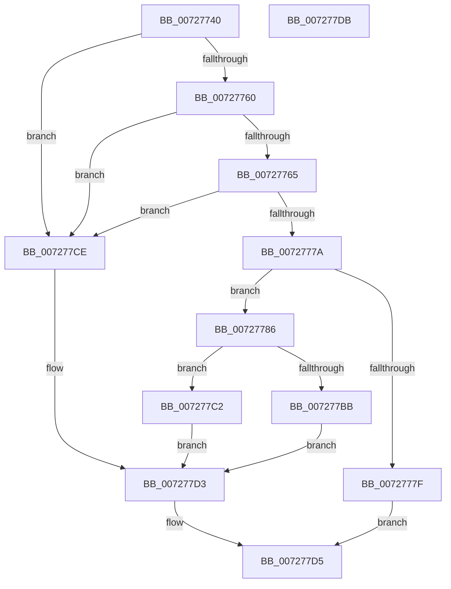

# IoSetDependency

- RVA: `0x00727740`–`0x007277DC` (길이 `156` bytes)
- VA: `0x0000000140727740`
- 실행 섹션: `PAGE`
- PDB 이름 있음: `예`; PDB Function 태그: `아니요`
- unwind 정보 RVA: `0x00071A74`
- 디코드: `46`개 명령, `156/156` bytes 표시
- 미해석 바이트: `0` (있으면 어셈블리에 `.byte`로 보존)

> 이 문서는 커널 이미지의 기계어와 PDB 기호를 분석해 생성했습니다. 4번과 5번은 함수 원형과 자료형을 바이너리 사용 방식에서 추정한 C 해석이며 원본 소스 복구 결과는 아닙니다.

## 1. Dependencies

- 직접 호출 지점: **5**; 고유 호출 대상: **4**
- 직접 호출자로 확인된 함수: **0**
- RIP 상대 이미지 참조: **0**

### Outgoing calls
- `0x007277A1` → [PnpAcquireDependencyRelationsLock](../A0/PnpAcquireDependencyRelationsLock_function_00A06788.md) (function, `0x00A06788`)
- `0x007277B0` → [PipSetDependency](PipSetDependency_function_00727F24.md) (function, `0x00727F24`)
- `0x007277BB` → [PnpReleaseDependencyRelationsLock](../A0/PnpReleaseDependencyRelationsLock_function_00A06E14.md) (function, `0x00A06E14`)
- `0x007277C2` → [PnpReleaseDependencyRelationsLock](../A0/PnpReleaseDependencyRelationsLock_function_00A06E14.md) (function, `0x00A06E14`)
- `0x007277C7` → [PipProcessRebuildPowerRelationsQueue](../A0/PipProcessRebuildPowerRelationsQueue_function_00A06844.md) (function, `0x00A06844`)

### Direct callers
- 이 함수 시작 RVA로 연결되는 직접 call은 확인되지 않았습니다. 간접 호출은 완전히 역산할 수 없습니다.

### Static image references
- 디코드된 RIP-relative 메모리 참조가 없습니다.

## 2. Other-region calls and transfers

- 다른 실행 섹션으로 향하는 call: **0**
- 별도 외부 분기/꼬리 이동을 확인하지 못했습니다.

## 3. Assembly (complete function range)

```asm
00727740  40 53                           push rbx
00727742  48 83 EC 50                     sub rsp, 0x50
00727746  33 C0                           xor eax, eax
00727748  4C 8B C9                        mov r9, rcx
0072774B  89 44 24 24                     mov dword ptr [rsp + 0x24], eax
0072774F  21 44 24 24                     and dword ptr [rsp + 0x24], eax
00727753  89 44 24 34                     mov dword ptr [rsp + 0x34], eax
00727757  21 44 24 34                     and dword ptr [rsp + 0x34], eax
0072775B  48 85 C9                        test rcx, rcx
0072775E  74 6E                           je 0x1407277ce
00727760  48 85 D2                        test rdx, rdx
00727763  74 69                           je 0x1407277ce
00727765  41 F6 C0 03                     test r8b, 3
00727769  0F 95 C1                        setne cl
0072776C  41 F7 C0 FC FF FF FF            test r8d, 0xfffffffc
00727773  0F 94 C0                        sete al
00727776  84 C8                           test al, cl
00727778  74 54                           je 0x1407277ce
0072777A  4C 3B CA                        cmp r9, rdx
0072777D  75 07                           jne 0x140727786
0072777F  B8 01 00 00 C0                  mov eax, 0xc0000001
00727784  EB 4F                           jmp 0x1407277d5
00727786  83 64 24 20 00                  and dword ptr [rsp + 0x20], 0
0072778B  B1 01                           mov cl, 1
0072778D  83 64 24 30 00                  and dword ptr [rsp + 0x30], 0
00727792  4C 89 4C 24 28                  mov qword ptr [rsp + 0x28], r9
00727797  48 89 54 24 38                  mov qword ptr [rsp + 0x38], rdx
0072779C  44 89 44 24 40                  mov dword ptr [rsp + 0x40], r8d
007277A1  E8 E2 EF 2D 00                  call 0x140a06788
007277A6  48 8D 54 24 30                  lea rdx, [rsp + 0x30]
007277AB  48 8D 4C 24 20                  lea rcx, [rsp + 0x20]
007277B0  E8 6F 07 00 00                  call 0x140727f24
007277B5  8B D8                           mov ebx, eax
007277B7  85 C0                           test eax, eax
007277B9  79 07                           jns 0x1407277c2
007277BB  E8 54 F6 2D 00                  call 0x140a06e14
007277C0  EB 11                           jmp 0x1407277d3
007277C2  E8 4D F6 2D 00                  call 0x140a06e14
007277C7  E8 78 F0 2D 00                  call 0x140a06844
007277CC  EB 05                           jmp 0x1407277d3
007277CE  BB 0D 00 00 C0                  mov ebx, 0xc000000d
007277D3  8B C3                           mov eax, ebx
007277D5  48 83 C4 50                     add rsp, 0x50
007277D9  5B                              pop rbx
007277DA  C3                              ret
007277DB  CC                              int3
```

## 4. C-style interpretation (structured pseudocode)

```c
__int64 __fastcall IoSetDependency(__int64 a1, __int64 a2, int a3)
{
    __int64 result;
    __int64 v_rsp;
    unsigned int v_stack_m18;
    unsigned __int64 v_stack_m20;
    unsigned int v_stack_m24;
    unsigned int v_stack_m28;
    unsigned __int64 v_stack_m30;
    unsigned int v_stack_m34;
    unsigned int v_stack_m38;

    v_rsp = (v_rsp) - (80);
    result = 0;
    v_stack_m34 = 0;
    v_stack_m24 = 0;
    if (a1 == 0) goto loc_007277CE;
    if (a2 == 0) goto loc_007277CE;
    a1 = ((((unsigned __int8)(a3)) & (3)) != 0) ? 1 : 0;
    result = (((a3) & (0xFFFFFFFCULL)) == 0) ? 1 : 0;
    if ((((unsigned __int8)(result)) & ((unsigned __int8)(a1))) == 0) goto loc_007277CE;
    if (a1 != a2) goto loc_00727786;
    goto loc_007277D5;
loc_00727786:
    v_stack_m30 = a1;
    v_stack_m20 = a2;
    v_stack_m18 = a3;
    result = PnpAcquireDependencyRelationsLock(1, a2, a3, a1);
    result = PipSetDependency(v_stack_m38, v_stack_m28, a3, a1);
    if (!sign_flag) goto loc_007277C2;
    result = PnpReleaseDependencyRelationsLock(v_stack_m38, v_stack_m28, a3, a1);
    goto loc_007277D3;
loc_007277C2:
    result = PnpReleaseDependencyRelationsLock(v_stack_m38, v_stack_m28, a3, a1);
    result = PipProcessRebuildPowerRelationsQueue(v_stack_m38, v_stack_m28, a3, a1);
    goto loc_007277D3;
loc_007277CE:
loc_007277D3:
loc_007277D5:
    v_rsp = (v_rsp) + (80);
    return (unsigned int)((unsigned int)((unsigned int)(0xC000000DULL)));
}
```

## 5. (Beta) C Style

```c
int64_t IoSetDependency(int64_t Arg1, int64_t Arg2, int32_t Arg3)
{
    int64_t result;
    int64_t local_rsp;
    uint32_t v_stack_m18;
    uint64_t v_stack_m20;
    uint32_t v_stack_m24;
    uint32_t v_stack_m28;
    uint64_t v_stack_m30;
    uint32_t v_stack_m34;
    uint32_t v_stack_m38;

    local_rsp = (local_rsp) - (80);
    result = 0;
    v_stack_m34 = 0;
    v_stack_m24 = 0;
    if (Arg1 == 0) goto loc_007277CE;
    if (Arg2 == 0) goto loc_007277CE;
    Arg1 = ((((uint8_t)(Arg3)) & (3)) != 0) ? 1 : 0;
    result = (((Arg3) & (0xFFFFFFFCULL)) == 0) ? 1 : 0;
    if ((((uint8_t)(result)) & ((uint8_t)(Arg1))) == 0) goto loc_007277CE;
    if (Arg1 != Arg2) goto loc_00727786;
    goto loc_007277D5;
loc_00727786:
    v_stack_m30 = Arg1;
    v_stack_m20 = Arg2;
    v_stack_m18 = Arg3;
    result = PnpAcquireDependencyRelationsLock(1, Arg2, Arg3, Arg1);
    result = PipSetDependency(v_stack_m38, v_stack_m28, Arg3, Arg1);
    if (!sign_flag) goto loc_007277C2;
    result = PnpReleaseDependencyRelationsLock(v_stack_m38, v_stack_m28, Arg3, Arg1);
    goto loc_007277D3;
loc_007277C2:
    result = PnpReleaseDependencyRelationsLock(v_stack_m38, v_stack_m28, Arg3, Arg1);
    result = PipProcessRebuildPowerRelationsQueue(v_stack_m38, v_stack_m28, Arg3, Arg1);
    goto loc_007277D3;
loc_007277CE:
loc_007277D3:
loc_007277D5:
    local_rsp = (local_rsp) + (80);
    return (uint32_t)((uint32_t)((uint32_t)(0xC000000DULL)));
}
```

## 6. Execution-region graph

[열기: 2D/3D 그래프와 함수 탐색 컨트롤 패널](../../../control-panel.html?section=page&rva=0x00727740&view=graph)

- 2D 그래프는 위에서 아래로 흐르고, 3D 그래프는 빈 공간을 드래그해 회전합니다. Shift+드래그는 이동, 휠은 확대·축소, 함수 노드 선택은 대상 보고서 이동입니다.

### Static fallback


