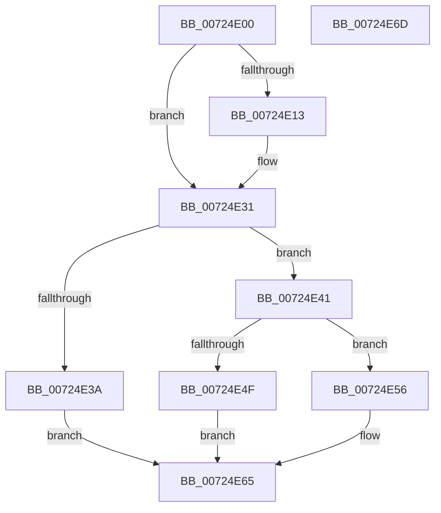

# IoWriteKsrPersistentMemory

- RVA: `0x00724E00`–`0x00724E6E` (길이 `110` bytes)
- VA: `0x0000000140724E00`
- 실행 섹션: `PAGE`
- PDB 이름 있음: `예`; PDB Function 태그: `아니요`
- unwind 정보 RVA: `0x00064C80`
- 디코드: `36`개 명령, `110/110` bytes 표시
- 미해석 바이트: `0` (있으면 어셈블리에 `.byte`로 보존)

> 이 문서는 커널 이미지의 기계어와 PDB 기호를 분석해 생성했습니다. 4번과 5번은 함수 원형과 자료형을 바이너리 사용 방식에서 추정한 C 해석이며 원본 소스 복구 결과는 아닙니다.

## 1. Dependencies

- 직접 호출 지점: **2**; 고유 호출 대상: **2**
- 직접 호출자로 확인된 함수: **0**
- RIP 상대 이미지 참조: **0**

### Outgoing calls
- `0x00724E2B` → [KeBugCheckEx](../../text/4F/KeBugCheckEx_function_004FD660.md) (function, `0x004FD660`)
- `0x00724E60` → [memcpy](../../text/6C/memcpy_function_006C6840.md) (function, `0x006C6840`)

### Direct callers
- 이 함수 시작 RVA로 연결되는 직접 call은 확인되지 않았습니다. 간접 호출은 완전히 역산할 수 없습니다.

### Static image references
- 디코드된 RIP-relative 메모리 참조가 없습니다.

## 2. Other-region calls and transfers

- 다른 실행 섹션으로 향하는 call: **2**
  - `0x00724E2B` → [KeBugCheckEx](../../text/4F/KeBugCheckEx_function_004FD660.md) (`PAGE` → `.text`)
  - `0x00724E60` → [memcpy](../../text/6C/memcpy_function_006C6840.md) (`PAGE` → `.text`)
- 별도 외부 분기/꼬리 이동을 확인하지 못했습니다.

## 3. Assembly (complete function range)

```asm
00724E00  40 53                           push rbx
00724E02  48 83 EC 30                     sub rsp, 0x30
00724E06  4C 8B CA                        mov r9, rdx
00724E09  33 DB                           xor ebx, ebx
00724E0B  44 0F 20 C0                     mov rax, cr8
00724E0F  84 C0                           test al, al
00724E11  74 1E                           je 0x140724e31
00724E13  44 0F 20 C0                     mov rax, cr8
00724E17  44 0F B6 C0                     movzx r8d, al
00724E1B  8D 53 01                        lea edx, [rbx + 1]
00724E1E  45 33 C9                        xor r9d, r9d
00724E21  48 89 5C 24 20                  mov qword ptr [rsp + 0x20], rbx
00724E26  B9 21 01 00 00                  mov ecx, 0x121
00724E2B  E8 30 88 DD FF                  call 0x1404fd660
00724E30  CC                              int3
00724E31  8B 01                           mov eax, dword ptr [rcx]
00724E33  FF C8                           dec eax
00724E35  83 F8 01                        cmp eax, 1
00724E38  76 07                           jbe 0x140724e41
00724E3A  BB EF 00 00 C0                  mov ebx, 0xc00000ef
00724E3F  EB 24                           jmp 0x140724e65
00724E41  48 8B 41 30                     mov rax, qword ptr [rcx + 0x30]
00724E45  48 8B 51 28                     mov rdx, qword ptr [rcx + 0x28]
00724E49  4C 3B 40 08                     cmp r8, qword ptr [rax + 8]
00724E4D  76 07                           jbe 0x140724e56
00724E4F  BB 23 00 00 C0                  mov ebx, 0xc0000023
00724E54  EB 0F                           jmp 0x140724e65
00724E56  4C 89 02                        mov qword ptr [rdx], r8
00724E59  48 8D 4A 08                     lea rcx, [rdx + 8]
00724E5D  49 8B D1                        mov rdx, r9
00724E60  E8 DB 19 FA FF                  call 0x1406c6840
00724E65  8B C3                           mov eax, ebx
00724E67  48 83 C4 30                     add rsp, 0x30
00724E6B  5B                              pop rbx
00724E6C  C3                              ret
00724E6D  CC                              int3
```

## 4. C-style interpretation (structured pseudocode)

```c
__int64 __fastcall IoWriteKsrPersistentMemory(__int64 a1, __int64 a2)
{
    __int64 result;
    __int64 v_rbx;
    __int64 v_rsp;
    unsigned __int64 v_stack_m18;

    v_rsp = (v_rsp) - (48);
    v_rbx = 0;
    result = v_cr8;
    if ((unsigned __int8)(v_cr8) != 0) {
        result = v_cr8;
        a3 = (unsigned __int8)(result);
        a2 = v_rbx + 1;
        a4 = 0;
        v_stack_m18 = 0;
        a1 = 289;
        result = KeBugCheckEx(a1, a2, a3, a4);
    }
    result = (unsigned int)(((unsigned int)(*(unsigned int *)(a1))) - 1);
    if (((unsigned int)(result)) <= 1) goto loc_00724E41;
    goto loc_00724E65;
loc_00724E41:
    if (a3 <= (*(unsigned __int64 *)(*(unsigned __int64 *)(a1 + 48) + 8))) goto loc_00724E56;
    goto loc_00724E65;
loc_00724E56:
    *(unsigned __int64 *)(*(unsigned __int64 *)(a1 + 40)) = a3;
    result = memcpy(*(unsigned __int64 *)(a1 + 40) + 8, 0, a3, a4);
loc_00724E65:
    v_rsp = (v_rsp) + (48);
    return (unsigned int)((unsigned int)((unsigned int)(0xC0000023ULL)));
}
```

## 5. (Beta) C Style

```c
int64_t IoWriteKsrPersistentMemory(int64_t Arg1, int64_t Arg2)
{
    int64_t result;
    int64_t local_rbx;
    int64_t local_rsp;
    uint64_t v_stack_m18;

    local_rsp = (local_rsp) - (48);
    local_rbx = 0;
    result = v_cr8;
    if ((uint8_t)(v_cr8) != 0) {
        result = v_cr8;
        a3 = (uint8_t)(result);
        Arg2 = local_rbx + 1;
        a4 = 0;
        v_stack_m18 = 0;
        Arg1 = 289;
        result = KeBugCheckEx(Arg1, Arg2, a3, a4);
    }
    result = (uint32_t)(((uint32_t)(*(uint32_t *)(Arg1))) - 1);
    if (((uint32_t)(result)) <= 1) goto loc_00724E41;
    goto loc_00724E65;
loc_00724E41:
    if (a3 <= (*(uint64_t *)(*(uint64_t *)(Arg1 + 0x30) + 0x8))) goto loc_00724E56;
    goto loc_00724E65;
loc_00724E56:
    *(uint64_t *)(*(uint64_t *)(Arg1 + 0x28)) = a3;
    result = memcpy(*(uint64_t *)(Arg1 + 0x28) + 8, 0, a3, a4);
loc_00724E65:
    local_rsp = (local_rsp) + (48);
    return (uint32_t)((uint32_t)((uint32_t)(0xC0000023ULL)));
}
```

## 6. Execution-region graph

[열기: 2D/3D 그래프와 함수 탐색 컨트롤 패널](../../../control-panel.html?section=page&rva=0x00724E00&view=graph)

- 2D 그래프는 위에서 아래로 흐르고, 3D 그래프는 빈 공간을 드래그해 회전합니다. Shift+드래그는 이동, 휠은 확대·축소, 함수 노드 선택은 대상 보고서 이동입니다.

### Static fallback


