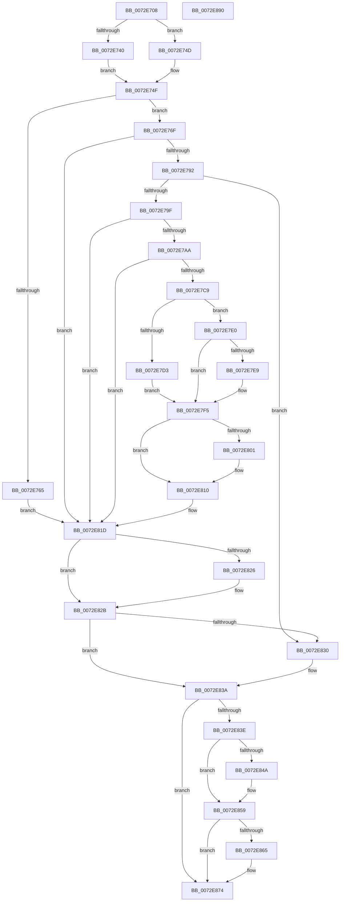

# IopAllocateBootResourcesInternal

- RVA: `0x0072E708`–`0x0072E891` (길이 `393` bytes)
- VA: `0x000000014072E708`
- 실행 섹션: `PAGE`
- PDB 이름 있음: `예`; PDB Function 태그: `아니요`
- unwind 정보 RVA: `0x00083BEC`
- 디코드: `107`개 명령, `393/393` bytes 표시
- 미해석 바이트: `0` (있으면 어셈블리에 `.byte`로 보존)

> 이 문서는 커널 이미지의 기계어와 PDB 기호를 분석해 생성했습니다. 4번과 5번은 함수 원형과 자료형을 바이너리 사용 방식에서 추정한 C 해석이며 원본 소스 복구 결과는 아닙니다.

## 1. Dependencies

- 직접 호출 지점: **12**; 고유 호출 대상: **8**
- 직접 호출자로 확인된 함수: **2**
- RIP 상대 이미지 참조: **0**

### Outgoing calls
- `0x0072E736` → [memset](../../text/6C/memset_function_006C6C40.md) (function, `0x006C6C40`)
- `0x0072E758` → [PnpCmResourcesToIoResources](../73/PnpCmResourcesToIoResources_function_0073D584.md) (function, `0x0073D584`)
- `0x0072E783` → [IopResourceRequirementsListToReqList](../A8/IopResourceRequirementsListToReqList_function_00A82954.md) (function, `0x00A82954`)
- `0x0072E79F` → [IopBootAllocation](IopBootAllocation_function_0072E898.md) (function, `0x0072E898`)
- `0x0072E7B2` → [PipSetDevNodeFlags](../8F/PipSetDevNodeFlags_function_008FC048.md) (function, `0x008FC048`)
- `0x0072E7BD` → [PnpBuildCmResourceList](../AA/PnpBuildCmResourceList_function_00AAB034.md) (function, `0x00AAB034`)
- `0x0072E7EB` → [ExFreePoolWithTag](../../poolcode/B8/ExFreePoolWithTag_function_00B82870.md) (function, `0x00B82870`)
- `0x0072E803` → [ExFreePoolWithTag](../../poolcode/B8/ExFreePoolWithTag_function_00B82870.md) (function, `0x00B82870`)
- `0x0072E826` → [IopFreeReqList](IopFreeReqList_function_0072ADAC.md) (function, `0x0072ADAC`)
- `0x0072E835` → [ExFreePoolWithTag](../../poolcode/B8/ExFreePoolWithTag_function_00B82870.md) (function, `0x00B82870`)
- `0x0072E84C` → [ExFreePoolWithTag](../../poolcode/B8/ExFreePoolWithTag_function_00B82870.md) (function, `0x00B82870`)
- `0x0072E867` → [ExFreePoolWithTag](../../poolcode/B8/ExFreePoolWithTag_function_00B82870.md) (function, `0x00B82870`)

### Direct callers
- [IopReleaseResources](IopReleaseResources_function_0072D964.md) at `0x0072D9EA`
- [IopAllocateBootResources](IopAllocateBootResources_function_0072E680.md) at `0x0072E6CC`

### Static image references
- 디코드된 RIP-relative 메모리 참조가 없습니다.

## 2. Other-region calls and transfers

- 다른 실행 섹션으로 향하는 call: **6**
  - `0x0072E736` → [memset](../../text/6C/memset_function_006C6C40.md) (`PAGE` → `.text`)
  - `0x0072E7EB` → [ExFreePoolWithTag](../../poolcode/B8/ExFreePoolWithTag_function_00B82870.md) (`PAGE` → `POOLCODE`)
  - `0x0072E803` → [ExFreePoolWithTag](../../poolcode/B8/ExFreePoolWithTag_function_00B82870.md) (`PAGE` → `POOLCODE`)
  - `0x0072E835` → [ExFreePoolWithTag](../../poolcode/B8/ExFreePoolWithTag_function_00B82870.md) (`PAGE` → `POOLCODE`)
  - `0x0072E84C` → [ExFreePoolWithTag](../../poolcode/B8/ExFreePoolWithTag_function_00B82870.md) (`PAGE` → `POOLCODE`)
  - `0x0072E867` → [ExFreePoolWithTag](../../poolcode/B8/ExFreePoolWithTag_function_00B82870.md) (`PAGE` → `POOLCODE`)
- 별도 외부 분기/꼬리 이동을 확인하지 못했습니다.

## 3. Assembly (complete function range)

```asm
0072E708  48 8B C4                        mov rax, rsp
0072E70B  48 89 58 08                     mov qword ptr [rax + 8], rbx
0072E70F  48 89 70 10                     mov qword ptr [rax + 0x10], rsi
0072E713  48 89 78 18                     mov qword ptr [rax + 0x18], rdi
0072E717  4C 89 70 20                     mov qword ptr [rax + 0x20], r14
0072E71B  55                              push rbp
0072E71C  48 8B EC                        mov rbp, rsp
0072E71F  48 83 EC 60                     sub rsp, 0x60
0072E723  48 8B FA                        mov rdi, rdx
0072E726  49 8B F0                        mov rsi, r8
0072E729  33 D2                           xor edx, edx
0072E72B  44 8B F1                        mov r14d, ecx
0072E72E  48 8D 4D C0                     lea rcx, [rbp - 0x40]
0072E732  44 8D 42 40                     lea r8d, [rdx + 0x40]
0072E736  E8 05 85 F9 FF                  call 0x1406c6c40
0072E73B  48 85 FF                        test rdi, rdi
0072E73E  74 0D                           je 0x14072e74d
0072E740  48 8B 87 38 01 00 00            mov rax, qword ptr [rdi + 0x138]
0072E747  48 8B 58 28                     mov rbx, qword ptr [rax + 0x28]
0072E74B  EB 02                           jmp 0x14072e74f
0072E74D  33 DB                           xor ebx, ebx
0072E74F  41 B8 01 00 00 00               mov r8d, 1
0072E755  48 8B D6                        mov rdx, rsi
0072E758  E8 27 EE 00 00                  call 0x14073d584
0072E75D  48 8B F0                        mov rsi, rax
0072E760  48 85 C0                        test rax, rax
0072E763  75 0A                           jne 0x14072e76f
0072E765  BF 01 00 00 C0                  mov edi, 0xc0000001
0072E76A  E9 AE 00 00 00                  jmp 0x14072e81d
0072E76F  48 8D 55 E0                     lea rdx, [rbp - 0x20]
0072E773  44 89 75 CC                     mov dword ptr [rbp - 0x34], r14d
0072E777  48 8D 4D C0                     lea rcx, [rbp - 0x40]
0072E77B  48 89 75 D8                     mov qword ptr [rbp - 0x28], rsi
0072E77F  48 89 7D C0                     mov qword ptr [rbp - 0x40], rdi
0072E783  E8 CC 41 35 00                  call 0x140a82954
0072E788  8B F8                           mov edi, eax
0072E78A  85 C0                           test eax, eax
0072E78C  0F 88 8B 00 00 00               js 0x14072e81d
0072E792  48 8B 4D E0                     mov rcx, qword ptr [rbp - 0x20]
0072E796  48 85 C9                        test rcx, rcx
0072E799  0F 84 91 00 00 00               je 0x14072e830
0072E79F  E8 F4 00 00 00                  call 0x14072e898
0072E7A4  8B F8                           mov edi, eax
0072E7A6  85 C0                           test eax, eax
0072E7A8  78 73                           js 0x14072e81d
0072E7AA  BA 80 00 00 00                  mov edx, 0x80
0072E7AF  48 8B CB                        mov rcx, rbx
0072E7B2  E8 91 D8 1C 00                  call 0x1408fc048
0072E7B7  33 D2                           xor edx, edx
0072E7B9  48 8D 4D C0                     lea rcx, [rbp - 0x40]
0072E7BD  E8 72 C8 37 00                  call 0x140aab034
0072E7C2  8B 7D F8                        mov edi, dword ptr [rbp - 8]
0072E7C5  85 FF                           test edi, edi
0072E7C7  78 54                           js 0x14072e81d
0072E7C9  48 83 BB 20 02 00 00 00         cmp qword ptr [rbx + 0x220], 0
0072E7D1  75 0D                           jne 0x14072e7e0
0072E7D3  48 8B 45 E8                     mov rax, qword ptr [rbp - 0x18]
0072E7D7  48 89 83 20 02 00 00            mov qword ptr [rbx + 0x220], rax
0072E7DE  EB 15                           jmp 0x14072e7f5
0072E7E0  48 8B 4D E8                     mov rcx, qword ptr [rbp - 0x18]
0072E7E4  48 85 C9                        test rcx, rcx
0072E7E7  74 0C                           je 0x14072e7f5
0072E7E9  33 D2                           xor edx, edx
0072E7EB  E8 80 40 45 00                  call 0x140b82870
0072E7F0  48 83 65 E8 00                  and qword ptr [rbp - 0x18], 0
0072E7F5  48 8B 8B 28 02 00 00            mov rcx, qword ptr [rbx + 0x228]
0072E7FC  48 85 C9                        test rcx, rcx
0072E7FF  74 0F                           je 0x14072e810
0072E801  33 D2                           xor edx, edx
0072E803  E8 68 40 45 00                  call 0x140b82870
0072E808  48 83 A3 28 02 00 00 00         and qword ptr [rbx + 0x228], 0
0072E810  48 8B 45 F0                     mov rax, qword ptr [rbp - 0x10]
0072E814  33 FF                           xor edi, edi
0072E816  48 89 83 28 02 00 00            mov qword ptr [rbx + 0x228], rax
0072E81D  48 8B 4D E0                     mov rcx, qword ptr [rbp - 0x20]
0072E821  48 85 C9                        test rcx, rcx
0072E824  74 05                           je 0x14072e82b
0072E826  E8 81 C5 FF FF                  call 0x14072adac
0072E82B  48 85 F6                        test rsi, rsi
0072E82E  74 0A                           je 0x14072e83a
0072E830  33 D2                           xor edx, edx
0072E832  48 8B CE                        mov rcx, rsi
0072E835  E8 36 40 45 00                  call 0x140b82870
0072E83A  85 FF                           test edi, edi
0072E83C  79 36                           jns 0x14072e874
0072E83E  48 8B 8B 20 02 00 00            mov rcx, qword ptr [rbx + 0x220]
0072E845  48 85 C9                        test rcx, rcx
0072E848  74 0F                           je 0x14072e859
0072E84A  33 D2                           xor edx, edx
0072E84C  E8 1F 40 45 00                  call 0x140b82870
0072E851  48 83 A3 20 02 00 00 00         and qword ptr [rbx + 0x220], 0
0072E859  48 8B 8B 28 02 00 00            mov rcx, qword ptr [rbx + 0x228]
0072E860  48 85 C9                        test rcx, rcx
0072E863  74 0F                           je 0x14072e874
0072E865  33 D2                           xor edx, edx
0072E867  E8 04 40 45 00                  call 0x140b82870
0072E86C  48 83 A3 28 02 00 00 00         and qword ptr [rbx + 0x228], 0
0072E874  4C 8D 5C 24 60                  lea r11, [rsp + 0x60]
0072E879  8B C7                           mov eax, edi
0072E87B  49 8B 5B 10                     mov rbx, qword ptr [r11 + 0x10]
0072E87F  49 8B 73 18                     mov rsi, qword ptr [r11 + 0x18]
0072E883  49 8B 7B 20                     mov rdi, qword ptr [r11 + 0x20]
0072E887  4D 8B 73 28                     mov r14, qword ptr [r11 + 0x28]
0072E88B  49 8B E3                        mov rsp, r11
0072E88E  5D                              pop rbp
0072E88F  C3                              ret
0072E890  CC                              int3
```

## 4. C-style interpretation (structured pseudocode)

```c
__int64 __fastcall IopAllocateBootResourcesInternal(int a1, __int64 a2, __int64 a3)
{
    __int64 result;
    __int64 v_rbx;
    __int64 v_rdi;
    __int64 v_rsp;
    unsigned int v_stack_m10;
    unsigned __int64 v_stack_m18;
    unsigned __int64 v_stack_m20;
    unsigned __int64 v_stack_m28;
    unsigned __int64 v_stack_m30;
    unsigned int v_stack_m3C;
    unsigned __int64 v_stack_m48;
    unsigned __int64 v_stack_m8;

    *(unsigned __int64 *)(v_rsp + 8) = v_rbx;
    *(unsigned __int64 *)(v_rsp + 16) = v_rsi;
    *(unsigned __int64 *)(v_rsp + 24) = v_rdi;
    *(unsigned __int64 *)(v_rsp + 32) = v_r14;
    v_rsp = (v_rsp) - (96);
    a2 = 0;
    result = memset(v_stack_m48, a2, a2 + 64, a4);
    if (0 == 0) goto loc_0072E74D;
    goto loc_0072E74F;
loc_0072E74D:
    v_rbx = 0;
loc_0072E74F:
    result = PnpCmResourcesToIoResources(v_stack_m48, a3, 1, a4);
    if (result != 0) goto loc_0072E76F;
    goto loc_0072E81D;
loc_0072E76F:
    v_stack_m3C = (unsigned int)((unsigned int)(a1));
    v_stack_m30 = result;
    v_stack_m48 = (unsigned int)(0xC0000001ULL);
    result = IopResourceRequirementsListToReqList(v_stack_m48, v_stack_m28, 1, a4);
    if (sign_flag) goto loc_0072E81D;
    if (v_stack_m28 == 0) goto loc_0072E830;
    result = IopBootAllocation(v_stack_m28, v_stack_m28, 1, a4);
    if (sign_flag) goto loc_0072E81D;
    result = PipSetDevNodeFlags(0, 128, 1, a4);
    a2 = 0;
    result = PnpBuildCmResourceList(v_stack_m48, a2, 1, a4);
    if (sign_flag) goto loc_0072E81D;
    if ((*(unsigned __int64 *)(v_rbx + 544)) != 0) goto loc_0072E7E0;
    *(unsigned __int64 *)(v_rbx + 544) = v_stack_m20;
    goto loc_0072E7F5;
loc_0072E7E0:
    result = v_stack_m20;
    if (v_stack_m20 != 0) {
        a2 = 0;
        result = ExFreePoolWithTag(v_stack_m20, a2, 1, a4);
    }
    if (*(unsigned __int64 *)(v_rbx + 552) != 0) {
        a2 = 0;
        result = ExFreePoolWithTag(*(unsigned __int64 *)(v_rbx + 552), a2, 1, a4);
    }
    v_rdi = 0;
    *(unsigned __int64 *)(v_rbx + 552) = v_stack_m18;
loc_0072E81D:
    result = v_stack_m18;
    if (v_stack_m28 != 0) {
        result = IopFreeReqList(v_stack_m28, a2, 1, a4);
    }
    if (result != 0) {
        a2 = 0;
        a1 = result;
        result = ExFreePoolWithTag(a1, a2, 1, a4);
    }
    if (!sign_flag) goto loc_0072E874;
    if (*(unsigned __int64 *)(v_rbx + 544) != 0) {
        a2 = 0;
        result = ExFreePoolWithTag(*(unsigned __int64 *)(v_rbx + 544), a2, 1, a4);
    }
    if (*(unsigned __int64 *)(v_rbx + 552) != 0) {
        a2 = 0;
        result = ExFreePoolWithTag(*(unsigned __int64 *)(v_rbx + 552), a2, 1, a4);
    }
    return 0;
}
```

## 5. (Beta) C Style

```c
int64_t IopAllocateBootResourcesInternal(int32_t Arg1, int64_t Arg2, int64_t Arg3)
{
    int64_t result;
    int64_t local_rbx;
    int64_t local_rdi;
    int64_t local_rsp;
    uint32_t v_stack_m10;
    uint64_t v_stack_m18;
    uint64_t v_stack_m20;
    uint64_t v_stack_m28;
    uint64_t v_stack_m30;
    uint32_t v_stack_m3C;
    uint64_t v_stack_m48;
    uint64_t v_stack_m8;

    *(uint64_t *)(local_rsp + 0x8) = local_rbx;
    *(uint64_t *)(local_rsp + 0x10) = local_rsi;
    *(uint64_t *)(local_rsp + 0x18) = local_rdi;
    *(uint64_t *)(local_rsp + 0x20) = local_r14;
    local_rsp = (local_rsp) - (96);
    Arg2 = 0;
    result = memset(v_stack_m48, Arg2, Arg2 + 64, a4);
    if (0 == 0) goto loc_0072E74D;
    goto loc_0072E74F;
loc_0072E74D:
    local_rbx = 0;
loc_0072E74F:
    result = PnpCmResourcesToIoResources(v_stack_m48, Arg3, 1, a4);
    if (result != 0) goto loc_0072E76F;
    goto loc_0072E81D;
loc_0072E76F:
    v_stack_m3C = (uint32_t)((uint32_t)(Arg1));
    v_stack_m30 = result;
    v_stack_m48 = (uint32_t)(0xC0000001ULL);
    result = IopResourceRequirementsListToReqList(v_stack_m48, v_stack_m28, 1, a4);
    if (sign_flag) goto loc_0072E81D;
    if (v_stack_m28 == 0) goto loc_0072E830;
    result = IopBootAllocation(v_stack_m28, v_stack_m28, 1, a4);
    if (sign_flag) goto loc_0072E81D;
    result = PipSetDevNodeFlags(0, 128, 1, a4);
    Arg2 = 0;
    result = PnpBuildCmResourceList(v_stack_m48, Arg2, 1, a4);
    if (sign_flag) goto loc_0072E81D;
    if ((*(uint64_t *)(local_rbx + 0x220)) != 0) goto loc_0072E7E0;
    *(uint64_t *)(local_rbx + 0x220) = v_stack_m20;
    goto loc_0072E7F5;
loc_0072E7E0:
    result = v_stack_m20;
    if (v_stack_m20 != 0) {
        Arg2 = 0;
        result = ExFreePoolWithTag(v_stack_m20, Arg2, 1, a4);
    }
    if (*(uint64_t *)(local_rbx + 0x228) != 0) {
        Arg2 = 0;
        result = ExFreePoolWithTag(*(uint64_t *)(local_rbx + 0x228), Arg2, 1, a4);
    }
    local_rdi = 0;
    *(uint64_t *)(local_rbx + 0x228) = v_stack_m18;
loc_0072E81D:
    result = v_stack_m18;
    if (v_stack_m28 != 0) {
        result = IopFreeReqList(v_stack_m28, Arg2, 1, a4);
    }
    if (result != 0) {
        Arg2 = 0;
        Arg1 = result;
        result = ExFreePoolWithTag(Arg1, Arg2, 1, a4);
    }
    if (!sign_flag) goto loc_0072E874;
    if (*(uint64_t *)(local_rbx + 0x220) != 0) {
        Arg2 = 0;
        result = ExFreePoolWithTag(*(uint64_t *)(local_rbx + 0x220), Arg2, 1, a4);
    }
    if (*(uint64_t *)(local_rbx + 0x228) != 0) {
        Arg2 = 0;
        result = ExFreePoolWithTag(*(uint64_t *)(local_rbx + 0x228), Arg2, 1, a4);
    }
    return 0;
}
```

## 6. Execution-region graph

[열기: 2D/3D 그래프와 함수 탐색 컨트롤 패널](../../../control-panel.html?section=page&rva=0x0072E708&view=graph)

- 2D 그래프는 위에서 아래로 흐르고, 3D 그래프는 빈 공간을 드래그해 회전합니다. Shift+드래그는 이동, 휠은 확대·축소, 함수 노드 선택은 대상 보고서 이동입니다.

### Static fallback


