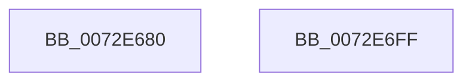

# IopAllocateBootResources

- RVA: `0x0072E680`–`0x0072E700` (길이 `128` bytes)
- VA: `0x000000014072E680`
- 실행 섹션: `PAGE`
- PDB 이름 있음: `예`; PDB Function 태그: `아니요`
- unwind 정보 RVA: `0x000794E0`
- 디코드: `34`개 명령, `128/128` bytes 표시
- 미해석 바이트: `0` (있으면 어셈블리에 `.byte`로 보존)

> 이 문서는 커널 이미지의 기계어와 PDB 기호를 분석해 생성했습니다. 4번과 5번은 함수 원형과 자료형을 바이너리 사용 방식에서 추정한 C 해석이며 원본 소스 복구 결과는 아닙니다.

## 1. Dependencies

- 직접 호출 지점: **4**; 고유 호출 대상: **4**
- 직접 호출자로 확인된 함수: **2**
- RIP 상대 이미지 참조: **1**

### Outgoing calls
- `0x0072E6BF` → [KeWaitForSingleObject](../../text/20/KeWaitForSingleObject_function_0020E6B0.md) (function, `0x0020E6B0`)
- `0x0072E6CC` → [IopAllocateBootResourcesInternal](IopAllocateBootResourcesInternal_function_0072E708.md) (function, `0x0072E708`)
- `0x0072E6E3` → [KeReleaseSemaphore](../../text/39/KeReleaseSemaphore_function_00397080.md) (function, `0x00397080`)
- `0x0072E6E8` → [KeLeaveCriticalRegion](../../text/25/KeLeaveCriticalRegion_function_0025D8B0.md) (function, `0x0025D8B0`)

### Direct callers
- [IopAllocateLegacyBootResources](../../init/C3/IopAllocateLegacyBootResources_function_00C34138.md) at `0x00C341D5`
- [IopAllocateLegacyBootResources](../../init/C3/IopAllocateLegacyBootResources_function_00C34138.md) at `0x00C34260`
- [IopReportBootResources](../../init/C3/IopReportBootResources_function_00C342D0.md) at `0x00C34320`

### Static image references
- `0x0072E6AC` → RVA `0x00F8C360` (`.data`; read)

## 2. Other-region calls and transfers

- 다른 실행 섹션으로 향하는 call: **3**
  - `0x0072E6BF` → [KeWaitForSingleObject](../../text/20/KeWaitForSingleObject_function_0020E6B0.md) (`PAGE` → `.text`)
  - `0x0072E6E3` → [KeReleaseSemaphore](../../text/39/KeReleaseSemaphore_function_00397080.md) (`PAGE` → `.text`)
  - `0x0072E6E8` → [KeLeaveCriticalRegion](../../text/25/KeLeaveCriticalRegion_function_0025D8B0.md) (`PAGE` → `.text`)
- 별도 외부 분기/꼬리 이동을 확인하지 못했습니다.

## 3. Assembly (complete function range)

```asm
0072E680  48 89 5C 24 08                  mov qword ptr [rsp + 8], rbx
0072E685  48 89 74 24 10                  mov qword ptr [rsp + 0x10], rsi
0072E68A  57                              push rdi
0072E68B  48 83 EC 30                     sub rsp, 0x30
0072E68F  65 48 8B 04 25 88 01 00 00      mov rax, qword ptr gs:[0x188]
0072E698  45 33 C9                        xor r9d, r9d
0072E69B  48 83 64 24 20 00               and qword ptr [rsp + 0x20], 0
0072E6A1  49 8B D8                        mov rbx, r8
0072E6A4  48 8B FA                        mov rdi, rdx
0072E6A7  8B F1                           mov esi, ecx
0072E6A9  45 33 C0                        xor r8d, r8d
0072E6AC  48 8D 0D AD DC 85 00            lea rcx, [rip + 0x85dcad]
0072E6B3  66 FF 88 E4 01 00 00            dec word ptr [rax + 0x1e4]
0072E6BA  41 8D 51 04                     lea edx, [r9 + 4]
0072E6BE  90                              nop
0072E6BF  E8 EC FF AD FF                  call 0x14020e6b0
0072E6C4  4C 8B C3                        mov r8, rbx
0072E6C7  48 8B D7                        mov rdx, rdi
0072E6CA  8B CE                           mov ecx, esi
0072E6CC  E8 37 00 00 00                  call 0x14072e708
0072E6D1  45 33 C9                        xor r9d, r9d
0072E6D4  48 8D 0D 85 DC 85 00            lea rcx, [rip + 0x85dc85]
0072E6DB  33 D2                           xor edx, edx
0072E6DD  8B D8                           mov ebx, eax
0072E6DF  45 8D 41 01                     lea r8d, [r9 + 1]
0072E6E3  E8 98 89 C6 FF                  call 0x140397080
0072E6E8  E8 C3 F1 B2 FF                  call 0x14025d8b0
0072E6ED  48 8B 74 24 48                  mov rsi, qword ptr [rsp + 0x48]
0072E6F2  8B C3                           mov eax, ebx
0072E6F4  48 8B 5C 24 40                  mov rbx, qword ptr [rsp + 0x40]
0072E6F9  48 83 C4 30                     add rsp, 0x30
0072E6FD  5F                              pop rdi
0072E6FE  C3                              ret
0072E6FF  CC                              int3
```

## 4. C-style interpretation (structured pseudocode)

```c
__int64 __fastcall IopAllocateBootResources(int a1, __int64 a2, __int64 a3, int a4)
{
    __int64 result;
    __int64 v_rsp;
    unsigned __int64 v_stack_m18;
    unsigned __int64 v_stack_p10;
    unsigned __int64 v_stack_p8;

    v_stack_p8 = v_rbx;
    v_stack_p10 = v_rsi;
    v_rsp = (v_rsp) - (48);
    a4 = 0;
    a3 = 0;
    result = KeWaitForSingleObject(v_rip + 8772781, a4 + 4, a3, a4);
    result = IopAllocateBootResourcesInternal((unsigned int)((unsigned int)((unsigned int)(a1))), a2, 0, a4);
    a4 = 0;
    a2 = 0;
    result = KeReleaseSemaphore(v_rip + 8772741, a2, a4 + 1, a4);
    result = KeLeaveCriticalRegion(v_rip + 8772741, a2, a4 + 1, a4);
    v_rsp = (v_rsp) + (48);
    return (unsigned int)((unsigned int)((unsigned int)((unsigned int)(result))));
}
```

## 5. (Beta) C Style

```c
int64_t IopAllocateBootResources(int32_t Arg1, int64_t Arg2, int64_t Arg3, int32_t Arg4)
{
    int64_t result;
    int64_t local_rsp;
    uint64_t v_stack_m18;
    uint64_t v_stack_p10;
    uint64_t v_stack_p8;

    v_stack_p8 = local_rbx;
    v_stack_p10 = local_rsi;
    local_rsp = (local_rsp) - (48);
    Arg4 = 0;
    Arg3 = 0;
    result = KeWaitForSingleObject(v_rip + 8772781, Arg4 + 4, Arg3, Arg4);
    result = IopAllocateBootResourcesInternal((uint32_t)((uint32_t)((uint32_t)(Arg1))), Arg2, 0, Arg4);
    Arg4 = 0;
    Arg2 = 0;
    result = KeReleaseSemaphore(v_rip + 8772741, Arg2, Arg4 + 1, Arg4);
    result = KeLeaveCriticalRegion(v_rip + 8772741, Arg2, Arg4 + 1, Arg4);
    local_rsp = (local_rsp) + (48);
    return (uint32_t)((uint32_t)((uint32_t)((uint32_t)(result))));
}
```

## 6. Execution-region graph

[열기: 2D/3D 그래프와 함수 탐색 컨트롤 패널](../../../control-panel.html?section=page&rva=0x0072E680&view=graph)

- 2D 그래프는 위에서 아래로 흐르고, 3D 그래프는 빈 공간을 드래그해 회전합니다. Shift+드래그는 이동, 휠은 확대·축소, 함수 노드 선택은 대상 보고서 이동입니다.

### Static fallback


