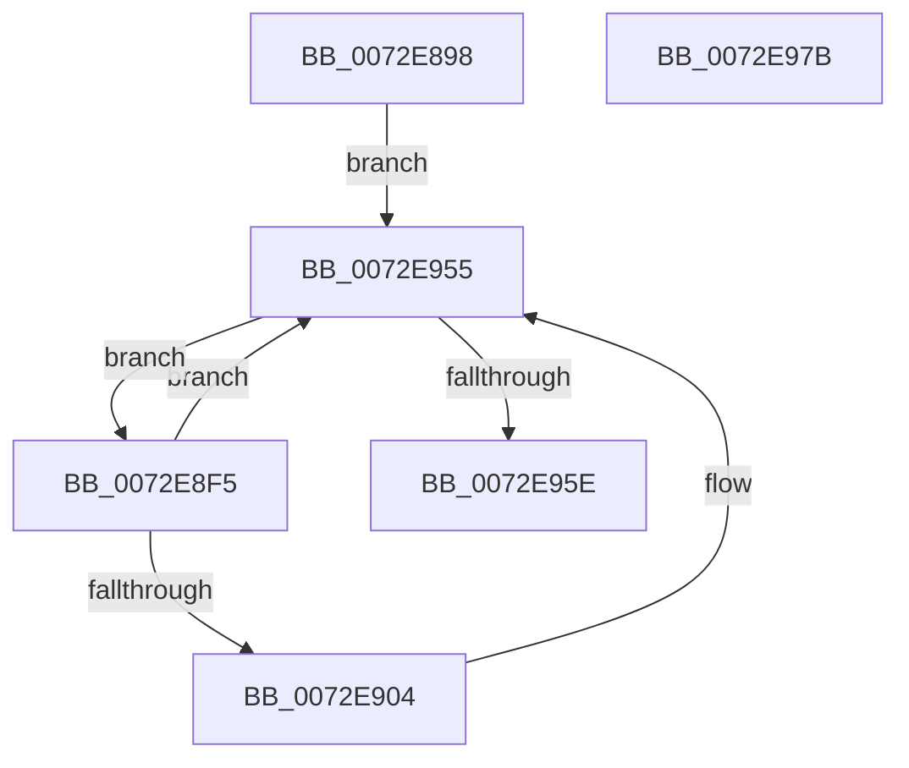

# IopBootAllocation

- RVA: `0x0072E898`–`0x0072E97C` (길이 `228` bytes)
- VA: `0x000000014072E898`
- 실행 섹션: `PAGE`
- PDB 이름 있음: `예`; PDB Function 태그: `아니요`
- unwind 정보 RVA: `0x0006F120`
- 디코드: `66`개 명령, `228/228` bytes 표시
- 미해석 바이트: `0` (있으면 어셈블리에 `.byte`로 보존)

> 이 문서는 커널 이미지의 기계어와 PDB 기호를 분석해 생성했습니다. 4번과 5번은 함수 원형과 자료형을 바이너리 사용 방식에서 추정한 C 해석이며 원본 소스 복구 결과는 아닙니다.

## 1. Dependencies

- 직접 호출 지점: **2**; 고유 호출 대상: **2**
- 직접 호출자로 확인된 함수: **1**
- RIP 상대 이미지 참조: **0**

### Outgoing calls
- `0x0072E8EA` → [IopAddRemoveReqDescs](../AB/IopAddRemoveReqDescs_function_00AB3FD0.md) (function, `0x00AB3FD0`)
- `0x0072E921` → [guard_dispatch_icall](../../text/6B/guard_dispatch_icall_function_006BAAD0.md) (function, `0x006BAAD0`)

### Direct callers
- [IopAllocateBootResourcesInternal](IopAllocateBootResourcesInternal_function_0072E708.md) at `0x0072E79F`

### Static image references
- 디코드된 RIP-relative 메모리 참조가 없습니다.

## 2. Other-region calls and transfers

- 다른 실행 섹션으로 향하는 call: **1**
  - `0x0072E921` → [guard_dispatch_icall](../../text/6B/guard_dispatch_icall_function_006BAAD0.md) (`PAGE` → `.text`)
- 별도 외부 분기/꼬리 이동을 확인하지 못했습니다.

## 3. Assembly (complete function range)

```asm
0072E898  48 89 5C 24 08                  mov qword ptr [rsp + 8], rbx
0072E89D  48 89 74 24 10                  mov qword ptr [rsp + 0x10], rsi
0072E8A2  48 89 7C 24 18                  mov qword ptr [rsp + 0x18], rdi
0072E8A7  55                              push rbp
0072E8A8  41 56                           push r14
0072E8AA  41 57                           push r15
0072E8AC  48 8B EC                        mov rbp, rsp
0072E8AF  48 83 EC 50                     sub rsp, 0x50
0072E8B3  0F 57 C0                        xorps xmm0, xmm0
0072E8B6  48 8D 45 D0                     lea rax, [rbp - 0x30]
0072E8BA  48 89 45 D8                     mov qword ptr [rbp - 0x28], rax
0072E8BE  4C 8D 45 D0                     lea r8, [rbp - 0x30]
0072E8C2  0F 11 45 E0                     movups xmmword ptr [rbp - 0x20], xmm0
0072E8C6  48 8D 45 D0                     lea rax, [rbp - 0x30]
0072E8CA  45 33 F6                        xor r14d, r14d
0072E8CD  48 89 45 D0                     mov qword ptr [rbp - 0x30], rax
0072E8D1  41 B1 01                        mov r9b, 1
0072E8D4  48 8D 41 28                     lea rax, [rcx + 0x28]
0072E8D8  48 89 41 10                     mov qword ptr [rcx + 0x10], rax
0072E8DC  0F 11 45 F0                     movups xmmword ptr [rbp - 0x10], xmm0
0072E8E0  48 8B 10                        mov rdx, qword ptr [rax]
0072E8E3  48 8D 4A 18                     lea rcx, [rdx + 0x18]
0072E8E7  8B 52 14                        mov edx, dword ptr [rdx + 0x14]
0072E8EA  E8 E1 56 38 00                  call 0x140ab3fd0
0072E8EF  48 8B 7D D0                     mov rdi, qword ptr [rbp - 0x30]
0072E8F3  EB 60                           jmp 0x14072e955
0072E8F5  48 8B F7                        mov rsi, rdi
0072E8F8  4C 8B FF                        mov r15, rdi
0072E8FB  48 8B 3F                        mov rdi, qword ptr [rdi]
0072E8FE  80 7E 11 00                     cmp byte ptr [rsi + 0x11], 0
0072E902  74 51                           je 0x14072e955
0072E904  48 8D 5E D0                     lea rbx, [rsi - 0x30]
0072E908  BA 09 00 00 00                  mov edx, 9
0072E90D  48 89 5D E0                     mov qword ptr [rbp - 0x20], rbx
0072E911  4C 8D 45 E0                     lea r8, [rbp - 0x20]
0072E915  48 8B 4E C0                     mov rcx, qword ptr [rsi - 0x40]
0072E919  48 8B 41 20                     mov rax, qword ptr [rcx + 0x20]
0072E91D  48 8B 49 08                     mov rcx, qword ptr [rcx + 8]
0072E921  E8 AA C1 F8 FF                  call 0x1406baad0
0072E926  48 8D 4E F0                     lea rcx, [rsi - 0x10]
0072E92A  85 C0                           test eax, eax
0072E92C  44 0F 48 F0                     cmovs r14d, eax
0072E930  66 83 66 10 00                  and word ptr [rsi + 0x10], 0
0072E935  48 89 76 08                     mov qword ptr [rsi + 8], rsi
0072E939  48 89 36                        mov qword ptr [rsi], rsi
0072E93C  48 89 49 08                     mov qword ptr [rcx + 8], rcx
0072E940  48 89 09                        mov qword ptr [rcx], rcx
0072E943  48 8D 4E E0                     lea rcx, [rsi - 0x20]
0072E947  48 89 5B 08                     mov qword ptr [rbx + 8], rbx
0072E94B  48 89 1B                        mov qword ptr [rbx], rbx
0072E94E  48 89 49 08                     mov qword ptr [rcx + 8], rcx
0072E952  48 89 09                        mov qword ptr [rcx], rcx
0072E955  48 8D 45 D0                     lea rax, [rbp - 0x30]
0072E959  48 3B F8                        cmp rdi, rax
0072E95C  75 97                           jne 0x14072e8f5
0072E95E  4C 8D 5C 24 50                  lea r11, [rsp + 0x50]
0072E963  41 8B C6                        mov eax, r14d
0072E966  49 8B 5B 20                     mov rbx, qword ptr [r11 + 0x20]
0072E96A  49 8B 73 28                     mov rsi, qword ptr [r11 + 0x28]
0072E96E  49 8B 7B 30                     mov rdi, qword ptr [r11 + 0x30]
0072E972  49 8B E3                        mov rsp, r11
0072E975  41 5F                           pop r15
0072E977  41 5E                           pop r14
0072E979  5D                              pop rbp
0072E97A  C3                              ret
0072E97B  CC                              int3
```

## 4. C-style interpretation (structured pseudocode)

```c
__int64 __fastcall IopBootAllocation(__int64 a1)
{
    __int64 result;
    __int64 v_r14;
    __int64 v_rbx;
    __int64 v_rsp;
    unsigned __int64 v_stack_m18;
    unsigned __int64 v_stack_m28;
    unsigned __int64 v_stack_m38;
    unsigned __int64 v_stack_m40;
    unsigned __int64 v_stack_m48;
    unsigned __int64 v_stack_p10;
    unsigned __int64 v_stack_p18;
    unsigned __int64 v_stack_p8;

    v_stack_p8 = v_rbx;
    v_stack_p10 = v_rsi;
    v_stack_p18 = v_rdi;
    v_rsp = (v_rsp) - (80);
    v_stack_m40 = v_stack_m48;
    v_stack_m38 = v_xmm0;
    v_r14 = 0;
    v_stack_m48 = v_stack_m48;
    *(unsigned __int64 *)(a1 + 16) = a1 + 40;
    v_stack_m28 = v_xmm0;
    result = IopAddRemoveReqDescs(*(unsigned __int64 *)(a1 + 40) + 24, (unsigned int)(*(unsigned int *)(*(unsigned __int64 *)(a1 + 40) + 20)), v_stack_m48, 1);
    goto loc_0072E955;
loc_0072E8F5:
    if ((*(unsigned __int8 *)(v_stack_m48 + 17)) != 0) {
        v_rbx = v_stack_m48 - 48;
        a2 = 9;
        v_stack_m38 = v_rbx;
        a3 = v_stack_m38;
        a1 = *(unsigned __int64 *)(v_stack_m48 - 64);
        result = *(unsigned __int64 *)(a1 + 32);
        a1 = *(unsigned __int64 *)(a1 + 8);
        result = guard_dispatch_icall(a1, a2, a3, 1);
        a1 = v_stack_m48 - 16;
        if (sign_flag) { v_r14 = (unsigned int)(result); }
        *(unsigned __int64 *)(v_stack_m48 + 8) = v_stack_m48;
        *(unsigned __int64 *)(v_stack_m48) = v_stack_m48;
        *(unsigned __int64 *)(a1 + 8) = a1;
        *(unsigned __int64 *)(a1) = a1;
        a1 = v_stack_m48 - 32;
        *(unsigned __int64 *)(v_rbx + 8) = v_rbx;
        *(unsigned __int64 *)(v_rbx) = v_rbx;
        *(unsigned __int64 *)(a1 + 8) = a1;
        *(unsigned __int64 *)(a1) = a1;
    }
    if ((*(unsigned __int64 *)(v_stack_m48)) != v_stack_m48) goto loc_0072E8F5;
    return (unsigned int)((unsigned int)(v_r14));
}
```

## 5. (Beta) C Style

```c
int64_t IopBootAllocation(void *Arg1)
{
    uint8_t *arg1 = (uint8_t *)Arg1;

    int64_t result;
    int64_t local_r14;
    int64_t local_rbx;
    int64_t local_rsp;
    uint64_t v_stack_m18;
    uint64_t v_stack_m28;
    uint64_t v_stack_m38;
    uint64_t v_stack_m40;
    uint64_t v_stack_m48;
    uint64_t v_stack_p10;
    uint64_t v_stack_p18;
    uint64_t v_stack_p8;

    v_stack_p8 = local_rbx;
    v_stack_p10 = local_rsi;
    v_stack_p18 = local_rdi;
    local_rsp = (local_rsp) - (80);
    v_stack_m40 = v_stack_m48;
    v_stack_m38 = v_xmm0;
    local_r14 = 0;
    v_stack_m48 = v_stack_m48;
    *(void **)(arg1 + 0x10) = Arg1 + 40;
    v_stack_m28 = v_xmm0;
    result = IopAddRemoveReqDescs(*(uint64_t *)(arg1 + 0x28) + 24, (uint32_t)(*(uint32_t *)(*(uint64_t *)(arg1 + 0x28) + 0x14)), v_stack_m48, 1);
    goto loc_0072E955;
loc_0072E8F5:
    if ((*(uint8_t *)(v_stack_m48 + 0x11)) != 0) {
        local_rbx = v_stack_m48 - 48;
        a2 = 9;
        v_stack_m38 = local_rbx;
        a3 = v_stack_m38;
        Arg1 = *(uint64_t *)(v_stack_m48 - 0x40);
        result = *(uint64_t *)(arg1 + 0x20);
        Arg1 = *(uint64_t *)(arg1 + 0x8);
        result = guard_dispatch_icall(Arg1, a2, a3, 1);
        Arg1 = v_stack_m48 - 16;
        if (sign_flag) { local_r14 = (uint32_t)(result); }
        *(uint64_t *)(v_stack_m48 + 0x8) = v_stack_m48;
        *(uint64_t *)(v_stack_m48) = v_stack_m48;
        *(void **)(arg1 + 0x8) = Arg1;
        *(void **)(arg1) = Arg1;
        Arg1 = v_stack_m48 - 32;
        *(uint64_t *)(local_rbx + 0x8) = local_rbx;
        *(uint64_t *)(local_rbx) = local_rbx;
        *(void **)(arg1 + 0x8) = Arg1;
        *(void **)(arg1) = Arg1;
    }
    if ((*(uint64_t *)(v_stack_m48)) != v_stack_m48) goto loc_0072E8F5;
    return (uint32_t)((uint32_t)(local_r14));
}
```

### 관측된 메모리 오프셋

구조체 형식이 확인되지 않은 접근은 인자 기준의 오프셋으로만 기록했습니다.

| 기준 인자 | 오프셋 표현 | 폭 (bit) | 접근 |
|---|---:|---:|---|
| `Arg1` | `+ 0x0` | `64` | `R` |
| `Arg1` | `+ 0x10` | `64` | `W` |
| `Arg1` | `+ 0x28` | `64` | `R` |

## 6. Execution-region graph

[열기: 2D/3D 그래프와 함수 탐색 컨트롤 패널](../../../control-panel.html?section=page&rva=0x0072E898&view=graph)

- 2D 그래프는 위에서 아래로 흐르고, 3D 그래프는 빈 공간을 드래그해 회전합니다. Shift+드래그는 이동, 휠은 확대·축소, 함수 노드 선택은 대상 보고서 이동입니다.

### Static fallback


