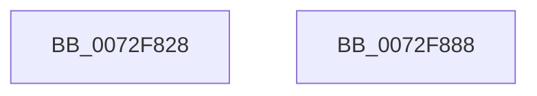

# IopBusNumberInitialize

- RVA: `0x0072F828`–`0x0072F889` (길이 `97` bytes)
- VA: `0x000000014072F828`
- 실행 섹션: `PAGE`
- PDB 이름 있음: `예`; PDB Function 태그: `아니요`
- unwind 정보 RVA: `0x0005D2F4`
- 디코드: `17`개 명령, `97/97` bytes 표시
- 미해석 바이트: `0` (있으면 어셈블리에 `.byte`로 보존)

> 이 문서는 커널 이미지의 기계어와 PDB 기호를 분석해 생성했습니다. 4번과 5번은 함수 원형과 자료형을 바이너리 사용 방식에서 추정한 C 해석이며 원본 소스 복구 결과는 아닙니다.

## 1. Dependencies

- 직접 호출 지점: **1**; 고유 호출 대상: **1**
- 직접 호출자로 확인된 함수: **1**
- RIP 상대 이미지 참조: **10**

### Outgoing calls
- `0x0072F87E` → [ArbInitializeArbiterInstance](../70/ArbInitializeArbiterInstance_function_0070ECB4.md) (function, `0x0070ECB4`)

### Direct callers
- [IopInitializePlugPlayServices](../../init/C2/IopInitializePlugPlayServices_function_00C2F298.md) at `0x00C2F5F5`

### Static image references
- `0x0072F832` → RVA `0x0072F8E0` (`IopBusNumberUnpackRequirement`; read)
- `0x0072F839` → RVA `0x00F8BAD8` (`.data`; write)
- `0x0072F840` → RVA `0x00AFE240` (` ?? ::NNGAKEGL::`string'`; read)
- `0x0072F847` → RVA `0x0072F890` (`IopBusNumberPackResource`; read)
- `0x0072F854` → RVA `0x00F8BAE0` (`.data`; write)
- `0x0072F85B` → RVA `0x00F8BA60` (`.data`; read)
- `0x0072F862` → RVA `0x0072F910` (`IopBusNumberUnpackResource`; read)
- `0x0072F869` → RVA `0x00F8BAE8` (`.data`; write)
- `0x0072F870` → RVA `0x0072F8C0` (`IopBusNumberScoreRequirement`; read)
- `0x0072F877` → RVA `0x00F8BAF0` (`.data`; write)

## 2. Other-region calls and transfers

- 다른 실행 섹션으로 향하는 call: **0**
- 별도 외부 분기/꼬리 이동을 확인하지 못했습니다.

## 3. Assembly (complete function range)

```asm
0072F828  48 83 EC 38                     sub rsp, 0x38
0072F82C  48 83 64 24 28 00               and qword ptr [rsp + 0x28], 0
0072F832  48 8D 05 A7 00 00 00            lea rax, [rip + 0xa7]
0072F839  48 89 05 98 C2 85 00            mov qword ptr [rip + 0x85c298], rax
0072F840  4C 8D 0D F9 E9 3C 00            lea r9, [rip + 0x3ce9f9]
0072F847  48 8D 05 42 00 00 00            lea rax, [rip + 0x42]
0072F84E  41 B8 06 00 00 00               mov r8d, 6
0072F854  48 89 05 85 C2 85 00            mov qword ptr [rip + 0x85c285], rax
0072F85B  48 8D 0D FE C1 85 00            lea rcx, [rip + 0x85c1fe]
0072F862  48 8D 05 A7 00 00 00            lea rax, [rip + 0xa7]
0072F869  48 89 05 78 C2 85 00            mov qword ptr [rip + 0x85c278], rax
0072F870  48 8D 05 49 00 00 00            lea rax, [rip + 0x49]
0072F877  48 89 05 72 C2 85 00            mov qword ptr [rip + 0x85c272], rax
0072F87E  E8 31 F4 FD FF                  call 0x14070ecb4
0072F883  48 83 C4 38                     add rsp, 0x38
0072F887  C3                              ret
0072F888  CC                              int3
```

## 4. C-style interpretation (structured pseudocode)

```c
__int64 __fastcall IopBusNumberInitialize(void)
{
    __int64 result;
    __int64 v_rsp;
    unsigned __int64 v_stack_m10;

    v_rsp = (v_rsp) - (56);
    *(unsigned __int64 *)(v_rip + 8766104) = v_rip + 167;
    *(unsigned __int64 *)(v_rip + 8766085) = v_rip + 66;
    *(unsigned __int64 *)(v_rip + 8766072) = v_rip + 167;
    *(unsigned __int64 *)(v_rip + 8766066) = v_rip + 73;
    result = ArbInitializeArbiterInstance(v_rip + 8765950, a2, 6, v_rip + 3992057);
    v_rsp = (v_rsp) + (56);
    return result;
}
```

## 5. (Beta) C Style

```c
void IopBusNumberInitialize(void)
{
    int64_t result;
    int64_t local_rsp;
    uint64_t v_stack_m10;

    local_rsp = (local_rsp) - (56);
    *(uint64_t *)(v_rip + 0x85C298) = v_rip + 167;
    *(uint64_t *)(v_rip + 0x85C285) = v_rip + 66;
    *(uint64_t *)(v_rip + 0x85C278) = v_rip + 167;
    *(uint64_t *)(v_rip + 0x85C272) = v_rip + 73;
    result = ArbInitializeArbiterInstance(v_rip + 8765950, a2, 6, v_rip + 3992057);
    local_rsp = (local_rsp) + (56);
    return result;
}
```

## 6. Execution-region graph

[열기: 2D/3D 그래프와 함수 탐색 컨트롤 패널](../../../control-panel.html?section=page&rva=0x0072F828&view=graph)

- 2D 그래프는 위에서 아래로 흐르고, 3D 그래프는 빈 공간을 드래그해 회전합니다. Shift+드래그는 이동, 휠은 확대·축소, 함수 노드 선택은 대상 보고서 이동입니다.

### Static fallback


