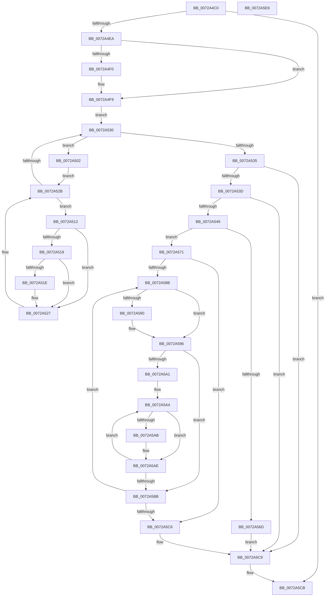

# IopChangeInterfaceType

- RVA: `0x0072A4C0`–`0x0072A5E7` (길이 `295` bytes)
- VA: `0x000000014072A4C0`
- 실행 섹션: `PAGE`
- PDB 이름 있음: `예`; PDB Function 태그: `아니요`
- unwind 정보 RVA: `0x0005E6B4`
- 디코드: `90`개 명령, `295/295` bytes 표시
- 미해석 바이트: `0` (있으면 어셈블리에 `.byte`로 보존)

> 이 문서는 커널 이미지의 기계어와 PDB 기호를 분석해 생성했습니다. 4번과 5번은 함수 원형과 자료형을 바이너리 사용 방식에서 추정한 C 해석이며 원본 소스 복구 결과는 아닙니다.

## 1. Dependencies

- 직접 호출 지점: **3**; 고유 호출 대상: **3**
- 직접 호출자로 확인된 함수: **1**
- RIP 상대 이미지 참조: **0**

### Outgoing calls
- `0x0072A54C` → [PnpDetermineResourceListSize](../8F/PnpDetermineResourceListSize_function_008FC6F8.md) (function, `0x008FC6F8`)
- `0x0072A560` → [ExAllocatePool2](../../poolcode/B8/ExAllocatePool2_function_00B820F0.md) (function, `0x00B820F0`)
- `0x0072A57A` → [memcpy](../../text/6C/memcpy_function_006C6840.md) (function, `0x006C6840`)

### Direct callers
- [IoReportResourceUsageInternal](IoReportResourceUsageInternal_function_0072A398.md) at `0x0072A44B`

### Static image references
- 디코드된 RIP-relative 메모리 참조가 없습니다.

## 2. Other-region calls and transfers

- 다른 실행 섹션으로 향하는 call: **2**
  - `0x0072A560` → [ExAllocatePool2](../../poolcode/B8/ExAllocatePool2_function_00B820F0.md) (`PAGE` → `POOLCODE`)
  - `0x0072A57A` → [memcpy](../../text/6C/memcpy_function_006C6840.md) (`PAGE` → `.text`)
- 별도 외부 분기/꼬리 이동을 확인하지 못했습니다.

## 3. Assembly (complete function range)

```asm
0072A4C0  48 8B C4                        mov rax, rsp
0072A4C3  48 89 58 08                     mov qword ptr [rax + 8], rbx
0072A4C7  48 89 68 10                     mov qword ptr [rax + 0x10], rbp
0072A4CB  48 89 70 18                     mov qword ptr [rax + 0x18], rsi
0072A4CF  48 89 78 20                     mov qword ptr [rax + 0x20], rdi
0072A4D3  41 56                           push r14
0072A4D5  48 83 EC 20                     sub rsp, 0x20
0072A4D9  32 DB                           xor bl, bl
0072A4DB  4C 8B F2                        mov r14, rdx
0072A4DE  48 8B C1                        mov rax, rcx
0072A4E1  48 85 C9                        test rcx, rcx
0072A4E4  0F 84 E1 00 00 00               je 0x14072a5cb
0072A4EA  83 79 04 00                     cmp dword ptr [rcx + 4], 0
0072A4EE  75 09                           jne 0x14072a4f9
0072A4F0  C7 41 04 01 00 00 00            mov dword ptr [rcx + 4], 1
0072A4F7  B3 01                           mov bl, 1
0072A4F9  8B 50 1C                        mov edx, dword ptr [rax + 0x1c]
0072A4FC  48 83 C1 20                     add rcx, 0x20
0072A500  EB 2E                           jmp 0x14072a530
0072A502  48 8D 41 08                     lea rax, [rcx + 8]
0072A506  8B 49 04                        mov ecx, dword ptr [rcx + 4]
0072A509  48 C1 E1 05                     shl rcx, 5
0072A50D  48 03 C8                        add rcx, rax
0072A510  EB 19                           jmp 0x14072a52b
0072A512  80 78 01 F0                     cmp byte ptr [rax + 1], 0xf0
0072A516  75 0F                           jne 0x14072a527
0072A518  83 78 08 00                     cmp dword ptr [rax + 8], 0
0072A51C  75 09                           jne 0x14072a527
0072A51E  C7 40 08 01 00 00 00            mov dword ptr [rax + 8], 1
0072A525  B3 01                           mov bl, 1
0072A527  48 83 C0 20                     add rax, 0x20
0072A52B  48 3B C1                        cmp rax, rcx
0072A52E  72 E2                           jb 0x14072a512
0072A530  83 EA 01                        sub edx, 1
0072A533  79 CD                           jns 0x14072a502
0072A535  84 DB                           test bl, bl
0072A537  0F 84 8C 00 00 00               je 0x14072a5c9
0072A53D  49 8B 3E                        mov rdi, qword ptr [r14]
0072A540  48 85 FF                        test rdi, rdi
0072A543  0F 84 80 00 00 00               je 0x14072a5c9
0072A549  48 8B CF                        mov rcx, rdi
0072A54C  E8 A7 21 1D 00                  call 0x1408fc6f8
0072A551  41 B8 50 70 20 20               mov r8d, 0x20207050
0072A557  8B D0                           mov edx, eax
0072A559  B9 00 01 00 00                  mov ecx, 0x100
0072A55E  8B E8                           mov ebp, eax
0072A560  E8 8B 7B 45 00                  call 0x140b820f0
0072A565  48 8B F0                        mov rsi, rax
0072A568  48 85 C0                        test rax, rax
0072A56B  75 04                           jne 0x14072a571
0072A56D  32 DB                           xor bl, bl
0072A56F  EB 58                           jmp 0x14072a5c9
0072A571  4C 8B C5                        mov r8, rbp
0072A574  48 8B D7                        mov rdx, rdi
0072A577  48 8B CE                        mov rcx, rsi
0072A57A  E8 C1 C2 F9 FF                  call 0x1406c6840
0072A57F  45 33 C0                        xor r8d, r8d
0072A582  48 8D 46 04                     lea rax, [rsi + 4]
0072A586  44 39 07                        cmp dword ptr [rdi], r8d
0072A589  76 3B                           jbe 0x14072a5c6
0072A58B  83 38 00                        cmp dword ptr [rax], 0
0072A58E  75 06                           jne 0x14072a596
0072A590  C7 00 01 00 00 00               mov dword ptr [rax], 1
0072A596  8B 50 0C                        mov edx, dword ptr [rax + 0xc]
0072A599  48 8D 48 10                     lea rcx, [rax + 0x10]
0072A59D  85 D2                           test edx, edx
0072A59F  74 1A                           je 0x14072a5bb
0072A5A1  44 8B CA                        mov r9d, edx
0072A5A4  33 C0                           xor eax, eax
0072A5A6  80 39 05                        cmp byte ptr [rcx], 5
0072A5A9  75 03                           jne 0x14072a5ae
0072A5AB  8B 41 04                        mov eax, dword ptr [rcx + 4]
0072A5AE  48 83 C1 14                     add rcx, 0x14
0072A5B2  48 03 C8                        add rcx, rax
0072A5B5  49 83 E9 01                     sub r9, 1
0072A5B9  75 E9                           jne 0x14072a5a4
0072A5BB  41 FF C0                        inc r8d
0072A5BE  48 8B C1                        mov rax, rcx
0072A5C1  44 3B 07                        cmp r8d, dword ptr [rdi]
0072A5C4  72 C5                           jb 0x14072a58b
0072A5C6  49 89 36                        mov qword ptr [r14], rsi
0072A5C9  8A C3                           mov al, bl
0072A5CB  48 8B 5C 24 30                  mov rbx, qword ptr [rsp + 0x30]
0072A5D0  48 8B 6C 24 38                  mov rbp, qword ptr [rsp + 0x38]
0072A5D5  48 8B 74 24 40                  mov rsi, qword ptr [rsp + 0x40]
0072A5DA  48 8B 7C 24 48                  mov rdi, qword ptr [rsp + 0x48]
0072A5DF  48 83 C4 20                     add rsp, 0x20
0072A5E3  41 5E                           pop r14
0072A5E5  C3                              ret
0072A5E6  CC                              int3
```

## 4. C-style interpretation (structured pseudocode)

```c
__int64 __fastcall IopChangeInterfaceType(__int64 a1, __int64 a2)
{
    __int64 result;
    __int64 v_rbx;
    __int64 v_rsp;
    unsigned __int64 v_stack_p10;
    unsigned __int64 v_stack_p18;
    unsigned __int64 v_stack_p20;
    unsigned __int64 v_stack_p8;

    *(unsigned __int64 *)(v_rsp + 8) = v_rbx;
    *(unsigned __int64 *)(v_rsp + 16) = v_rbp;
    *(unsigned __int64 *)(v_rsp + 24) = v_rsi;
    *(unsigned __int64 *)(v_rsp + 32) = v_rdi;
    v_rsp = (v_rsp) - (32);
    v_rbx = 0;
    if (a1 == 0) goto loc_0072A5CB;
    if ((*(unsigned int *)(a1 + 4)) == 0) {
        *(unsigned int *)(a1 + 4) = 1;
        v_rbx = 1;
    }
    a1 = (a1) + (32);
    goto loc_0072A530;
loc_0072A502:
    a1 = ((unsigned int)(*(unsigned int *)(a1 + 4))) << (5);
    a1 = (a1) + (a1 + 8);
    goto loc_0072A52B;
loc_0072A512:
    if ((*(unsigned __int8 *)(a1 + 8 + 1)) != 240) goto loc_0072A527;
    if ((*(unsigned int *)(a1 + 8 + 8)) == 0) {
        *(unsigned int *)(a1 + 8 + 8) = 1;
        v_rbx = 1;
    }
    result = (a1 + 8) + (32);
loc_0072A52B:
    if (result < a1) goto loc_0072A512;
loc_0072A530:
    a2 = (unsigned int)(((unsigned int)(*(unsigned int *)(a1 + 28))) - (1));
    if (!sign_flag) goto loc_0072A502;
    if ((unsigned __int8)(v_rbx) == 0) goto loc_0072A5C9;
    if (*(unsigned __int64 *)(a2) == 0) goto loc_0072A5C9;
    result = PnpDetermineResourceListSize(*(unsigned __int64 *)(a2), a2, a3, a4);
    result = ExAllocatePool2(256, (unsigned int)((unsigned int)(result)), (unsigned int)(0x20207050ULL), a4);
    if (result != 0) goto loc_0072A571;
    v_rbx = 0;
    goto loc_0072A5C9;
loc_0072A571:
    result = memcpy(result, *(unsigned __int64 *)(a2), (unsigned int)((unsigned int)(result)), a4);
    a3 = 0;
    if ((*(unsigned int *)(*(unsigned __int64 *)(a2))) <= 0) goto loc_0072A5C6;
loc_0072A58B:
    if ((*(unsigned int *)(result + 4)) == 0) {
        *(unsigned int *)(result + 4) = 1;
    }
    if ((unsigned int)((unsigned int)(*(unsigned int *)(result + 4 + 12))) == 0) goto loc_0072A5BB;
loc_0072A5A4:
    result = 0;
    if ((*(unsigned __int8 *)(result + 4 + 16)) == 5) {
        result = *(unsigned int *)(result + 4 + 16 + 4);
    }
    a1 = (result + 4 + 16) + (20);
    a1 = (a1) + (result);
    a4 = ((unsigned int)((unsigned int)((unsigned int)(*(unsigned int *)(result + 4 + 12))))) - (1);
    if (condition_is_not_equal) goto loc_0072A5A4;
loc_0072A5BB:
    a3 = (unsigned int)((a3) + 1);
    if (((unsigned int)(a3)) < (*(unsigned int *)(*(unsigned __int64 *)(a2)))) goto loc_0072A58B;
loc_0072A5C6:
    *(unsigned __int64 *)(a2) = result;
loc_0072A5C9:
loc_0072A5CB:
    v_rsp = (v_rsp) + (32);
    return 0;
}
```

## 5. (Beta) C Style

```c
int64_t IopChangeInterfaceType(void *Arg1, void *Arg2)
{
    uint8_t *arg1 = (uint8_t *)Arg1;
    uint8_t *arg2 = (uint8_t *)Arg2;

    int64_t result;
    int64_t local_rbx;
    int64_t local_rsp;
    uint64_t v_stack_p10;
    uint64_t v_stack_p18;
    uint64_t v_stack_p20;
    uint64_t v_stack_p8;

    *(uint64_t *)(local_rsp + 0x8) = local_rbx;
    *(uint64_t *)(local_rsp + 0x10) = local_rbp;
    *(uint64_t *)(local_rsp + 0x18) = local_rsi;
    *(uint64_t *)(local_rsp + 0x20) = local_rdi;
    local_rsp = (local_rsp) - (32);
    local_rbx = 0;
    if (Arg1 == NULL) goto loc_0072A5CB;
    if ((*(uint32_t *)(arg1 + 0x4)) == 0) {
        *(uint32_t *)(arg1 + 0x4) = 1;
        local_rbx = 1;
    }
    Arg1 = (Arg1) + (32);
    goto loc_0072A530;
loc_0072A502:
    Arg1 = ((uint32_t)(*(uint32_t *)(arg1 + 0x4))) << (5);
    Arg1 = (Arg1) + (Arg1 + 8);
    goto loc_0072A52B;
loc_0072A512:
    if ((*(uint8_t *)(arg1 + 0x8 + 0x1)) != 240) goto loc_0072A527;
    if ((*(uint32_t *)(arg1 + 0x8 + 0x8)) == 0) {
        *(uint32_t *)(arg1 + 0x8 + 0x8) = 1;
        local_rbx = 1;
    }
    result = (Arg1 + 8) + (32);
loc_0072A52B:
    if (result < Arg1) goto loc_0072A512;
loc_0072A530:
    Arg2 = (uint32_t)(((uint32_t)(*(uint32_t *)(arg1 + 0x1C))) - (1));
    if (!sign_flag) goto loc_0072A502;
    if ((uint8_t)(local_rbx) == 0) goto loc_0072A5C9;
    if (*(uint64_t *)(arg2) == 0) goto loc_0072A5C9;
    result = PnpDetermineResourceListSize(*(uint64_t *)(arg2), Arg2, a3, a4);
    result = ExAllocatePool2(256, (uint32_t)((uint32_t)(result)), (uint32_t)(0x20207050ULL), a4);
    if (result != 0) goto loc_0072A571;
    local_rbx = 0;
    goto loc_0072A5C9;
loc_0072A571:
    result = memcpy(result, *(uint64_t *)(arg2), (uint32_t)((uint32_t)(result)), a4);
    a3 = 0;
    if ((*(uint32_t *)(*(uint64_t *)(arg2))) <= 0) goto loc_0072A5C6;
loc_0072A58B:
    if ((*(uint32_t *)(result + 0x4)) == 0) {
        *(uint32_t *)(result + 0x4) = 1;
    }
    if ((uint32_t)((uint32_t)(*(uint32_t *)(result + 0x4 + 0xC))) == 0) goto loc_0072A5BB;
loc_0072A5A4:
    result = 0;
    if ((*(uint8_t *)(result + 0x4 + 0x10)) == 5) {
        result = *(uint32_t *)(result + 0x4 + 0x10 + 0x4);
    }
    Arg1 = (result + 4 + 16) + (20);
    Arg1 = (Arg1) + (result);
    a4 = ((uint32_t)((uint32_t)((uint32_t)(*(uint32_t *)(result + 0x4 + 0xC))))) - (1);
    if (condition_is_not_equal) goto loc_0072A5A4;
loc_0072A5BB:
    a3 = (uint32_t)((a3) + 1);
    if (((uint32_t)(a3)) < (*(uint32_t *)(*(uint64_t *)(arg2)))) goto loc_0072A58B;
loc_0072A5C6:
    *(uint64_t *)(arg2) = result;
loc_0072A5C9:
loc_0072A5CB:
    local_rsp = (local_rsp) + (32);
    return 0;
}
```

### 관측된 메모리 오프셋

구조체 형식이 확인되지 않은 접근은 인자 기준의 오프셋으로만 기록했습니다.

| 기준 인자 | 오프셋 표현 | 폭 (bit) | 접근 |
|---|---:|---:|---|
| `Arg1` | `+ 0x1C` | `32` | `R` |
| `Arg2` | `+ 0x0` | `64` | `R` |
| `Arg2` | `+ 0x0` | `64` | `W` |

## 6. Execution-region graph

[열기: 2D/3D 그래프와 함수 탐색 컨트롤 패널](../../../control-panel.html?section=page&rva=0x0072A4C0&view=graph)

- 2D 그래프는 위에서 아래로 흐르고, 3D 그래프는 빈 공간을 드래그해 회전합니다. Shift+드래그는 이동, 휠은 확대·축소, 함수 노드 선택은 대상 보고서 이동입니다.

### Static fallback


