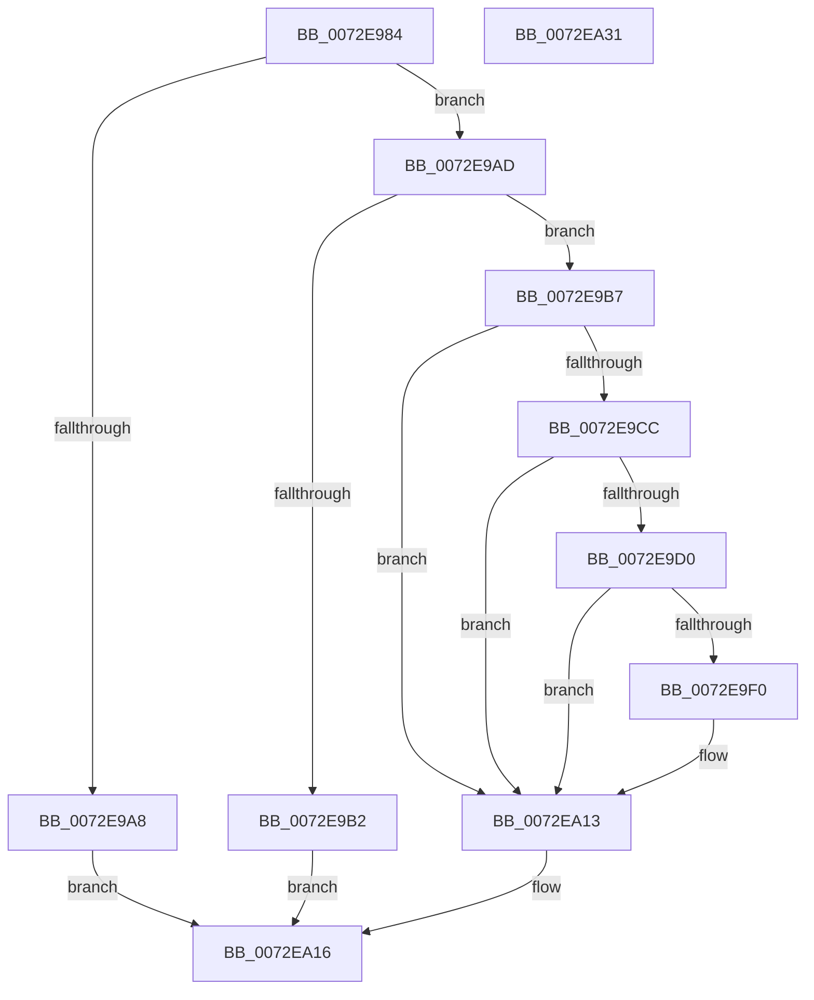

# IopCombineCmResourceList

- RVA: `0x0072E984`–`0x0072EA32` (길이 `174` bytes)
- VA: `0x000000014072E984`
- 실행 섹션: `PAGE`
- PDB 이름 있음: `예`; PDB Function 태그: `아니요`
- unwind 정보 RVA: `0x0005E6B4`
- 디코드: `53`개 명령, `174/174` bytes 표시
- 미해석 바이트: `0` (있으면 어셈블리에 `.byte`로 보존)

> 이 문서는 커널 이미지의 기계어와 PDB 기호를 분석해 생성했습니다. 4번과 5번은 함수 원형과 자료형을 바이너리 사용 방식에서 추정한 C 해석이며 원본 소스 복구 결과는 아닙니다.

## 1. Dependencies

- 직접 호출 지점: **5**; 고유 호출 대상: **3**
- 직접 호출자로 확인된 함수: **1**
- RIP 상대 이미지 참조: **0**

### Outgoing calls
- `0x0072E9B9` → [PnpDetermineResourceListSize](../8F/PnpDetermineResourceListSize_function_008FC6F8.md) (function, `0x008FC6F8`)
- `0x0072E9C3` → [PnpDetermineResourceListSize](../8F/PnpDetermineResourceListSize_function_008FC6F8.md) (function, `0x008FC6F8`)
- `0x0072E9E3` → [ExAllocatePool2](../../poolcode/B8/ExAllocatePool2_function_00B820F0.md) (function, `0x00B820F0`)
- `0x0072E9F9` → [memcpy](../../text/6C/memcpy_function_006C6840.md) (function, `0x006C6840`)
- `0x0072EA09` → [memcpy](../../text/6C/memcpy_function_006C6840.md) (function, `0x006C6840`)

### Direct callers
- [IopAllocateLegacyBootResources](../../init/C3/IopAllocateLegacyBootResources_function_00C34138.md) at `0x00C3420E`

### Static image references
- 디코드된 RIP-relative 메모리 참조가 없습니다.

## 2. Other-region calls and transfers

- 다른 실행 섹션으로 향하는 call: **3**
  - `0x0072E9E3` → [ExAllocatePool2](../../poolcode/B8/ExAllocatePool2_function_00B820F0.md) (`PAGE` → `POOLCODE`)
  - `0x0072E9F9` → [memcpy](../../text/6C/memcpy_function_006C6840.md) (`PAGE` → `.text`)
  - `0x0072EA09` → [memcpy](../../text/6C/memcpy_function_006C6840.md) (`PAGE` → `.text`)
- 별도 외부 분기/꼬리 이동을 확인하지 못했습니다.

## 3. Assembly (complete function range)

```asm
0072E984  48 8B C4                        mov rax, rsp
0072E987  48 89 58 08                     mov qword ptr [rax + 8], rbx
0072E98B  48 89 68 10                     mov qword ptr [rax + 0x10], rbp
0072E98F  48 89 70 18                     mov qword ptr [rax + 0x18], rsi
0072E993  48 89 78 20                     mov qword ptr [rax + 0x20], rdi
0072E997  41 56                           push r14
0072E999  48 83 EC 20                     sub rsp, 0x20
0072E99D  48 8B FA                        mov rdi, rdx
0072E9A0  48 8B F1                        mov rsi, rcx
0072E9A3  48 85 C9                        test rcx, rcx
0072E9A6  75 05                           jne 0x14072e9ad
0072E9A8  48 8B C2                        mov rax, rdx
0072E9AB  EB 69                           jmp 0x14072ea16
0072E9AD  48 85 FF                        test rdi, rdi
0072E9B0  75 05                           jne 0x14072e9b7
0072E9B2  48 8B C6                        mov rax, rsi
0072E9B5  EB 5F                           jmp 0x14072ea16
0072E9B7  33 ED                           xor ebp, ebp
0072E9B9  E8 3A DD 1C 00                  call 0x1408fc6f8
0072E9BE  48 8B CF                        mov rcx, rdi
0072E9C1  8B D8                           mov ebx, eax
0072E9C3  E8 30 DD 1C 00                  call 0x1408fc6f8
0072E9C8  85 DB                           test ebx, ebx
0072E9CA  74 47                           je 0x14072ea13
0072E9CC  85 C0                           test eax, eax
0072E9CE  74 43                           je 0x14072ea13
0072E9D0  44 8D 70 FC                     lea r14d, [rax - 4]
0072E9D4  B9 00 01 00 00                  mov ecx, 0x100
0072E9D9  41 8D 14 1E                     lea edx, [r14 + rbx]
0072E9DD  41 B8 50 70 20 20               mov r8d, 0x20207050
0072E9E3  E8 08 37 45 00                  call 0x140b820f0
0072E9E8  48 8B E8                        mov rbp, rax
0072E9EB  48 85 C0                        test rax, rax
0072E9EE  74 23                           je 0x14072ea13
0072E9F0  44 8B C3                        mov r8d, ebx
0072E9F3  48 8B D6                        mov rdx, rsi
0072E9F6  48 8B C8                        mov rcx, rax
0072E9F9  E8 42 7E F9 FF                  call 0x1406c6840
0072E9FE  45 8B C6                        mov r8d, r14d
0072EA01  48 8D 57 04                     lea rdx, [rdi + 4]
0072EA05  48 8D 0C 2B                     lea rcx, [rbx + rbp]
0072EA09  E8 32 7E F9 FF                  call 0x1406c6840
0072EA0E  8B 0F                           mov ecx, dword ptr [rdi]
0072EA10  01 4D 00                        add dword ptr [rbp], ecx
0072EA13  48 8B C5                        mov rax, rbp
0072EA16  48 8B 5C 24 30                  mov rbx, qword ptr [rsp + 0x30]
0072EA1B  48 8B 6C 24 38                  mov rbp, qword ptr [rsp + 0x38]
0072EA20  48 8B 74 24 40                  mov rsi, qword ptr [rsp + 0x40]
0072EA25  48 8B 7C 24 48                  mov rdi, qword ptr [rsp + 0x48]
0072EA2A  48 83 C4 20                     add rsp, 0x20
0072EA2E  41 5E                           pop r14
0072EA30  C3                              ret
0072EA31  CC                              int3
```

## 4. C-style interpretation (structured pseudocode)

```c
__int64 __fastcall IopCombineCmResourceList(__int64 a1, __int64 a2)
{
    __int64 result;
    __int64 v_rbp;
    __int64 v_rsp;
    unsigned __int64 v_stack_p10;
    unsigned __int64 v_stack_p18;
    unsigned __int64 v_stack_p20;
    unsigned __int64 v_stack_p8;

    *(unsigned __int64 *)(v_rsp + 8) = v_rbx;
    *(unsigned __int64 *)(v_rsp + 16) = v_rbp;
    *(unsigned __int64 *)(v_rsp + 24) = v_rsi;
    *(unsigned __int64 *)(v_rsp + 32) = v_rdi;
    v_rsp = (v_rsp) - (32);
    if (a1 != 0) goto loc_0072E9AD;
    goto loc_0072EA16;
loc_0072E9AD:
    if (a2 != 0) goto loc_0072E9B7;
    goto loc_0072EA16;
loc_0072E9B7:
    v_rbp = 0;
    result = PnpDetermineResourceListSize(a1, a2, a3, a4);
    result = PnpDetermineResourceListSize(a2, a2, a3, a4);
    if ((unsigned int)((unsigned int)((unsigned int)(result))) == 0) goto loc_0072EA13;
    if ((unsigned int)(result) == 0) goto loc_0072EA13;
    result = ExAllocatePool2(256, result - 4 + (unsigned int)((unsigned int)(result)) * 1, (unsigned int)(0x20207050ULL), a4);
    if (result != 0) {
        a3 = (unsigned int)((unsigned int)((unsigned int)(result)));
        a2 = a1;
        a1 = result;
        result = memcpy(a1, a2, a3, a4);
        a3 = (unsigned int)(result - 4);
        a2 = a2 + 4;
        a1 = (unsigned int)((unsigned int)(result)) + result * 1;
        result = memcpy(a1, a2, a3, a4);
        a1 = *(unsigned int *)(a2);
    }
loc_0072EA16:
    v_rsp = (v_rsp) + (32);
    return result;
}
```

## 5. (Beta) C Style

```c
int64_t IopCombineCmResourceList(int64_t Arg1, int64_t Arg2)
{
    int64_t result;
    int64_t local_rbp;
    int64_t local_rsp;
    uint64_t v_stack_p10;
    uint64_t v_stack_p18;
    uint64_t v_stack_p20;
    uint64_t v_stack_p8;

    *(uint64_t *)(local_rsp + 0x8) = local_rbx;
    *(uint64_t *)(local_rsp + 0x10) = local_rbp;
    *(uint64_t *)(local_rsp + 0x18) = local_rsi;
    *(uint64_t *)(local_rsp + 0x20) = local_rdi;
    local_rsp = (local_rsp) - (32);
    if (Arg1 != 0) goto loc_0072E9AD;
    goto loc_0072EA16;
loc_0072E9AD:
    if (Arg2 != 0) goto loc_0072E9B7;
    goto loc_0072EA16;
loc_0072E9B7:
    local_rbp = 0;
    result = PnpDetermineResourceListSize(Arg1, Arg2, a3, a4);
    result = PnpDetermineResourceListSize(Arg2, Arg2, a3, a4);
    if ((uint32_t)((uint32_t)((uint32_t)(result))) == 0) goto loc_0072EA13;
    if ((uint32_t)(result) == 0) goto loc_0072EA13;
    result = ExAllocatePool2(256, result - 4 + (uint32_t)((uint32_t)(result)) * 1, (uint32_t)(0x20207050ULL), a4);
    if (result != 0) {
        a3 = (uint32_t)((uint32_t)((uint32_t)(result)));
        Arg2 = Arg1;
        Arg1 = result;
        result = memcpy(Arg1, Arg2, a3, a4);
        a3 = (uint32_t)(result - 4);
        Arg2 = Arg2 + 4;
        Arg1 = (uint32_t)((uint32_t)(result)) + result * 1;
        result = memcpy(Arg1, Arg2, a3, a4);
        Arg1 = *(uint32_t *)(Arg2);
    }
loc_0072EA16:
    local_rsp = (local_rsp) + (32);
    return result;
}
```

## 6. Execution-region graph

[열기: 2D/3D 그래프와 함수 탐색 컨트롤 패널](../../../control-panel.html?section=page&rva=0x0072E984&view=graph)

- 2D 그래프는 위에서 아래로 흐르고, 3D 그래프는 빈 공간을 드래그해 회전합니다. Shift+드래그는 이동, 휠은 확대·축소, 함수 노드 선택은 대상 보고서 이동입니다.

### Static fallback


