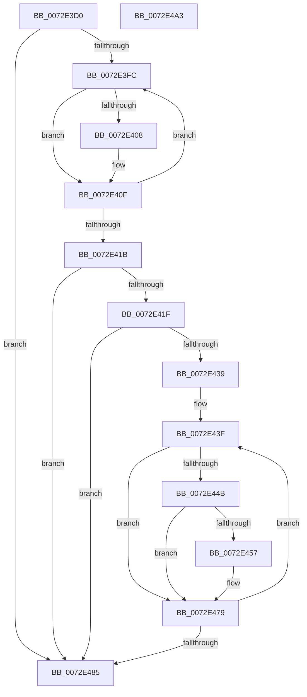

# IopCombineLegacyResources

- RVA: `0x0072E3D0`–`0x0072E4A4` (길이 `212` bytes)
- VA: `0x000000014072E3D0`
- 실행 섹션: `PAGE`
- PDB 이름 있음: `예`; PDB Function 태그: `아니요`
- unwind 정보 RVA: `0x0005E6B4`
- 디코드: `61`개 명령, `212/212` bytes 표시
- 미해석 바이트: `0` (있으면 어셈블리에 `.byte`로 보존)

> 이 문서는 커널 이미지의 기계어와 PDB 기호를 분석해 생성했습니다. 4번과 5번은 함수 원형과 자료형을 바이너리 사용 방식에서 추정한 C 해석이며 원본 소스 복구 결과는 아닙니다.

## 1. Dependencies

- 직접 호출 지점: **4**; 고유 호출 대상: **3**
- 직접 호출자로 확인된 함수: **1**
- RIP 상대 이미지 참조: **0**

### Outgoing calls
- `0x0072E408` → [PnpDetermineResourceListSize](../8F/PnpDetermineResourceListSize_function_008FC6F8.md) (function, `0x008FC6F8`)
- `0x0072E42C` → [ExAllocatePool2](../../poolcode/B8/ExAllocatePool2_function_00B820F0.md) (function, `0x00B820F0`)
- `0x0072E44E` → [PnpDetermineResourceListSize](../8F/PnpDetermineResourceListSize_function_008FC6F8.md) (function, `0x008FC6F8`)
- `0x0072E466` → [memcpy](../../text/6C/memcpy_function_006C6840.md) (function, `0x006C6840`)

### Direct callers
- [IopLegacyResourceAllocation](../A0/IopLegacyResourceAllocation_function_00A07224.md) at `0x00A0743A`

### Static image references
- 디코드된 RIP-relative 메모리 참조가 없습니다.

## 2. Other-region calls and transfers

- 다른 실행 섹션으로 향하는 call: **2**
  - `0x0072E42C` → [ExAllocatePool2](../../poolcode/B8/ExAllocatePool2_function_00B820F0.md) (`PAGE` → `POOLCODE`)
  - `0x0072E466` → [memcpy](../../text/6C/memcpy_function_006C6840.md) (`PAGE` → `.text`)
- 별도 외부 분기/꼬리 이동을 확인하지 못했습니다.

## 3. Assembly (complete function range)

```asm
0072E3D0  48 8B C4                        mov rax, rsp
0072E3D3  48 89 58 08                     mov qword ptr [rax + 8], rbx
0072E3D7  48 89 68 10                     mov qword ptr [rax + 0x10], rbp
0072E3DB  48 89 70 18                     mov qword ptr [rax + 0x18], rsi
0072E3DF  48 89 78 20                     mov qword ptr [rax + 0x20], rdi
0072E3E3  41 56                           push r14
0072E3E5  48 83 EC 20                     sub rsp, 0x20
0072E3E9  33 F6                           xor esi, esi
0072E3EB  33 ED                           xor ebp, ebp
0072E3ED  48 8B F9                        mov rdi, rcx
0072E3F0  48 8B D9                        mov rbx, rcx
0072E3F3  48 85 C9                        test rcx, rcx
0072E3F6  0F 84 89 00 00 00               je 0x14072e485
0072E3FC  48 8B 8B A0 01 00 00            mov rcx, qword ptr [rbx + 0x1a0]
0072E403  48 85 C9                        test rcx, rcx
0072E406  74 07                           je 0x14072e40f
0072E408  E8 EB E2 1C 00                  call 0x1408fc6f8
0072E40D  03 E8                           add ebp, eax
0072E40F  48 8B 9B 18 02 00 00            mov rbx, qword ptr [rbx + 0x218]
0072E416  48 85 DB                        test rbx, rbx
0072E419  75 E1                           jne 0x14072e3fc
0072E41B  85 ED                           test ebp, ebp
0072E41D  74 66                           je 0x14072e485
0072E41F  8B D5                           mov edx, ebp
0072E421  B9 00 01 00 00                  mov ecx, 0x100
0072E426  41 B8 50 70 20 20               mov r8d, 0x20207050
0072E42C  E8 BF 3C 45 00                  call 0x140b820f0
0072E431  48 8B F0                        mov rsi, rax
0072E434  48 85 C0                        test rax, rax
0072E437  74 4C                           je 0x14072e485
0072E439  21 18                           and dword ptr [rax], ebx
0072E43B  4C 8D 70 04                     lea r14, [rax + 4]
0072E43F  48 8B AF A0 01 00 00            mov rbp, qword ptr [rdi + 0x1a0]
0072E446  48 85 ED                        test rbp, rbp
0072E449  74 2E                           je 0x14072e479
0072E44B  48 8B CD                        mov rcx, rbp
0072E44E  E8 A5 E2 1C 00                  call 0x1408fc6f8
0072E453  85 C0                           test eax, eax
0072E455  74 22                           je 0x14072e479
0072E457  83 C0 FC                        add eax, -4
0072E45A  48 8D 55 04                     lea rdx, [rbp + 4]
0072E45E  44 8B C0                        mov r8d, eax
0072E461  49 8B CE                        mov rcx, r14
0072E464  8B D8                           mov ebx, eax
0072E466  E8 D5 83 F9 FF                  call 0x1406c6840
0072E46B  48 8B 87 A0 01 00 00            mov rax, qword ptr [rdi + 0x1a0]
0072E472  4C 03 F3                        add r14, rbx
0072E475  8B 08                           mov ecx, dword ptr [rax]
0072E477  01 0E                           add dword ptr [rsi], ecx
0072E479  48 8B BF 18 02 00 00            mov rdi, qword ptr [rdi + 0x218]
0072E480  48 85 FF                        test rdi, rdi
0072E483  75 BA                           jne 0x14072e43f
0072E485  48 8B 5C 24 30                  mov rbx, qword ptr [rsp + 0x30]
0072E48A  48 8B C6                        mov rax, rsi
0072E48D  48 8B 74 24 40                  mov rsi, qword ptr [rsp + 0x40]
0072E492  48 8B 6C 24 38                  mov rbp, qword ptr [rsp + 0x38]
0072E497  48 8B 7C 24 48                  mov rdi, qword ptr [rsp + 0x48]
0072E49C  48 83 C4 20                     add rsp, 0x20
0072E4A0  41 5E                           pop r14
0072E4A2  C3                              ret
0072E4A3  CC                              int3
```

## 4. C-style interpretation (structured pseudocode)

```c
__int64 __fastcall IopCombineLegacyResources(__int64 a1)
{
    __int64 result;
    __int64 v_r14;
    __int64 v_rbp;
    __int64 v_rbx;
    __int64 v_rsi;
    __int64 v_rsp;
    unsigned __int64 v_stack_p10;
    unsigned __int64 v_stack_p18;
    unsigned __int64 v_stack_p20;
    unsigned __int64 v_stack_p8;

    *(unsigned __int64 *)(v_rsp + 8) = v_rbx;
    *(unsigned __int64 *)(v_rsp + 16) = v_rbp;
    *(unsigned __int64 *)(v_rsp + 24) = v_rsi;
    *(unsigned __int64 *)(v_rsp + 32) = v_rdi;
    v_rsp = (v_rsp) - (32);
    v_rsi = 0;
    v_rbp = 0;
    if (a1 == 0) goto loc_0072E485;
loc_0072E3FC:
    result = v_rsp;
    if (*(unsigned __int64 *)(a1 + 416) != 0) {
        result = PnpDetermineResourceListSize(*(unsigned __int64 *)(a1 + 416), a2, a3, a4);
        v_rbp = (unsigned int)((v_rbp) + ((unsigned int)(result)));
    }
    if (*(unsigned __int64 *)(a1 + 536) != 0) goto loc_0072E3FC;
    if ((unsigned int)(v_rbp) == 0) goto loc_0072E485;
    result = ExAllocatePool2(256, (unsigned int)((unsigned int)(v_rbp)), (unsigned int)(0x20207050ULL), a4);
    if (result == 0) goto loc_0072E485;
loc_0072E43F:
    if (*(unsigned __int64 *)(a1 + 416) == 0) goto loc_0072E479;
    result = PnpDetermineResourceListSize(*(unsigned __int64 *)(a1 + 416), (unsigned int)((unsigned int)(v_rbp)), (unsigned int)(0x20207050ULL), a4);
    v_rbx = *(unsigned __int64 *)(a1 + 536);
    v_r14 = result + 4;
    if ((unsigned int)(result) != 0) {
        result = (unsigned int)((result) + (-4));
        a2 = *(unsigned __int64 *)(a1 + 416) + 4;
        a3 = (unsigned int)(result);
        a1 = result + 4;
        v_rbx = (unsigned int)(result);
        result = memcpy(a1, a2, a3, a4);
        result = *(unsigned __int64 *)(a1 + 416);
        v_r14 = (result + 4) + (v_rbx);
        a1 = *(unsigned int *)(result);
    }
    if (*(unsigned __int64 *)(a1 + 536) != 0) goto loc_0072E43F;
loc_0072E485:
    v_rsp = (v_rsp) + (32);
    return result;
}
```

## 5. (Beta) C Style

```c
int64_t IopCombineLegacyResources(int64_t Arg1)
{
    int64_t result;
    int64_t local_r14;
    int64_t local_rbp;
    int64_t local_rbx;
    int64_t local_rsi;
    int64_t local_rsp;
    uint64_t v_stack_p10;
    uint64_t v_stack_p18;
    uint64_t v_stack_p20;
    uint64_t v_stack_p8;

    *(uint64_t *)(local_rsp + 0x8) = local_rbx;
    *(uint64_t *)(local_rsp + 0x10) = local_rbp;
    *(uint64_t *)(local_rsp + 0x18) = local_rsi;
    *(uint64_t *)(local_rsp + 0x20) = local_rdi;
    local_rsp = (local_rsp) - (32);
    local_rsi = 0;
    local_rbp = 0;
    if (Arg1 == 0) goto loc_0072E485;
loc_0072E3FC:
    result = local_rsp;
    if (*(uint64_t *)(Arg1 + 0x1A0) != 0) {
        result = PnpDetermineResourceListSize(*(uint64_t *)(Arg1 + 0x1A0), a2, a3, a4);
        local_rbp = (uint32_t)((local_rbp) + ((uint32_t)(result)));
    }
    if (*(uint64_t *)(Arg1 + 0x218) != 0) goto loc_0072E3FC;
    if ((uint32_t)(local_rbp) == 0) goto loc_0072E485;
    result = ExAllocatePool2(256, (uint32_t)((uint32_t)(local_rbp)), (uint32_t)(0x20207050ULL), a4);
    if (result == 0) goto loc_0072E485;
loc_0072E43F:
    if (*(uint64_t *)(Arg1 + 0x1A0) == 0) goto loc_0072E479;
    result = PnpDetermineResourceListSize(*(uint64_t *)(Arg1 + 0x1A0), (uint32_t)((uint32_t)(local_rbp)), (uint32_t)(0x20207050ULL), a4);
    local_rbx = *(uint64_t *)(Arg1 + 0x218);
    local_r14 = result + 4;
    if ((uint32_t)(result) != 0) {
        result = (uint32_t)((result) + (-4));
        a2 = *(uint64_t *)(Arg1 + 0x1A0) + 4;
        a3 = (uint32_t)(result);
        Arg1 = result + 4;
        local_rbx = (uint32_t)(result);
        result = memcpy(Arg1, a2, a3, a4);
        result = *(uint64_t *)(Arg1 + 0x1A0);
        local_r14 = (result + 4) + (local_rbx);
        Arg1 = *(uint32_t *)(result);
    }
    if (*(uint64_t *)(Arg1 + 0x218) != 0) goto loc_0072E43F;
loc_0072E485:
    local_rsp = (local_rsp) + (32);
    return result;
}
```

## 6. Execution-region graph

[열기: 2D/3D 그래프와 함수 탐색 컨트롤 패널](../../../control-panel.html?section=page&rva=0x0072E3D0&view=graph)

- 2D 그래프는 위에서 아래로 흐르고, 3D 그래프는 빈 공간을 드래그해 회전합니다. Shift+드래그는 이동, 휠은 확대·축소, 함수 노드 선택은 대상 보고서 이동입니다.

### Static fallback


