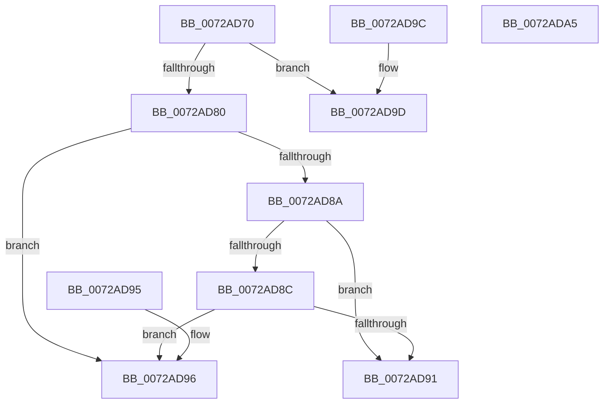

# IopCompareReqAlternativePriority

- RVA: `0x0072AD70`–`0x0072ADA6` (길이 `54` bytes)
- VA: `0x000000014072AD70`
- 실행 섹션: `PAGE`
- PDB 이름 있음: `예`; PDB Function 태그: `아니요`
- unwind 정보 RVA: `0x000DB714`
- 디코드: `23`개 명령, `54/54` bytes 표시
- 미해석 바이트: `0` (있으면 어셈블리에 `.byte`로 보존)

> 이 문서는 커널 이미지의 기계어와 PDB 기호를 분석해 생성했습니다. 4번과 5번은 함수 원형과 자료형을 바이너리 사용 방식에서 추정한 C 해석이며 원본 소스 복구 결과는 아닙니다.

## 1. Dependencies

- 직접 호출 지점: **0**; 고유 호출 대상: **0**
- 직접 호출자로 확인된 함수: **0**
- RIP 상대 이미지 참조: **0**

### Outgoing calls
- 직접 디코드된 call 명령이 없습니다.

### Direct callers
- 이 함수 시작 RVA로 연결되는 직접 call은 확인되지 않았습니다. 간접 호출은 완전히 역산할 수 없습니다.

### Static image references
- 디코드된 RIP-relative 메모리 참조가 없습니다.

## 2. Other-region calls and transfers

- 다른 실행 섹션으로 향하는 call: **0**
- 별도 외부 분기/꼬리 이동을 확인하지 못했습니다.

## 3. Assembly (complete function range)

```asm
0072AD70  4C 8B 01                        mov r8, qword ptr [rcx]
0072AD73  4C 8B 0A                        mov r9, qword ptr [rdx]
0072AD76  41 8B 00                        mov eax, dword ptr [r8]
0072AD79  41 8B 09                        mov ecx, dword ptr [r9]
0072AD7C  3B C8                           cmp ecx, eax
0072AD7E  75 1D                           jne 0x14072ad9d
0072AD80  41 8B 40 04                     mov eax, dword ptr [r8 + 4]
0072AD84  41 3B 41 04                     cmp eax, dword ptr [r9 + 4]
0072AD88  77 0C                           ja 0x14072ad96
0072AD8A  72 05                           jb 0x14072ad91
0072AD8C  4D 3B C1                        cmp r8, r9
0072AD8F  73 05                           jae 0x14072ad96
0072AD91  83 C8 FF                        or eax, 0xffffffff
0072AD94  C3                              ret
0072AD95  CC                              int3
0072AD96  B8 01 00 00 00                  mov eax, 1
0072AD9B  C3                              ret
0072AD9C  CC                              int3
0072AD9D  1B C0                           sbb eax, eax
0072AD9F  83 E0 02                        and eax, 2
0072ADA2  FF C8                           dec eax
0072ADA4  C3                              ret
0072ADA5  CC                              int3
```

## 4. C-style interpretation (structured pseudocode)

```c
__int64 __fastcall IopCompareReqAlternativePriority(__int64 a1, __int64 a2)
{
    __int64 result;

    if (((unsigned int)((unsigned int)(*(unsigned int *)(*(unsigned __int64 *)(a2))))) != ((unsigned int)((unsigned int)(*(unsigned int *)(*(unsigned __int64 *)(a1)))))) goto loc_0072AD9D;
    if (((unsigned int)((unsigned int)(*(unsigned int *)(*(unsigned __int64 *)(a1) + 4)))) > (*(unsigned int *)(*(unsigned __int64 *)(a2) + 4))) goto loc_0072AD96;
    if (((unsigned int)((unsigned int)(*(unsigned int *)(*(unsigned __int64 *)(a1) + 4)))) < (*(unsigned int *)(*(unsigned __int64 *)(a2) + 4))) goto loc_0072AD91;
    if ((*(unsigned __int64 *)(a1)) >= (*(unsigned __int64 *)(a2))) goto loc_0072AD96;
loc_0072AD91:
    result = (unsigned int)(((unsigned int)(*(unsigned int *)(*(unsigned __int64 *)(a1) + 4))) | (0xFFFFFFFFULL));
    return result;
loc_0072AD96:
    return 1;
loc_0072AD9D:
    result = (unsigned int)((1) & (2));
    result = (unsigned int)((result) - 1);
    return result;
}
```

## 5. (Beta) C Style

```c
int64_t IopCompareReqAlternativePriority(void *Arg1, void *Arg2)
{
    uint8_t *arg1 = (uint8_t *)Arg1;
    uint8_t *arg2 = (uint8_t *)Arg2;

    int64_t result;

    if (((uint32_t)((uint32_t)(*(uint32_t *)(*(uint64_t *)(arg2))))) != ((uint32_t)((uint32_t)(*(uint32_t *)(*(uint64_t *)(arg1)))))) goto loc_0072AD9D;
    if (((uint32_t)((uint32_t)(*(uint32_t *)(*(uint64_t *)(arg1) + 0x4)))) > (*(uint32_t *)(*(uint64_t *)(arg2) + 0x4))) goto loc_0072AD96;
    if (((uint32_t)((uint32_t)(*(uint32_t *)(*(uint64_t *)(arg1) + 0x4)))) < (*(uint32_t *)(*(uint64_t *)(arg2) + 0x4))) goto loc_0072AD91;
    if ((*(uint64_t *)(arg1)) >= (*(uint64_t *)(arg2))) goto loc_0072AD96;
loc_0072AD91:
    result = (uint32_t)(((uint32_t)(*(uint32_t *)(*(uint64_t *)(arg1) + 0x4))) | (0xFFFFFFFFULL));
    return result;
loc_0072AD96:
    return 1;
loc_0072AD9D:
    result = (uint32_t)((1) & (2));
    result = (uint32_t)((result) - 1);
    return result;
}
```

### 관측된 메모리 오프셋

구조체 형식이 확인되지 않은 접근은 인자 기준의 오프셋으로만 기록했습니다.

| 기준 인자 | 오프셋 표현 | 폭 (bit) | 접근 |
|---|---:|---:|---|
| `Arg1` | `+ 0x0` | `64` | `R` |
| `Arg2` | `+ 0x0` | `64` | `R` |

## 6. Execution-region graph

[열기: 2D/3D 그래프와 함수 탐색 컨트롤 패널](../../../control-panel.html?section=page&rva=0x0072AD70&view=graph)

- 2D 그래프는 위에서 아래로 흐르고, 3D 그래프는 빈 공간을 드래그해 회전합니다. Shift+드래그는 이동, 휠은 확대·축소, 함수 노드 선택은 대상 보고서 이동입니다.

### Static fallback


