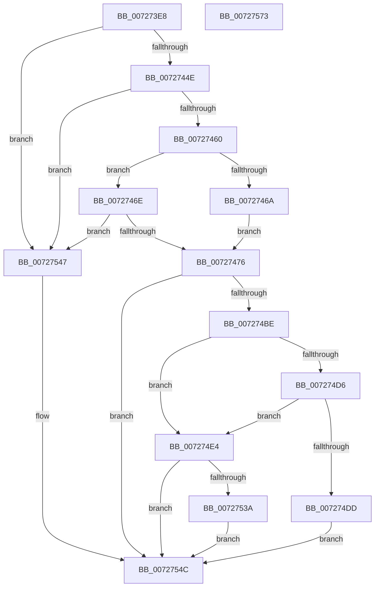

# IopConnectInterruptFullySpecified

- RVA: `0x007273E8`–`0x00727574` (길이 `396` bytes)
- VA: `0x00000001407273E8`
- 실행 섹션: `PAGE`
- PDB 이름 있음: `예`; PDB Function 태그: `아니요`
- unwind 정보 RVA: `0x00093850`
- 디코드: `114`개 명령, `396/396` bytes 표시
- 미해석 바이트: `0` (있으면 어셈블리에 `.byte`로 보존)

> 이 문서는 커널 이미지의 기계어와 PDB 기호를 분석해 생성했습니다. 4번과 5번은 함수 원형과 자료형을 바이너리 사용 방식에서 추정한 C 해석이며 원본 소스 복구 결과는 아닙니다.

## 1. Dependencies

- 직접 호출 지점: **6**; 고유 호출 대상: **6**
- 직접 호출자로 확인된 함수: **2**
- RIP 상대 이미지 참조: **2**

### Outgoing calls
- `0x00727434` → [memset](../../text/6C/memset_function_006C6C40.md) (function, `0x006C6C40`)
- `0x00727453` → [KeVerifyGroupAffinity](../../text/47/KeVerifyGroupAffinity_function_0047B1F0.md) (function, `0x0047B1F0`)
- `0x007274B1` → [HalGetVectorInput](../../text/54/HalGetVectorInput_function_00542560.md) (function, `0x00542560`)
- `0x007274CA` → [guard_dispatch_icall](../../text/6B/guard_dispatch_icall_function_006BAAD0.md) (function, `0x006BAAD0`)
- `0x00727531` → [IopConnectInterrupt](../90/IopConnectInterrupt_function_00900B40.md) (function, `0x00900B40`)
- `0x00727553` → [_security_check_cookie](../../text/6A/_security_check_cookie_function_006AC640.md) (function, `0x006AC640`)

### Direct callers
- [IoConnectInterrupt](IoConnectInterrupt_function_00727050.md) at `0x007270DD`
- [sub_00B2000C](../B2/Unknown_function_00B2000C.md) at `0x00B20064`

### Static image references
- `0x00727404` → RVA `0x00E0A740` (`.data`; read)
- `0x007274BE` → RVA `0x00E009E0` (`.data`; read)

## 2. Other-region calls and transfers

- 다른 실행 섹션으로 향하는 call: **5**
  - `0x00727434` → [memset](../../text/6C/memset_function_006C6C40.md) (`PAGE` → `.text`)
  - `0x00727453` → [KeVerifyGroupAffinity](../../text/47/KeVerifyGroupAffinity_function_0047B1F0.md) (`PAGE` → `.text`)
  - `0x007274B1` → [HalGetVectorInput](../../text/54/HalGetVectorInput_function_00542560.md) (`PAGE` → `.text`)
  - `0x007274CA` → [guard_dispatch_icall](../../text/6B/guard_dispatch_icall_function_006BAAD0.md) (`PAGE` → `.text`)
  - `0x00727553` → [_security_check_cookie](../../text/6A/_security_check_cookie_function_006AC640.md) (`PAGE` → `.text`)
- 별도 외부 분기/꼬리 이동을 확인하지 못했습니다.

## 3. Assembly (complete function range)

```asm
007273E8  48 89 5C 24 18                  mov qword ptr [rsp + 0x18], rbx
007273ED  55                              push rbp
007273EE  56                              push rsi
007273EF  57                              push rdi
007273F0  41 54                           push r12
007273F2  41 55                           push r13
007273F4  41 56                           push r14
007273F6  41 57                           push r15
007273F8  48 8D 6C 24 F9                  lea rbp, [rsp - 7]
007273FD  48 81 EC E0 00 00 00            sub rsp, 0xe0
00727404  48 8B 05 35 33 6E 00            mov rax, qword ptr [rip + 0x6e3335]
0072740B  48 33 C4                        xor rax, rsp
0072740E  48 89 45 F7                     mov qword ptr [rbp - 9], rax
00727412  48 8B B5 97 00 00 00            mov rsi, qword ptr [rbp + 0x97]
00727419  33 C0                           xor eax, eax
0072741B  4D 8B F8                        mov r15, r8
0072741E  89 45 9B                        mov dword ptr [rbp - 0x65], eax
00727421  4C 8B EA                        mov r13, rdx
00727424  4C 8B F1                        mov r14, rcx
00727427  33 D2                           xor edx, edx
00727429  48 8D 4D 97                     lea rcx, [rbp - 0x69]
0072742D  44 8D 40 5C                     lea r8d, [rax + 0x5c]
00727431  4D 8B E1                        mov r12, r9
00727434  E8 07 F8 F9 FF                  call 0x1406c6c40
00727439  33 FF                           xor edi, edi
0072743B  89 7D 87                        mov dword ptr [rbp - 0x79], edi
0072743E  48 89 7D 8F                     mov qword ptr [rbp - 0x71], rdi
00727442  89 7D 8B                        mov dword ptr [rbp - 0x75], edi
00727445  4D 85 FF                        test r15, r15
00727448  0F 84 F9 00 00 00               je 0x140727547
0072744E  33 D2                           xor edx, edx
00727450  48 8B CE                        mov rcx, rsi
00727453  E8 98 3D D5 FF                  call 0x14047b1f0
00727458  84 C0                           test al, al
0072745A  0F 84 E7 00 00 00               je 0x140727547
00727460  8A 5D 7F                        mov bl, byte ptr [rbp + 0x7f]
00727463  8A 45 77                        mov al, byte ptr [rbp + 0x77]
00727466  84 DB                           test bl, bl
00727468  75 04                           jne 0x14072746e
0072746A  8A D8                           mov bl, al
0072746C  EB 08                           jmp 0x140727476
0072746E  3A D8                           cmp bl, al
00727470  0F 82 D1 00 00 00               jb 0x140727547
00727476  0F 10 06                        movups xmm0, xmmword ptr [rsi]
00727479  8B 4D 6F                        mov ecx, dword ptr [rbp + 0x6f]
0072747C  4C 8D 4D 8B                     lea r9, [rbp - 0x75]
00727480  83 65 9F 00                     and dword ptr [rbp - 0x61], 0
00727484  4C 8D 45 87                     lea r8, [rbp - 0x79]
00727488  88 45 A7                        mov byte ptr [rbp - 0x59], al
0072748B  48 8D 55 B7                     lea rdx, [rbp - 0x49]
0072748F  8B 85 87 00 00 00               mov eax, dword ptr [rbp + 0x87]
00727495  BF 01 00 00 00                  mov edi, 1
0072749A  89 45 AF                        mov dword ptr [rbp - 0x51], eax
0072749D  48 8D 45 C7                     lea rax, [rbp - 0x39]
007274A1  48 89 44 24 20                  mov qword ptr [rsp + 0x20], rax
007274A6  89 7D 97                        mov dword ptr [rbp - 0x69], edi
007274A9  89 4D A3                        mov dword ptr [rbp - 0x5d], ecx
007274AC  F3 0F 7F 45 B7                  movdqu xmmword ptr [rbp - 0x49], xmm0
007274B1  E8 AA B0 E1 FF                  call 0x140542560
007274B6  85 C0                           test eax, eax
007274B8  0F 88 8E 00 00 00               js 0x14072754c
007274BE  48 8B 05 1B 95 6D 00            mov rax, qword ptr [rip + 0x6d951b]
007274C5  33 C9                           xor ecx, ecx
007274C7  8B 55 87                        mov edx, dword ptr [rbp - 0x79]
007274CA  E8 01 36 F9 FF                  call 0x1406baad0
007274CF  8B 4D 8B                        mov ecx, dword ptr [rbp - 0x75]
007274D2  84 C0                           test al, al
007274D4  75 0E                           jne 0x1407274e4
007274D6  8D 41 FD                        lea eax, [rcx - 3]
007274D9  3B C7                           cmp eax, edi
007274DB  77 07                           ja 0x1407274e4
007274DD  B8 BB 00 00 C0                  mov eax, 0xc00000bb
007274E2  EB 68                           jmp 0x14072754c
007274E4  8B 45 87                        mov eax, dword ptr [rbp - 0x79]
007274E7  4D 8B C7                        mov r8, r15
007274EA  49 83 26 00                     and qword ptr [r14], 0
007274EE  49 8B D5                        mov rdx, r13
007274F1  40 84 7D DB                     test byte ptr [rbp - 0x25], dil
007274F5  89 45 D7                        mov dword ptr [rbp - 0x29], eax
007274F8  0F B6 85 8F 00 00 00            movzx eax, byte ptr [rbp + 0x8f]
007274FF  0F 44 F8                        cmove edi, eax
00727502  89 4D AB                        mov dword ptr [rbp - 0x55], ecx
00727505  48 8D 45 97                     lea rax, [rbp - 0x69]
00727509  45 33 C9                        xor r9d, r9d
0072750C  48 89 44 24 50                  mov qword ptr [rsp + 0x50], rax
00727511  48 8D 4D 8F                     lea rcx, [rbp - 0x71]
00727515  48 8B 45 67                     mov rax, qword ptr [rbp + 0x67]
00727519  40 88 7C 24 40                  mov byte ptr [rsp + 0x40], dil
0072751E  88 5C 24 38                     mov byte ptr [rsp + 0x38], bl
00727522  48 89 44 24 30                  mov qword ptr [rsp + 0x30], rax
00727527  83 64 24 28 00                  and dword ptr [rsp + 0x28], 0
0072752C  4C 89 64 24 20                  mov qword ptr [rsp + 0x20], r12
00727531  E8 0A 96 1D 00                  call 0x140900b40
00727536  85 C0                           test eax, eax
00727538  78 12                           js 0x14072754c
0072753A  48 8B 4D 8F                     mov rcx, qword ptr [rbp - 0x71]
0072753E  48 83 C1 70                     add rcx, 0x70
00727542  49 89 0E                        mov qword ptr [r14], rcx
00727545  EB 05                           jmp 0x14072754c
00727547  B8 0D 00 00 C0                  mov eax, 0xc000000d
0072754C  48 8B 4D F7                     mov rcx, qword ptr [rbp - 9]
00727550  48 33 CC                        xor rcx, rsp
00727553  E8 E8 50 F8 FF                  call 0x1406ac640
00727558  48 8B 9C 24 30 01 00 00         mov rbx, qword ptr [rsp + 0x130]
00727560  48 81 C4 E0 00 00 00            add rsp, 0xe0
00727567  41 5F                           pop r15
00727569  41 5E                           pop r14
0072756B  41 5D                           pop r13
0072756D  41 5C                           pop r12
0072756F  5F                              pop rdi
00727570  5E                              pop rsi
00727571  5D                              pop rbp
00727572  C3                              ret
00727573  CC                              int3
```

## 4. C-style interpretation (structured pseudocode)

```c
__int64 __fastcall IopConnectInterruptFullySpecified(__int64 a1, __int64 a2, __int64 a3, __int64 a4, __int64 a5, unsigned int a6, unsigned __int8 a7, unsigned __int8 a8, unsigned int a9, unsigned __int8 a10, __int64 a11)
{
    __int64 result;
    __int64 v_rdi;
    __int64 v_rsp;
    unsigned __int64 v_stack_m3F;
    unsigned __int64 v_stack_m48;
    unsigned __int8 v_stack_m64;
    unsigned int v_stack_m68;
    unsigned __int64 v_stack_m78;
    unsigned __int64 v_stack_m88;
    unsigned int v_stack_m90;
    unsigned int v_stack_m94;
    unsigned __int8 v_stack_m98;
    unsigned int v_stack_m9C;
    unsigned int v_stack_mA0;
    unsigned int v_stack_mA4;
    unsigned __int64 v_stack_mA8;
    unsigned __int64 v_stack_mB0;
    unsigned int v_stack_mB4;
    unsigned int v_stack_mB8;
    unsigned __int64 v_stack_mC8;
    unsigned __int8 v_stack_mD8;
    unsigned __int8 v_stack_mE0;
    unsigned __int64 v_stack_mE8;
    unsigned int v_stack_mF0;
    unsigned __int64 v_stack_mF8;
    unsigned __int64 v_stack_p18;

    v_stack_p18 = v_rbx;
    v_rsp = (v_rsp) - (224);
    result = (*(unsigned __int64 *)(v_rip + 7222069)) ^ (v_rsp);
    v_stack_m48 = result;
    result = 0;
    v_stack_mA4 = 0;
    a2 = 0;
    result = memset(v_stack_mA8, a2, result + 92, a4);
    v_rdi = 0;
    v_stack_mB8 = 0;
    v_stack_mB0 = 0;
    v_stack_mB4 = 0;
    if (a3 == 0) goto loc_00727547;
    a2 = 0;
    result = KeVerifyGroupAffinity(a11, a2, result + 92, a4);
    if ((unsigned __int8)(result) == 0) goto loc_00727547;
    if (a8 != 0) goto loc_0072746E;
    goto loc_00727476;
loc_0072746E:
    if (a7 < a7) goto loc_00727547;
loc_00727476:
    v_stack_m98 = a7;
    v_stack_m90 = (unsigned int)((unsigned int)(a9));
    v_stack_mF8 = v_stack_m78;
    v_stack_mA8 = 1;
    v_stack_m9C = (unsigned int)((unsigned int)(a6));
    v_stack_m88 = v_xmm0;
    result = HalGetVectorInput((unsigned int)(a6), v_stack_m88, v_stack_mB8, v_stack_mB4);
    if (sign_flag) goto loc_0072754C;
    a1 = 0;
    result = guard_dispatch_icall(a1, (unsigned int)(v_stack_mB8), v_stack_mB8, v_stack_mB4);
    if ((unsigned __int8)(result) != 0) goto loc_007274E4;
    if (((unsigned int)((unsigned int)(v_stack_mB4) - 3)) > 1) goto loc_007274E4;
    goto loc_0072754C;
loc_007274E4:
    v_stack_m68 = (unsigned int)((unsigned int)(v_stack_mB8));
    v_rdi = 1;
    if (((v_stack_m64) & (1)) == 0) { v_rdi = a10; }
    v_stack_m94 = (unsigned int)((unsigned int)(v_stack_mB4));
    a4 = 0;
    v_stack_mC8 = v_stack_mA8;
    v_stack_mD8 = (unsigned __int8)(v_rdi);
    v_stack_mE0 = a7;
    v_stack_mE8 = a5;
    v_stack_mF8 = 0;
    result = IopConnectInterrupt(v_stack_mB0, 0, a3, a4);
    if (sign_flag) goto loc_0072754C;
    a1 = (v_stack_mB0) + (112);
    *(unsigned __int64 *)(a1) = a1;
    goto loc_0072754C;
loc_00727547:
loc_0072754C:
    a1 = (v_stack_m48) ^ (v_rsp);
    result = _security_check_cookie(a1, 0, a3, a4);
    v_rsp = (v_rsp) + (224);
    return result;
}
```

## 5. (Beta) C Style

```c
int64_t IopConnectInterruptFullySpecified(void *Arg1, int64_t Arg2, int64_t Arg3, int64_t Arg4, int64_t Arg5, uint32_t Arg6, uint8_t Arg7, uint8_t Arg8, uint32_t Arg9, uint8_t Arg10, void *Arg11)
{
    uint8_t *arg1 = (uint8_t *)Arg1;
    uint8_t *arg11 = (uint8_t *)Arg11;

    int64_t result;
    int64_t local_rdi;
    int64_t local_rsp;
    uint64_t v_stack_m3F;
    uint64_t v_stack_m48;
    uint8_t v_stack_m64;
    uint32_t v_stack_m68;
    uint64_t v_stack_m78;
    uint64_t v_stack_m88;
    uint32_t v_stack_m90;
    uint32_t v_stack_m94;
    uint8_t v_stack_m98;
    uint32_t v_stack_m9C;
    uint32_t v_stack_mA0;
    uint32_t v_stack_mA4;
    uint64_t v_stack_mA8;
    uint64_t v_stack_mB0;
    uint32_t v_stack_mB4;
    uint32_t v_stack_mB8;
    uint64_t v_stack_mC8;
    uint8_t v_stack_mD8;
    uint8_t v_stack_mE0;
    uint64_t v_stack_mE8;
    uint32_t v_stack_mF0;
    uint64_t v_stack_mF8;
    uint64_t v_stack_p18;

    v_stack_p18 = local_rbx;
    local_rsp = (local_rsp) - (224);
    result = (*(uint64_t *)(v_rip + 0x6E3335)) ^ (local_rsp);
    v_stack_m48 = result;
    result = 0;
    v_stack_mA4 = 0;
    Arg2 = 0;
    result = memset(v_stack_mA8, Arg2, result + 92, Arg4);
    local_rdi = 0;
    v_stack_mB8 = 0;
    v_stack_mB0 = 0;
    v_stack_mB4 = 0;
    if (Arg3 == 0) goto loc_00727547;
    Arg2 = 0;
    result = KeVerifyGroupAffinity(Arg11, Arg2, result + 92, Arg4);
    if ((uint8_t)(result) == 0) goto loc_00727547;
    if (Arg8 != 0) goto loc_0072746E;
    goto loc_00727476;
loc_0072746E:
    if (Arg7 < Arg7) goto loc_00727547;
loc_00727476:
    v_stack_m98 = Arg7;
    v_stack_m90 = (uint32_t)((uint32_t)(Arg9));
    v_stack_mF8 = v_stack_m78;
    v_stack_mA8 = 1;
    v_stack_m9C = (uint32_t)((uint32_t)(Arg6));
    v_stack_m88 = v_xmm0;
    result = HalGetVectorInput((uint32_t)(Arg6), v_stack_m88, v_stack_mB8, v_stack_mB4);
    if (sign_flag) goto loc_0072754C;
    Arg1 = 0;
    result = guard_dispatch_icall(Arg1, (uint32_t)(v_stack_mB8), v_stack_mB8, v_stack_mB4);
    if ((uint8_t)(result) != 0) goto loc_007274E4;
    if (((uint32_t)((uint32_t)(v_stack_mB4) - 3)) > 1) goto loc_007274E4;
    goto loc_0072754C;
loc_007274E4:
    v_stack_m68 = (uint32_t)((uint32_t)(v_stack_mB8));
    local_rdi = 1;
    if (((v_stack_m64) & (1)) == 0) { local_rdi = Arg10; }
    v_stack_m94 = (uint32_t)((uint32_t)(v_stack_mB4));
    Arg4 = 0;
    v_stack_mC8 = v_stack_mA8;
    v_stack_mD8 = (uint8_t)(local_rdi);
    v_stack_mE0 = Arg7;
    v_stack_mE8 = Arg5;
    v_stack_mF8 = 0;
    result = IopConnectInterrupt(v_stack_mB0, 0, Arg3, Arg4);
    if (sign_flag) goto loc_0072754C;
    Arg1 = (v_stack_mB0) + (112);
    *(void **)(arg1) = Arg1;
    goto loc_0072754C;
loc_00727547:
loc_0072754C:
    Arg1 = (v_stack_m48) ^ (local_rsp);
    result = _security_check_cookie(Arg1, 0, Arg3, Arg4);
    local_rsp = (local_rsp) + (224);
    return result;
}
```

### 관측된 메모리 오프셋

구조체 형식이 확인되지 않은 접근은 인자 기준의 오프셋으로만 기록했습니다.

| 기준 인자 | 오프셋 표현 | 폭 (bit) | 접근 |
|---|---:|---:|---|
| `Arg1` | `+ 0x0` | `64` | `R/W` |
| `Arg1` | `+ 0x0` | `64` | `W` |
| `Arg11` | `+ 0x0` | `128` | `R` |

## 6. Execution-region graph

[열기: 2D/3D 그래프와 함수 탐색 컨트롤 패널](../../../control-panel.html?section=page&rva=0x007273E8&view=graph)

- 2D 그래프는 위에서 아래로 흐르고, 3D 그래프는 빈 공간을 드래그해 회전합니다. Shift+드래그는 이동, 휠은 확대·축소, 함수 노드 선택은 대상 보고서 이동입니다.

### Static fallback


