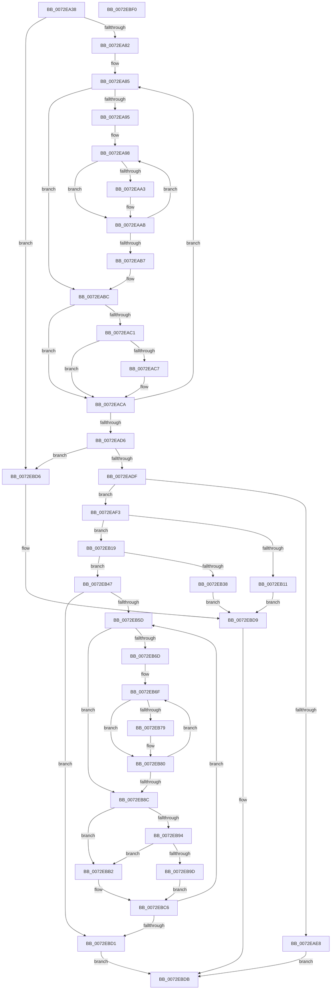

# IopCreateCmResourceList

- RVA: `0x0072EA38`–`0x0072EBF1` (길이 `441` bytes)
- VA: `0x000000014072EA38`
- 실행 섹션: `PAGE`
- PDB 이름 있음: `예`; PDB Function 태그: `아니요`
- unwind 정보 RVA: `0x000C88A8`
- 디코드: `140`개 명령, `441/441` bytes 표시
- 미해석 바이트: `0` (있으면 어셈블리에 `.byte`로 보존)

> 이 문서는 커널 이미지의 기계어와 PDB 기호를 분석해 생성했습니다. 4번과 5번은 함수 원형과 자료형을 바이너리 사용 방식에서 추정한 C 해석이며 원본 소스 복구 결과는 아닙니다.

## 1. Dependencies

- 직접 호출 지점: **5**; 고유 호출 대상: **3**
- 직접 호출자로 확인된 함수: **1**
- RIP 상대 이미지 참조: **1**

### Outgoing calls
- `0x0072EB04` → [ExAllocatePool2](../../poolcode/B8/ExAllocatePool2_function_00B820F0.md) (function, `0x00B820F0`)
- `0x0072EB28` → [ExAllocatePool2](../../poolcode/B8/ExAllocatePool2_function_00B820F0.md) (function, `0x00B820F0`)
- `0x0072EB3D` → [ExFreePoolWithTag](../../poolcode/B8/ExFreePoolWithTag_function_00B82870.md) (function, `0x00B82870`)
- `0x0072EBA8` → [memcpy](../../text/6C/memcpy_function_006C6840.md) (function, `0x006C6840`)
- `0x0072EBBE` → [memcpy](../../text/6C/memcpy_function_006C6840.md) (function, `0x006C6840`)

### Direct callers
- [IopAllocateLegacyBootResources](../../init/C3/IopAllocateLegacyBootResources_function_00C34138.md) at `0x00C3417A`

### Static image references
- `0x0072EA55` → RVA `0x010086A0` (`INITDATA`; read)

## 2. Other-region calls and transfers

- 다른 실행 섹션으로 향하는 call: **5**
  - `0x0072EB04` → [ExAllocatePool2](../../poolcode/B8/ExAllocatePool2_function_00B820F0.md) (`PAGE` → `POOLCODE`)
  - `0x0072EB28` → [ExAllocatePool2](../../poolcode/B8/ExAllocatePool2_function_00B820F0.md) (`PAGE` → `POOLCODE`)
  - `0x0072EB3D` → [ExFreePoolWithTag](../../poolcode/B8/ExFreePoolWithTag_function_00B82870.md) (`PAGE` → `POOLCODE`)
  - `0x0072EBA8` → [memcpy](../../text/6C/memcpy_function_006C6840.md) (`PAGE` → `.text`)
  - `0x0072EBBE` → [memcpy](../../text/6C/memcpy_function_006C6840.md) (`PAGE` → `.text`)
- 별도 외부 분기/꼬리 이동을 확인하지 못했습니다.

## 3. Assembly (complete function range)

```asm
0072EA38  48 89 5C 24 08                  mov qword ptr [rsp + 8], rbx
0072EA3D  44 89 44 24 18                  mov dword ptr [rsp + 0x18], r8d
0072EA42  89 54 24 10                     mov dword ptr [rsp + 0x10], edx
0072EA46  55                              push rbp
0072EA47  56                              push rsi
0072EA48  57                              push rdi
0072EA49  41 54                           push r12
0072EA4B  41 55                           push r13
0072EA4D  41 56                           push r14
0072EA4F  41 57                           push r15
0072EA51  48 83 EC 20                     sub rsp, 0x20
0072EA55  4C 8B 3D 44 9C 8D 00            mov r15, qword ptr [rip + 0x8d9c44]
0072EA5C  45 33 E4                        xor r12d, r12d
0072EA5F  4D 8B F1                        mov r14, r9
0072EA62  44 8B DA                        mov r11d, edx
0072EA65  45 8B C8                        mov r9d, r8d
0072EA68  BD 04 00 00 00                  mov ebp, 4
0072EA6D  41 8B FC                        mov edi, r12d
0072EA70  41 8B 07                        mov eax, dword ptr [r15]
0072EA73  49 8D 77 04                     lea rsi, [r15 + 4]
0072EA77  48 8B CE                        mov rcx, rsi
0072EA7A  85 C0                           test eax, eax
0072EA7C  0F 84 54 01 00 00               je 0x14072ebd6
0072EA82  44 8B D0                        mov r10d, eax
0072EA85  8B 41 0C                        mov eax, dword ptr [rcx + 0xc]
0072EA88  4C 8D 41 10                     lea r8, [rcx + 0x10]
0072EA8C  BA 10 00 00 00                  mov edx, 0x10
0072EA91  85 C0                           test eax, eax
0072EA93  74 27                           je 0x14072eabc
0072EA95  44 8B C8                        mov r9d, eax
0072EA98  41 80 38 05                     cmp byte ptr [r8], 5
0072EA9C  B8 14 00 00 00                  mov eax, 0x14
0072EAA1  75 08                           jne 0x14072eaab
0072EAA3  41 8B 40 04                     mov eax, dword ptr [r8 + 4]
0072EAA7  48 83 C0 14                     add rax, 0x14
0072EAAB  48 03 D0                        add rdx, rax
0072EAAE  4C 03 C0                        add r8, rax
0072EAB1  49 83 E9 01                     sub r9, 1
0072EAB5  75 E1                           jne 0x14072ea98
0072EAB7  44 8B 4C 24 70                  mov r9d, dword ptr [rsp + 0x70]
0072EABC  44 39 19                        cmp dword ptr [rcx], r11d
0072EABF  75 09                           jne 0x14072eaca
0072EAC1  44 39 49 04                     cmp dword ptr [rcx + 4], r9d
0072EAC5  75 03                           jne 0x14072eaca
0072EAC7  48 03 FA                        add rdi, rdx
0072EACA  48 03 EA                        add rbp, rdx
0072EACD  48 03 CA                        add rcx, rdx
0072EAD0  49 83 EA 01                     sub r10, 1
0072EAD4  75 AF                           jne 0x14072ea85
0072EAD6  48 85 FF                        test rdi, rdi
0072EAD9  0F 84 F7 00 00 00               je 0x14072ebd6
0072EADF  48 83 C7 04                     add rdi, 4
0072EAE3  48 3B FD                        cmp rdi, rbp
0072EAE6  75 0B                           jne 0x14072eaf3
0072EAE8  4D 89 26                        mov qword ptr [r14], r12
0072EAEB  49 8B C7                        mov rax, r15
0072EAEE  E9 E8 00 00 00                  jmp 0x14072ebdb
0072EAF3  41 BD 50 70 20 20               mov r13d, 0x20207050
0072EAF9  48 8B D7                        mov rdx, rdi
0072EAFC  45 8B C5                        mov r8d, r13d
0072EAFF  B9 00 01 00 00                  mov ecx, 0x100
0072EB04  E8 E7 35 45 00                  call 0x140b820f0
0072EB09  48 8B D8                        mov rbx, rax
0072EB0C  48 85 C0                        test rax, rax
0072EB0F  75 08                           jne 0x14072eb19
0072EB11  4D 89 26                        mov qword ptr [r14], r12
0072EB14  E9 C0 00 00 00                  jmp 0x14072ebd9
0072EB19  48 2B EF                        sub rbp, rdi
0072EB1C  45 8B C5                        mov r8d, r13d
0072EB1F  B9 00 01 00 00                  mov ecx, 0x100
0072EB24  48 8D 55 04                     lea rdx, [rbp + 4]
0072EB28  E8 C3 35 45 00                  call 0x140b820f0
0072EB2D  49 89 06                        mov qword ptr [r14], rax
0072EB30  48 8B E8                        mov rbp, rax
0072EB33  48 85 C0                        test rax, rax
0072EB36  75 0F                           jne 0x14072eb47
0072EB38  33 D2                           xor edx, edx
0072EB3A  48 8B CB                        mov rcx, rbx
0072EB3D  E8 2E 3D 45 00                  call 0x140b82870
0072EB42  E9 92 00 00 00                  jmp 0x14072ebd9
0072EB47  44 89 23                        mov dword ptr [rbx], r12d
0072EB4A  4C 8D 68 04                     lea r13, [rax + 4]
0072EB4E  44 89 20                        mov dword ptr [rax], r12d
0072EB51  45 33 F6                        xor r14d, r14d
0072EB54  4C 8D 63 04                     lea r12, [rbx + 4]
0072EB58  45 39 37                        cmp dword ptr [r15], r14d
0072EB5B  76 74                           jbe 0x14072ebd1
0072EB5D  8B 46 0C                        mov eax, dword ptr [rsi + 0xc]
0072EB60  48 8D 4E 10                     lea rcx, [rsi + 0x10]
0072EB64  BF 10 00 00 00                  mov edi, 0x10
0072EB69  85 C0                           test eax, eax
0072EB6B  74 1F                           je 0x14072eb8c
0072EB6D  8B D0                           mov edx, eax
0072EB6F  80 39 05                        cmp byte ptr [rcx], 5
0072EB72  B8 14 00 00 00                  mov eax, 0x14
0072EB77  75 07                           jne 0x14072eb80
0072EB79  8B 41 04                        mov eax, dword ptr [rcx + 4]
0072EB7C  48 83 C0 14                     add rax, 0x14
0072EB80  48 03 F8                        add rdi, rax
0072EB83  48 03 C8                        add rcx, rax
0072EB86  48 83 EA 01                     sub rdx, 1
0072EB8A  75 E3                           jne 0x14072eb6f
0072EB8C  8B 44 24 68                     mov eax, dword ptr [rsp + 0x68]
0072EB90  39 06                           cmp dword ptr [rsi], eax
0072EB92  75 1E                           jne 0x14072ebb2
0072EB94  8B 44 24 70                     mov eax, dword ptr [rsp + 0x70]
0072EB98  39 46 04                        cmp dword ptr [rsi + 4], eax
0072EB9B  75 15                           jne 0x14072ebb2
0072EB9D  FF 03                           inc dword ptr [rbx]
0072EB9F  4C 8B C7                        mov r8, rdi
0072EBA2  48 8B D6                        mov rdx, rsi
0072EBA5  49 8B CC                        mov rcx, r12
0072EBA8  E8 93 7C F9 FF                  call 0x1406c6840
0072EBAD  4C 03 E7                        add r12, rdi
0072EBB0  EB 14                           jmp 0x14072ebc6
0072EBB2  FF 45 00                        inc dword ptr [rbp]
0072EBB5  4C 8B C7                        mov r8, rdi
0072EBB8  48 8B D6                        mov rdx, rsi
0072EBBB  49 8B CD                        mov rcx, r13
0072EBBE  E8 7D 7C F9 FF                  call 0x1406c6840
0072EBC3  4C 03 EF                        add r13, rdi
0072EBC6  48 03 F7                        add rsi, rdi
0072EBC9  41 FF C6                        inc r14d
0072EBCC  45 3B 37                        cmp r14d, dword ptr [r15]
0072EBCF  72 8C                           jb 0x14072eb5d
0072EBD1  48 8B C3                        mov rax, rbx
0072EBD4  EB 05                           jmp 0x14072ebdb
0072EBD6  4D 89 3E                        mov qword ptr [r14], r15
0072EBD9  33 C0                           xor eax, eax
0072EBDB  48 8B 5C 24 60                  mov rbx, qword ptr [rsp + 0x60]
0072EBE0  48 83 C4 20                     add rsp, 0x20
0072EBE4  41 5F                           pop r15
0072EBE6  41 5E                           pop r14
0072EBE8  41 5D                           pop r13
0072EBEA  41 5C                           pop r12
0072EBEC  5F                              pop rdi
0072EBED  5E                              pop rsi
0072EBEE  5D                              pop rbp
0072EBEF  C3                              ret
0072EBF0  CC                              int3
```

## 4. C-style interpretation (structured pseudocode)

```c
__int64 __fastcall IopCreateCmResourceList(__int64 a1, int a2, int a3, __int64 a4)
{
    __int64 result;
    __int64 v_r10;
    __int64 v_r12;
    __int64 v_r13;
    __int64 v_r14;
    __int64 v_rbp;
    __int64 v_rdi;
    __int64 v_rsi;
    __int64 v_rsp;
    unsigned int v_stack_p10;
    unsigned int v_stack_p18;
    unsigned __int64 v_stack_p8;

    v_stack_p8 = v_rbx;
    v_stack_p18 = a3;
    v_stack_p10 = a2;
    v_rsp = (v_rsp) - (32);
    v_r12 = 0;
    if ((unsigned int)((unsigned int)(*(unsigned int *)(*(unsigned __int64 *)(v_rip + 9280580)))) == 0) goto loc_0072EBD6;
loc_0072EA85:
    if ((unsigned int)((unsigned int)(*(unsigned int *)(*(unsigned __int64 *)(v_rip + 9280580) + 4 + 12))) == 0) goto loc_0072EABC;
loc_0072EA98:
    result = 20;
    if ((*(unsigned __int8 *)(*(unsigned __int64 *)(v_rip + 9280580) + 4 + 16)) == 5) {
        result = *(unsigned int *)(*(unsigned __int64 *)(v_rip + 9280580) + 4 + 16 + 4);
        result = (result) + (20);
    }
    a2 = (16) + (result);
    a3 = (*(unsigned __int64 *)(v_rip + 9280580) + 4 + 16) + (result);
    a4 = ((unsigned int)((unsigned int)((unsigned int)(*(unsigned int *)(*(unsigned __int64 *)(v_rip + 9280580) + 4 + 12))))) - (1);
    if (condition_is_not_equal) goto loc_0072EA98;
loc_0072EABC:
    if ((*(unsigned int *)(*(unsigned __int64 *)(v_rip + 9280580) + 4)) != ((unsigned int)((unsigned int)(a2)))) goto loc_0072EACA;
    v_rdi = 0;
    if ((*(unsigned int *)(*(unsigned __int64 *)(v_rip + 9280580) + 4 + 4)) == ((unsigned int)((unsigned int)(v_stack_p18)))) {
        v_rdi = (0) + (a2);
    }
    v_rbp = (4) + (a2);
    a1 = (*(unsigned __int64 *)(v_rip + 9280580) + 4) + (a2);
    v_r10 = ((unsigned int)((unsigned int)((unsigned int)(*(unsigned int *)(*(unsigned __int64 *)(v_rip + 9280580)))))) - (1);
    if (condition_is_not_equal) goto loc_0072EA85;
    if (v_rdi == 0) goto loc_0072EBD6;
    v_rdi = (v_rdi) + (4);
    if (v_rdi != v_rbp) goto loc_0072EAF3;
    *(unsigned __int64 *)(a4) = 0;
    goto loc_0072EBDB;
loc_0072EAF3:
    result = ExAllocatePool2(256, v_rdi, (unsigned int)((unsigned int)((unsigned int)(0x20207050ULL))), (unsigned int)(v_stack_p18));
    if (result != 0) goto loc_0072EB19;
    *(unsigned __int64 *)(a4) = 0;
    goto loc_0072EBD9;
loc_0072EB19:
    v_rbp = (v_rbp) - (v_rdi);
    result = ExAllocatePool2(256, v_rbp + 4, (unsigned int)((unsigned int)((unsigned int)(0x20207050ULL))), (unsigned int)(v_stack_p18));
    *(unsigned __int64 *)(a4) = result;
    if (result != 0) goto loc_0072EB47;
    a2 = 0;
    result = ExFreePoolWithTag(result, a2, (unsigned int)((unsigned int)((unsigned int)(0x20207050ULL))), (unsigned int)(v_stack_p18));
    goto loc_0072EBD9;
loc_0072EB47:
    *(unsigned int *)(result) = 0;
    *(unsigned int *)(result) = 0;
    v_r14 = 0;
    if ((*(unsigned int *)(*(unsigned __int64 *)(v_rip + 9280580))) <= 0) goto loc_0072EBD1;
loc_0072EB5D:
    if ((unsigned int)((unsigned int)(*(unsigned int *)(*(unsigned __int64 *)(v_rip + 9280580) + 4 + 12))) == 0) goto loc_0072EB8C;
loc_0072EB6F:
    result = 20;
    if ((*(unsigned __int8 *)(*(unsigned __int64 *)(v_rip + 9280580) + 4 + 16)) == 5) {
        result = *(unsigned int *)(*(unsigned __int64 *)(v_rip + 9280580) + 4 + 16 + 4);
        result = (result) + (20);
    }
    v_rdi = (16) + (result);
    a1 = (*(unsigned __int64 *)(v_rip + 9280580) + 4 + 16) + (result);
    a2 = ((unsigned int)((unsigned int)((unsigned int)(*(unsigned int *)(*(unsigned __int64 *)(v_rip + 9280580) + 4 + 12))))) - (1);
    if (condition_is_not_equal) goto loc_0072EB6F;
loc_0072EB8C:
    if ((*(unsigned int *)(*(unsigned __int64 *)(v_rip + 9280580) + 4)) != ((unsigned int)((unsigned int)(v_stack_p10)))) goto loc_0072EBB2;
    if ((*(unsigned int *)(*(unsigned __int64 *)(v_rip + 9280580) + 4 + 4)) != ((unsigned int)((unsigned int)(v_stack_p18)))) goto loc_0072EBB2;
    result = memcpy(result + 4, *(unsigned __int64 *)(v_rip + 9280580) + 4, v_rdi, (unsigned int)(v_stack_p18));
    v_r12 = (result + 4) + (v_rdi);
    goto loc_0072EBC6;
loc_0072EBB2:
    result = memcpy(result + 4, *(unsigned __int64 *)(v_rip + 9280580) + 4, v_rdi, (unsigned int)(v_stack_p18));
    v_r13 = (result + 4) + (v_rdi);
loc_0072EBC6:
    v_rsi = (*(unsigned __int64 *)(v_rip + 9280580) + 4) + (v_rdi);
    v_r14 = (unsigned int)((v_r14) + 1);
    if (((unsigned int)(v_r14)) < (*(unsigned int *)(*(unsigned __int64 *)(v_rip + 9280580)))) goto loc_0072EB5D;
loc_0072EBD1:
    goto loc_0072EBDB;
loc_0072EBD6:
    *(unsigned __int64 *)(v_r14) = *(unsigned __int64 *)(v_rip + 9280580);
loc_0072EBD9:
    result = 0;
loc_0072EBDB:
    v_rsp = (v_rsp) + (32);
    return result;
}
```

## 5. (Beta) C Style

```c
int64_t IopCreateCmResourceList(int64_t Arg1, int32_t Arg2, int32_t Arg3, void *Arg4)
{
    uint8_t *arg4 = (uint8_t *)Arg4;

    int64_t result;
    int64_t local_r10;
    int64_t local_r12;
    int64_t local_r13;
    int64_t local_r14;
    int64_t local_rbp;
    int64_t local_rdi;
    int64_t local_rsi;
    int64_t local_rsp;
    uint32_t v_stack_p10;
    uint32_t v_stack_p18;
    uint64_t v_stack_p8;

    v_stack_p8 = local_rbx;
    v_stack_p18 = Arg3;
    v_stack_p10 = Arg2;
    local_rsp = (local_rsp) - (32);
    local_r12 = 0;
    if ((uint32_t)((uint32_t)(*(uint32_t *)(*(uint64_t *)(v_rip + 0x8D9C44)))) == 0) goto loc_0072EBD6;
loc_0072EA85:
    if ((uint32_t)((uint32_t)(*(uint32_t *)(*(uint64_t *)(v_rip + 0x8D9C44) + 0x4 + 0xC))) == 0) goto loc_0072EABC;
loc_0072EA98:
    result = 20;
    if ((*(uint8_t *)(*(uint64_t *)(v_rip + 0x8D9C44) + 0x4 + 0x10)) == 5) {
        result = *(uint32_t *)(*(uint64_t *)(v_rip + 0x8D9C44) + 0x4 + 0x10 + 0x4);
        result = (result) + (20);
    }
    Arg2 = (16) + (result);
    Arg3 = (*(uint64_t *)(v_rip + 0x8D9C44) + 4 + 16) + (result);
    Arg4 = ((uint32_t)((uint32_t)((uint32_t)(*(uint32_t *)(*(uint64_t *)(v_rip + 0x8D9C44) + 0x4 + 0xC))))) - (1);
    if (condition_is_not_equal) goto loc_0072EA98;
loc_0072EABC:
    if ((*(uint32_t *)(*(uint64_t *)(v_rip + 0x8D9C44) + 0x4)) != ((uint32_t)((uint32_t)(Arg2)))) goto loc_0072EACA;
    local_rdi = 0;
    if ((*(uint32_t *)(*(uint64_t *)(v_rip + 0x8D9C44) + 0x4 + 0x4)) == ((uint32_t)((uint32_t)(v_stack_p18)))) {
        local_rdi = (0) + (Arg2);
    }
    local_rbp = (4) + (Arg2);
    Arg1 = (*(uint64_t *)(v_rip + 0x8D9C44) + 4) + (Arg2);
    local_r10 = ((uint32_t)((uint32_t)((uint32_t)(*(uint32_t *)(*(uint64_t *)(v_rip + 0x8D9C44)))))) - (1);
    if (condition_is_not_equal) goto loc_0072EA85;
    if (local_rdi == 0) goto loc_0072EBD6;
    local_rdi = (local_rdi) + (4);
    if (local_rdi != local_rbp) goto loc_0072EAF3;
    *(uint64_t *)(arg4) = 0;
    goto loc_0072EBDB;
loc_0072EAF3:
    result = ExAllocatePool2(256, local_rdi, (uint32_t)((uint32_t)((uint32_t)(0x20207050ULL))), (uint32_t)(v_stack_p18));
    if (result != 0) goto loc_0072EB19;
    *(uint64_t *)(arg4) = 0;
    goto loc_0072EBD9;
loc_0072EB19:
    local_rbp = (local_rbp) - (local_rdi);
    result = ExAllocatePool2(256, local_rbp + 4, (uint32_t)((uint32_t)((uint32_t)(0x20207050ULL))), (uint32_t)(v_stack_p18));
    *(uint64_t *)(arg4) = result;
    if (result != 0) goto loc_0072EB47;
    Arg2 = 0;
    result = ExFreePoolWithTag(result, Arg2, (uint32_t)((uint32_t)((uint32_t)(0x20207050ULL))), (uint32_t)(v_stack_p18));
    goto loc_0072EBD9;
loc_0072EB47:
    *(uint32_t *)(result) = 0;
    *(uint32_t *)(result) = 0;
    local_r14 = 0;
    if ((*(uint32_t *)(*(uint64_t *)(v_rip + 0x8D9C44))) <= 0) goto loc_0072EBD1;
loc_0072EB5D:
    if ((uint32_t)((uint32_t)(*(uint32_t *)(*(uint64_t *)(v_rip + 0x8D9C44) + 0x4 + 0xC))) == 0) goto loc_0072EB8C;
loc_0072EB6F:
    result = 20;
    if ((*(uint8_t *)(*(uint64_t *)(v_rip + 0x8D9C44) + 0x4 + 0x10)) == 5) {
        result = *(uint32_t *)(*(uint64_t *)(v_rip + 0x8D9C44) + 0x4 + 0x10 + 0x4);
        result = (result) + (20);
    }
    local_rdi = (16) + (result);
    Arg1 = (*(uint64_t *)(v_rip + 0x8D9C44) + 4 + 16) + (result);
    Arg2 = ((uint32_t)((uint32_t)((uint32_t)(*(uint32_t *)(*(uint64_t *)(v_rip + 0x8D9C44) + 0x4 + 0xC))))) - (1);
    if (condition_is_not_equal) goto loc_0072EB6F;
loc_0072EB8C:
    if ((*(uint32_t *)(*(uint64_t *)(v_rip + 0x8D9C44) + 0x4)) != ((uint32_t)((uint32_t)(v_stack_p10)))) goto loc_0072EBB2;
    if ((*(uint32_t *)(*(uint64_t *)(v_rip + 0x8D9C44) + 0x4 + 0x4)) != ((uint32_t)((uint32_t)(v_stack_p18)))) goto loc_0072EBB2;
    result = memcpy(result + 4, *(uint64_t *)(v_rip + 0x8D9C44) + 4, local_rdi, (uint32_t)(v_stack_p18));
    local_r12 = (result + 4) + (local_rdi);
    goto loc_0072EBC6;
loc_0072EBB2:
    result = memcpy(result + 4, *(uint64_t *)(v_rip + 0x8D9C44) + 4, local_rdi, (uint32_t)(v_stack_p18));
    local_r13 = (result + 4) + (local_rdi);
loc_0072EBC6:
    local_rsi = (*(uint64_t *)(v_rip + 0x8D9C44) + 4) + (local_rdi);
    local_r14 = (uint32_t)((local_r14) + 1);
    if (((uint32_t)(local_r14)) < (*(uint32_t *)(*(uint64_t *)(v_rip + 0x8D9C44)))) goto loc_0072EB5D;
loc_0072EBD1:
    goto loc_0072EBDB;
loc_0072EBD6:
    *(uint64_t *)(local_r14) = *(uint64_t *)(v_rip + 0x8D9C44);
loc_0072EBD9:
    result = 0;
loc_0072EBDB:
    local_rsp = (local_rsp) + (32);
    return result;
}
```

### 관측된 메모리 오프셋

구조체 형식이 확인되지 않은 접근은 인자 기준의 오프셋으로만 기록했습니다.

| 기준 인자 | 오프셋 표현 | 폭 (bit) | 접근 |
|---|---:|---:|---|
| `Arg4` | `+ 0x0` | `64` | `W` |

## 6. Execution-region graph

[열기: 2D/3D 그래프와 함수 탐색 컨트롤 패널](../../../control-panel.html?section=page&rva=0x0072EA38&view=graph)

- 2D 그래프는 위에서 아래로 흐르고, 3D 그래프는 빈 공간을 드래그해 회전합니다. Shift+드래그는 이동, 휠은 확대·축소, 함수 노드 선택은 대상 보고서 이동입니다.

### Static fallback


