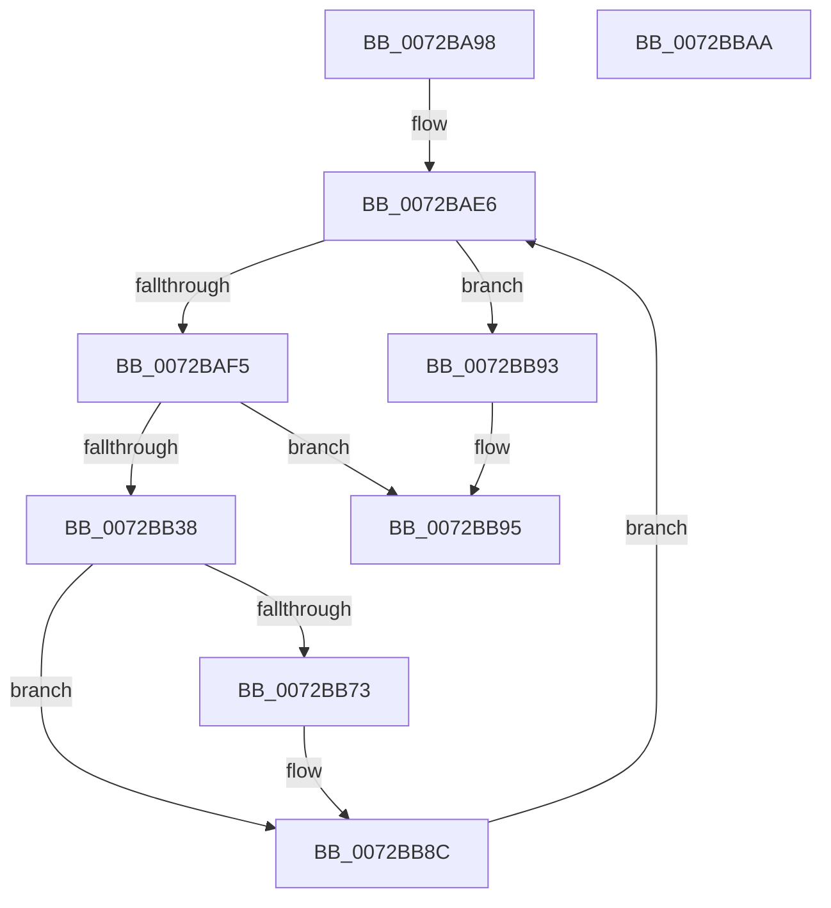

# IopCreatePassiveInterruptRealtimeThreads

- RVA: `0x0072BA98`–`0x0072BBAB` (길이 `275` bytes)
- VA: `0x000000014072BA98`
- 실행 섹션: `PAGE`
- PDB 이름 있음: `예`; PDB Function 태그: `아니요`
- unwind 정보 RVA: `0x000C8634`
- 디코드: `64`개 명령, `275/275` bytes 표시
- 미해석 바이트: `0` (있으면 어셈블리에 `.byte`로 보존)

> 이 문서는 커널 이미지의 기계어와 PDB 기호를 분석해 생성했습니다. 4번과 5번은 함수 원형과 자료형을 바이너리 사용 방식에서 추정한 C 해석이며 원본 소스 복구 결과는 아닙니다.

## 1. Dependencies

- 직접 호출 지점: **5**; 고유 호출 대상: **5**
- 직접 호출자로 확인된 함수: **1**
- RIP 상대 이미지 참조: **5**

### Outgoing calls
- `0x0072BB2F` → [PsCreateSystemThreadEx](../9E/PsCreateSystemThreadEx_function_009ED120.md) (function, `0x009ED120`)
- `0x0072BB5F` → [ObReferenceObjectByHandle](../86/ObReferenceObjectByHandle_function_00868DB0.md) (function, `0x00868DB0`)
- `0x0072BB6A` → [ZwClose](../../text/6A/ZwClose_function_006AD2B0.md) (function, `0x006AD2B0`)
- `0x0072BB7E` → [KeSetActualBasePriorityThread](../../text/3C/KeSetActualBasePriorityThread_function_003C4370.md) (function, `0x003C4370`)
- `0x0072BB87` → [ObfDereferenceObject](../../text/2F/ObfDereferenceObject_function_002F9350.md) (function, `0x002F9350`)

### Direct callers
- [IoInitSystemPreDrivers](../../init/C2/IoInitSystemPreDrivers_function_00C2AC3C.md) at `0x00C2B9FA`

### Static image references
- `0x0072BAE6` → RVA `0x00E0AA01` (`.data`; read)
- `0x0072BAFB` → RVA `0x00F8CC40` (`.data`; read)
- `0x0072BB15` → RVA `0x005A6850` (`IopPassiveInterruptRealtimeWorker`; read)
- `0x0072BB38` → RVA `0x00FC6AC8` (`ALMOSTRO`; read)
- `0x0072BB73` → RVA `0x00E0AA00` (`.data`; read)

## 2. Other-region calls and transfers

- 다른 실행 섹션으로 향하는 call: **3**
  - `0x0072BB6A` → [ZwClose](../../text/6A/ZwClose_function_006AD2B0.md) (`PAGE` → `.text`)
  - `0x0072BB7E` → [KeSetActualBasePriorityThread](../../text/3C/KeSetActualBasePriorityThread_function_003C4370.md) (`PAGE` → `.text`)
  - `0x0072BB87` → [ObfDereferenceObject](../../text/2F/ObfDereferenceObject_function_002F9350.md) (`PAGE` → `.text`)
- 별도 외부 분기/꼬리 이동을 확인하지 못했습니다.

## 3. Assembly (complete function range)

```asm
0072BA98  48 8B C4                        mov rax, rsp
0072BA9B  48 89 58 18                     mov qword ptr [rax + 0x18], rbx
0072BA9F  48 89 78 20                     mov qword ptr [rax + 0x20], rdi
0072BAA3  48 89 50 10                     mov qword ptr [rax + 0x10], rdx
0072BAA7  48 89 48 08                     mov qword ptr [rax + 8], rcx
0072BAAB  55                              push rbp
0072BAAC  48 8B EC                        mov rbp, rsp
0072BAAF  48 81 EC 80 00 00 00            sub rsp, 0x80
0072BAB6  83 65 EC 00                     and dword ptr [rbp - 0x14], 0
0072BABA  0F 57 C0                        xorps xmm0, xmm0
0072BABD  48 83 65 18 00                  and qword ptr [rbp + 0x18], 0
0072BAC2  48 83 65 D8 00                  and qword ptr [rbp - 0x28], 0
0072BAC7  48 83 65 E0 00                  and qword ptr [rbp - 0x20], 0
0072BACC  48 C7 45 D0 30 00 00 00         mov qword ptr [rbp - 0x30], 0x30
0072BAD4  83 65 D4 00                     and dword ptr [rbp - 0x2c], 0
0072BAD8  33 FF                           xor edi, edi
0072BADA  C7 45 E8 00 02 00 00            mov dword ptr [rbp - 0x18], 0x200
0072BAE1  F3 0F 7F 45 F0                  movdqu xmmword ptr [rbp - 0x10], xmm0
0072BAE6  0F B6 05 14 EF 6D 00            movzx eax, byte ptr [rip + 0x6def14]
0072BAED  3B F8                           cmp edi, eax
0072BAEF  0F 83 9E 00 00 00               jae 0x14072bb93
0072BAF5  48 83 64 24 40 00               and qword ptr [rsp + 0x40], 0
0072BAFB  48 8D 05 3E 11 86 00            lea rax, [rip + 0x86113e]
0072BB02  48 83 64 24 38 00               and qword ptr [rsp + 0x38], 0
0072BB08  4C 8D 45 D0                     lea r8, [rbp - 0x30]
0072BB0C  48 89 44 24 30                  mov qword ptr [rsp + 0x30], rax
0072BB11  48 8D 4D 18                     lea rcx, [rbp + 0x18]
0072BB15  48 8D 05 34 AD E7 FF            lea rax, [rip - 0x1852cc]
0072BB1C  45 33 C9                        xor r9d, r9d
0072BB1F  48 89 44 24 28                  mov qword ptr [rsp + 0x28], rax
0072BB24  BA FF FF 1F 00                  mov edx, 0x1fffff
0072BB29  48 83 64 24 20 00               and qword ptr [rsp + 0x20], 0
0072BB2F  E8 EC 15 2C 00                  call 0x1409ed120
0072BB34  85 C0                           test eax, eax
0072BB36  78 5D                           js 0x14072bb95
0072BB38  4C 8B 05 89 AF 89 00            mov r8, qword ptr [rip + 0x89af89]
0072BB3F  48 8D 45 10                     lea rax, [rbp + 0x10]
0072BB43  48 83 64 24 28 00               and qword ptr [rsp + 0x28], 0
0072BB49  45 33 C9                        xor r9d, r9d
0072BB4C  48 8B 4D 18                     mov rcx, qword ptr [rbp + 0x18]
0072BB50  BA FF FF 1F 00                  mov edx, 0x1fffff
0072BB55  48 83 65 10 00                  and qword ptr [rbp + 0x10], 0
0072BB5A  48 89 44 24 20                  mov qword ptr [rsp + 0x20], rax
0072BB5F  E8 4C D2 13 00                  call 0x140868db0
0072BB64  48 8B 4D 18                     mov rcx, qword ptr [rbp + 0x18]
0072BB68  8B D8                           mov ebx, eax
0072BB6A  E8 41 17 F8 FF                  call 0x1406ad2b0
0072BB6F  85 DB                           test ebx, ebx
0072BB71  78 19                           js 0x14072bb8c
0072BB73  0F B6 15 86 EE 6D 00            movzx edx, byte ptr [rip + 0x6dee86]
0072BB7A  48 8B 4D 10                     mov rcx, qword ptr [rbp + 0x10]
0072BB7E  E8 ED 87 C9 FF                  call 0x1403c4370
0072BB83  48 8B 4D 10                     mov rcx, qword ptr [rbp + 0x10]
0072BB87  E8 C4 D7 BC FF                  call 0x1402f9350
0072BB8C  FF C7                           inc edi
0072BB8E  E9 53 FF FF FF                  jmp 0x14072bae6
0072BB93  33 C0                           xor eax, eax
0072BB95  4C 8D 9C 24 80 00 00 00         lea r11, [rsp + 0x80]
0072BB9D  49 8B 5B 20                     mov rbx, qword ptr [r11 + 0x20]
0072BBA1  49 8B 7B 28                     mov rdi, qword ptr [r11 + 0x28]
0072BBA5  49 8B E3                        mov rsp, r11
0072BBA8  5D                              pop rbp
0072BBA9  C3                              ret
0072BBAA  CC                              int3
```

## 4. C-style interpretation (structured pseudocode)

```c
__int64 __fastcall IopCreatePassiveInterruptRealtimeThreads(__int64 a1, __int64 a2, __int64 a3, int a4)
{
    __int64 result;
    __int64 v_rdi;
    __int64 v_rsp;
    unsigned __int64 v_stack_m18;
    unsigned int v_stack_m1C;
    unsigned int v_stack_m20;
    unsigned __int64 v_stack_m28;
    unsigned __int64 v_stack_m30;
    unsigned int v_stack_m34;
    unsigned __int64 v_stack_m38;
    unsigned __int64 v_stack_m48;
    unsigned __int64 v_stack_m50;
    unsigned __int64 v_stack_m58;
    unsigned __int64 v_stack_m60;
    unsigned __int64 v_stack_m68;
    unsigned __int64 v_stack_m8;
    unsigned __int64 v_stack_p10;
    unsigned __int64 v_stack_p8;

    *(unsigned __int64 *)(v_rsp + 24) = v_rbx;
    *(unsigned __int64 *)(v_rsp + 32) = v_rdi;
    *(unsigned __int64 *)(v_rsp + 16) = a2;
    *(unsigned __int64 *)(v_rsp + 8) = a1;
    v_rsp = (v_rsp) - (128);
    v_stack_m38 = 48;
    v_rdi = 0;
    v_stack_m20 = 512;
    v_stack_m18 = v_xmm0;
loc_0072BAE6:
    if (0 >= ((unsigned int)(*(unsigned __int8 *)(v_rip + 7204628)))) goto loc_0072BB93;
    v_stack_m58 = v_rip + 8786238;
    a4 = 0;
    v_stack_m60 = v_rip - 1594060;
    result = PsCreateSystemThreadEx(v_stack_p10, (unsigned int)(0x1FFFFFULL), v_stack_m38, a4);
    if (sign_flag) goto loc_0072BB95;
    a4 = 0;
    v_stack_m68 = v_stack_p8;
    result = ObReferenceObjectByHandle(v_stack_p10, (unsigned int)(0x1FFFFFULL), *(unsigned __int64 *)(v_rip + 9023369), a4);
    result = ZwClose(v_stack_p10, (unsigned int)(0x1FFFFFULL), *(unsigned __int64 *)(v_rip + 9023369), a4);
    if (!(sign_flag)) {
        a2 = *(unsigned __int8 *)(v_rip + 7204486);
        a1 = v_stack_p8;
        result = KeSetActualBasePriorityThread(a1, a2, *(unsigned __int64 *)(v_rip + 9023369), a4);
        a1 = v_stack_p8;
        result = ObfDereferenceObject(a1, a2, *(unsigned __int64 *)(v_rip + 9023369), a4);
    }
    v_rdi = (unsigned int)((v_rdi) + 1);
    goto loc_0072BAE6;
loc_0072BB93:
    result = 0;
loc_0072BB95:
    return result;
}
```

## 5. (Beta) C Style

```c
int64_t IopCreatePassiveInterruptRealtimeThreads(int64_t Arg1, int64_t Arg2, int64_t Arg3, int32_t Arg4)
{
    int64_t result;
    int64_t local_rdi;
    int64_t local_rsp;
    uint64_t v_stack_m18;
    uint32_t v_stack_m1C;
    uint32_t v_stack_m20;
    uint64_t v_stack_m28;
    uint64_t v_stack_m30;
    uint32_t v_stack_m34;
    uint64_t v_stack_m38;
    uint64_t v_stack_m48;
    uint64_t v_stack_m50;
    uint64_t v_stack_m58;
    uint64_t v_stack_m60;
    uint64_t v_stack_m68;
    uint64_t v_stack_m8;
    uint64_t v_stack_p10;
    uint64_t v_stack_p8;

    *(uint64_t *)(local_rsp + 0x18) = local_rbx;
    *(uint64_t *)(local_rsp + 0x20) = local_rdi;
    *(uint64_t *)(local_rsp + 0x10) = Arg2;
    *(uint64_t *)(local_rsp + 0x8) = Arg1;
    local_rsp = (local_rsp) - (128);
    v_stack_m38 = 48;
    local_rdi = 0;
    v_stack_m20 = 512;
    v_stack_m18 = v_xmm0;
loc_0072BAE6:
    if (0 >= ((uint32_t)(*(uint8_t *)(v_rip + 0x6DEF14)))) goto loc_0072BB93;
    v_stack_m58 = v_rip + 8786238;
    Arg4 = 0;
    v_stack_m60 = v_rip - 1594060;
    result = PsCreateSystemThreadEx(v_stack_p10, (uint32_t)(0x1FFFFFULL), v_stack_m38, Arg4);
    if (sign_flag) goto loc_0072BB95;
    Arg4 = 0;
    v_stack_m68 = v_stack_p8;
    result = ObReferenceObjectByHandle(v_stack_p10, (uint32_t)(0x1FFFFFULL), *(uint64_t *)(v_rip + 0x89AF89), Arg4);
    result = ZwClose(v_stack_p10, (uint32_t)(0x1FFFFFULL), *(uint64_t *)(v_rip + 0x89AF89), Arg4);
    if (!(sign_flag)) {
        Arg2 = *(uint8_t *)(v_rip + 0x6DEE86);
        Arg1 = v_stack_p8;
        result = KeSetActualBasePriorityThread(Arg1, Arg2, *(uint64_t *)(v_rip + 0x89AF89), Arg4);
        Arg1 = v_stack_p8;
        result = ObfDereferenceObject(Arg1, Arg2, *(uint64_t *)(v_rip + 0x89AF89), Arg4);
    }
    local_rdi = (uint32_t)((local_rdi) + 1);
    goto loc_0072BAE6;
loc_0072BB93:
    result = 0;
loc_0072BB95:
    return result;
}
```

## 6. Execution-region graph

[열기: 2D/3D 그래프와 함수 탐색 컨트롤 패널](../../../control-panel.html?section=page&rva=0x0072BA98&view=graph)

- 2D 그래프는 위에서 아래로 흐르고, 3D 그래프는 빈 공간을 드래그해 회전합니다. Shift+드래그는 이동, 휠은 확대·축소, 함수 노드 선택은 대상 보고서 이동입니다.

### Static fallback


