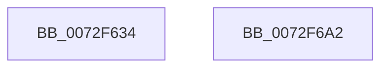

# IopDmaInitialize

- RVA: `0x0072F634`–`0x0072F6A3` (길이 `111` bytes)
- VA: `0x000000014072F634`
- 실행 섹션: `PAGE`
- PDB 이름 있음: `예`; PDB Function 태그: `아니요`
- unwind 정보 RVA: `0x0005D2F4`
- 디코드: `19`개 명령, `111/111` bytes 표시
- 미해석 바이트: `0` (있으면 어셈블리에 `.byte`로 보존)

> 이 문서는 커널 이미지의 기계어와 PDB 기호를 분석해 생성했습니다. 4번과 5번은 함수 원형과 자료형을 바이너리 사용 방식에서 추정한 C 해석이며 원본 소스 복구 결과는 아닙니다.

## 1. Dependencies

- 직접 호출 지점: **1**; 고유 호출 대상: **1**
- 직접 호출자로 확인된 함수: **1**
- RIP 상대 이미지 참조: **12**

### Outgoing calls
- `0x0072F698` → [ArbInitializeArbiterInstance](../70/ArbInitializeArbiterInstance_function_0070ECB4.md) (function, `0x0070ECB4`)

### Direct callers
- [IopInitializePlugPlayServices](../../init/C2/IopInitializePlugPlayServices_function_00C2F298.md) at `0x00C2F5D7`

### Static image references
- `0x0072F63E` → RVA `0x0072F710` (`IopDmaUnpackRequirement`; read)
- `0x0072F645` → RVA `0x00F8BD98` (`.data`; write)
- `0x0072F64C` → RVA `0x00AFE220` (` ?? ::NNGAKEGL::`string'`; read)
- `0x0072F653` → RVA `0x0072F6B0` (`IopDmaPackResource`; read)
- `0x0072F660` → RVA `0x00F8BDA0` (`.data`; write)
- `0x0072F667` → RVA `0x00F8BD20` (`.data`; read)
- `0x0072F66E` → RVA `0x0072F740` (`IopDmaUnpackResource`; read)
- `0x0072F675` → RVA `0x00F8BDA8` (`.data`; write)
- `0x0072F67C` → RVA `0x0072F700` (`IopDmaScoreRequirement`; read)
- `0x0072F683` → RVA `0x00F8BDB0` (`.data`; write)
- `0x0072F68A` → RVA `0x00705520` (`BiIsLogEnabled`; read)
- `0x0072F691` → RVA `0x00F8BE30` (`.data`; write)

## 2. Other-region calls and transfers

- 다른 실행 섹션으로 향하는 call: **0**
- 별도 외부 분기/꼬리 이동을 확인하지 못했습니다.

## 3. Assembly (complete function range)

```asm
0072F634  48 83 EC 38                     sub rsp, 0x38
0072F638  48 83 64 24 28 00               and qword ptr [rsp + 0x28], 0
0072F63E  48 8D 05 CB 00 00 00            lea rax, [rip + 0xcb]
0072F645  48 89 05 4C C7 85 00            mov qword ptr [rip + 0x85c74c], rax
0072F64C  4C 8D 0D CD EB 3C 00            lea r9, [rip + 0x3cebcd]
0072F653  48 8D 05 56 00 00 00            lea rax, [rip + 0x56]
0072F65A  41 B8 04 00 00 00               mov r8d, 4
0072F660  48 89 05 39 C7 85 00            mov qword ptr [rip + 0x85c739], rax
0072F667  48 8D 0D B2 C6 85 00            lea rcx, [rip + 0x85c6b2]
0072F66E  48 8D 05 CB 00 00 00            lea rax, [rip + 0xcb]
0072F675  48 89 05 2C C7 85 00            mov qword ptr [rip + 0x85c72c], rax
0072F67C  48 8D 05 7D 00 00 00            lea rax, [rip + 0x7d]
0072F683  48 89 05 26 C7 85 00            mov qword ptr [rip + 0x85c726], rax
0072F68A  48 8D 05 8F 5E FD FF            lea rax, [rip - 0x2a171]
0072F691  48 89 05 98 C7 85 00            mov qword ptr [rip + 0x85c798], rax
0072F698  E8 17 F6 FD FF                  call 0x14070ecb4
0072F69D  48 83 C4 38                     add rsp, 0x38
0072F6A1  C3                              ret
0072F6A2  CC                              int3
```

## 4. C-style interpretation (structured pseudocode)

```c
__int64 __fastcall IopDmaInitialize(void)
{
    __int64 result;
    __int64 v_rsp;
    unsigned __int64 v_stack_m10;

    v_rsp = (v_rsp) - (56);
    *(unsigned __int64 *)(v_rip + 8767308) = v_rip + 203;
    *(unsigned __int64 *)(v_rip + 8767289) = v_rip + 86;
    *(unsigned __int64 *)(v_rip + 8767276) = v_rip + 203;
    *(unsigned __int64 *)(v_rip + 8767270) = v_rip + 125;
    *(unsigned __int64 *)(v_rip + 8767384) = v_rip - 172401;
    result = ArbInitializeArbiterInstance(v_rip + 8767154, a2, 4, v_rip + 3992525);
    v_rsp = (v_rsp) + (56);
    return result;
}
```

## 5. (Beta) C Style

```c
void IopDmaInitialize(void)
{
    int64_t result;
    int64_t local_rsp;
    uint64_t v_stack_m10;

    local_rsp = (local_rsp) - (56);
    *(uint64_t *)(v_rip + 0x85C74C) = v_rip + 203;
    *(uint64_t *)(v_rip + 0x85C739) = v_rip + 86;
    *(uint64_t *)(v_rip + 0x85C72C) = v_rip + 203;
    *(uint64_t *)(v_rip + 0x85C726) = v_rip + 125;
    *(uint64_t *)(v_rip + 0x85C798) = v_rip - 172401;
    result = ArbInitializeArbiterInstance(v_rip + 8767154, a2, 4, v_rip + 3992525);
    local_rsp = (local_rsp) + (56);
    return result;
}
```

## 6. Execution-region graph

[열기: 2D/3D 그래프와 함수 탐색 컨트롤 패널](../../../control-panel.html?section=page&rva=0x0072F634&view=graph)

- 2D 그래프는 위에서 아래로 흐르고, 3D 그래프는 빈 공간을 드래그해 회전합니다. Shift+드래그는 이동, 휠은 확대·축소, 함수 노드 선택은 대상 보고서 이동입니다.

### Static fallback


