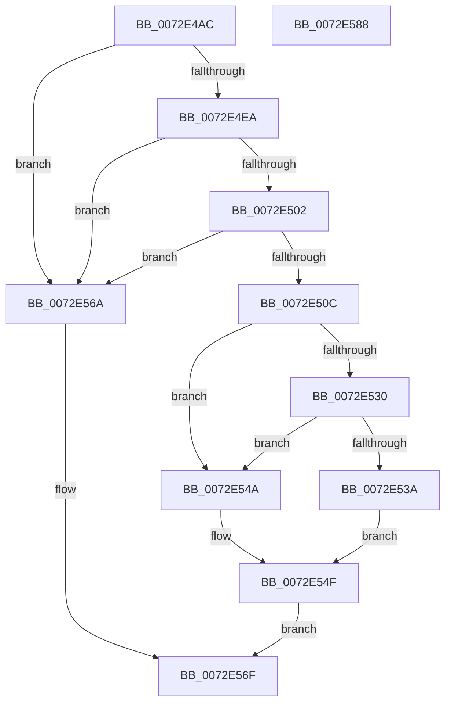

# IopDuplicateDetection

- RVA: `0x0072E4AC`–`0x0072E589` (길이 `221` bytes)
- VA: `0x000000014072E4AC`
- 실행 섹션: `PAGE`
- PDB 이름 있음: `예`; PDB Function 태그: `아니요`
- unwind 정보 RVA: `0x00093E28`
- 디코드: `65`개 명령, `221/221` bytes 표시
- 미해석 바이트: `0` (있으면 어셈블리에 `.byte`로 보존)

> 이 문서는 커널 이미지의 기계어와 PDB 기호를 분석해 생성했습니다. 4번과 5번은 함수 원형과 자료형을 바이너리 사용 방식에서 추정한 C 해석이며 원본 소스 복구 결과는 아닙니다.

## 1. Dependencies

- 직접 호출 지점: **5**; 고유 호출 대상: **4**
- 직접 호출자로 확인된 함수: **1**
- RIP 상대 이미지 참조: **0**

### Outgoing calls
- `0x0072E4DC` → [IopFindLegacyBusDeviceNode](../AA/IopFindLegacyBusDeviceNode_function_00AAB698.md) (function, `0x00AAB698`)
- `0x0072E4F9` → [IopQueryResourceHandlerInterface](../A8/IopQueryResourceHandlerInterface_function_00A830E4.md) (function, `0x00A830E4`)
- `0x0072E527` → [guard_dispatch_icall](../../text/6B/guard_dispatch_icall_function_006BAAD0.md) (function, `0x006BAAD0`)
- `0x0072E557` → [guard_dispatch_icall](../../text/6B/guard_dispatch_icall_function_006BAAD0.md) (function, `0x006BAAD0`)
- `0x0072E561` → [ExFreePoolWithTag](../../poolcode/B8/ExFreePoolWithTag_function_00B82870.md) (function, `0x00B82870`)

### Direct callers
- [IoReportDetectedDevice](IoReportDetectedDevice_function_00725CD0.md) at `0x00725E63`

### Static image references
- 디코드된 RIP-relative 메모리 참조가 없습니다.

## 2. Other-region calls and transfers

- 다른 실행 섹션으로 향하는 call: **3**
  - `0x0072E527` → [guard_dispatch_icall](../../text/6B/guard_dispatch_icall_function_006BAAD0.md) (`PAGE` → `.text`)
  - `0x0072E557` → [guard_dispatch_icall](../../text/6B/guard_dispatch_icall_function_006BAAD0.md) (`PAGE` → `.text`)
  - `0x0072E561` → [ExFreePoolWithTag](../../poolcode/B8/ExFreePoolWithTag_function_00B82870.md) (`PAGE` → `POOLCODE`)
- 별도 외부 분기/꼬리 이동을 확인하지 못했습니다.

## 3. Assembly (complete function range)

```asm
0072E4AC  48 8B C4                        mov rax, rsp
0072E4AF  48 89 58 08                     mov qword ptr [rax + 8], rbx
0072E4B3  48 89 68 10                     mov qword ptr [rax + 0x10], rbp
0072E4B7  48 89 70 18                     mov qword ptr [rax + 0x18], rsi
0072E4BB  57                              push rdi
0072E4BC  41 56                           push r14
0072E4BE  41 57                           push r15
0072E4C0  48 83 EC 40                     sub rsp, 0x40
0072E4C4  33 DB                           xor ebx, ebx
0072E4C6  49 8B F1                        mov rsi, r9
0072E4C9  48 89 58 20                     mov qword ptr [rax + 0x20], rbx
0072E4CD  45 8B F8                        mov r15d, r8d
0072E4D0  48 89 58 D8                     mov qword ptr [rax - 0x28], rbx
0072E4D4  8B EA                           mov ebp, edx
0072E4D6  49 89 19                        mov qword ptr [r9], rbx
0072E4D9  44 8B F1                        mov r14d, ecx
0072E4DC  E8 B7 D1 37 00                  call 0x140aab698
0072E4E1  48 85 C0                        test rax, rax
0072E4E4  0F 84 80 00 00 00               je 0x14072e56a
0072E4EA  48 8B 50 20                     mov rdx, qword ptr [rax + 0x20]
0072E4EE  4C 8D 4C 24 78                  lea r9, [rsp + 0x78]
0072E4F3  45 33 C0                        xor r8d, r8d
0072E4F6  8D 4B 03                        lea ecx, [rbx + 3]
0072E4F9  E8 E6 4B 35 00                  call 0x140a830e4
0072E4FE  85 C0                           test eax, eax
0072E500  78 68                           js 0x14072e56a
0072E502  48 8B 7C 24 78                  mov rdi, qword ptr [rsp + 0x78]
0072E507  48 85 FF                        test rdi, rdi
0072E50A  74 5E                           je 0x14072e56a
0072E50C  48 8B 47 20                     mov rax, qword ptr [rdi + 0x20]
0072E510  48 8D 4C 24 30                  lea rcx, [rsp + 0x30]
0072E515  48 89 4C 24 20                  mov qword ptr [rsp + 0x20], rcx
0072E51A  45 8B CF                        mov r9d, r15d
0072E51D  48 8B 4F 08                     mov rcx, qword ptr [rdi + 8]
0072E521  44 8B C5                        mov r8d, ebp
0072E524  41 8B D6                        mov edx, r14d
0072E527  E8 A4 C5 F8 FF                  call 0x1406baad0
0072E52C  85 C0                           test eax, eax
0072E52E  78 1A                           js 0x14072e54a
0072E530  48 8B 44 24 30                  mov rax, qword ptr [rsp + 0x30]
0072E535  48 85 C0                        test rax, rax
0072E538  74 10                           je 0x14072e54a
0072E53A  48 8B 80 38 01 00 00            mov rax, qword ptr [rax + 0x138]
0072E541  48 8B 48 28                     mov rcx, qword ptr [rax + 0x28]
0072E545  48 89 0E                        mov qword ptr [rsi], rcx
0072E548  EB 05                           jmp 0x14072e54f
0072E54A  BB 10 00 00 C0                  mov ebx, 0xc0000010
0072E54F  48 8B 47 18                     mov rax, qword ptr [rdi + 0x18]
0072E553  48 8B 4F 08                     mov rcx, qword ptr [rdi + 8]
0072E557  E8 74 C5 F8 FF                  call 0x1406baad0
0072E55C  33 D2                           xor edx, edx
0072E55E  48 8B CF                        mov rcx, rdi
0072E561  E8 0A 43 45 00                  call 0x140b82870
0072E566  8B C3                           mov eax, ebx
0072E568  EB 05                           jmp 0x14072e56f
0072E56A  B8 10 00 00 C0                  mov eax, 0xc0000010
0072E56F  48 8B 5C 24 60                  mov rbx, qword ptr [rsp + 0x60]
0072E574  48 8B 6C 24 68                  mov rbp, qword ptr [rsp + 0x68]
0072E579  48 8B 74 24 70                  mov rsi, qword ptr [rsp + 0x70]
0072E57E  48 83 C4 40                     add rsp, 0x40
0072E582  41 5F                           pop r15
0072E584  41 5E                           pop r14
0072E586  5F                              pop rdi
0072E587  C3                              ret
0072E588  CC                              int3
```

## 4. C-style interpretation (structured pseudocode)

```c
__int64 __fastcall IopDuplicateDetection(int a1, int a2, int a3, __int64 a4)
{
    __int64 result;
    __int64 v_rbx;
    __int64 v_rsp;
    unsigned __int64 v_stack_m28;
    unsigned __int64 v_stack_m38;
    unsigned __int64 v_stack_p10;
    unsigned __int64 v_stack_p18;
    unsigned __int64 v_stack_p20;
    unsigned __int64 v_stack_p8;

    *(unsigned __int64 *)(v_rsp + 8) = v_rbx;
    *(unsigned __int64 *)(v_rsp + 16) = v_rbp;
    *(unsigned __int64 *)(v_rsp + 24) = v_rsi;
    v_rsp = (v_rsp) - (64);
    v_rbx = 0;
    *(unsigned __int64 *)(v_rsp + 32) = 0;
    *(unsigned __int64 *)(v_rsp - 40) = 0;
    *(unsigned __int64 *)(a4) = 0;
    result = IopFindLegacyBusDeviceNode(a1, a2, a3, a4);
    if (result == 0) goto loc_0072E56A;
    a3 = 0;
    result = IopQueryResourceHandlerInterface(v_rbx + 3, *(unsigned __int64 *)(result + 32), a3, v_stack_p20);
    if (sign_flag) goto loc_0072E56A;
    if (v_stack_p20 == 0) goto loc_0072E56A;
    v_stack_m38 = v_stack_m28;
    result = guard_dispatch_icall(*(unsigned __int64 *)(v_stack_p20 + 8), (unsigned int)((unsigned int)((unsigned int)(a1))), (unsigned int)((unsigned int)((unsigned int)(a2))), (unsigned int)((unsigned int)((unsigned int)(a3))));
    if (sign_flag) goto loc_0072E54A;
    if (v_stack_m28 == 0) goto loc_0072E54A;
    *(unsigned __int64 *)(a4) = *(unsigned __int64 *)(*(unsigned __int64 *)(v_stack_m28 + 312) + 40);
    goto loc_0072E54F;
loc_0072E54A:
loc_0072E54F:
    result = guard_dispatch_icall(*(unsigned __int64 *)(v_stack_p20 + 8), (unsigned int)((unsigned int)((unsigned int)(a1))), (unsigned int)((unsigned int)((unsigned int)(a2))), (unsigned int)((unsigned int)((unsigned int)(a3))));
    a2 = 0;
    result = ExFreePoolWithTag(v_stack_p20, a2, (unsigned int)((unsigned int)((unsigned int)(a2))), (unsigned int)((unsigned int)((unsigned int)(a3))));
    goto loc_0072E56F;
loc_0072E56A:
loc_0072E56F:
    v_rsp = (v_rsp) + (64);
    return (unsigned int)(0xC0000010ULL);
}
```

## 5. (Beta) C Style

```c
int64_t IopDuplicateDetection(int32_t Arg1, int32_t Arg2, int32_t Arg3, void *Arg4)
{
    uint8_t *arg4 = (uint8_t *)Arg4;

    int64_t result;
    int64_t local_rbx;
    int64_t local_rsp;
    uint64_t v_stack_m28;
    uint64_t v_stack_m38;
    uint64_t v_stack_p10;
    uint64_t v_stack_p18;
    uint64_t v_stack_p20;
    uint64_t v_stack_p8;

    *(uint64_t *)(local_rsp + 0x8) = local_rbx;
    *(uint64_t *)(local_rsp + 0x10) = local_rbp;
    *(uint64_t *)(local_rsp + 0x18) = local_rsi;
    local_rsp = (local_rsp) - (64);
    local_rbx = 0;
    *(uint64_t *)(local_rsp + 0x20) = 0;
    *(uint64_t *)(local_rsp - 0x28) = 0;
    *(uint64_t *)(arg4) = 0;
    result = IopFindLegacyBusDeviceNode(Arg1, Arg2, Arg3, Arg4);
    if (result == 0) goto loc_0072E56A;
    Arg3 = 0;
    result = IopQueryResourceHandlerInterface(local_rbx + 3, *(uint64_t *)(result + 0x20), Arg3, v_stack_p20);
    if (sign_flag) goto loc_0072E56A;
    if (v_stack_p20 == 0) goto loc_0072E56A;
    v_stack_m38 = v_stack_m28;
    result = guard_dispatch_icall(*(uint64_t *)(v_stack_p20 + 0x8), (uint32_t)((uint32_t)((uint32_t)(Arg1))), (uint32_t)((uint32_t)((uint32_t)(Arg2))), (uint32_t)((uint32_t)((uint32_t)(Arg3))));
    if (sign_flag) goto loc_0072E54A;
    if (v_stack_m28 == 0) goto loc_0072E54A;
    *(uint64_t *)(arg4) = *(uint64_t *)(*(uint64_t *)(v_stack_m28 + 0x138) + 0x28);
    goto loc_0072E54F;
loc_0072E54A:
loc_0072E54F:
    result = guard_dispatch_icall(*(uint64_t *)(v_stack_p20 + 0x8), (uint32_t)((uint32_t)((uint32_t)(Arg1))), (uint32_t)((uint32_t)((uint32_t)(Arg2))), (uint32_t)((uint32_t)((uint32_t)(Arg3))));
    Arg2 = 0;
    result = ExFreePoolWithTag(v_stack_p20, Arg2, (uint32_t)((uint32_t)((uint32_t)(Arg2))), (uint32_t)((uint32_t)((uint32_t)(Arg3))));
    goto loc_0072E56F;
loc_0072E56A:
loc_0072E56F:
    local_rsp = (local_rsp) + (64);
    return (uint32_t)(0xC0000010ULL);
}
```

### 관측된 메모리 오프셋

구조체 형식이 확인되지 않은 접근은 인자 기준의 오프셋으로만 기록했습니다.

| 기준 인자 | 오프셋 표현 | 폭 (bit) | 접근 |
|---|---:|---:|---|
| `Arg4` | `+ 0x0` | `64` | `W` |

## 6. Execution-region graph

[열기: 2D/3D 그래프와 함수 탐색 컨트롤 패널](../../../control-panel.html?section=page&rva=0x0072E4AC&view=graph)

- 2D 그래프는 위에서 아래로 흐르고, 3D 그래프는 빈 공간을 드래그해 회전합니다. Shift+드래그는 이동, 휠은 확대·축소, 함수 노드 선택은 대상 보고서 이동입니다.

### Static fallback


