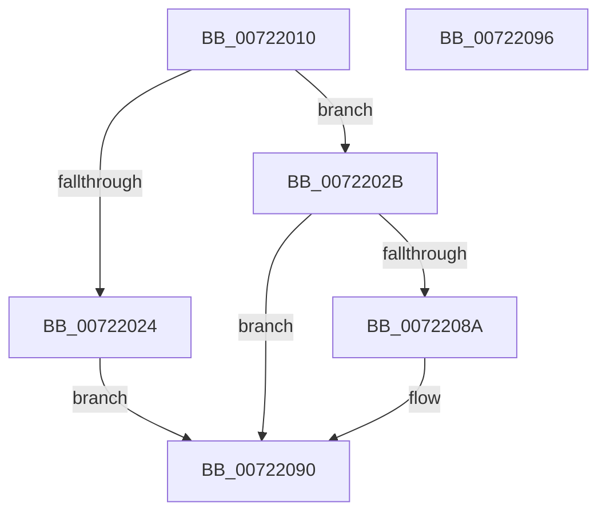

# IopEnumerateEnvironmentVariablesSysEnv

- RVA: `0x00722010`–`0x00722097` (길이 `135` bytes)
- VA: `0x0000000140722010`
- 실행 섹션: `PAGE`
- PDB 이름 있음: `예`; PDB Function 태그: `아니요`
- unwind 정보 RVA: `0x0006E5B4`
- 디코드: `33`개 명령, `135/135` bytes 표시
- 미해석 바이트: `0` (있으면 어셈블리에 `.byte`로 보존)

> 이 문서는 커널 이미지의 기계어와 PDB 기호를 분석해 생성했습니다. 4번과 5번은 함수 원형과 자료형을 바이너리 사용 방식에서 추정한 C 해석이며 원본 소스 복구 결과는 아닙니다.

## 1. Dependencies

- 직접 호출 지점: **1**; 고유 호출 대상: **1**
- 직접 호출자로 확인된 함수: **0**
- RIP 상대 이미지 참조: **0**

### Outgoing calls
- `0x0072207E` → [IopIssueSystemEnvironmentRequest](IopIssueSystemEnvironmentRequest_function_00722878.md) (function, `0x00722878`)

### Direct callers
- 이 함수 시작 RVA로 연결되는 직접 call은 확인되지 않았습니다. 간접 호출은 완전히 역산할 수 없습니다.

### Static image references
- 디코드된 RIP-relative 메모리 참조가 없습니다.

## 2. Other-region calls and transfers

- 다른 실행 섹션으로 향하는 call: **0**
- 별도 외부 분기/꼬리 이동을 확인하지 못했습니다.

## 3. Assembly (complete function range)

```asm
00722010  40 53                           push rbx
00722012  48 83 EC 60                     sub rsp, 0x60
00722016  83 64 24 50 00                  and dword ptr [rsp + 0x50], 0
0072201B  41 8D 40 FF                     lea eax, [r8 - 1]
0072201F  83 F8 01                        cmp eax, 1
00722022  76 07                           jbe 0x14072202b
00722024  B8 0D 00 00 C0                  mov eax, 0xc000000d
00722029  EB 65                           jmp 0x140722090
0072202B  48 8B 9C 24 98 00 00 00         mov rbx, qword ptr [rsp + 0x98]
00722033  48 8D 44 24 50                  lea rax, [rsp + 0x50]
00722038  48 89 44 24 40                  mov qword ptr [rsp + 0x40], rax
0072203D  41 83 F8 02                     cmp r8d, 2
00722041  4C 8B CA                        mov r9, rdx
00722044  B9 0C 00 52 00                  mov ecx, 0x52000c
00722049  0F 94 84 24 80 00 00 00         sete byte ptr [rsp + 0x80]
00722051  B2 01                           mov dl, 1
00722053  8B 03                           mov eax, dword ptr [rbx]
00722055  45 33 C0                        xor r8d, r8d
00722058  89 44 24 38                     mov dword ptr [rsp + 0x38], eax
0072205C  48 8B 84 24 90 00 00 00         mov rax, qword ptr [rsp + 0x90]
00722064  48 89 44 24 30                  mov qword ptr [rsp + 0x30], rax
00722069  48 8D 84 24 80 00 00 00         lea rax, [rsp + 0x80]
00722071  C7 44 24 28 01 00 00 00         mov dword ptr [rsp + 0x28], 1
00722079  48 89 44 24 20                  mov qword ptr [rsp + 0x20], rax
0072207E  E8 F5 07 00 00                  call 0x140722878
00722083  3D 23 00 00 C0                  cmp eax, 0xc0000023
00722088  75 06                           jne 0x140722090
0072208A  8B 4C 24 50                     mov ecx, dword ptr [rsp + 0x50]
0072208E  89 0B                           mov dword ptr [rbx], ecx
00722090  48 83 C4 60                     add rsp, 0x60
00722094  5B                              pop rbx
00722095  C3                              ret
00722096  CC                              int3
```

## 4. C-style interpretation (structured pseudocode)

```c
__int64 __fastcall IopEnumerateEnvironmentVariablesSysEnv(__int64 a1, __int64 a2, __int64 a3, __int64 a4, __int64 a5, __int64 a6)
{
    __int64 result;
    __int64 v_rsp;
    unsigned int v_stack_m18;
    unsigned __int64 v_stack_m28;
    unsigned int v_stack_m30;
    unsigned __int64 v_stack_m38;
    unsigned int v_stack_m40;
    unsigned __int64 v_stack_m48;
    unsigned __int8 v_stack_p18;

    v_rsp = (v_rsp) - (96);
    if (((unsigned int)(a3 - 1)) <= 1) goto loc_0072202B;
    goto loc_00722090;
loc_0072202B:
    v_stack_m28 = v_stack_m18;
    a3 = 0;
    v_stack_m30 = (unsigned int)((unsigned int)(*(unsigned int *)(a6)));
    v_stack_m38 = a5;
    v_stack_m40 = 1;
    v_stack_m48 = v_stack_p18;
    result = IopIssueSystemEnvironmentRequest((unsigned int)(0x52000CULL), 1, a3, a2);
    if (((unsigned int)(result)) == 0xC0000023ULL) {
        a1 = v_stack_m18;
        *(unsigned int *)(a6) = (unsigned int)(a1);
    }
    v_rsp = (v_rsp) + (96);
    return result;
}
```

## 5. (Beta) C Style

```c
int64_t IopEnumerateEnvironmentVariablesSysEnv(int64_t Arg1, int64_t Arg2, void *Arg3, int64_t Arg4, int64_t Arg5, void *Arg6)
{
    uint8_t *arg3 = (uint8_t *)Arg3;
    uint8_t *arg6 = (uint8_t *)Arg6;

    int64_t result;
    int64_t local_rsp;
    uint32_t v_stack_m18;
    uint64_t v_stack_m28;
    uint32_t v_stack_m30;
    uint64_t v_stack_m38;
    uint32_t v_stack_m40;
    uint64_t v_stack_m48;
    uint8_t v_stack_p18;

    local_rsp = (local_rsp) - (96);
    if (((uint32_t)(Arg3 - 1)) <= 1) goto loc_0072202B;
    goto loc_00722090;
loc_0072202B:
    v_stack_m28 = v_stack_m18;
    Arg3 = 0;
    v_stack_m30 = (uint32_t)((uint32_t)(*(uint32_t *)(arg6)));
    v_stack_m38 = Arg5;
    v_stack_m40 = 1;
    v_stack_m48 = v_stack_p18;
    result = IopIssueSystemEnvironmentRequest((uint32_t)(0x52000CULL), 1, Arg3, Arg2);
    if (((uint32_t)(result)) == 0xC0000023ULL) {
        Arg1 = v_stack_m18;
        *(uint32_t *)(arg6) = (uint32_t)(Arg1);
    }
    local_rsp = (local_rsp) + (96);
    return result;
}
```

### 관측된 메모리 오프셋

구조체 형식이 확인되지 않은 접근은 인자 기준의 오프셋으로만 기록했습니다.

| 기준 인자 | 오프셋 표현 | 폭 (bit) | 접근 |
|---|---:|---:|---|
| `Arg3` | `- 0x1` | `32` | `R` |
| `Arg6` | `+ 0x0` | `32` | `R` |
| `Arg6` | `+ 0x0` | `32` | `W` |

## 6. Execution-region graph

[열기: 2D/3D 그래프와 함수 탐색 컨트롤 패널](../../../control-panel.html?section=page&rva=0x00722010&view=graph)

- 2D 그래프는 위에서 아래로 흐르고, 3D 그래프는 빈 공간을 드래그해 회전합니다. Shift+드래그는 이동, 휠은 확대·축소, 함수 노드 선택은 대상 보고서 이동입니다.

### Static fallback


