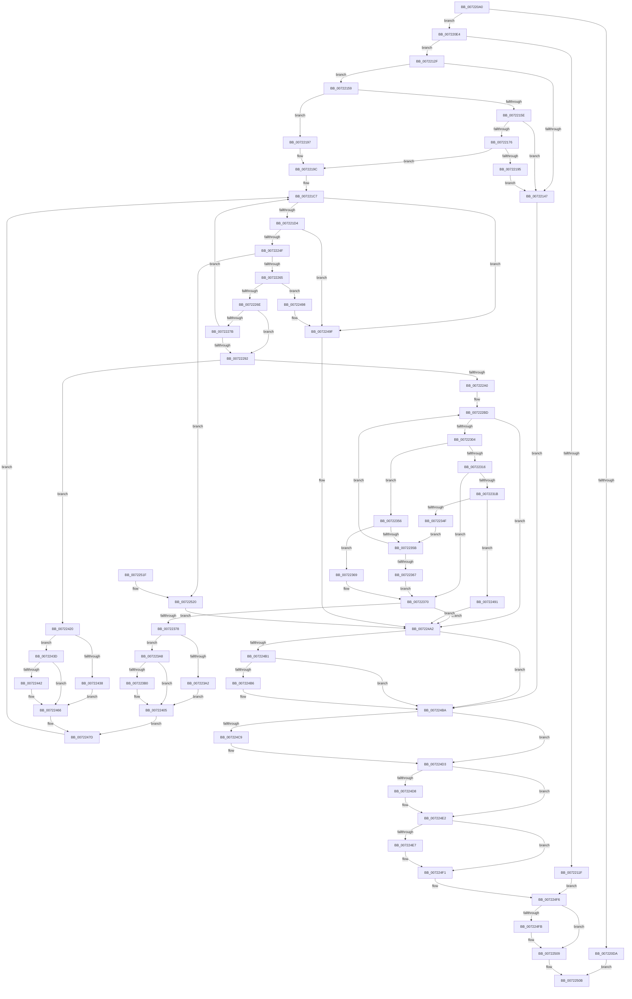

# IopEnumerateEnvironmentVariablesTrEE

- RVA: `0x007220A0`–`0x0072252B` (길이 `1,163` bytes)
- VA: `0x00000001407220A0`
- 실행 섹션: `PAGE`
- PDB 이름 있음: `예`; PDB Function 태그: `아니요`
- unwind 정보 RVA: `0x000C7CB0`
- 디코드: `302`개 명령, `1,163/1,163` bytes 표시
- 미해석 바이트: `0` (있으면 어셈블리에 `.byte`로 보존)

> 이 문서는 커널 이미지의 기계어와 PDB 기호를 분석해 생성했습니다. 4번과 5번은 함수 원형과 자료형을 바이너리 사용 방식에서 추정한 C 해석이며 원본 소스 복구 결과는 아닙니다.

## 1. Dependencies

- 직접 호출 지점: **20**; 고유 호출 대상: **6**
- 직접 호출자로 확인된 함수: **0**
- RIP 상대 이미지 참조: **0**

### Outgoing calls
- `0x00722108` → [ExAllocatePool2](../../poolcode/B8/ExAllocatePool2_function_00B820F0.md) (function, `0x00B820F0`)
- `0x0072213A` → [ExAllocatePool2](../../poolcode/B8/ExAllocatePool2_function_00B820F0.md) (function, `0x00B820F0`)
- `0x00722169` → [ExAllocatePool2](../../poolcode/B8/ExAllocatePool2_function_00B820F0.md) (function, `0x00B820F0`)
- `0x00722188` → [ExAllocatePool2](../../poolcode/B8/ExAllocatePool2_function_00B820F0.md) (function, `0x00B820F0`)
- `0x007221ED` → [memcpy](../../text/6C/memcpy_function_006C6840.md) (function, `0x006C6840`)
- `0x0072223E` → [IopIssueTrEERequest](../../text/5A/IopIssueTrEERequest_function_005A041C.md) (function, `0x005A041C`)
- `0x00722283` → [guard_dispatch_icall](../../text/6B/guard_dispatch_icall_function_006BAAD0.md) (function, `0x006BAAD0`)
- `0x007222B5` → [memcpy](../../text/6C/memcpy_function_006C6840.md) (function, `0x006C6840`)
- `0x007222F5` → [IopIssueTrEERequest](../../text/5A/IopIssueTrEERequest_function_005A041C.md) (function, `0x005A041C`)
- `0x0072232C` → [ExFreePoolWithTag](../../poolcode/B8/ExFreePoolWithTag_function_00B82870.md) (function, `0x00B82870`)
- `0x0072233E` → [ExAllocatePool2](../../poolcode/B8/ExAllocatePool2_function_00B820F0.md) (function, `0x00B820F0`)
- `0x00722369` → [IopEfiStatusToNTSTATUS](IopEfiStatusToNTSTATUS_function_00721E30.md) (function, `0x00721E30`)
- `0x007223CA` → [memcpy](../../text/6C/memcpy_function_006C6840.md) (function, `0x006C6840`)
- `0x007223E2` → [memcpy](../../text/6C/memcpy_function_006C6840.md) (function, `0x006C6840`)
- `0x00722458` → [memcpy](../../text/6C/memcpy_function_006C6840.md) (function, `0x006C6840`)
- `0x00722498` → [IopEfiStatusToNTSTATUS](IopEfiStatusToNTSTATUS_function_00721E30.md) (function, `0x00721E30`)
- `0x007224BF` → [ExFreePoolWithTag](../../poolcode/B8/ExFreePoolWithTag_function_00B82870.md) (function, `0x00B82870`)
- `0x007224CE` → [ExFreePoolWithTag](../../poolcode/B8/ExFreePoolWithTag_function_00B82870.md) (function, `0x00B82870`)
- `0x007224DD` → [ExFreePoolWithTag](../../poolcode/B8/ExFreePoolWithTag_function_00B82870.md) (function, `0x00B82870`)
- `0x007224EC` → [ExFreePoolWithTag](../../poolcode/B8/ExFreePoolWithTag_function_00B82870.md) (function, `0x00B82870`)

### Direct callers
- 이 함수 시작 RVA로 연결되는 직접 call은 확인되지 않았습니다. 간접 호출은 완전히 역산할 수 없습니다.

### Static image references
- 디코드된 RIP-relative 메모리 참조가 없습니다.

## 2. Other-region calls and transfers

- 다른 실행 섹션으로 향하는 call: **18**
  - `0x00722108` → [ExAllocatePool2](../../poolcode/B8/ExAllocatePool2_function_00B820F0.md) (`PAGE` → `POOLCODE`)
  - `0x0072213A` → [ExAllocatePool2](../../poolcode/B8/ExAllocatePool2_function_00B820F0.md) (`PAGE` → `POOLCODE`)
  - `0x00722169` → [ExAllocatePool2](../../poolcode/B8/ExAllocatePool2_function_00B820F0.md) (`PAGE` → `POOLCODE`)
  - `0x00722188` → [ExAllocatePool2](../../poolcode/B8/ExAllocatePool2_function_00B820F0.md) (`PAGE` → `POOLCODE`)
  - `0x007221ED` → [memcpy](../../text/6C/memcpy_function_006C6840.md) (`PAGE` → `.text`)
  - `0x0072223E` → [IopIssueTrEERequest](../../text/5A/IopIssueTrEERequest_function_005A041C.md) (`PAGE` → `.text`)
  - `0x00722283` → [guard_dispatch_icall](../../text/6B/guard_dispatch_icall_function_006BAAD0.md) (`PAGE` → `.text`)
  - `0x007222B5` → [memcpy](../../text/6C/memcpy_function_006C6840.md) (`PAGE` → `.text`)
  - `0x007222F5` → [IopIssueTrEERequest](../../text/5A/IopIssueTrEERequest_function_005A041C.md) (`PAGE` → `.text`)
  - `0x0072232C` → [ExFreePoolWithTag](../../poolcode/B8/ExFreePoolWithTag_function_00B82870.md) (`PAGE` → `POOLCODE`)
  - `0x0072233E` → [ExAllocatePool2](../../poolcode/B8/ExAllocatePool2_function_00B820F0.md) (`PAGE` → `POOLCODE`)
  - `0x007223CA` → [memcpy](../../text/6C/memcpy_function_006C6840.md) (`PAGE` → `.text`)
  - `0x007223E2` → [memcpy](../../text/6C/memcpy_function_006C6840.md) (`PAGE` → `.text`)
  - `0x00722458` → [memcpy](../../text/6C/memcpy_function_006C6840.md) (`PAGE` → `.text`)
  - `0x007224BF` → [ExFreePoolWithTag](../../poolcode/B8/ExFreePoolWithTag_function_00B82870.md) (`PAGE` → `POOLCODE`)
  - `0x007224CE` → [ExFreePoolWithTag](../../poolcode/B8/ExFreePoolWithTag_function_00B82870.md) (`PAGE` → `POOLCODE`)
  - `0x007224DD` → [ExFreePoolWithTag](../../poolcode/B8/ExFreePoolWithTag_function_00B82870.md) (`PAGE` → `POOLCODE`)
  - `0x007224EC` → [ExFreePoolWithTag](../../poolcode/B8/ExFreePoolWithTag_function_00B82870.md) (`PAGE` → `POOLCODE`)
- 별도 외부 분기/꼬리 이동을 확인하지 못했습니다.

## 3. Assembly (complete function range)

```asm
007220A0  48 8B C4                        mov rax, rsp
007220A3  4C 89 48 20                     mov qword ptr [rax + 0x20], r9
007220A7  44 89 40 18                     mov dword ptr [rax + 0x18], r8d
007220AB  48 89 50 10                     mov qword ptr [rax + 0x10], rdx
007220AF  48 89 48 08                     mov qword ptr [rax + 8], rcx
007220B3  53                              push rbx
007220B4  55                              push rbp
007220B5  56                              push rsi
007220B6  57                              push rdi
007220B7  41 54                           push r12
007220B9  41 55                           push r13
007220BB  41 56                           push r14
007220BD  41 57                           push r15
007220BF  48 81 EC 98 00 00 00            sub rsp, 0x98
007220C6  45 33 E4                        xor r12d, r12d
007220C9  41 8D 40 FF                     lea eax, [r8 - 1]
007220CD  44 89 64 24 50                  mov dword ptr [rsp + 0x50], r12d
007220D2  41 8B D8                        mov ebx, r8d
007220D5  83 F8 01                        cmp eax, 1
007220D8  76 0A                           jbe 0x1407220e4
007220DA  B8 0D 00 00 C0                  mov eax, 0xc000000d
007220DF  E9 27 04 00 00                  jmp 0x14072250b
007220E4  BF 49 6F 53 79                  mov edi, 0x79536f49
007220E9  44 89 64 24 60                  mov dword ptr [rsp + 0x60], r12d
007220EE  BD 00 01 00 00                  mov ebp, 0x100
007220F3  4C 89 64 24 70                  mov qword ptr [rsp + 0x70], r12
007220F8  44 8B C7                        mov r8d, edi
007220FB  8B CD                           mov ecx, ebp
007220FD  BA 14 02 00 00                  mov edx, 0x214
00722102  4D 8B FC                        mov r15, r12
00722105  4D 8B F4                        mov r14, r12
00722108  E8 E3 FF 45 00                  call 0x140b820f0
0072210D  48 89 44 24 68                  mov qword ptr [rsp + 0x68], rax
00722112  4C 8B E8                        mov r13, rax
00722115  B9 23 00 00 C0                  mov ecx, 0xc0000023
0072211A  48 85 C0                        test rax, rax
0072211D  75 10                           jne 0x14072212f
0072211F  48 8B BC 24 00 01 00 00         mov rdi, qword ptr [rsp + 0x100]
00722127  8D 59 77                        lea ebx, [rcx + 0x77]
0072212A  E9 C7 03 00 00                  jmp 0x1407224f6
0072212F  44 8B C7                        mov r8d, edi
00722132  BA 20 02 00 00                  mov edx, 0x220
00722137  48 8B CD                        mov rcx, rbp
0072213A  E8 B1 FF 45 00                  call 0x140b820f0
0072213F  48 8B F0                        mov rsi, rax
00722142  48 85 C0                        test rax, rax
00722145  75 12                           jne 0x140722159
00722147  48 8B BC 24 00 01 00 00         mov rdi, qword ptr [rsp + 0x100]
0072214F  BB 9A 00 00 C0                  mov ebx, 0xc000009a
00722154  E9 61 03 00 00                  jmp 0x1407224ba
00722159  83 FB 02                        cmp ebx, 2
0072215C  75 39                           jne 0x140722197
0072215E  44 8B C7                        mov r8d, edi
00722161  BA 14 02 00 00                  mov edx, 0x214
00722166  48 8B CD                        mov rcx, rbp
00722169  E8 82 FF 45 00                  call 0x140b820f0
0072216E  4C 8B F8                        mov r15, rax
00722171  48 85 C0                        test rax, rax
00722174  74 D1                           je 0x140722147
00722176  BD 20 01 00 00                  mov ebp, 0x120
0072217B  44 8B C7                        mov r8d, edi
0072217E  8B D5                           mov edx, ebp
00722180  48 89 6C 24 60                  mov qword ptr [rsp + 0x60], rbp
00722185  8D 4D E0                        lea ecx, [rbp - 0x20]
00722188  E8 63 FF 45 00                  call 0x140b820f0
0072218D  4C 8B F0                        mov r14, rax
00722190  48 85 C0                        test rax, rax
00722193  75 07                           jne 0x14072219c
00722195  EB B0                           jmp 0x140722147
00722197  48 8B 6C 24 60                  mov rbp, qword ptr [rsp + 0x60]
0072219C  48 8B BC 24 00 01 00 00         mov rdi, qword ptr [rsp + 0x100]
007221A4  41 8B DC                        mov ebx, r12d
007221A7  48 8B 84 24 08 01 00 00         mov rax, qword ptr [rsp + 0x108]
007221AF  4C 8B EF                        mov r13, rdi
007221B2  48 89 7C 24 58                  mov qword ptr [rsp + 0x58], rdi
007221B7  8B 08                           mov ecx, dword ptr [rax]
007221B9  48 03 CF                        add rcx, rdi
007221BC  44 89 20                        mov dword ptr [rax], r12d
007221BF  48 89 8C 24 80 00 00 00         mov qword ptr [rsp + 0x80], rcx
007221C7  48 89 7C 24 78                  mov qword ptr [rsp + 0x78], rdi
007221CC  85 DB                           test ebx, ebx
007221CE  0F 88 CB 02 00 00               js 0x14072249f
007221D4  48 8B 5C 24 68                  mov rbx, qword ptr [rsp + 0x68]
007221D9  48 8D 56 1C                     lea rdx, [rsi + 0x1c]
007221DD  0F 10 46 08                     movups xmm0, xmmword ptr [rsi + 8]
007221E1  F3 0F 7F 03                     movdqu xmmword ptr [rbx], xmm0
007221E5  44 8B 46 18                     mov r8d, dword ptr [rsi + 0x18]
007221E9  48 8D 4B 10                     lea rcx, [rbx + 0x10]
007221ED  E8 4E 46 FA FF                  call 0x1406c6840
007221F2  8B 46 18                        mov eax, dword ptr [rsi + 0x18]
007221F5  33 D2                           xor edx, edx
007221F7  4C 8B 84 24 E8 00 00 00         mov r8, qword ptr [rsp + 0xe8]
007221FF  4C 8B CB                        mov r9, rbx
00722202  48 D1 E8                        shr rax, 1
00722205  B9 01 00 00 00                  mov ecx, 1
0072220A  66 89 54 43 10                  mov word ptr [rbx + rax*2 + 0x10], dx
0072220F  48 8D 44 24 50                  lea rax, [rsp + 0x50]
00722214  48 8B 94 24 E0 00 00 00         mov rdx, qword ptr [rsp + 0xe0]
0072221C  48 89 44 24 40                  mov qword ptr [rsp + 0x40], rax
00722221  C7 44 24 38 1C 00 00 00         mov dword ptr [rsp + 0x38], 0x1c
00722229  C7 44 24 30 20 02 00 00         mov dword ptr [rsp + 0x30], 0x220
00722231  48 89 74 24 28                  mov qword ptr [rsp + 0x28], rsi
00722236  C7 44 24 20 14 02 00 00         mov dword ptr [rsp + 0x20], 0x214
0072223E  E8 D9 E1 E7 FF                  call 0x1405a041c
00722243  33 D2                           xor edx, edx
00722245  8B D8                           mov ebx, eax
00722247  85 C0                           test eax, eax
00722249  0F 88 50 02 00 00               js 0x14072249f
0072224F  48 8B 0E                        mov rcx, qword ptr [rsi]
00722252  48 B8 0E 00 00 00 00 00 00 80   movabs rax, 0x800000000000000e
0072225C  48 3B C8                        cmp rcx, rax
0072225F  0F 84 BB 02 00 00               je 0x140722520
00722265  48 85 C9                        test rcx, rcx
00722268  0F 88 2A 02 00 00               js 0x140722498
0072226E  48 8B 84 24 F8 00 00 00         mov rax, qword ptr [rsp + 0xf8]
00722276  48 85 C0                        test rax, rax
00722279  74 17                           je 0x140722292
0072227B  48 8D 56 1C                     lea rdx, [rsi + 0x1c]
0072227F  48 8D 4E 08                     lea rcx, [rsi + 8]
00722283  E8 48 88 F9 FF                  call 0x1406baad0
00722288  33 D2                           xor edx, edx
0072228A  84 C0                           test al, al
0072228C  0F 84 35 FF FF FF               je 0x1407221c7
00722292  83 BC 24 F0 00 00 00 02         cmp dword ptr [rsp + 0xf0], 2
0072229A  0F 85 80 01 00 00               jne 0x140722420
007222A0  0F 10 46 08                     movups xmm0, xmmword ptr [rsi + 8]
007222A4  49 8D 4F 10                     lea rcx, [r15 + 0x10]
007222A8  48 8D 56 1C                     lea rdx, [rsi + 0x1c]
007222AC  F3 41 0F 7F 07                  movdqu xmmword ptr [r15], xmm0
007222B1  44 8B 46 18                     mov r8d, dword ptr [rsi + 0x18]
007222B5  E8 86 45 FA FF                  call 0x1406c6840
007222BA  45 33 E4                        xor r12d, r12d
007222BD  4C 8B 84 24 E8 00 00 00         mov r8, qword ptr [rsp + 0xe8]
007222C5  48 8D 44 24 50                  lea rax, [rsp + 0x50]
007222CA  48 8B 94 24 E0 00 00 00         mov rdx, qword ptr [rsp + 0xe0]
007222D2  4D 8B CF                        mov r9, r15
007222D5  48 89 44 24 40                  mov qword ptr [rsp + 0x40], rax
007222DA  33 C9                           xor ecx, ecx
007222DC  C7 44 24 38 18 00 00 00         mov dword ptr [rsp + 0x38], 0x18
007222E4  89 6C 24 30                     mov dword ptr [rsp + 0x30], ebp
007222E8  4C 89 74 24 28                  mov qword ptr [rsp + 0x28], r14
007222ED  C7 44 24 20 14 02 00 00         mov dword ptr [rsp + 0x20], 0x214
007222F5  E8 22 E1 E7 FF                  call 0x1405a041c
007222FA  8B D8                           mov ebx, eax
007222FC  85 C0                           test eax, eax
007222FE  0F 88 9E 01 00 00               js 0x1407224a2
00722304  49 8B 0E                        mov rcx, qword ptr [r14]
00722307  48 B8 05 00 00 00 00 00 00 80   movabs rax, 0x8000000000000005
00722311  48 3B C8                        cmp rcx, rax
00722314  75 40                           jne 0x140722356
00722316  48 85 FF                        test rdi, rdi
00722319  74 55                           je 0x140722370
0072231B  41 8B 6E 10                     mov ebp, dword ptr [r14 + 0x10]
0072231F  33 D2                           xor edx, edx
00722321  83 C5 20                        add ebp, 0x20
00722324  49 8B CE                        mov rcx, r14
00722327  48 89 6C 24 60                  mov qword ptr [rsp + 0x60], rbp
0072232C  E8 3F 05 46 00                  call 0x140b82870
00722331  8B D5                           mov edx, ebp
00722333  B9 00 01 00 00                  mov ecx, 0x100
00722338  41 B8 49 6F 53 79               mov r8d, 0x79536f49
0072233E  E8 AD FD 45 00                  call 0x140b820f0
00722343  4C 8B F0                        mov r14, rax
00722346  48 85 C0                        test rax, rax
00722349  0F 84 42 01 00 00               je 0x140722491
0072234F  BB 23 00 00 C0                  mov ebx, 0xc0000023
00722354  EB 05                           jmp 0x14072235b
00722356  48 85 C9                        test rcx, rcx
00722359  78 0E                           js 0x140722369
0072235B  81 FB 23 00 00 C0               cmp ebx, 0xc0000023
00722361  0F 84 56 FF FF FF               je 0x1407222bd
00722367  EB 07                           jmp 0x140722370
00722369  E8 C2 FA FF FF                  call 0x140721e30
0072236E  8B D8                           mov ebx, eax
00722370  85 DB                           test ebx, ebx
00722372  0F 88 2A 01 00 00               js 0x1407224a2
00722378  48 8B 4C 24 58                  mov rcx, qword ptr [rsp + 0x58]
0072237D  8B 46 18                        mov eax, dword ptr [rsi + 0x18]
00722380  4C 8D 61 27                     lea r12, [rcx + 0x27]
00722384  4C 03 E0                        add r12, rax
00722387  49 83 E4 F8                     and r12, 0xfffffffffffffff8
0072238B  49 8D 6C 24 07                  lea rbp, [r12 + 7]
00722390  49 03 6E 10                     add rbp, qword ptr [r14 + 0x10]
00722394  48 83 E5 F8                     and rbp, 0xfffffffffffffff8
00722398  48 3B AC 24 80 00 00 00         cmp rbp, qword ptr [rsp + 0x80]
007223A0  76 06                           jbe 0x1407223a8
007223A2  33 D2                           xor edx, edx
007223A4  8B FA                           mov edi, edx
007223A6  EB 5D                           jmp 0x140722405
007223A8  48 8B C7                        mov rax, rdi
007223AB  48 85 C0                        test rax, rax
007223AE  74 55                           je 0x140722405
007223B0  48 8B 7C 24 58                  mov rdi, qword ptr [rsp + 0x58]
007223B5  48 8D 56 1C                     lea rdx, [rsi + 0x1c]
007223B9  0F 10 46 08                     movups xmm0, xmmword ptr [rsi + 8]
007223BD  F3 0F 7F 47 10                  movdqu xmmword ptr [rdi + 0x10], xmm0
007223C2  44 8B 46 18                     mov r8d, dword ptr [rsi + 0x18]
007223C6  48 8D 4F 20                     lea rcx, [rdi + 0x20]
007223CA  E8 71 44 FA FF                  call 0x1406c6840
007223CF  41 8B C4                        mov eax, r12d
007223D2  49 8D 56 18                     lea rdx, [r14 + 0x18]
007223D6  2B C7                           sub eax, edi
007223D8  49 8B CC                        mov rcx, r12
007223DB  89 47 04                        mov dword ptr [rdi + 4], eax
007223DE  4D 8B 46 10                     mov r8, qword ptr [r14 + 0x10]
007223E2  E8 59 44 FA FF                  call 0x1406c6840
007223E7  41 8B 46 10                     mov eax, dword ptr [r14 + 0x10]
007223EB  48 8B 4C 24 58                  mov rcx, qword ptr [rsp + 0x58]
007223F0  89 47 08                        mov dword ptr [rdi + 8], eax
007223F3  41 8B 46 08                     mov eax, dword ptr [r14 + 8]
007223F7  89 47 0C                        mov dword ptr [rdi + 0xc], eax
007223FA  8B C5                           mov eax, ebp
007223FC  2B C7                           sub eax, edi
007223FE  89 07                           mov dword ptr [rdi], eax
00722400  48 8B 7C 24 78                  mov rdi, qword ptr [rsp + 0x78]
00722405  48 8B 84 24 08 01 00 00         mov rax, qword ptr [rsp + 0x108]
0072240D  48 89 4C 24 70                  mov qword ptr [rsp + 0x70], rcx
00722412  48 89 6C 24 58                  mov qword ptr [rsp + 0x58], rbp
00722417  8B 00                           mov eax, dword ptr [rax]
00722419  2B C1                           sub eax, ecx
0072241B  8D 0C 28                        lea ecx, [rax + rbp]
0072241E  EB 5D                           jmp 0x14072247d
00722420  8B 6E 18                        mov ebp, dword ptr [rsi + 0x18]
00722423  48 83 C5 1B                     add rbp, 0x1b
00722427  49 03 ED                        add rbp, r13
0072242A  48 83 E5 F8                     and rbp, 0xfffffffffffffff8
0072242E  48 3B AC 24 80 00 00 00         cmp rbp, qword ptr [rsp + 0x80]
00722436  76 05                           jbe 0x14072243d
00722438  48 8B FA                        mov rdi, rdx
0072243B  EB 29                           jmp 0x140722466
0072243D  48 85 FF                        test rdi, rdi
00722440  74 24                           je 0x140722466
00722442  0F 10 46 08                     movups xmm0, xmmword ptr [rsi + 8]
00722446  48 8D 56 1C                     lea rdx, [rsi + 0x1c]
0072244A  49 8D 4D 14                     lea rcx, [r13 + 0x14]
0072244E  F3 41 0F 7F 45 04               movdqu xmmword ptr [r13 + 4], xmm0
00722454  44 8B 46 18                     mov r8d, dword ptr [rsi + 0x18]
00722458  E8 E3 43 FA FF                  call 0x1406c6840
0072245D  8B C5                           mov eax, ebp
0072245F  41 2B C5                        sub eax, r13d
00722462  41 89 45 00                     mov dword ptr [r13], eax
00722466  48 8B 84 24 08 01 00 00         mov rax, qword ptr [rsp + 0x108]
0072246E  4C 89 6C 24 70                  mov qword ptr [rsp + 0x70], r13
00722473  8B 08                           mov ecx, dword ptr [rax]
00722475  41 2B CD                        sub ecx, r13d
00722478  4C 8B ED                        mov r13, rbp
0072247B  03 CD                           add ecx, ebp
0072247D  48 8B 84 24 08 01 00 00         mov rax, qword ptr [rsp + 0x108]
00722485  48 8B 6C 24 60                  mov rbp, qword ptr [rsp + 0x60]
0072248A  89 08                           mov dword ptr [rax], ecx
0072248C  E9 36 FD FF FF                  jmp 0x1407221c7
00722491  BB 9A 00 00 C0                  mov ebx, 0xc000009a
00722496  EB 0A                           jmp 0x1407224a2
00722498  E8 93 F9 FF FF                  call 0x140721e30
0072249D  8B D8                           mov ebx, eax
0072249F  45 33 E4                        xor r12d, r12d
007224A2  48 8B 6C 24 70                  mov rbp, qword ptr [rsp + 0x70]
007224A7  4C 8B 6C 24 68                  mov r13, qword ptr [rsp + 0x68]
007224AC  48 85 ED                        test rbp, rbp
007224AF  74 09                           je 0x1407224ba
007224B1  48 85 FF                        test rdi, rdi
007224B4  74 04                           je 0x1407224ba
007224B6  44 89 65 00                     mov dword ptr [rbp], r12d
007224BA  33 D2                           xor edx, edx
007224BC  49 8B CD                        mov rcx, r13
007224BF  E8 AC 03 46 00                  call 0x140b82870
007224C4  48 85 F6                        test rsi, rsi
007224C7  74 0A                           je 0x1407224d3
007224C9  33 D2                           xor edx, edx
007224CB  48 8B CE                        mov rcx, rsi
007224CE  E8 9D 03 46 00                  call 0x140b82870
007224D3  4D 85 FF                        test r15, r15
007224D6  74 0A                           je 0x1407224e2
007224D8  33 D2                           xor edx, edx
007224DA  49 8B CF                        mov rcx, r15
007224DD  E8 8E 03 46 00                  call 0x140b82870
007224E2  4D 85 F6                        test r14, r14
007224E5  74 0A                           je 0x1407224f1
007224E7  33 D2                           xor edx, edx
007224E9  49 8B CE                        mov rcx, r14
007224EC  E8 7F 03 46 00                  call 0x140b82870
007224F1  B9 23 00 00 C0                  mov ecx, 0xc0000023
007224F6  48 85 FF                        test rdi, rdi
007224F9  75 0E                           jne 0x140722509
007224FB  48 8B 84 24 08 01 00 00         mov rax, qword ptr [rsp + 0x108]
00722503  44 39 20                        cmp dword ptr [rax], r12d
00722506  0F 45 D9                        cmovne ebx, ecx
00722509  8B C3                           mov eax, ebx
0072250B  48 81 C4 98 00 00 00            add rsp, 0x98
00722512  41 5F                           pop r15
00722514  41 5E                           pop r14
00722516  41 5D                           pop r13
00722518  41 5C                           pop r12
0072251A  5F                              pop rdi
0072251B  5E                              pop rsi
0072251C  5D                              pop rbp
0072251D  5B                              pop rbx
0072251E  C3                              ret
0072251F  CC                              int3
00722520  45 33 E4                        xor r12d, r12d
00722523  41 8B DC                        mov ebx, r12d
00722526  E9 77 FF FF FF                  jmp 0x1407224a2
```

## 4. C-style interpretation (structured pseudocode)

```c
__int64 __fastcall IopEnumerateEnvironmentVariablesTrEE(__int64 a1, __int64 a2, __int64 a3, __int64 a4, __int64 a5, __int64 a6)
{
    __int64 result;
    __int64 v_r12;
    __int64 v_rbp;
    __int64 v_rbx;
    __int64 v_rdi;
    __int64 v_rsp;
    unsigned __int64 v_stack_m58;
    unsigned __int64 v_stack_m60;
    unsigned __int64 v_stack_m68;
    unsigned __int64 v_stack_m70;
    unsigned int v_stack_m78;
    unsigned __int64 v_stack_m80;
    unsigned int v_stack_m88;
    unsigned __int64 v_stack_m98;
    unsigned int v_stack_mA0;
    unsigned int v_stack_mA8;
    unsigned __int64 v_stack_mB0;
    unsigned int v_stack_mB8;
    unsigned __int64 v_stack_p10;
    unsigned int v_stack_p18;
    unsigned __int64 v_stack_p20;
    unsigned __int64 v_stack_p8;

    *(unsigned __int64 *)(v_rsp + 32) = a4;
    *(unsigned int *)(v_rsp + 24) = (unsigned int)(a3);
    *(unsigned __int64 *)(v_rsp + 16) = a2;
    *(unsigned __int64 *)(v_rsp + 8) = a1;
    v_rsp = (v_rsp) - (152);
    v_r12 = 0;
    v_stack_m88 = 0;
    if (((unsigned int)(a3 - 1)) <= 1) goto loc_007220E4;
    goto loc_0072250B;
loc_007220E4:
    v_stack_m78 = 0;
    v_stack_m68 = 0;
    result = ExAllocatePool2(256, 532, (unsigned int)((unsigned int)((unsigned int)(0x79536F49ULL))), a4);
    v_stack_m70 = result;
    if (result != 0) goto loc_0072212F;
    goto loc_007224F6;
loc_0072212F:
    result = ExAllocatePool2(256, 544, (unsigned int)((unsigned int)(a5)), a4);
    if (result != 0) goto loc_00722159;
loc_00722147:
    goto loc_007224BA;
loc_00722159:
    if (((unsigned int)((unsigned int)(0xC000009AULL))) != 2) goto loc_00722197;
    result = ExAllocatePool2(256, 532, (unsigned int)((unsigned int)(a5)), a4);
    if (result == 0) goto loc_00722147;
    v_stack_m78 = 288;
    result = ExAllocatePool2(288 - 32, 288, (unsigned int)((unsigned int)(a5)), a4);
    if (result != 0) goto loc_0072219C;
    goto loc_00722147;
loc_00722197:
loc_0072219C:
    v_stack_m80 = a5;
    a1 = ((unsigned int)(*(unsigned int *)(a6))) + (a5);
    *(unsigned int *)(a6) = 0;
    v_stack_m58 = a1;
loc_007221C7:
    v_stack_m60 = a5;
    if (sign_flag) goto loc_0072249F;
    *(unsigned __int64 *)(v_stack_m70) = v_xmm0;
    result = memcpy(v_stack_m70 + 16, result + 28, (unsigned int)(*(unsigned int *)(result + 24)), a4);
    a2 = 0;
    result = ((unsigned int)(*(unsigned int *)(result + 24))) >> (1);
    *(unsigned __int16 *)(v_stack_m70 + result * 2 + 16) = 0;
    v_stack_m98 = v_stack_m88;
    v_stack_mA0 = 28;
    v_stack_mA8 = 544;
    v_stack_mB0 = result;
    v_stack_mB8 = 532;
    result = IopIssueTrEERequest(1, v_stack_p8, v_stack_p10, v_stack_m70);
    a2 = 0;
    if (sign_flag) goto loc_0072249F;
    if ((*(unsigned __int64 *)(result)) == result) goto loc_00722520;
    if (sign_flag) goto loc_00722498;
    if (v_stack_p20 == 0) goto loc_00722292;
    result = guard_dispatch_icall(result + 8, result + 28, v_stack_p10, v_stack_m70);
    a2 = 0;
    if ((unsigned __int8)(result) == 0) goto loc_007221C7;
loc_00722292:
    if (v_stack_p18 != 2) goto loc_00722420;
    *(unsigned __int64 *)(result) = v_xmm0;
    result = memcpy(result + 16, result + 28, (unsigned int)(*(unsigned int *)(result + 24)), v_stack_m70);
    v_r12 = 0;
loc_007222BD:
    v_stack_m98 = v_stack_m88;
    a1 = 0;
    v_stack_mA0 = 24;
    v_stack_mA8 = (unsigned int)(v_stack_m78);
    v_stack_mB0 = result;
    v_stack_mB8 = 532;
    result = IopIssueTrEERequest(a1, v_stack_p8, v_stack_p10, result);
    if (sign_flag) goto loc_007224A2;
    if ((*(unsigned __int64 *)(result)) != result) goto loc_00722356;
    if (a5 == 0) goto loc_00722370;
    a2 = 0;
    v_rbp = (unsigned int)(((unsigned int)(*(unsigned int *)(result + 16))) + (32));
    v_stack_m78 = v_rbp;
    result = ExFreePoolWithTag(result, a2, v_stack_p10, result);
    result = ExAllocatePool2(256, (unsigned int)((unsigned int)(v_rbp)), (unsigned int)(0x79536F49ULL), result);
    if (result == 0) goto loc_00722491;
    goto loc_0072235B;
loc_00722356:
    if (sign_flag) goto loc_00722369;
loc_0072235B:
    if (((unsigned int)((unsigned int)(0xC0000023ULL))) == 0xC0000023ULL) goto loc_007222BD;
    goto loc_00722370;
loc_00722369:
    result = IopEfiStatusToNTSTATUS(256, (unsigned int)((unsigned int)(v_rbp)), (unsigned int)(0x79536F49ULL), result);
loc_00722370:
    if (sign_flag) goto loc_007224A2;
    v_r12 = (v_stack_m80 + 39) + ((unsigned int)(*(unsigned int *)(result + 24)));
    v_r12 = (v_r12) & (-8);
    v_rbp = (v_r12 + 7) + (*(unsigned __int64 *)(result + 16));
    v_rbp = (v_rbp) & (-8);
    if (v_rbp <= v_stack_m58) goto loc_007223A8;
    a2 = 0;
    goto loc_00722405;
loc_007223A8:
    result = 0;
    v_rdi = 0;
    if (0 != 0) {
        v_rdi = v_stack_m80;
        a2 = result + 28;
        *(unsigned __int64 *)(v_rdi + 16) = v_xmm0;
        a3 = *(unsigned int *)(result + 24);
        a1 = v_rdi + 32;
        result = memcpy(a1, a2, a3, result);
        result = (unsigned int)(v_r12);
        a2 = result + 24;
        result = (unsigned int)((result) - ((unsigned int)(v_rdi)));
        a1 = v_r12;
        *(unsigned int *)(v_rdi + 4) = (unsigned int)(result);
        a3 = *(unsigned __int64 *)(result + 16);
        result = memcpy(a1, a2, a3, result);
        result = *(unsigned int *)(result + 16);
        a1 = v_stack_m80;
        *(unsigned int *)(v_rdi + 8) = (unsigned int)(result);
        result = *(unsigned int *)(result + 8);
        *(unsigned int *)(v_rdi + 12) = (unsigned int)(result);
        result = (unsigned int)(v_rbp);
        result = (unsigned int)((result) - ((unsigned int)(v_rdi)));
        *(unsigned int *)(v_rdi) = (unsigned int)(result);
        v_rdi = v_stack_m60;
    }
    v_stack_m68 = a1;
    v_stack_m80 = v_rbp;
    result = (unsigned int)(((unsigned int)(*(unsigned int *)(a6))) - ((unsigned int)(a1)));
    goto loc_0072247D;
loc_00722420:
    v_rbp = ((unsigned int)(*(unsigned int *)(result + 24))) + (27);
    v_rbp = (v_rbp) + (a5);
    v_rbp = (v_rbp) & (-8);
    if (v_rbp <= v_stack_m58) goto loc_0072243D;
    goto loc_00722466;
loc_0072243D:
    if (a2 != 0) {
        a2 = result + 28;
        a1 = a5 + 20;
        *(unsigned __int64 *)(a5 + 4) = v_xmm0;
        a3 = *(unsigned int *)(result + 24);
        result = memcpy(a1, a2, a3, result);
        result = (unsigned int)(v_rbp);
        result = (unsigned int)((result) - ((unsigned int)(a5)));
        *(unsigned int *)(a5) = (unsigned int)(result);
    }
    v_stack_m68 = a5;
    a1 = (unsigned int)(((unsigned int)(*(unsigned int *)(a6))) - ((unsigned int)(a5)));
    a1 = (unsigned int)((a1) + ((unsigned int)(v_rbp)));
loc_0072247D:
    *(unsigned int *)(a6) = (unsigned int)(a1);
    goto loc_007221C7;
loc_00722491:
    goto loc_007224A2;
loc_00722498:
    result = IopEfiStatusToNTSTATUS(a1, a2, a3, result);
loc_0072249F:
    v_r12 = 0;
loc_007224A2:
    if (v_stack_m68 == 0) goto loc_007224BA;
    if (a2 != 0) {
        *(unsigned int *)(v_stack_m68) = 0;
    }
    a2 = 0;
    result = ExFreePoolWithTag(v_stack_m70, a2, a3, result);
    if (result != 0) {
        a2 = 0;
        a1 = result;
        result = ExFreePoolWithTag(a1, a2, a3, result);
    }
    if (result != 0) {
        a2 = 0;
        a1 = result;
        result = ExFreePoolWithTag(a1, a2, a3, result);
    }
    if (result != 0) {
        a2 = 0;
        a1 = result;
        result = ExFreePoolWithTag(a1, a2, a3, result);
    }
loc_007224F6:
    v_rbx = (unsigned int)((unsigned int)(result));
    if (0 == 0) {
        result = a6;
        v_rbx = (unsigned int)((unsigned int)(result));
        if ((*(unsigned int *)(result)) != 0) { v_rbx = (unsigned int)((unsigned int)(0xC0000023ULL)); }
    }
loc_0072250B:
    v_rsp = (v_rsp) + (152);
    return (unsigned int)((unsigned int)(v_rbx));
loc_00722520:
    v_r12 = 0;
    goto loc_007224A2;
}
```

## 5. (Beta) C Style

```c
int64_t IopEnumerateEnvironmentVariablesTrEE(int64_t Arg1, int64_t Arg2, void *Arg3, int64_t Arg4, int64_t Arg5, void *Arg6)
{
    uint8_t *arg3 = (uint8_t *)Arg3;
    uint8_t *arg6 = (uint8_t *)Arg6;

    int64_t result;
    int64_t local_r12;
    int64_t local_rbp;
    int64_t local_rbx;
    int64_t local_rdi;
    int64_t local_rsp;
    uint64_t v_stack_m58;
    uint64_t v_stack_m60;
    uint64_t v_stack_m68;
    uint64_t v_stack_m70;
    uint32_t v_stack_m78;
    uint64_t v_stack_m80;
    uint32_t v_stack_m88;
    uint64_t v_stack_m98;
    uint32_t v_stack_mA0;
    uint32_t v_stack_mA8;
    uint64_t v_stack_mB0;
    uint32_t v_stack_mB8;
    uint64_t v_stack_p10;
    uint32_t v_stack_p18;
    uint64_t v_stack_p20;
    uint64_t v_stack_p8;

    *(uint64_t *)(local_rsp + 0x20) = Arg4;
    *(uint32_t *)(local_rsp + 0x18) = (uint32_t)(Arg3);
    *(uint64_t *)(local_rsp + 0x10) = Arg2;
    *(uint64_t *)(local_rsp + 0x8) = Arg1;
    local_rsp = (local_rsp) - (152);
    local_r12 = 0;
    v_stack_m88 = 0;
    if (((uint32_t)(Arg3 - 1)) <= 1) goto loc_007220E4;
    goto loc_0072250B;
loc_007220E4:
    v_stack_m78 = 0;
    v_stack_m68 = 0;
    result = ExAllocatePool2(256, 532, (uint32_t)((uint32_t)((uint32_t)(0x79536F49ULL))), Arg4);
    v_stack_m70 = result;
    if (result != 0) goto loc_0072212F;
    goto loc_007224F6;
loc_0072212F:
    result = ExAllocatePool2(256, 544, (uint32_t)((uint32_t)(Arg5)), Arg4);
    if (result != 0) goto loc_00722159;
loc_00722147:
    goto loc_007224BA;
loc_00722159:
    if (((uint32_t)((uint32_t)(0xC000009AULL))) != 2) goto loc_00722197;
    result = ExAllocatePool2(256, 532, (uint32_t)((uint32_t)(Arg5)), Arg4);
    if (result == 0) goto loc_00722147;
    v_stack_m78 = 288;
    result = ExAllocatePool2(288 - 32, 288, (uint32_t)((uint32_t)(Arg5)), Arg4);
    if (result != 0) goto loc_0072219C;
    goto loc_00722147;
loc_00722197:
loc_0072219C:
    v_stack_m80 = Arg5;
    Arg1 = ((uint32_t)(*(uint32_t *)(arg6))) + (Arg5);
    *(uint32_t *)(arg6) = 0;
    v_stack_m58 = Arg1;
loc_007221C7:
    v_stack_m60 = Arg5;
    if (sign_flag) goto loc_0072249F;
    *(uint64_t *)(v_stack_m70) = v_xmm0;
    result = memcpy(v_stack_m70 + 16, result + 28, (uint32_t)(*(uint32_t *)(result + 0x18)), Arg4);
    Arg2 = 0;
    result = ((uint32_t)(*(uint32_t *)(result + 0x18))) >> (1);
    *(uint16_t *)(v_stack_m70 + result * 2 + 0x10) = 0;
    v_stack_m98 = v_stack_m88;
    v_stack_mA0 = 28;
    v_stack_mA8 = 544;
    v_stack_mB0 = result;
    v_stack_mB8 = 532;
    result = IopIssueTrEERequest(1, v_stack_p8, v_stack_p10, v_stack_m70);
    Arg2 = 0;
    if (sign_flag) goto loc_0072249F;
    if ((*(uint64_t *)(result)) == result) goto loc_00722520;
    if (sign_flag) goto loc_00722498;
    if (v_stack_p20 == 0) goto loc_00722292;
    result = guard_dispatch_icall(result + 8, result + 28, v_stack_p10, v_stack_m70);
    Arg2 = 0;
    if ((uint8_t)(result) == 0) goto loc_007221C7;
loc_00722292:
    if (v_stack_p18 != 2) goto loc_00722420;
    *(uint64_t *)(result) = v_xmm0;
    result = memcpy(result + 16, result + 28, (uint32_t)(*(uint32_t *)(result + 0x18)), v_stack_m70);
    local_r12 = 0;
loc_007222BD:
    v_stack_m98 = v_stack_m88;
    Arg1 = 0;
    v_stack_mA0 = 24;
    v_stack_mA8 = (uint32_t)(v_stack_m78);
    v_stack_mB0 = result;
    v_stack_mB8 = 532;
    result = IopIssueTrEERequest(Arg1, v_stack_p8, v_stack_p10, result);
    if (sign_flag) goto loc_007224A2;
    if ((*(uint64_t *)(result)) != result) goto loc_00722356;
    if (Arg5 == 0) goto loc_00722370;
    Arg2 = 0;
    local_rbp = (uint32_t)(((uint32_t)(*(uint32_t *)(result + 0x10))) + (32));
    v_stack_m78 = local_rbp;
    result = ExFreePoolWithTag(result, Arg2, v_stack_p10, result);
    result = ExAllocatePool2(256, (uint32_t)((uint32_t)(local_rbp)), (uint32_t)(0x79536F49ULL), result);
    if (result == 0) goto loc_00722491;
    goto loc_0072235B;
loc_00722356:
    if (sign_flag) goto loc_00722369;
loc_0072235B:
    if (((uint32_t)((uint32_t)(0xC0000023ULL))) == 0xC0000023ULL) goto loc_007222BD;
    goto loc_00722370;
loc_00722369:
    result = IopEfiStatusToNTSTATUS(256, (uint32_t)((uint32_t)(local_rbp)), (uint32_t)(0x79536F49ULL), result);
loc_00722370:
    if (sign_flag) goto loc_007224A2;
    local_r12 = (v_stack_m80 + 39) + ((uint32_t)(*(uint32_t *)(result + 0x18)));
    local_r12 = (local_r12) & (-8);
    local_rbp = (local_r12 + 7) + (*(uint64_t *)(result + 0x10));
    local_rbp = (local_rbp) & (-8);
    if (local_rbp <= v_stack_m58) goto loc_007223A8;
    Arg2 = 0;
    goto loc_00722405;
loc_007223A8:
    result = 0;
    local_rdi = 0;
    if (0 != 0) {
        local_rdi = v_stack_m80;
        Arg2 = result + 28;
        *(uint64_t *)(local_rdi + 0x10) = v_xmm0;
        Arg3 = *(uint32_t *)(result + 0x18);
        Arg1 = local_rdi + 32;
        result = memcpy(Arg1, Arg2, Arg3, result);
        result = (uint32_t)(local_r12);
        Arg2 = result + 24;
        result = (uint32_t)((result) - ((uint32_t)(local_rdi)));
        Arg1 = local_r12;
        *(uint32_t *)(local_rdi + 0x4) = (uint32_t)(result);
        Arg3 = *(uint64_t *)(result + 0x10);
        result = memcpy(Arg1, Arg2, Arg3, result);
        result = *(uint32_t *)(result + 0x10);
        Arg1 = v_stack_m80;
        *(uint32_t *)(local_rdi + 0x8) = (uint32_t)(result);
        result = *(uint32_t *)(result + 0x8);
        *(uint32_t *)(local_rdi + 0xC) = (uint32_t)(result);
        result = (uint32_t)(local_rbp);
        result = (uint32_t)((result) - ((uint32_t)(local_rdi)));
        *(uint32_t *)(local_rdi) = (uint32_t)(result);
        local_rdi = v_stack_m60;
    }
    v_stack_m68 = Arg1;
    v_stack_m80 = local_rbp;
    result = (uint32_t)(((uint32_t)(*(uint32_t *)(arg6))) - ((uint32_t)(Arg1)));
    goto loc_0072247D;
loc_00722420:
    local_rbp = ((uint32_t)(*(uint32_t *)(result + 0x18))) + (27);
    local_rbp = (local_rbp) + (Arg5);
    local_rbp = (local_rbp) & (-8);
    if (local_rbp <= v_stack_m58) goto loc_0072243D;
    goto loc_00722466;
loc_0072243D:
    if (Arg2 != 0) {
        Arg2 = result + 28;
        Arg1 = Arg5 + 20;
        *(uint64_t *)(Arg5 + 0x4) = v_xmm0;
        Arg3 = *(uint32_t *)(result + 0x18);
        result = memcpy(Arg1, Arg2, Arg3, result);
        result = (uint32_t)(local_rbp);
        result = (uint32_t)((result) - ((uint32_t)(Arg5)));
        *(uint32_t *)(Arg5) = (uint32_t)(result);
    }
    v_stack_m68 = Arg5;
    Arg1 = (uint32_t)(((uint32_t)(*(uint32_t *)(arg6))) - ((uint32_t)(Arg5)));
    Arg1 = (uint32_t)((Arg1) + ((uint32_t)(local_rbp)));
loc_0072247D:
    *(uint32_t *)(arg6) = (uint32_t)(Arg1);
    goto loc_007221C7;
loc_00722491:
    goto loc_007224A2;
loc_00722498:
    result = IopEfiStatusToNTSTATUS(Arg1, Arg2, Arg3, result);
loc_0072249F:
    local_r12 = 0;
loc_007224A2:
    if (v_stack_m68 == 0) goto loc_007224BA;
    if (Arg2 != 0) {
        *(uint32_t *)(v_stack_m68) = 0;
    }
    Arg2 = 0;
    result = ExFreePoolWithTag(v_stack_m70, Arg2, Arg3, result);
    if (result != 0) {
        Arg2 = 0;
        Arg1 = result;
        result = ExFreePoolWithTag(Arg1, Arg2, Arg3, result);
    }
    if (result != 0) {
        Arg2 = 0;
        Arg1 = result;
        result = ExFreePoolWithTag(Arg1, Arg2, Arg3, result);
    }
    if (result != 0) {
        Arg2 = 0;
        Arg1 = result;
        result = ExFreePoolWithTag(Arg1, Arg2, Arg3, result);
    }
loc_007224F6:
    local_rbx = (uint32_t)((uint32_t)(result));
    if (0 == 0) {
        result = Arg6;
        local_rbx = (uint32_t)((uint32_t)(result));
        if ((*(uint32_t *)(result)) != 0) { local_rbx = (uint32_t)((uint32_t)(0xC0000023ULL)); }
    }
loc_0072250B:
    local_rsp = (local_rsp) + (152);
    return (uint32_t)((uint32_t)(local_rbx));
loc_00722520:
    local_r12 = 0;
    goto loc_007224A2;
}
```

### 관측된 메모리 오프셋

구조체 형식이 확인되지 않은 접근은 인자 기준의 오프셋으로만 기록했습니다.

| 기준 인자 | 오프셋 표현 | 폭 (bit) | 접근 |
|---|---:|---:|---|
| `Arg3` | `- 0x1` | `32` | `R` |
| `Arg6` | `+ 0x0` | `32` | `R` |
| `Arg6` | `+ 0x0` | `32` | `W` |

## 6. Execution-region graph

[열기: 2D/3D 그래프와 함수 탐색 컨트롤 패널](../../../control-panel.html?section=page&rva=0x007220A0&view=graph)

- 2D 그래프는 위에서 아래로 흐르고, 3D 그래프는 빈 공간을 드래그해 회전합니다. Shift+드래그는 이동, 휠은 확대·축소, 함수 노드 선택은 대상 보고서 이동입니다.

### Static fallback


