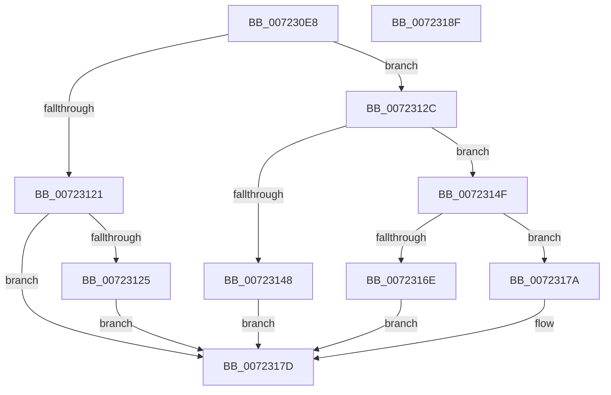

# IopFindSystemDevice

- RVA: `0x007230E8`–`0x00723190` (길이 `168` bytes)
- VA: `0x00000001407230E8`
- 실행 섹션: `PAGE`
- PDB 이름 있음: `예`; PDB Function 태그: `아니요`
- unwind 정보 RVA: `0x000B9DCC`
- 디코드: `49`개 명령, `168/168` bytes 표시
- 미해석 바이트: `0` (있으면 어셈블리에 `.byte`로 보존)

> 이 문서는 커널 이미지의 기계어와 PDB 기호를 분석해 생성했습니다. 4번과 5번은 함수 원형과 자료형을 바이너리 사용 방식에서 추정한 C 해석이며 원본 소스 복구 결과는 아닙니다.

## 1. Dependencies

- 직접 호출 지점: **4**; 고유 호출 대상: **3**
- 직접 호출자로 확인된 함수: **1**
- RIP 상대 이미지 참조: **1**

### Outgoing calls
- `0x00723113` → [SiGetSystemDeviceName](../A5/SiGetSystemDeviceName_function_00A558B8.md) (function, `0x00A558B8`)
- `0x0072313B` → [ExAllocatePool2](../../poolcode/B8/ExAllocatePool2_function_00B820F0.md) (function, `0x00B820F0`)
- `0x00723163` → [SiGetSystemDeviceName](../A5/SiGetSystemDeviceName_function_00A558B8.md) (function, `0x00A558B8`)
- `0x00723173` → [ExFreePoolWithTag](../../poolcode/B8/ExFreePoolWithTag_function_00B82870.md) (function, `0x00B82870`)

### Direct callers
- [sub_00B3F378](../B3/Unknown_function_00B3F378.md) at `0x00B3F386`

### Static image references
- `0x00723107` → RVA `0x00A376F0` (`SiGetSystemDisk`; read)

## 2. Other-region calls and transfers

- 다른 실행 섹션으로 향하는 call: **2**
  - `0x0072313B` → [ExAllocatePool2](../../poolcode/B8/ExAllocatePool2_function_00B820F0.md) (`PAGE` → `POOLCODE`)
  - `0x00723173` → [ExFreePoolWithTag](../../poolcode/B8/ExFreePoolWithTag_function_00B82870.md) (`PAGE` → `POOLCODE`)
- 별도 외부 분기/꼬리 이동을 확인하지 못했습니다.

## 3. Assembly (complete function range)

```asm
007230E8  48 8B C4                        mov rax, rsp
007230EB  48 89 58 10                     mov qword ptr [rax + 0x10], rbx
007230EF  48 89 70 18                     mov qword ptr [rax + 0x18], rsi
007230F3  48 89 48 08                     mov qword ptr [rax + 8], rcx
007230F7  57                              push rdi
007230F8  48 83 EC 20                     sub rsp, 0x20
007230FC  83 60 08 00                     and dword ptr [rax + 8], 0
00723100  4C 8D 48 08                     lea r9, [rax + 8]
00723104  48 8B F2                        mov rsi, rdx
00723107  48 8D 0D E2 45 31 00            lea rcx, [rip + 0x3145e2]
0072310E  33 D2                           xor edx, edx
00723110  45 33 C0                        xor r8d, r8d
00723113  E8 A0 27 33 00                  call 0x140a558b8
00723118  8B D8                           mov ebx, eax
0072311A  3D 23 00 00 C0                  cmp eax, 0xc0000023
0072311F  74 0B                           je 0x14072312c
00723121  85 C0                           test eax, eax
00723123  78 58                           js 0x14072317d
00723125  BB E5 00 00 C0                  mov ebx, 0xc00000e5
0072312A  EB 51                           jmp 0x14072317d
0072312C  8B 54 24 30                     mov edx, dword ptr [rsp + 0x30]
00723130  B9 00 01 00 00                  mov ecx, 0x100
00723135  41 B8 49 6F 53 44               mov r8d, 0x44536f49
0072313B  E8 B0 EF 45 00                  call 0x140b820f0
00723140  48 8B F8                        mov rdi, rax
00723143  48 85 C0                        test rax, rax
00723146  75 07                           jne 0x14072314f
00723148  BB 9A 00 00 C0                  mov ebx, 0xc000009a
0072314D  EB 2E                           jmp 0x14072317d
0072314F  44 8B 44 24 30                  mov r8d, dword ptr [rsp + 0x30]
00723154  4C 8D 4C 24 30                  lea r9, [rsp + 0x30]
00723159  48 8B D7                        mov rdx, rdi
0072315C  48 8D 0D 8D 45 31 00            lea rcx, [rip + 0x31458d]
00723163  E8 50 27 33 00                  call 0x140a558b8
00723168  8B D8                           mov ebx, eax
0072316A  85 C0                           test eax, eax
0072316C  79 0C                           jns 0x14072317a
0072316E  33 D2                           xor edx, edx
00723170  48 8B CF                        mov rcx, rdi
00723173  E8 F8 F6 45 00                  call 0x140b82870
00723178  EB 03                           jmp 0x14072317d
0072317A  48 89 3E                        mov qword ptr [rsi], rdi
0072317D  48 8B 74 24 40                  mov rsi, qword ptr [rsp + 0x40]
00723182  8B C3                           mov eax, ebx
00723184  48 8B 5C 24 38                  mov rbx, qword ptr [rsp + 0x38]
00723189  48 83 C4 20                     add rsp, 0x20
0072318D  5F                              pop rdi
0072318E  C3                              ret
0072318F  CC                              int3
```

## 4. C-style interpretation (structured pseudocode)

```c
__int64 __fastcall IopFindSystemDevice(__int64 a1, __int64 a2, int a3)
{
    __int64 result;
    __int64 v_rsp;
    unsigned __int64 v_stack_p10;
    unsigned __int64 v_stack_p18;
    unsigned int v_stack_p8;

    *(unsigned __int64 *)(v_rsp + 16) = v_rbx;
    *(unsigned __int64 *)(v_rsp + 24) = v_rsi;
    *(unsigned __int64 *)(v_rsp + 8) = a1;
    v_rsp = (v_rsp) - (32);
    a2 = 0;
    a3 = 0;
    result = SiGetSystemDeviceName(v_rip + 3229154, a2, a3, v_rsp + 8);
    if (((unsigned int)(result)) == 0xC0000023ULL) goto loc_0072312C;
    if (sign_flag) goto loc_0072317D;
    goto loc_0072317D;
loc_0072312C:
    result = ExAllocatePool2(256, (unsigned int)(v_stack_p8), (unsigned int)(0x44536F49ULL), v_rsp + 8);
    if (result != 0) goto loc_0072314F;
    goto loc_0072317D;
loc_0072314F:
    result = SiGetSystemDeviceName(v_rip + 3229069, result, (unsigned int)(v_stack_p8), v_stack_p8);
    if (!sign_flag) goto loc_0072317A;
    a2 = 0;
    result = ExFreePoolWithTag(result, a2, (unsigned int)(v_stack_p8), v_stack_p8);
    goto loc_0072317D;
loc_0072317A:
    *(unsigned __int64 *)(a2) = result;
loc_0072317D:
    v_rsp = (v_rsp) + (32);
    return (unsigned int)((unsigned int)((unsigned int)((unsigned int)(result))));
}
```

## 5. (Beta) C Style

```c
int64_t IopFindSystemDevice(int64_t Arg1, void *Arg2, int32_t Arg3)
{
    uint8_t *arg2 = (uint8_t *)Arg2;

    int64_t result;
    int64_t local_rsp;
    uint64_t v_stack_p10;
    uint64_t v_stack_p18;
    uint32_t v_stack_p8;

    *(uint64_t *)(local_rsp + 0x10) = local_rbx;
    *(uint64_t *)(local_rsp + 0x18) = local_rsi;
    *(uint64_t *)(local_rsp + 0x8) = Arg1;
    local_rsp = (local_rsp) - (32);
    Arg2 = 0;
    Arg3 = 0;
    result = SiGetSystemDeviceName(v_rip + 3229154, Arg2, Arg3, local_rsp + 8);
    if (((uint32_t)(result)) == 0xC0000023ULL) goto loc_0072312C;
    if (sign_flag) goto loc_0072317D;
    goto loc_0072317D;
loc_0072312C:
    result = ExAllocatePool2(256, (uint32_t)(v_stack_p8), (uint32_t)(0x44536F49ULL), local_rsp + 8);
    if (result != 0) goto loc_0072314F;
    goto loc_0072317D;
loc_0072314F:
    result = SiGetSystemDeviceName(v_rip + 3229069, result, (uint32_t)(v_stack_p8), v_stack_p8);
    if (!sign_flag) goto loc_0072317A;
    Arg2 = 0;
    result = ExFreePoolWithTag(result, Arg2, (uint32_t)(v_stack_p8), v_stack_p8);
    goto loc_0072317D;
loc_0072317A:
    *(uint64_t *)(arg2) = result;
loc_0072317D:
    local_rsp = (local_rsp) + (32);
    return (uint32_t)((uint32_t)((uint32_t)((uint32_t)(result))));
}
```

### 관측된 메모리 오프셋

구조체 형식이 확인되지 않은 접근은 인자 기준의 오프셋으로만 기록했습니다.

| 기준 인자 | 오프셋 표현 | 폭 (bit) | 접근 |
|---|---:|---:|---|
| `Arg2` | `+ 0x0` | `64` | `W` |

## 6. Execution-region graph

[열기: 2D/3D 그래프와 함수 탐색 컨트롤 패널](../../../control-panel.html?section=page&rva=0x007230E8&view=graph)

- 2D 그래프는 위에서 아래로 흐르고, 3D 그래프는 빈 공간을 드래그해 회전합니다. Shift+드래그는 이동, 휠은 확대·축소, 함수 노드 선택은 대상 보고서 이동입니다.

### Static fallback


