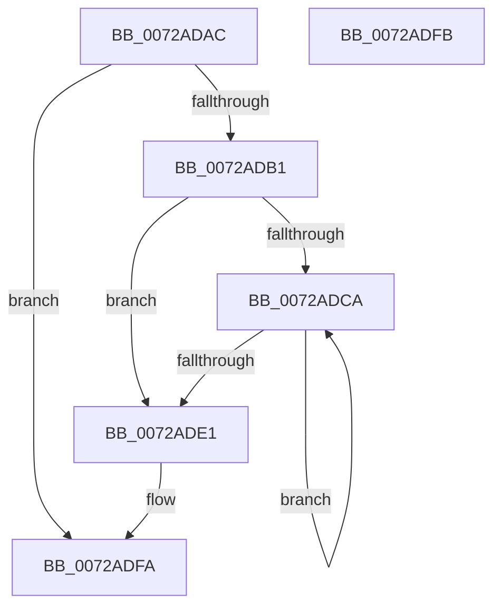

# IopFreeReqList

- RVA: `0x0072ADAC`–`0x0072ADFC` (길이 `80` bytes)
- VA: `0x000000014072ADAC`
- 실행 섹션: `PAGE`
- PDB 이름 있음: `예`; PDB Function 태그: `아니요`
- unwind 정보 RVA: `0x000ADC24`
- 디코드: `25`개 명령, `80/80` bytes 표시
- 미해석 바이트: `0` (있으면 어셈블리에 `.byte`로 보존)

> 이 문서는 커널 이미지의 기계어와 PDB 기호를 분석해 생성했습니다. 4번과 5번은 함수 원형과 자료형을 바이너리 사용 방식에서 추정한 C 해석이며 원본 소스 복구 결과는 아닙니다.

## 1. Dependencies

- 직접 호출 지점: **2**; 고유 호출 대상: **2**
- 직접 호출자로 확인된 함수: **5**
- RIP 상대 이미지 참조: **0**

### Outgoing calls
- `0x0072ADCF` → [IopFreeReqAlternative](../70/IopFreeReqAlternative_function_007027B4.md) (function, `0x007027B4`)
- `0x0072ADE6` → [ExFreePoolWithTag](../../poolcode/B8/ExFreePoolWithTag_function_00B82870.md) (function, `0x00B82870`)

### Direct callers
- [PnpReleaseBootResourcesForFilteredRequirements](../../text/5A/PnpReleaseBootResourcesForFilteredRequirements_function_005A79D4.md) at `0x005A7A4B`
- [IopAllocateBootResourcesInternal](IopAllocateBootResourcesInternal_function_0072E708.md) at `0x0072E826`
- [PnpFreeResourceRequirementsForAssignTable](../73/PnpFreeResourceRequirementsForAssignTable_function_0073E8B8.md) at `0x0073E8DE`
- [IopResourceRequirementsListToReqList](../A8/IopResourceRequirementsListToReqList_function_00A82954.md) at `0x00A82D5D`
- [sub_00B43A94](../B4/Unknown_function_00B43A94.md) at `0x00B43B1A`

### Static image references
- 디코드된 RIP-relative 메모리 참조가 없습니다.

## 2. Other-region calls and transfers

- 다른 실행 섹션으로 향하는 call: **1**
  - `0x0072ADE6` → [ExFreePoolWithTag](../../poolcode/B8/ExFreePoolWithTag_function_00B82870.md) (`PAGE` → `POOLCODE`)
- 별도 외부 분기/꼬리 이동을 확인하지 못했습니다.

## 3. Assembly (complete function range)

```asm
0072ADAC  48 85 C9                        test rcx, rcx
0072ADAF  74 49                           je 0x14072adfa
0072ADB1  48 89 5C 24 08                  mov qword ptr [rsp + 8], rbx
0072ADB6  48 89 74 24 10                  mov qword ptr [rsp + 0x10], rsi
0072ADBB  57                              push rdi
0072ADBC  48 83 EC 20                     sub rsp, 0x20
0072ADC0  33 F6                           xor esi, esi
0072ADC2  48 8B F9                        mov rdi, rcx
0072ADC5  39 71 20                        cmp dword ptr [rcx + 0x20], esi
0072ADC8  76 17                           jbe 0x14072ade1
0072ADCA  48 8B 4C F7 28                  mov rcx, qword ptr [rdi + rsi*8 + 0x28]
0072ADCF  E8 E0 79 FD FF                  call 0x1407027b4
0072ADD4  48 83 64 F7 28 00               and qword ptr [rdi + rsi*8 + 0x28], 0
0072ADDA  FF C6                           inc esi
0072ADDC  3B 77 20                        cmp esi, dword ptr [rdi + 0x20]
0072ADDF  72 E9                           jb 0x14072adca
0072ADE1  33 D2                           xor edx, edx
0072ADE3  48 8B CF                        mov rcx, rdi
0072ADE6  E8 85 7A 45 00                  call 0x140b82870
0072ADEB  48 8B 5C 24 30                  mov rbx, qword ptr [rsp + 0x30]
0072ADF0  48 8B 74 24 38                  mov rsi, qword ptr [rsp + 0x38]
0072ADF5  48 83 C4 20                     add rsp, 0x20
0072ADF9  5F                              pop rdi
0072ADFA  C3                              ret
0072ADFB  CC                              int3
```

## 4. C-style interpretation (structured pseudocode)

```c
__int64 __fastcall IopFreeReqList(__int64 a1, int a2)
{
    __int64 result;
    __int64 v_rsi;
    __int64 v_rsp;
    unsigned __int64 v_stack_p10;
    unsigned __int64 v_stack_p8;

    if (a1 == 0) goto loc_0072ADFA;
    v_stack_p8 = v_rbx;
    v_stack_p10 = v_rsi;
    v_rsp = (v_rsp) - (32);
    v_rsi = 0;
    if ((*(unsigned int *)(a1 + 32)) <= 0) goto loc_0072ADE1;
loc_0072ADCA:
    result = IopFreeReqAlternative(*(unsigned __int64 *)(a1 + v_rsi * 8 + 40), a2, a3, a4);
    v_rsi = (unsigned int)((v_rsi) + 1);
    if (((unsigned int)(v_rsi)) < (*(unsigned int *)(a1 + 32))) goto loc_0072ADCA;
loc_0072ADE1:
    a2 = 0;
    result = ExFreePoolWithTag(a1, a2, a3, a4);
    v_rsp = (v_rsp) + (32);
loc_0072ADFA:
    return result;
}
```

## 5. (Beta) C Style

```c
int64_t IopFreeReqList(int64_t Arg1, int32_t Arg2)
{
    int64_t result;
    int64_t local_rsi;
    int64_t local_rsp;
    uint64_t v_stack_p10;
    uint64_t v_stack_p8;

    if (Arg1 == 0) goto loc_0072ADFA;
    v_stack_p8 = local_rbx;
    v_stack_p10 = local_rsi;
    local_rsp = (local_rsp) - (32);
    local_rsi = 0;
    if ((*(uint32_t *)(Arg1 + 0x20)) <= 0) goto loc_0072ADE1;
loc_0072ADCA:
    result = IopFreeReqAlternative(*(uint64_t *)(Arg1 + local_rsi * 8 + 0x28), Arg2, a3, a4);
    local_rsi = (uint32_t)((local_rsi) + 1);
    if (((uint32_t)(local_rsi)) < (*(uint32_t *)(Arg1 + 0x20))) goto loc_0072ADCA;
loc_0072ADE1:
    Arg2 = 0;
    result = ExFreePoolWithTag(Arg1, Arg2, a3, a4);
    local_rsp = (local_rsp) + (32);
loc_0072ADFA:
    return result;
}
```

## 6. Execution-region graph

[열기: 2D/3D 그래프와 함수 탐색 컨트롤 패널](../../../control-panel.html?section=page&rva=0x0072ADAC&view=graph)

- 2D 그래프는 위에서 아래로 흐르고, 3D 그래프는 빈 공간을 드래그해 회전합니다. Shift+드래그는 이동, 휠은 확대·축소, 함수 노드 선택은 대상 보고서 이동입니다.

### Static fallback


